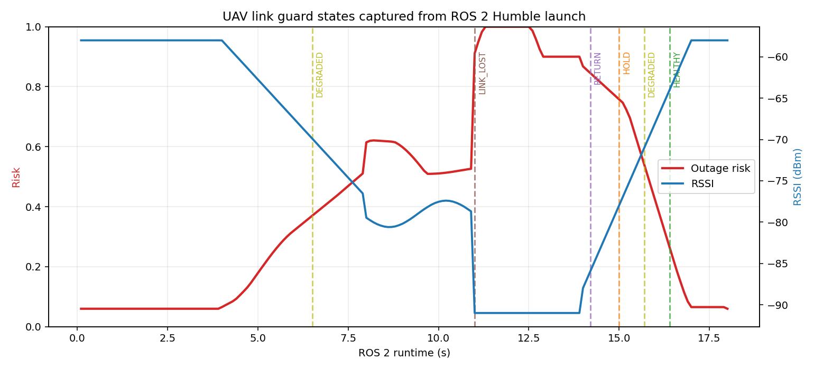

# 无人机通信链路退化保护与断联风险预测

本项目面向低空无人机任务中的无线链路退化问题。模块综合接收信号强度、端到端延迟、丢包率、遥测陈旧度和 RSSI 趋势，输出 `HEALTHY → DEGRADED → HOLD → RETURN → LINK_LOST` 保护状态以及任务建议。

与仓库已有任务安全模块的区别：

- `uav_mission_safety_manager` 关注航点、返航、降落和遥测超时；
- 本模块聚焦无线链路从“还能用”到“即将不可用”的连续退化过程；
- 输出包含指数平滑质量、RSSI 回归斜率和到达风险阈值的预计时间，可用于提前降速或返航。

## 1. 风险计算

单项风险经过归一化后加权：

\[
R = 0.27R_{\mathrm{RSSI}} + 0.25R_{\mathrm{latency}}
\quad + 0.25R_{\mathrm{loss}} + 0.13R_{\mathrm{age}} + 0.10R_{\mathrm{trend}}
\]

状态阈值默认为：

| 状态 | 风险条件 | 建议 |
|---|---:|---|
| `HEALTHY` | `R < 0.35` | 正常继续 |
| `DEGRADED` | `0.35 ≤ R < 0.62` | 降低任务速率 |
| `HOLD` | `0.62 ≤ R < 0.78` | 原地保持并重试 |
| `RETURN` | `R ≥ 0.78` 或丢包率 ≥ 0.55 | 返回安全点 |
| `LINK_LOST` | RSSI ≤ -93 dBm、延迟 ≥ 600 ms、丢包 ≥ 0.80 或遥测年龄 ≥ 1.6 s | 交由飞控故障保护 |

除 `LINK_LOST` 外的状态需要连续 3 帧确认，降低阈值附近的抖动。

## 2. ROS 2 接口

| 话题 | 类型 | 方向 | 说明 |
|---|---|---|---|
| `/uav_link/quality` | `std_msgs/String` | 输入 | 原始 RSSI、延迟、丢包和遥测年龄 JSON |
| `/uav_link/assessment` | `std_msgs/String` | 输出 | 风险、EWMA、趋势和预计到达风险阈值时间 |
| `/uav_link/advice` | `std_msgs/String` | 输出 | 任务级建议 |

模块只做链路评估，不直接向飞控发送返航或降落命令。实际系统必须把建议接入经过独立验证的任务管理与飞控故障保护。

## 3. 构建与运行

```bash
source /opt/ros/humble/setup.bash
colcon build --symlink-install --packages-select uav_link_outage_guard
source install/setup.bash
ros2 launch uav_link_outage_guard main.launch.py duration:=18
```

查看：

```bash
ros2 topic list | grep uav_link
ros2 topic echo /uav_link/assessment
ros2 topic echo /uav_link/advice
```

CSV 默认写入 `/tmp/uav_link_outage_runtime.csv`。

## 4. Humble 虚拟机实测

2026-11-10 在 Ubuntu 22.04.5 / ROS 2 Humble 的 VMware 虚拟机中完成：

```text
Starting >>> uav_link_outage_guard
Finished <<< uav_link_outage_guard [0.64s]
Summary: 1 package finished [0.81s]
```

VM 内 8 项 `unittest` 全部通过。`ros2 launch` 启动 `uav_link_quality_sim` 和 `uav_link_outage_guard` 两个节点，连续运行 18 秒，记录 180 条有效 CSV 状态。

实际观测到的状态变化：

```text
HEALTHY → DEGRADED → LINK_LOST → RETURN → HOLD → DEGRADED → HEALTHY
```

其中故障段最大风险约 0.91，恢复段风险逐步降至 0.06 以下。`LINK_LOST` 会立即触发；恢复过程经连续帧确认后逐级回到健康状态。



## 5. 限制

1. 场景中的 RSSI、延迟和丢包由确定性仿真生成，不是现场无线电实测。
2. 权重和阈值是工程默认值，没有针对具体数传电台、频段和天线进行标定。
3. RSSI 趋势只使用短期线性回归，突变遮挡仍依赖绝对质量阈值处理。
4. 没有模拟多径、切换基站、卫星链路中断和飞控侧故障保护延迟。
5. `LINK_LOST` 是软件评估状态，不代表真实飞行器已经自动执行故障保护。

## 6. 大模型使用声明

使用 OpenAI Codex 辅助完成代码、测试、文档和运行图生成；作者已逐项复核代码、参数和结果，并对提交内容、数据真实性和后续维护负责。
