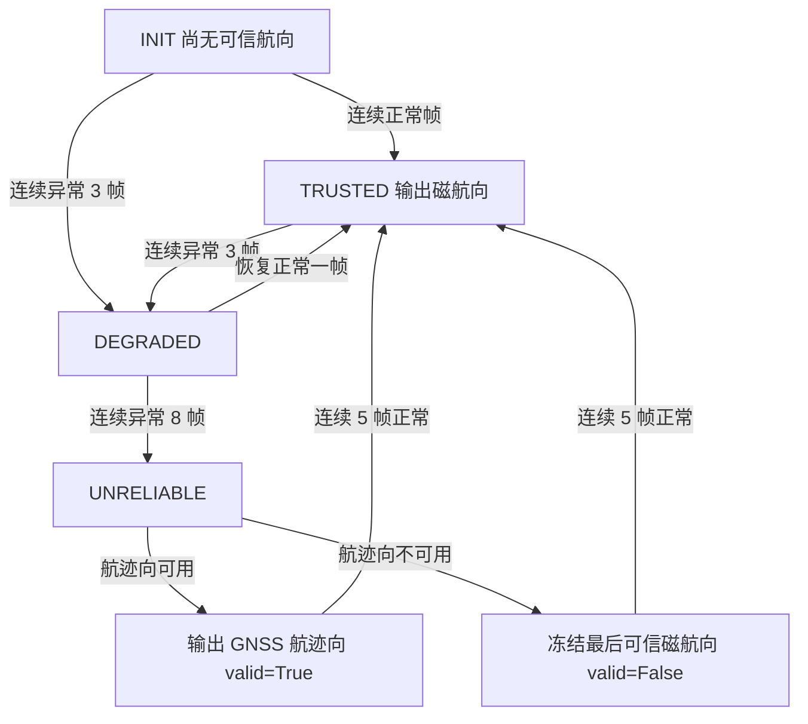

# 无人机磁力计干扰自检与航向一致性门控


> 上图由 `python main.py --plot` **实际运行生成**（矢量图，非截图）：
> 上半部分是航向对比（灰=真实航向/航迹向，红=原始磁航向，蓝=门控输出），
> 下半部分是水平磁场模值占标定半径的百分比；浅红竖带为 DEGRADED / UNRELIABLE 区间。
>
> MuJoCo 物理仿真验证的同款曲线见
> [mujoco_replay.svg](../img/air/uav_mag_interference_monitor/mujoco_replay.svg)。

## 1. 为什么要做这个模块

偏航控制默认磁力计给的航向是对的。实际飞行中，动力线束和电调产生的磁场会随油门
变化，把磁航向推偏十几度到几十度；贴近铁磁结构则会让磁场模值异常。地面检查时
电机没转，这些问题看不出来；起飞后在定点悬停里表现为缓慢跑偏、原地打转，
操作者往往先怀疑控制器参数，最后才发现是罗盘被干扰。

仓库已有的关心里，[目标高度指令约束](./uav_altitude_command_guard.md) 处理目标指令，
[遥测诊断](./telemetry_diagnostics.md) 输出异常评分，
[任务安全状态机](./uav_mission_safety_manager/overview.md) 处理任务层，
另有定位完整性门控处理位置输入；
**航向输入侧**的干扰自检与一致性判断是空缺。

本模块把这件事拆成地面和空中两段：地面用「怠速 vs 上油门」两组整圈样本比较硬铁
偏差，把干扰留在地面解决；空中用 GNSS 航迹向与磁航向互检，配合模值判据，
异常时明确告诉下游「改用航迹向」或「冻结最后可信航向」。
纯计算层只用标准库，所以判据可以脱离 ROS 单测。

## 2. 起飞前：电机干扰自检

整机绕竖轴旋转一周采样，机体系下的水平磁场样本应落在一个圆上：

$$
(m_x-b_x)^2+(m_y-b_y)^2=r^2
$$

展开后关于 $(b_x,b_y,r^2-b_x^2-b_y^2)$ 线性，用正规方程 + 高斯消元求最小二乘解
（纯标准库实现，不引入 NumPy）。怠速组记 $(\mathbf b_0,r_0,\bar z_0)$，
上油门组记 $(\mathbf b_1,r_1,\bar z_1)$，偏移量定义为

$$
\Delta=\sqrt{\lVert\mathbf b_1-\mathbf b_0\rVert^2+(\bar z_1-\bar z_0)^2},
\qquad p=\frac{\Delta}{r_0}\times 100\%
$$

判据：$p>5\%$ → `FAIL`；$3\%<p\le5\%$ → `WARN`；否则 `PASS`。
拟合残差 RMS 超过 $4\ \mu\mathrm{T}$ 也判 `FAIL`——这通常意味着旋转不完整或样本
被尖峰污染，此时应重新采样，而不是相信标定值。

!!! note "为什么是圆拟合而不是球面拟合"
    整机只绕竖轴转一圈时，机体系样本集中在一个水平圆上，$z$ 分量没有展布，
    $b_z$ 与半径不可分辨，三维球面拟合在这个条件下是**退化**的。实现初期用了
    球面拟合，结果把零干扰的干净样本算成 2.86% 的偏移（真值 0%），
    这正是数值病态的体现。改为水平圆拟合 + 垂直均值差之后，干净样本的偏移
    降到 0.04% 以内。

## 3. 飞行中：航向一致性门控

每帧计算三路信号：

| 信号 | 判据 | 典型成因 |
| --- | --- | --- |
| 水平模值偏离 | $\left\lvert \lVert\mathbf m-\mathbf b\rVert/r_{cal}-1\right\rvert>15\%$ | 贴近铁磁结构、载荷变化 |
| 航向偏差 | $\lvert\mathrm{wrap}(\psi_{mag}-\psi_{course})\rvert>15^\circ$（$>30^\circ$ 为严重） | 大电流线束的旋转磁场 |
| 数据流超时 | 相邻帧间隔 $>1\ \mathrm{s}$ | 话题中断、驱动异常 |

其中航向偏差只用在地速 $\ge 2\ \mathrm{m/s}$ 时——悬停时 GNSS 航迹向由噪声主导，
不能当参考。$r_{cal}$ 来自起飞前自检（`expected_radius`），不是「第一帧模值」；
后者在首帧本身被干扰时会把正常数据反向判成异常，实现初期踩过这个坑。
可信状态下 $r_{cal}$ 以 1% 步长缓慢跟随环境变化，但只在模值本身正常时才跟随，
避免把真实干扰"学"进基准。



降级不等于失效：`DEGRADED` 仍输出磁航向，只是把状态和原因码一起发出去，
让上层自己决定是否降权；只有 `UNRELIABLE` 才切换航向来源。

!!! note "超时判据的一个实现细节（冒烟测试暴露并已修正）"
    节点最初把 GNSS 回调时间当作观测时间传给状态机，结果是：只要 GNSS 还在
    正常发布，看门狗的 `last_seen_t` 就会被不断刷新，**磁场话题真正中断时
    超时判据被掩盖**，缓存的旧磁场数据会被当作新观测继续输出 TRUSTED。
    现在观测时间以磁力计自身时间戳为准，缓存超过 `stale_timeout` 后不再
    参与评估，降级统一交给 10 Hz 看门狗处理。该行为由闭环冒烟测试中
    「磁场断流 + GNSS 正常」与「悬停断流」两条用例锁定。

## 4. 运行方式

离线（不需要 ROS）：

```bash
cd src/air/uav_mag_interference_monitor
python main.py                                  # 回放报告
python main.py --plot ./outputs                 # CSV + SVG
python main.py --export-preflight ./outputs     # 导出两组自检样本 CSV
python main.py --idle-csv idle.csv --spin-csv spin.csv   # 真实日志自检
python -m unittest -v test_mag_interference_monitor.py   # 37 项单测
```

自检 CLI 的退出码：`PASS` / `WARN` 返回 0，`FAIL` 返回 3，参数或文件错误返回 2，
可以直接串进起飞前检查脚本。

在线（Ubuntu 22.04 + ROS 2 Humble）：

```bash
colcon build --packages-select uav_mag_interference_monitor
source install/setup.bash
ros2 launch uav_mag_interference_monitor uav_mag_interference_monitor.launch.py
```

ROS 话题闭环冒烟测试（同一份测试在两种模式下运行）：

```bash
# Ubuntu + ROS 2：真实 rclpy / 话题 / 定时器（墙钟驱动，约 50 s）
source /opt/ros/humble/setup.bash
python -m unittest -v test_ros_loop_smoke.py

# 无 ROS 2 的机器（Windows / 纯 Python CI）：内置最小 rclpy 兼容层，逐拍确定
python -m unittest -v test_ros_loop_smoke.py
```

回放节点发布 `/drone/magnetic_field` 与 `/drone/gnss`，真实的 `MagInterferenceNode`
不改一行地订阅处理，测试对三路输出话题做端到端断言，覆盖正常输入（含 T→µT
单位换算验证）、横向/模值/NaN 三类异常输入、磁场断流时看门狗的两种兜底
（有航迹向→输出航迹向；无航迹向→冻结航向并 `valid=False`）与恢复行为。

MuJoCo 物理仿真验证（需要 `pip install mujoco`）：

```bash
python mujoco_mag_verification.py            # 自检两组 + 飞行段门控
python mujoco_mag_verification.py --plot DIR # 额外输出 CSV 与 SVG
```

## 5. 回放结果（实际运行输出）

```text
起飞前电机干扰自检:
  无干扰组: PASS  偏差偏移  0.04% 拟合残差 0.17 µT  原因 ok
  注入干扰: FAIL  偏差偏移 30.15% 拟合残差 0.17 µT  原因 bias_shift_exceeds_limit
飞行段 328 帧：DEGRADED 10 帧，UNRELIABLE 153 帧，切换 GNSS 航迹向 3 次，恢复 2 次
磁航向最大偏差 31.12°；门控输出最大偏差 14.86°
```

回放按时间注入了四类情况：

| 时段 (s) | 注入内容 | 期望 | 实际 |
| --- | --- | --- | --- |
| 0–8 | 无 | TRUSTED | TRUSTED |
| 8–20 | 横向干扰 0→13 µT | 航向偏差超限，降级并切换来源 | 9.20 DEGRADED，9.70 UNRELIABLE |
| 20–26 | 干扰退去 | 连续 5 帧后恢复 | 19.60 TRUSTED |
| 22.3–23.6 | 丢帧 1.3 s | 触发 `stale` | 单帧 `stale`，未升级 |
| 26–32 | 沿航向干扰 18 µT | 模值超限 | 26.40 DEGRADED，26.90 UNRELIABLE |
| 32–34 | 干扰退去 | 恢复 | 32.30 TRUSTED |

## 6. 单元测试与验证结果

```text
python -m unittest -v test_mag_interference_monitor.py
Ran 37 tests in 0.109s
OK

python -m unittest -v test_ros_loop_smoke.py   # 本机（兼容层模式）
Ran 7 tests in 0.103s
OK
```

单元测试覆盖：圆拟合还原水平偏差/半径/垂直均值、样本不足与非有限值处理、
自检三级判定（PASS/WARN/FAIL）、纯垂直偏移判失败、角度归一化、
首帧可信判定、航向偏差计算、低速不比航迹向、DEGRADED/UNRELIABLE 的分级、
无航迹向时冻结最后可信航向、恢复需满连续帧、模值判据、非有限输入、
超时判据、看门狗 `note_timeout` 升级、配置校验、回放端到端指标、
CSV/SVG 生成与 CSV 读写的往返一致性。

闭环冒烟测试（7 项）覆盖：正常输入与单位换算、横向干扰切换航迹向、
磁场断流看门狗（含升级 UNRELIABLE）、模值异常、恢复、NaN 输入、
悬停断流冻结航向。

MuJoCo 物理仿真验证（旋转与平飞由物理引擎驱动，磁力计读数来自引擎的
`magnetometer` 传感器，硬铁与电机磁场为文档化解析叠加模型）：

```text
自检采样：怠速整圈 349 帧（速度伺服，非均匀角速度）
  无干扰组: PASS  偏差偏移  0.00%    注入干扰: FAIL  偏差偏移 30.21%
  圆拟合硬铁估计: (4.00, -2.50) µT（注入真值 4.0, -2.5） 半径 22.00 µT（真值 22.00）
飞行段 328 帧（MuJoCo 平飞）：DEGRADED 10 帧，UNRELIABLE 152 帧，
  切换 GNSS 航迹向 3 次，恢复 2 次
磁航向最大偏差 30.58°；门控输出最大偏差 14.89°
事件: 9.20 DEGRADED(heading_error) → 9.70 UNRELIABLE → 19.50 TRUSTED
      → 26.40 DEGRADED(field_norm_out_of_range) → 26.90 UNRELIABLE → 32.30 TRUSTED
```

与第 5 节离线回放（解析合成数据）相比，事件时间、切换次数与输出误差全部吻合，
说明门控行为不依赖数据来源。证据文件：
`docs/evidence/uav_mag_interference_monitor/`（`ros_loop_smoke.txt`、
`mujoco_verification.txt`、`mujoco_replay.csv`）。

## 7. 已知限制

- **已验证**：判据、状态机、离线回放、ROS 话题闭环（进程内兼容层模式 7 项
  冒烟测试）、MuJoCo 物理仿真。**未验证**：部署机（Ubuntu + ROS 2 Humble）
  上以真实 rclpy 模式跑冒烟测试（命令已给出，待复测）、真实磁力计与电机
  干扰、倾斜状态下的航向精度。开发机为 Windows 11 + Python 3.13.14。
- **未做倾斜补偿**：假设机体近似水平。横滚/俯仰超过约 15° 时磁航向误差明显，
  上机前需串联姿态补偿，或只在定高平飞段启用。
- MuJoCo 的 magnetometer 参考磁场为固定水平方向（世界系 `(0,-0.5,0)`，
  无垂直分量），仿真中的垂直地磁与机体固定磁场为解析叠加模型，非电磁场仿真。
- 只检测、不补偿：超标时给结论与兜底来源，不做在线椭球补偿。
- GNSS 航迹向由相邻位置差分得到，低速时不可用（`min_ground_speed` 的作用）。
- 阈值面向小型多旋翼，实机前需按机体、当地地磁倾角与动力系统重新标定。
- 自检需要整圈旋转，只在小角度内摆动会导致拟合病态，此时明确报错而非给出错误值。

## 8. 大模型使用声明

本模块的判据实现、ROS 2 封装、文档、单元测试与 PR 描述使用
WorkBuddy（均衡模型）辅助生成；提交者已逐行审阅、实际运行全部命令并核对输出，
对提交内容负责。
