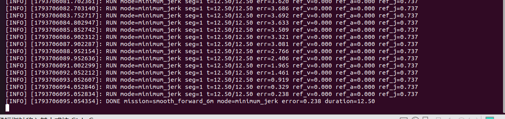
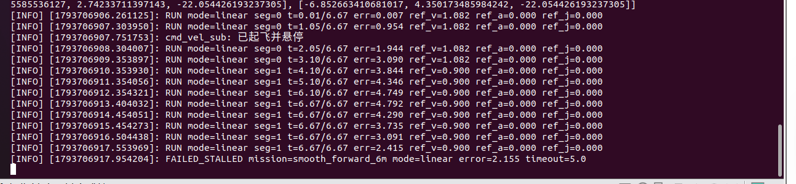

# 无人机最小加加速度轨迹生成与跟踪

本实验在 OpenHUTB/CarlaAir 中比较五种轨迹参考和普通线性参考，并使用同一套
速度跟踪控制器执行多段飞行。

源码位置：`src/air/uav_minimum_jerk_tracking/`

## 1. 实验目标

- 根据相对航点生成连续的位置、速度、加速度和加加速度参考；
- 根据最大速度和最大加速度自动计算每段轨迹时长；
- 用参考速度前馈和位置反馈跟踪轨迹；
- 与线性轨迹比较跟踪误差和运动平滑性；
- 在 OpenHUTB 中记录参考轨迹、实际轨迹和 CSV 数据。

## 2. 系统结构

```text
OpenHUTB / AirSim
    │ /uav/odom
    ▼
carlair_ros_bridge
    ▼
uav_minimum_jerk_tracking
    │ 五次轨迹 + 跟踪控制
    ▼
/uav/cmd_vel（世界 ENU 速度）
    ▼
carlair_ros_bridge ──► 无人机
```

桥接必须以 `body_frame:=false` 启动，否则本模块输出的世界 ENU 速度会被错误地
解释为机体系速度。

## 3. 五次最小加加速度

对一段从 $p_0$ 到 $p_1$、时长 $T$ 的轨迹，引入 $s=t/T$：

```text
p  = p0 + Δp(10s³ - 15s⁴ + 6s⁵)
v  = Δp(30s² - 60s³ + 30s⁴) / T
a  = Δp(60s - 180s² + 120s³) / T²
j  = Δp(60 - 360s + 360s²) / T³
```

该多项式在起止点同时满足零速度和零加速度。轨迹时长分别受以下峰值约束：

```text
v_peak = 1.875 · distance / T
a_peak = 5.7735 · distance / T²
```

模块取满足速度与加速度约束的最短时长，并允许通过 `min_segment_duration`
设置最小段时长。

## 4. 跟踪控制

控制器使用：

```text
v_cmd = v_ref + Kp · (p_ref - p_actual)
```

随后对水平/垂直速度、水平/垂直加速度分别限幅。参考位置、速度、加速度和
加加速度会随状态和 CSV 一起发布，便于比较不同轨迹模式。

轨迹结束后若超过 `final_wait_timeout` 仍未进入终点容差，节点会输出
`FAILED_STALLED` 并停止，避免执行器受阻时持续发布相同日志。

## 5. 线性参考对照

`mode:=linear` 使用同一组航点和控制器，但参考位置在每段内线性变化。该模式
在段边界存在速度跳变，可作为没有轨迹平滑时的基线。

## 6. 运行

先启动 Windows 侧 OpenHUTB，进入地图后按 `Ctrl+V` 切到 AirSim，再在虚拟机
执行：

```bash
cd ~/catkin_ws
source /opt/ros/noetic/setup.bash
catkin_make
source devel/setup.bash

roslaunch uav_minimum_jerk_tracking openhutb_test.launch \
  host:=<宿主机IP> \
  mission:=smooth_forward_6m \
  mode:=minimum_jerk
```

线性对照：

```bash
roslaunch uav_minimum_jerk_tracking openhutb_test.launch \
  host:=<宿主机IP> \
  mission:=smooth_forward_6m \
  mode:=linear
```

## 7. 观察与数据

```bash
rostopic echo /uav_minimum_jerk_tracking/status
rostopic hz /uav/odom
rostopic hz /uav/cmd_vel
```

RViz 中添加两个 `Path`：

- `/uav_minimum_jerk_tracking/desired_path`
- `/uav_minimum_jerk_tracking/actual_path`

CSV 位于：

```text
~/.ros/uav_minimum_jerk_tracking/<mission>_<mode>.csv
```

## 8. OpenHUTB 实测结果

测试环境为 OpenHUTB/CarlaAir Town10HD Opt、ROS Noetic、`Drone1`。
同一任务 `smooth_forward_6m` 分别运行五次轨迹和线性轨迹。

| 模式 | 参考时长 | 实测结束时刻 | 最终误差 | 运动段 RMSE | 运动段最大误差 | 结果 |
|---|---:|---:|---:|---:|---:|---|
| minimum_jerk | 12.5 s | 37.9 s | 0.238 m | 2.023 m | 2.908 m | DONE |
| linear | 6.67 s | 11.7 s | 2.155 m | 3.297 m | 4.995 m | FAILED_STALLED |

参考量峰值：

| 模式 | 速度峰值 | 加速度峰值 | 加加速度峰值 |
|---|---:|---:|---:|
| minimum_jerk | 1.082 m/s | 0.533 m/s² | 0.885 m/s³ |
| linear | 1.082 m/s | 0 | 0 |





线性参考在段边界存在速度跳变，实际机体受速度环和执行器限幅影响出现较大跟踪
滞后；在 `final_wait_timeout=5 s` 到达时仍未收敛，输出 `FAILED_STALLED`。
五次轨迹最终收敛到 0.238 m，但实际收敛时间明显长于 12.5 s 参考时长，说明
当前控制器在 OpenHUTB 的速度执行滞后下仍需继续整定；这一限制没有被隐藏。

## 9. AI 使用声明

使用 Codex 辅助需求分析、代码编写、测试和文档整理；作者负责 OpenHUTB
飞行验证、数据采集和最终内容复核。
