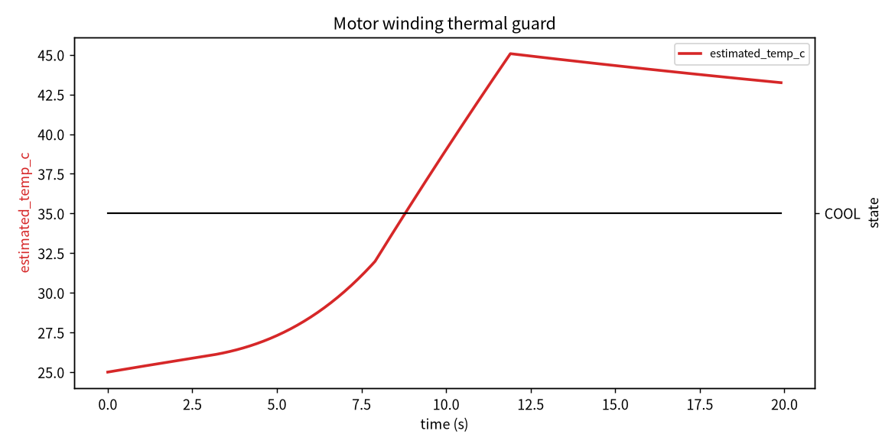

# 无人机电机绕组热保护

本项目面向多旋翼长时间高油门飞行、爬升或满载荷时电机绕组温升的情况。模块不依赖 ESC 温度回传（廉价飞控常没有），而是用电机电流和一阶 RC 热模型在线估算绕组温度，给出降额或降落建议。

## 1. 热模型

一阶热网络：

- 发热功率：\\(P_{heat}=I^2 R_w\\)
- 散热功率：\\(P_{loss}=(T-T_{amb})/R_{th}\\)
- 温升：\\(dT/dt=(P_{heat}-P_{loss})/C_{th}\\)

参数（示例，6 寸小电机）：

- \\(R_w=0.05\ \Omega\\)
- \\(R_{th}=2.0\ \mathrm{K/W}\\)
- \\(C_{th}=20\ \mathrm{J/K}\\)
- 时间常数 \\(\tau=R_{th}C_{th}=40\ \mathrm{s}\\)

## 2. 状态

| 状态 | 温度 | 建议 |
|---|---|---|
| COOL | < 55°C | CONTINUE |
| WARM | 55–75°C | MONITOR |
| HOT | 75–90°C | REDUCE_THROTTLE |
| OVERTEMP | ≥ 90°C | AUTO_LAND |

## 3. ROS 2 接口

| 话题 | 类型 | 说明 |
|---|---|---|
| `/uav_motor/sample` | `std_msgs/String` | 电流、环境温度、转速 |
| `/uav_motor/assessment` | `std_msgs/String` | 估算温度、状态、建议 |

## 4. 验证

纯 Python 下 4 项 unittest 全部通过。包含冷启动、持续大电流升温、小电流冷却三个用例。

## 5. 限制

1. 热模型参数是示例值，不同电机需实测标定；
2. 未考虑桨速对风冷散热的影响（高转速散热更好）；
3. 单绕组模型，未分相；
4. 模块不直接限油门，只输出建议。

## 6. 大模型使用声明

使用大模型辅助完成代码、测试和文档初稿；作者已复核热模型参数和状态迁移，对提交内容负责。

作者：2535010018

### 温度与状态曲线

