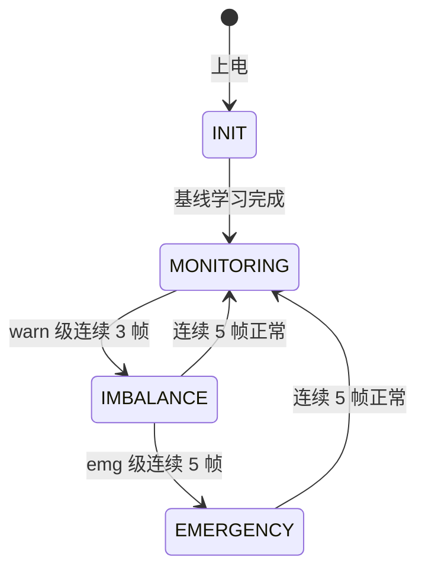
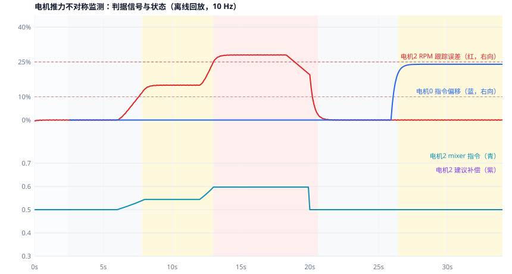

# 电机推力不对称监测与紧急降落触发

多旋翼动力系统「输出侧」的失效保护：从 mixer 指令与 ESC 转速遥测中
检测单电机推力不对称，区分电机/电调性能衰减与螺旋桨损伤两类故障，
输出四态健康状态、逐电机补偿指令与紧急降落触发建议。

模块代码：[src/air/uav_motor_thrust_imbalance_monitor](https://github.com/OpenHUTB/ros2/tree/master/src/air/uav_motor_thrust_imbalance_monitor)

## 为什么需要它

单电机性能衰减或桨损在起飞前看不出来；起飞后表现为悬停缓慢漂移、
姿态持续歪斜、高度掉落，操作者常先怀疑控制参数或 GPS。等姿态完全
失控时，剩余拉力通常已不足以正常返航——早发现 10 秒，就多一次可控
降落的机会。本模块不重写飞控，只做**检测、补偿建议、紧急降落触发**。

## 两类故障与两路判据

| 故障类型 | 物理表现 | 判据 |
| --- | --- | --- |
| 电机/电调性能衰减（进沙、轴承磨损、电调降额） | 同样指令达不到应有转速 | RPM 跟踪误差 |
| 螺旋桨损伤（裂纹、缺口、异物） | 转速正常但拉力下降，控制器抬高该电机指令 | 指令相对健康基线的持续偏移 |

指令偏移判据只在**近悬停窗口**内生效，避免大机动的合法不对称指令被
误判；指令基线在起飞后的健康段学习并冻结。

## 状态机



- **IMBALANCE**：确认不对称但可控，输出逐电机补偿指令（封顶防饱和），
  建议尽快降落；
- **EMERGENCY**：不对称超出补偿能力，`emergency_land=True`，补偿归零。

安全设计：**纯遥测超时封顶在 IMBALANCE**，不因数据流丢失触发紧急
降落——断流无法区分动力失效与链路掉线。

## 快速开始

```bash
cd src/air/uav_motor_thrust_imbalance_monitor

# 离线回放（不需要 ROS）：电机衰减 → 紧急 → 中断 → 恢复 → 桨损
python main.py --plot out/

# ROS 2
colcon build --packages-select uav_motor_thrust_imbalance_monitor
ros2 launch uav_motor_thrust_imbalance_monitor uav_motor_thrust_imbalance_monitor.launch.py

# 测试与验证（无 ROS 的机器自动用内置 rclpy 兼容层）
python -m unittest -v test_motor_imbalance_monitor.py
python -m unittest -v test_ros_loop_smoke.py
python mujoco_motor_verification.py --plot out/
```

话题（全部标准消息）：订阅 `/drone/motor_commands`、`/drone/esc_rpm`
（`std_msgs/Float32MultiArray`）；发布 `/drone/motor_health`、
`/drone/emergency_land`（`Bool`）、`/drone/commands_compensated`
（`Float32MultiArray`）、`/drone/motor_status`（`String`，JSON 明细）。
无 ESC 遥测时自动退化为指令偏移单路判据，不误报。

## 离线回放实测



时间线（10 Hz，34 s，与冒烟测试同一套剖面）：

| 时段 | 场景 | 监测器行为 |
| --- | --- | --- |
| 0–2.4 s | 健康悬停，基线学习 | INIT → MONITORING |
| 6–12 s | 电机 2 效率渐变到 85%（跟踪误差 15%） | 7.8 s IMBALANCE，输出补偿指令 |
| 12–20 s | 效率加深到 72%（跟踪误差 28%） | 13.0 s EMERGENCY，`emergency_land=True` |
| 18.4–19.9 s | ESC 遥测中断 | 看门狗 stream_timeout，封顶 IMBALANCE |
| 20–26 s | 电机恢复 | 20.6 s 恢复 MONITORING |
| 26–34 s | 桨损：转速正常、0 号指令 +24% | 26.4 s IMBALANCE（指令偏移判据） |

逐帧数据：[offline_replay.csv](../evidence/uav_motor_thrust_imbalance_monitor/offline_replay.csv)

## MuJoCo 台架验证

按电机/ESC 测试的行业做法做**定基座台架**验证：四个转子用铰链关节 +
速度作动器建模，关节角速度就是实测转速（物理状态）；注入摩擦退化后，
稳态转速亏与理论值 `c/(kv+c)` 一致，虚拟拉力按实测转速平方计算。

| 检查项 | 结果 |
| --- | --- |
| 健康段转速跟踪误差 < 3% | PASS（峰值 2.0%） |
| 中退化段稳态转速亏 ~11% | PASS（10.9%，理论 11.0%） |
| 深退化段稳态亏 ~29%、拉力亏 > 40% | PASS（28.7% / 51.8%） |
| 中段检出 IMBALANCE（worst=2） | PASS（t=5.7 s，含 EMA 平滑延迟） |
| 深段升级 EMERGENCY | PASS（t=8.26 s） |
| 恢复段回 MONITORING | PASS（t=9.86 s） |
| 全程无数值发散 | PASS |

完整报告：[mujoco_verification.txt](../evidence/uav_motor_thrust_imbalance_monitor/mujoco_verification.txt)，
逐帧数据：[mujoco_replay.csv](../evidence/uav_motor_thrust_imbalance_monitor/mujoco_replay.csv)。

适用范围（如实声明）：台架验证覆盖转子动力学与转速遥测链路；**自由飞
姿态耦合未在 MuJoCo 中验证**，由 ROS 话题闭环冒烟测试与离线回放覆盖；
真实 ESC 遥测、真实 rclpy 在线闭环与补偿指令接入真实飞控均未验证。

## 简化假设与适用范围

- 指令→转速取线性映射；判据用相对误差对斜率不敏感，但绝对门限需按
  机型空载曲线校准（`rpm_max` 等参数见 `main.py --show-config`）；
- 不做总拉力估计与故障电机隔离（mixer 重分配）；
- 不检测多电机同时对称衰减；
- 倾斜补偿、气动扰动下的指令基线漂移未建模，激进飞行风格下建议调高
  `cmd_dev_warn_pct` 或关闭指令偏移判据。
