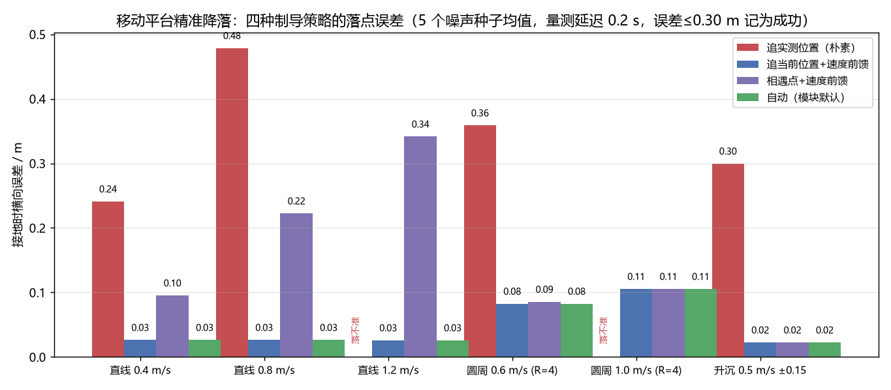
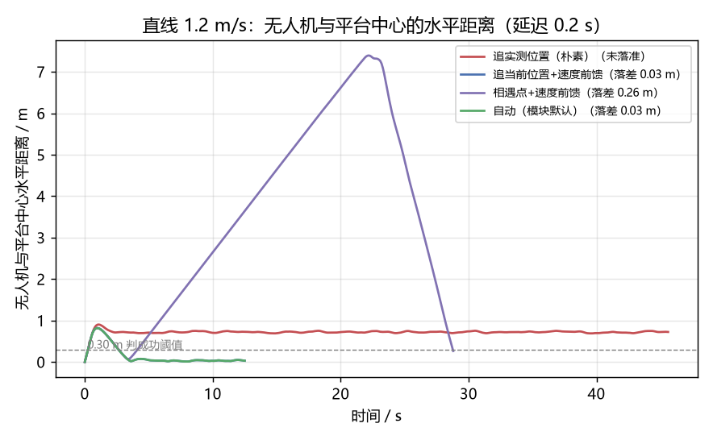
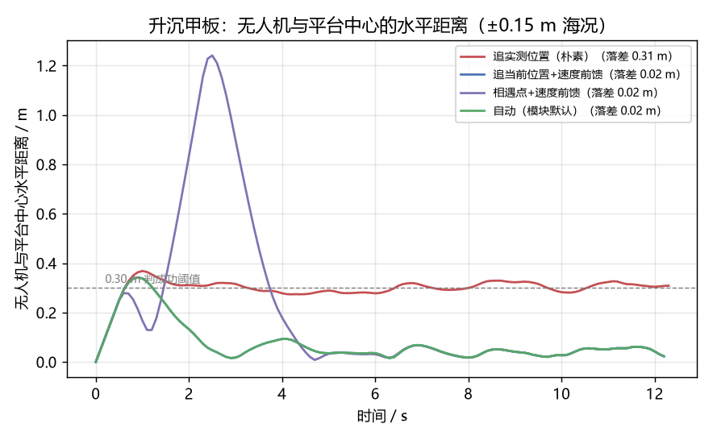
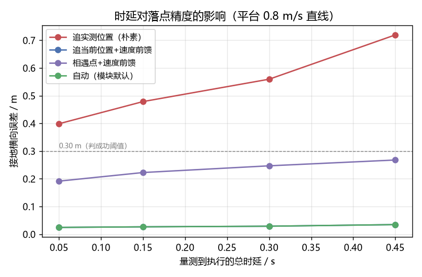
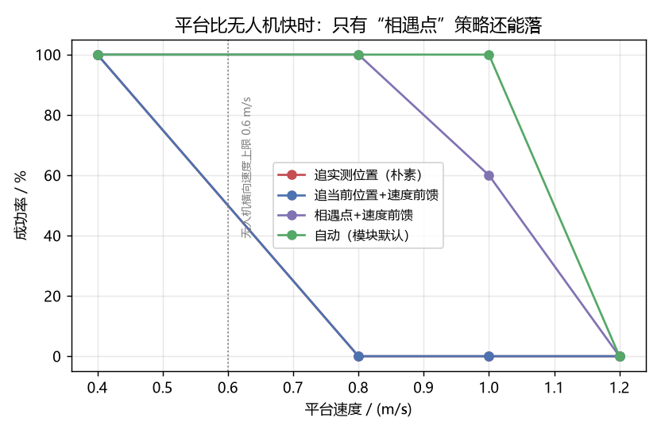

# 移动平台（车 / 船 / 移动甲板）精准降落

无人机落在一块**会动**的平台上：行驶中的车顶、航行中的甲板、会起伏的小艇。
和落在静止屋顶（见 [屋顶降落](./rooftop_landing.md)）相比，这里多出两个绕不过去的麻烦，
而且它们是**静默**的 —— 日志全绿、状态机一路走到 `LANDED`，飞机其实落在平台
后面半米。

源码位于
[`src/air/uav_moving_platform_landing`](https://github.com/OpenHUTB/ros2/tree/master/src/air/uav_moving_platform_landing)，
参数、话题与故障排查的完整说明见该目录下的
[`README.md`](https://github.com/OpenHUTB/ros2/blob/master/src/air/uav_moving_platform_landing/README.md)。

---

## 1. 它解决什么问题

**问题一：量测是旧的。** 平台位置从"被相机看到"到"变成飞控的一条速度指令"，
中间要过视觉推理、ROS 通信、控制周期，实测 0.1~0.45 s。把这段旧数据当成"现在的
位置"去追，落点就必然带着 `v × 时延` 的偏差：`v = 1.0 m/s`、时延 0.3 s 就是 0.3 m，
比一块小车顶还宽。

**问题二：平台会从脚下溜走。** 从 2.5 m 高度以 0.4 m/s 下降要 6 s；这 6 s 里
0.6 m/s 的平台已经走出去 3.6 m。所以"先飞到平台正上方、再直着往下掉"这种朴素做法
要么落空，要么只能靠"边下降边追"——那就又回到问题一。

本模块只吃**一路**平台中心位置观测（不管它来自视觉、另一台载具还是仿真器转发），
自己把速度估出来，然后：

1. **估计**：滑窗加权最小二乘 + 跳点闸门 + MAD 粗筛，从带噪声、带延迟的位置序列里
   估出平台速度（不用平台自己报速度，视觉方案也拿不到）；
2. **预测**：反解"还要多久接地"`T`（含下降剖面的加速段、平台自身的升沉），
   于是候选落点是 `deck(t + T)` 而不是 `deck(t)`；
3. **制导**：按平台速度与曲率自动选择"贴着平台飞"或"飞到相遇点等它滑过来"，
   全程用落点速度做前馈；
4. **保护**：预计落偏超限就拉起复飞，穿到甲板下面、观测断流、超时都收敛到悬停。

---

## 2. 为什么"相遇点"在世界上是静止的

这一点是本模块能用、也是它能落上"比无人机还快的平台"的关键。

设平台速度 `v`、下降速度 `v_d`、当前相对高度 `z`，则剩余接地时间
`T = z / v_d`，而 `z` 正以 `v_d` 减小，所以 `dT/dt = -1`。候选落点
`p(t) = deck(t + T(t))` 的速度是

```
dp/dt = v · (1 + dT/dt) ≈ 0
```

也就是说：**下降段的落点在世界上几乎不动**。无人机的动作变成"飞到那个点上方悬停，
平台自己滑过来"，横向控制几乎不需要持续跟随。当平台速度超过无人机横向速度上限时，
"跟着飞"在物理上不可能，但"在前面等着"完全可以 —— 实测这一差别是 100% 与 0% 的成功率。

平台在转弯时这条外推就不成立了（4 m 半径、1 m/s 的圆周在 6 s 内转过 90°），
所以模块用一条**长窗**估计横向加速度，一旦确实在转弯或有升沉，自动退回"贴着平台飞"
的速度匹配式跟踪。

---

## 3. 架构位置

```
Windows 宿主                                    Ubuntu 客户机
┌──────────────────┐                        ┌──────────────────────────────────┐
│ AirSim / CarlaAir│◀── TCP 41451 ─────────▶│ carlair_ros_bridge               │
│  无人机 / 载具   │                        │  /uav/odom      /uav/cmd_vel     │
└──────────────────┘                        └───────────┬──────────────────────┘
                                                        │
                                    ┌───────────────────▼───────────────────┐
                                    │ 感知 / 转发节点（任选其一）            │
                                    │  视觉、另一台载具位姿、AirSim 位姿转发 │
                                    │  -> /uav/platform_pose                │
                                    └───────────────────┬───────────────────┘
                                                        │
                                    ┌───────────────────▼───────────────────┐
                                    │ uav_moving_platform_landing（本模块） │
                                    │  估计速度 → 预测落点 → 制导 → 接地     │
                                    └───────────────────────────────────────┘
```

本模块不直接连仿真器：NED↔ENU 换算、速度限幅、指令超时保护都在桥接层，
所以它和键盘控制、屋顶降落等模块**共用同一条 `/uav/cmd_vel` 通道**。

---

## 4. 运行

```bash
# 客机 1：桥接层（host 填宿主 IP）
rosparam set /control/cmd_duration 0.5      # 关键，见下面「踩过的坑」
roslaunch carlair_ros_bridge main.launch host:=192.168.49.1

# 客机 2：本模块（平台位置 /uav/platform_pose 由别的节点提供）
roslaunch uav_moving_platform_landing main.launch

# 客机 3：看状态
rostopic echo /uav/moving_landing/state     # 2 Hz JSON：状态/剩余接地时间/平台速度估计
```

常用覆盖参数：`lead_mode:=now|touchdown|auto`、`descend_speed:=0.3`、
`track_altitude:=1.5`、`max_xy_speed:=1.2`、`z_up:=false`。

状态机：

```
WAIT_DECK ──拿到足够的平台观测──▶ ALIGN ──连续 align_settle_s 满足对准──▶ DESCEND
DESCEND  ──相对高度 ≤ 0.12 m──▶ TOUCHDOWN ──▶ LANDED
DESCEND  ──预计落偏超限持续 0.4 s──▶ ALIGN（复飞，计数 +1）
任意状态 ──超时 / 复飞次数用完 / 穿到甲板下面──▶ ABORT（原地悬停）
```

---

## 5. 实测结果

### 5.1 四种制导策略的定量对照

用**同一套运动学模型**（一阶速度滞后 0.35 s、10 Hz 带延迟带噪声观测、控制 10 Hz）
跑闭环，落点误差用仿真真值算（不是控制器自己的估计），5 个噪声种子取均值：



| 场景 | 追实测位置（朴素） | 追当前位置+前馈 | 相遇点+前馈 | **自动（默认）** |
| --- | --- | --- | --- | --- |
| 直线 0.4 m/s | 0.24 m / 100% | 0.03 m / 100% | 0.10 m / 100% | **0.03 m / 100%** |
| 直线 0.8 m/s | 0.48 m / 0% | 0.03 m / 100% | 0.22 m / 100% | **0.03 m / 100%** |
| 直线 1.2 m/s | 落不准 / 0% | 0.03 m / 100% | 0.34 m / 20% | **0.03 m / 100%** |
| 圆周 0.6 m/s (R=4) | 0.36 m / 0% | 0.08 m / 100% | 0.09 m / 100% | **0.08 m / 100%** |
| 圆周 1.0 m/s (R=4) | 落不准 / 0% | 0.11 m / 100% | 0.11 m / 100% | **0.11 m / 100%** |
| 升沉 0.5 m/s ±0.15 m | 0.30 m / 40% | 0.02 m / 100% | 0.02 m / 100% | **0.02 m / 100%** |

（误差 = 接地瞬间无人机与平台**真实中心**的水平距离；成功率 = 误差 ≤ 0.30 m 的比例。）

朴素做法的失败方式很典型：它追的是 0.2 s 前的实测位置，稳态残差约
`v × 时延 + v / kp`，0.8 m/s 时就有 0.48 m，而且连"对准容差"都进不去，
最后按对准超时放弃。

同样是 1.2 m/s 平台，横向距离随时间的曲线更直观 —— 相遇点策略会先飞到前方
7 m 处悬停等平台过来，其余两种则贴着平台飞：




### 5.2 时延的影响



时延从 0.05 s 拉到 0.45 s：朴素做法 0.40 m → 0.72 m（近似线性，就是 `v × 时延`），
补偿延迟的做法 0.024 m → 0.035 m（几乎不变）。这也说明"补偿"这一步比"调增益"重要得多。

### 5.3 平台比无人机还快

把无人机横向速度上限压到 0.6 m/s、起点放在平台前方 10 m，让平台分别以
0.4 / 0.8 / 1.0 / 1.2 m/s 开过来：



| 平台速度 | 追当前位置+前馈 | 相遇点+前馈 | 自动 |
| --- | --- | --- | --- |
| 0.4 m/s | 0.02 m / 100% | 0.14 m / 100% | **0.02 m / 100%** |
| 0.8 m/s | 2.66 m / 0% | 0.21 m / 100% | **0.21 m / 100%** |
| 1.0 m/s | 5.66 m / 0% | 0.29 m / 60% | **0.11 m / 100%** |
| 1.2 m/s | 8.90 m / 0% | 3.14 m / 0% | 4.30 m / 0% |

最后一行是**物理上做不到**：从 8 m 高度以 0.4 m/s 下降要 20 s，这 20 s 里相遇点在
24 m 外，无人机需要 0.7 m/s 的水平速度，超过 0.6 m/s 的上限 —— 谁都落不准是应该的。
这条数据反过来验证了模型没有"作弊"：超过能力边界就老老实实失败。

### 5.4 ROS 闭环（假桥接层）

`tests/test_uav_moving_platform_landing_ros_sim.py` 自建 `/uav/odom` 与
`/uav/platform_pose`（0.6 m/s 直线平台、0.15 s 延迟、0.03 m 噪声），把
`/uav/cmd_vel` 积分进一阶滞后模型，跑真节点：

```
WAIT_DECK(0.0s) → ALIGN(1.3s) → DESCEND(5.1s) → TOUCHDOWN(11.7s，误差 0.04 m) → LANDED
桥接层用真值量到的落点误差：0.034 / 0.069 / 0.145 m（三轮）   结论：通过（≤ 0.30 m）
```

宿主机 RoboStack ROS1（Windows）与 Ubuntu 20.04 + Noetic 都能直接跑。

---

## 6. 踩过的坑（都是这次实测逼出来的）

| 现象 | 根因 | 处理 |
| --- | --- | --- |
| 落点预测点随机横跳 1~2 m，状态机永远对不准 | `T = z/(v_d + v_deck_z)` 对平台**垂向**速度的放大倍数是 `T/v_d ≈ 15`，平台上真的是 0 时，估计器 0.05 m/s 的噪声就让 `T` 在 5~8 s 之间跳 | 垂向速度先一阶平滑 + 死区（<0.08 m/s 当平地），再进 `T` 的求解 |
| 二次项一拟合就把相遇点甩飞 | 噪声也能拟合出"伪曲率"，往外推 6 s 误差被放大成几十米 | 位置外推**只用一次项**；加速度只用于"是否在转弯"的判定，且要 3 倍标准误显著 |
| 转弯平台上检测不到曲率 | 4 m 半径、0.6 m/s 的圆周在 2.5 s 窗内拱高约 **7.0 cm**，和 4 cm 噪声同量级 | 判曲率专用一条 **4 s 长窗**估计器（拱高 17.9 cm，检测率 113/115，直线 0 误报） |
| 下降段飞机根本不往下走，卡在 2.3 m 直到超时 | 垂直指令按 `descend_profile(0)` 取的是**当前的**垂直速度（0） | 按控制周期一步步推进剖面：`vz = max(vz - a·dt, -v_d)` |
| 一个 40 m 的 RPC 跳点把速度估计从 0.5 拉到 15.6 m/s | 跳点进了拟合矩阵，杠杆效应把整条直线拉歪，MAD 粗筛也救不回来 | 跳点**在进拟合之前**用"外推 + 1 m 闸门"挡掉 |
| 对准段目标点从 12 m 外突然跳到 6 m，越调越乱 | 对准段用**当前高度**算 `T`（8 m→20 s，被上限截断），等降到 2.5 m 时 `T` 又变 6 s | 对准段一律用**目标巡航高度**算 `T`，与下降段无缝衔接 |
| 节点状态一直 `WAIT_DECK` | `rospy.Rate()` 要的是 Hz，代码里传成了周期（0.1 Hz）→ 10 s 才控制一次，永远攒不够样本 | 改成 `rospy.Rate(tick_rate_hz)`；节点里加了"已收 N 帧 / 最新一帧年龄"的节流诊断 |
| 飞了 4 s 高度只掉 0.11 m | 桥接层 `/control/cmd_duration` 默认 0.1 s，10 Hz 下发时上一条还没生效就被顶掉 | launch 里显式设 `cmd_duration:=0.5`，日志也会提醒 |

---

## 7. 测试

```bash
# 1) 离线回归：无 ROS、无仿真器、无 GPU
python3 tests/test_uav_moving_platform_landing_local.py
#    → 58 项断言全通过（速度估计 / 曲率 / 下降剖面 / 状态机 / 策略对照 /
#       包结构 + 入库状态 + CMakeLists 与 package.xml 一致性）
#    其中「package.xml 解析」2 项需要 catkin_pkg，没有该库时自动跳过（56 通过 + 2 跳过）

# 2) ROS 闭环：假桥接层
roscore &
python3 tests/test_uav_moving_platform_landing_ros_sim.py
#    → 落点误差 0.034~0.145 m（多轮真值，均 ≤ 0.30 m），exit 0

# 3) 定量对照实验 + 出图
python3 src/air/uav_moving_platform_landing/tools/evaluate.py
```

另外两项与包结构有关的检查（本机实测）：

```bash
rospack find uav_moving_platform_landing      # → 包可被发现
roslaunch --files uav_moving_platform_landing main.launch   # → launch XML 解析通过
roslaunch uav_moving_platform_landing main.launch           # → 60 个参数从 YAML 载入、
                                                            #   节点 main.py 正常启动
```

> `catkin_make` 没有在本机跑成：宿主机 RoboStack 的 cmake 是 4.x 且没有 MSVC/nmake
> （`cmake_minimum_required(VERSION 3.0.2)` 会被 4.x 直接拒绝，也没有 C 编译器）。
> **对照组**：用同样命令构建仓库里已合并的 `rooftop_landing` 也在同一步失败，说明是
> 本机环境限制而不是本包的 CMakeLists 问题；Ubuntu 20.04 + Noetic（cmake 3.16）按常规
> 流程构建。包内没有 C++ 代码与自定义 msg/srv，`CMakeLists.txt` 只做
> `catkin_install_python` 与 launch/config 安装，离线测试会校验其中列出的脚本都真实存在。

---

## 8. 已知限制

* **不做避障**：对准段与下降段都假设当前高度到平台之间没有障碍物；
* **平台倾角未建模**：假定甲板水平，落在斜坡/倾斜甲板上需要另外估计台面法向；
* **极快平台无解**：平台速度超过无人机横向速度上限、且几何上赶不到相遇点时，
  任何策略都落不准（§5.3 最后一行就是这个边界）；
* **接地判据只用相对高度**：真机建议把飞控的落地标志、电流或触地开关一起纳入判决。

## 9. 大模型使用声明

本模块的代码、测试与文档在编写过程中使用了大模型辅助（算法讨论、代码与文档起草、
绘图脚本整理）。文中所有数值都来自仓库内可复现的运行结果（离线回归、ROS 闭环、
定量对照实验），未完成或做不到的部分已如实标注。作者对提交内容的正确性与完整性负全部责任。
