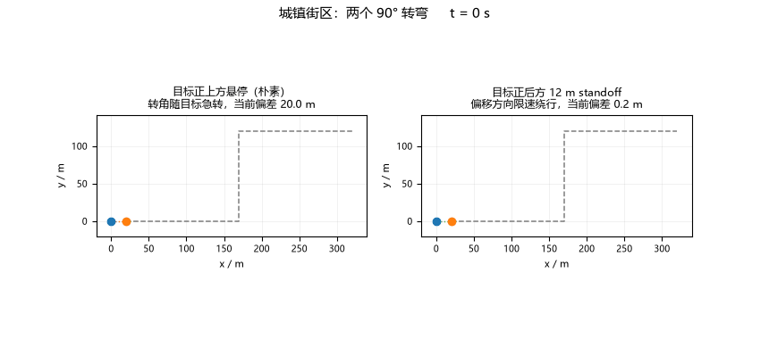
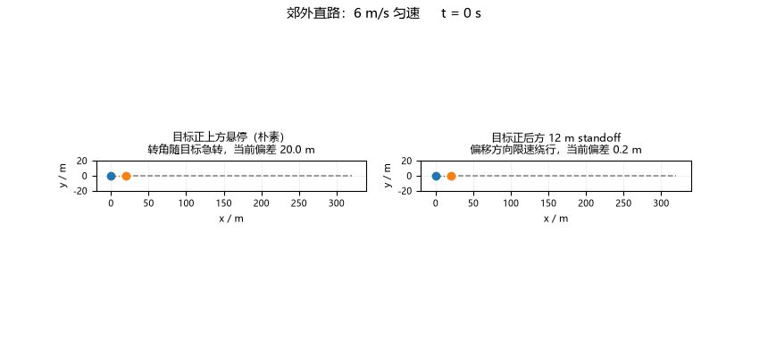
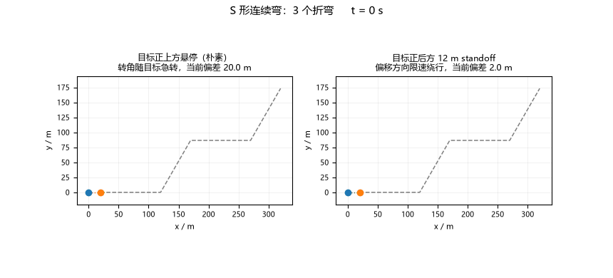
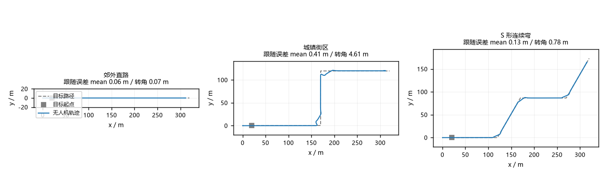

# 移动地面目标的后方等距跟随

无人机跟踪一辆行驶中的车，"飞到它旁边"只是入场券：车在动，追的时候要预测
它能到哪；跟住之后参考点放在哪决定了转角处会不会被甩出去。本模块把这件事拆
成截获预测、standoff 参考生成、偏移方向限速三步，最后整条链路在 MuJoCo 里真
飞验证。

## 先看效果

左栏把参考点直接放在目标正上方——转角处目标急转，无人机被拖着甩出去；右栏
把参考点放在目标正后方 12 m 的 standoff 环上，偏移方向按 15°/s 限速绕目标转
圆弧。两栏对比的是同一条 MuJoCo 真实轨迹：



直线与 S 弯算例：





三算例俯视总览（虚线为目标路径，实线为无人机轨迹）：



## 问题拆解

**目标在动，截获点在哪？** 目标轨迹是恒速折线，任意 t 的位置有解析解；无人
机"爬升到跟随高度 + 以巡航速度直飞 t 时刻的 standoff 点"的可达时刻也是解析
的。两者相等的时刻即最早截获时刻，固定点迭代几步就收敛。追不上（目标速度接
近巡航上限）时明确报告不可行，并给出提高巡航速度或缩小 standoff 的建议。

**参考点放哪？** 目标速度反方向 standoff 米（正后方）、固定高度，参考速度 =
目标速度。正后方 standoff 的意义：转角处参考点绕行而不是原地急转，观测方向
稳定；目标停车时保持上一次的偏移方向，不在停车瞬间跳到随机一侧。

**转角跳变怎么办？** 目标直角转弯时，"速度反方向"一瞬间转 90°，参考点跳变
2·standoff·sin 45° ≈ 17 m。把偏移方向按角速度上限（15°/s，按巡航 9 m/s 扫
描标定：45°/s 时切向速度超出巡航能力，误差反而更大）旋转，参考点绕目标走半
径 12 m 的圆弧，弧长切向速度计入参考速度前馈。

## 实现与验证

**闭环（`core/flyer.py`）**：uav_mujoco_sim 的 Quadrotor +
GeometricController 真飞，dt = 0.01 s 与控制周期一致。截获段沿解析方案给定的
直线以巡航速度推进（直接追移动参考点会让位置误差项顶到倾角上限，实测俯冲掉
高 20 m），t ≥ t_i 后切入 standoff 跟随。

**ROS 节点（`ros/follow_node.py`）**：薄壳，订阅 `/uav/odom` 与
`/target/odom`，在 `/uav_moving_target_follow/setpoint` 发 JSON 参考点
（p_ref / v_ref / yaw_d）；几何全部在 `core/follow.py`，节点只做消息转换。

**结果**：

| 算例 | 路径 | 截获时刻 | 跟随误差 mean / max | 转角最大 | 朴素"正上方"转角最大 |
| --- | --- | --- | --- | --- | --- |
| 郊外直路 | 300 m | 14.76 s | 0.06 / 0.07 m | 0.07 m | 12.27 m |
| 城镇街区 | 420 m，两个 90° 弯 | 14.76 s | 0.41 / 4.61 m | 4.61 m | 12.61 m |
| S 形连续弯 | 400 m，3 个折弯 | 11.10 s | 0.13 / 1.00 m | 0.78 m | 12.19 m |

朴素列用同一条真实轨迹、把参考点换成目标正上方复算——转角处误差是 standoff
参考的 2.6~15 倍。目标停车瞬间有一次 3~4 m 减速超调（速度前馈骤降 + 滤波滞
后），results JSON 单列 `stop_transient_max_m`，1.5 s 内收敛。

测试 14 项：参考几何（正后方、停车保持方向、standoff 半径恒定）、截获固定点、
不可行报告、偏移限速角度，以及 5 项 MuJoCo 冒烟（截获发生、转角误差上界、与
解析截获时刻一致）。

## 复现

```bash
cd src/air/uav_moving_target_follow
python main.py                 # 三个算例各真飞一次，墙钟约 4 s
python main.py --no-sim        # 仅算法层，秒级
python tools/make_gif.py       # 重录四个图
python -m pytest test/ -q      # 14 项
```

## 与仓库已有模块的关系

| 模块 | 关注点 | 本模块的区别 |
| --- | --- | --- |
| `uav_waypoint_tracking` | PID 跟静止航点 | 参考点随移动目标连续变化 |
| `uav_moving_platform_landing` | 相对导航落到平台 | 只跟随不降落，关注 standoff 几何 |
| `uav_poi_orbit` | 绕固定点盘旋 | 目标本身在移动，偏移方向要限速旋转 |

## 大模型使用声明

使用了 AI 大模型辅助进行代码编写与自查。作者对提交内容负责。
