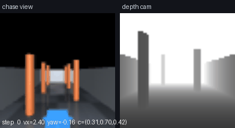
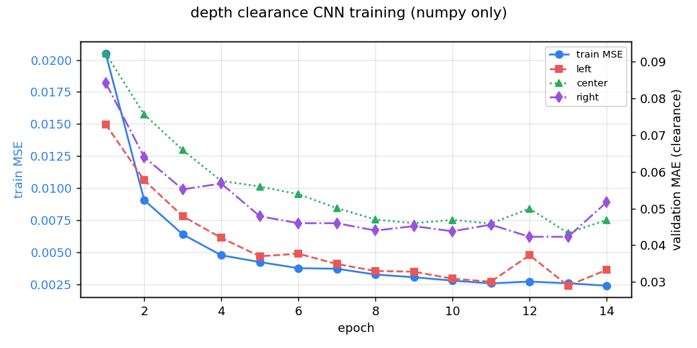
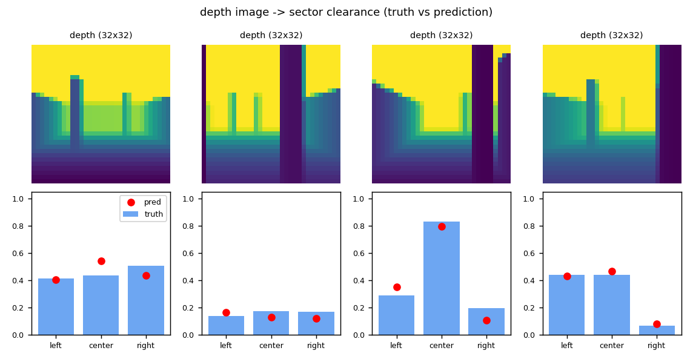
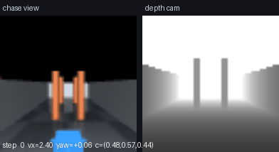

# 无人机深度相机神经网络避障飞行（MuJoCo）

> 对应课程任务（1）**物理仿真 + 键盘运动控制** 与任务（2）**传感器感知 + 给定轨迹的控制**。
> 场景是 MuJoCo 里的真实刚体四旋翼（RK4 积分、重力、碰撞检测），传感器是机载 64×64 前视
> 深度相机，感知网络是一个**纯 numpy 手写反向传播**的小型 CNN，输出左/中/右三个扇区的通行度，
> 控制律据此决定前向速度与偏航角速度。**不使用 Gazebo，不使用 GPU，不需要 PyTorch/TensorFlow。**



上图：左半是追尾视角，右半是网络输入（深度图），底部文字是当步的网络输出与指令。

## 1. 功能目标

| 编号 | 功能 | 对应课程要求 |
| --- | --- | --- |
| 1 | MuJoCo 物理仿真中的四旋翼，速度伺服飞行 | 任务（1）物理仿真 |
| 2 | 键盘遥操作（W/S 速度、A/D 偏航、空格悬停、R 重开） | 任务（1）键盘运动控制 |
| 3 | 机载深度相机 → CNN → 三扇区通行度 | 任务（2）传感器感知 |
| 4 | 通行度 → 速度/偏航的闭环飞行，三种场景各 3 次评估 | 任务（2）给定轨迹的控制 |
| 5 | ROS 2 节点 + launch，发布深度图/通行度/里程计 | 交付要求（4） |

## 2. 与已有模块的区别

| 已有模块 | 已有能力 | 本模块的区别 |
| --- | --- | --- |
| `uav_keyboard_control` | 键盘把速度指令发给 AirSim，**人看画面判断** | 本模块的避障判断由网络完成，键盘只是任务（1）的演示通道 |
| `uav_depth_gate_racing_e2e` | 深度图**端到端**回归穿越门竞速的横滚/推力 | 本模块输出的是**可解释的物理量**（三扇区通行度），控制律显式可查、可调试 |
| `uav_lidar_safety_corridor` | 激光雷达点云做安全走廊 | 本模块只用**单目深度相机**，无点云、无地图 |
| `uav_ppo_nav` / `uav_dqn_nav` | 强化学习直接输出动作 | 本模块是**监督学习**：标签直接来自渲染真值，训练可复现（约 10 s），不依赖随机探索 |

## 3. 计算原理

### 3.1 四旋翼动力学与控制抽象

状态 $\mathbf{p}\in\mathbb{R}^3$、速度 $\mathbf{v}$、偏航角 $\psi$。MuJoCo 用 RK4 以 $\Delta t_{sim}=5$ ms 积分；控制层以 $T=50$ ms 下发一次指令，中间跑 10 个子步。

外环（速度伺服）把期望速度 $\mathbf{v}^{d}$ 变成世界系加速度：

$$
\mathbf{a}^{d} = k_v\left(\mathbf{v}^{d} - \mathbf{v}\right) + g\,\mathbf{e}_z,
\qquad
\mathbf{F} = m\,\mathbf{a}^{d},\quad m = 1.12\ \text{kg}
$$

其中 $\mathbf{v}^{d} = v_x^{d}\,[\cos\psi, \sin\psi, 0]^\top$，$k_v = 2.5$，$m$ 直接从模型 `body_subtreemass` 读取（避免手填质量与模型不一致）。

内环（姿态 PD）把机体系 $z$ 轴拉回世界 $z$ 轴，同时跟踪偏航：

$$
\boldsymbol{\tau} = k_\theta\left(\mathbf{z}_b \times \mathbf{e}_z\right) - k_\omega\,\boldsymbol{\omega}
+ k_\psi^{y}\left(\psi^{ref}-\psi\right)\mathbf{e}_z - k_\omega^{y}\,\omega_z
$$

$\mathbf{z}_b$ 是机体 $z$ 轴在世界系的表示，$\boldsymbol{\omega}$ 是角速度，取 $k_\theta=3.0$、$k_\omega=0.35$、$k_\psi^{y}=2.5$、$k_\omega^{y}=0.9$，力矩限幅 $\pm 4$ N·m。

> 这一层是"推力矢量抽象"：真实多旋翼靠四个电机的转速差产生力矩，这里把姿态内环简化为力矩伺服，
> 但质量、惯量、重力、碰撞、积分全部由 MuJoCo 承担，因此外环看到的速度响应仍然是非线性的，
> 网络输出错一次就会真的撞柱子（见 §6 的碰撞测试）。

### 3.2 深度相机模型

相机固定在机头前 0.18 m、离机体中心 0.02 m，视场角 80°，分辨率 64×64，输出米制深度 $z(u,v)$。渲染得到的是透视深度，直接截断到 8 m：

$$
\tilde z = \min\left(z,\; z_{max}\right),\qquad z_{max}=8\ \text{m}
$$

机头方向为 $+x$。相机姿态四元数为 $q=(0.5,0.5,-0.5,-0.5)$，它把 $-z_{cam}$ 对齐到 $+x$、$+y_{cam}$ 对齐到 $+z$，
即"看向机头方向、并且上方向是天空"——这个四元数是按 $R=[-\mathbf{e}_y,\ \mathbf{e}_z,\ -\mathbf{e}_x]$ 反解出来的，
`test_uav_nav.py` 里的画面方向问题（早期版本上下颠倒）就是靠这一步修正的。

### 3.3 标签：三扇区通行度

把 64×64 深度图按列三等分，忽略下方 38% 的地面像素（否则地面永远比障碍近，标签失效）：

$$
c_k = \frac{1}{z_{max}}\min_{(u,v)\in \Omega_k,\ v<0.62H}\tilde z(u,v),
\qquad k\in\{L,M,R\}
$$

$\Omega_L$ 取列 $[0, w/3-1)$，$\Omega_M$ 取 $[w/3+1, 2w/3-1)$，$\Omega_R$ 取 $[2w/3+1, w)$。
$c_k\in[0,1]$，含义是"这个方向还有多少余量"：$c=1$ 表示 8 m 内没有东西，$c\approx0.02$ 表示贴脸。

### 3.4 网络结构

输入是 $32\times32$ 的"通行度图" $\mathbf{x}=1-\tilde z/z_{max}$（64×64 做 2×2 平均池化），不是原始米制深度——
这样输入与输出同一量纲，训练更稳定。

$$
\begin{aligned}
\mathbf{z}_1 &= \mathrm{im2col}(\mathbf{x})\mathbf{W}_1+\mathbf{b}_1, & \mathbf{a}_1 &= \mathrm{ReLU}(\mathbf{z}_1) & (32^2\to15^2,\ 6\ \text{通道})\\
\mathbf{z}_2 &= \mathrm{im2col}(\mathbf{a}_1)\mathbf{W}_2+\mathbf{b}_2, & \mathbf{a}_2 &= \mathrm{ReLU}(\mathbf{z}_2) & (15^2\to7^2,\ 12\ \text{通道})\\
\mathbf{z}_3 &= \mathbf{a}_2\mathbf{W}_3+\mathbf{b}_3, & \mathbf{a}_3 &= \mathrm{ReLU}(\mathbf{z}_3) & (588\to32)\\
\hat{\mathbf{c}} &= \sigma(\mathbf{a}_3\mathbf{W}_4+\mathbf{b}_4) & &
\end{aligned}
$$

参数量（与程序输出 `params = 19667` 一致）：

$$
(9\cdot1\cdot6+6)+(9\cdot6\cdot12+12)+(7^2\cdot12\cdot32+32)+(32\cdot3+3)
= 60+660+18848+99 = 19667
$$

损失为三个扇区的平方误差，梯度由手写反向传播给出（im2col/col2im 处理卷积的 $3\times3$ 重叠），优化器 Adam（$lr=2\times10^{-3}$）：

$$
J(\theta)=\frac{1}{N}\sum_{i=1}^{N}\sum_{k=1}^{3}\left(\hat c_{ik}-c_{ik}\right)^2
$$

### 3.5 控制律

设网络预测 $\hat{\mathbf{c}}=(\hat c_L,\hat c_M,\hat c_R)$，则

$$
v_x = v_{max}\cdot\mathrm{clip}\!\left(\frac{\hat c_M-c_{safe}}{c_{nom}-c_{safe}},\,0.12,\,1\right)
$$

$$
\dot\psi = k_\psi(\hat c_L-\hat c_R) - k_{head}\,\psi + k_{esc}\cdot\mathbb{1}[\hat c_M<c_{safe}]\cdot\mathrm{sign}(\hat c_L-\hat c_R)
$$

取 $v_{max}=2.4$ m/s、$c_{safe}=0.14$、$c_{nom}=0.5$、$k_\psi=1.5$、$k_{head}=1.2$、$k_{esc}=1.4$、$|\dot\psi|\le1.5$ rad/s。

三项的物理含义：**限速**（前方越挤越慢）、**绕行**（朝更空的一侧转）、**逃逸**（贴脸时强制转开）。
$k_{head}\psi$ 这一项是调参时踩坑后加的：没有它，只要左右通行度存在固定差，飞机就会一直朝同一侧转、
原地绕圈而不前进（实测第一版 9 次全部失败，前进距离为负）。

## 4. 算法流程

```text
数据阶段
  1. 把飞机随机放到场景中（x∈[1,13], y∈[-2,2], yaw∈[-0.5,0.5]，且离柱子 > 0.7 m）
  2. MuJoCo 渲染 64×64 深度图 -> 截断到 8 m
  3. 按 §3.3 计算三扇区通行度作为标签
  4. 900 训练 / 200 验证样本，三种场景轮换生成

训练阶段
  5. 32×32 通行度图输入 CNN -> 3 个 sigmoid 输出
  6. 反向传播（im2col/col2im）算梯度，Adam 更新，14 轮

闭环阶段（20 Hz）
  7. 渲染当前深度图 -> 网络前向 -> ĉ
  8. 由 §3.5 算 (v_x, ψ̇) -> MuJoCo 积分子步 -> 检查碰撞
  9. 到达 x>13.6 m 记为成功；碰撞或超过 420 步（21 s）记为失败
```

## 5. 源代码解析

| 文件 | 职责 |
| --- | --- |
| `models/uav_depth_scene.xml` | 场景与机体：地面、三面墙、6 根可复用柱子、前视深度相机与追尾相机 |
| `uav_nav/env.py` | `DepthUavEnv`：场景摆放 `set_scene()`、物理步进 `step()`、深度渲染 `depth()`、扇区标签 `sector_clearance()` |
| `uav_nav/data.py` | 随机采样 `sample_scene()`、数据集 `make_dataset()`、网络输入 `to_net_input()` |
| `uav_nav/net.py` | `im2col`/`col2im`、`DepthCNN` 前向/反向/Adam |
| `uav_nav/train.py` | 训练循环、训练曲线、预测对照图、GIF 合成、指标落盘 |
| `uav_nav/policy.py` | 控制律 `act()`、单次飞行 `run_episode()`、多场景 `run_all()` |
| `uav_nav/teleop.py` | 键盘遥操作（pygame 窗口 / 无窗口脚本化） |
| `uav_nav/node.py` | ROS 2 节点：深度图、通行度、里程计发布，Twist 订阅 |
| `main.py` | 课程入口：`--demo` / `--teleop` / `--test` / `--ros` |
| `test/test_uav_nav.py` | 16 项离线测试（物理、传感器、网络、策略） |

几个关键实现点：

- **场景复用**：6 根柱子在 XML 里只定义一次，`set_scene()` 按布局改写 `model.geom_pos`；
  改完必须 `mj_forward()` 重算运动学，否则渲染仍用旧位置（这是测试 `test_depth_reacts_to_obstacle` 抓出来的 bug）。
- **标签与输入同量纲**：网络输入是 $1-z/z_{max}$，输出是 $1-z_{min}/z_{max}$，两者都是"通行度"，避免了输入输出尺度差 8 倍。
- **地面像素必须排除**：相机水平看出去，画面下缘几乎全是地面（1.5 m 高、80° 视场），
  不排除的话三个扇区的"最近距离"会被地面统一压到 1.4–2.6 m，标签失去区分度（第一版就是这个现象）。
- **碰撞检测**：遍历 `data.contact`，若接触的一对几何体里有无人机刚体就置 `crashed=True`。

## 6. 运行步骤

### 6.1 环境

- Python 3.8+（已在 Python 3.10.6 验证）
- `numpy`、`mujoco>=3.0`、`matplotlib`、`pillow`、`pygame`（仅键盘模式）
- **不需要** ROS / CARLA / AirSim / Gazebo / GPU（ROS 只在 `--ros` 模式需要）

```bash
cd src/air/uav_mujoco_depth_avoidance
pip3 install -r requirements.txt
```

> MuJoCo 的离屏渲染需要 OpenGL：本机 Windows 11（NVIDIA 驱动）与 Ubuntu 20.04 均可直接渲染；
> 纯无头服务器请先 `export MUJOCO_GL=egl`。

### 6.2 训练 + 三场景闭环（推荐先跑这个）

```bash
python3 main.py --demo --output-dir results
# Windows 也可以直接双击 main.bat
```

终端输出示例（本机实测）：

```text
[slalom] 成功=True 碰撞=False 步数=221 前进=13.60 m 最小余量=0.074 预测误差=0.043 路径长=14.12 m
[gate]   成功=True 碰撞=False 步数=293 前进=13.61 m 最小余量=0.061 预测误差=0.038 路径长=14.15 m
[clutter]成功=True 碰撞=False 步数=229 前进=13.61 m 最小余量=0.060 预测误差=0.043 路径长=14.15 m
```

`results/` 下会得到：`training_curve.png`、`prediction.png`、`flight_{slalom,gate,clutter}.gif`、`metrics.json`。

### 6.3 键盘遥操作（任务 1）

```bash
python3 main.py --teleop
```

| 按键 | 作用 |
| --- | --- |
| `W` / `S` | 前向速度 +0.4 / −0.4 m/s（限幅 ±2.4） |
| `A` / `D` | 偏航角速度 ±0.8 rad/s（限幅 ±1.5） |
| `空格` | 悬停（速度清零） |
| `R` | 重置场景 |
| `ESC` | 退出 |

窗口左侧是追尾视角，右侧是深度相机（网络输入），底部实时显示位置、偏航、指令与网络预测。

### 6.4 单元测试

```bash
python3 main.py --test          # 16 passed，约 1 s
python3 -m pytest -q test
```

覆盖：悬停高度保持、偏航角速度跟踪、前进方向、**撞柱子必须触发碰撞**、深度范围、
"前方加柱子则正前方通行度变小"、网络参数量公式、前反向形状、**数值梯度校验**、
短训练损失下降、控制量限幅、朝向回正项、单次飞行指标。

### 6.5 ROS 2 运行

```bash
colcon build --packages-select uav_mujoco_depth_avoidance --symlink-install
source install/setup.bash
ros2 launch uav_mujoco_depth_avoidance main.launch.py
```

另一个终端：

```bash
ros2 topic hz   /uav/depth                    # 深度图发布频率（20 Hz）
ros2 topic echo /uav/sector_clearance         # 网络预测的左/中/右通行度
ros2 topic echo /uav/odom --once              # 位置与速度
ros2 topic pub /uav/cmd_vel geometry_msgs/Twist "{linear: {x: 1.0}}" -r 10   # 键盘之外的手动指令
ros2 topic pub /uav/scene std_msgs/String "{data: gate}" -1                  # 切场景
```

未收到 `/uav/cmd_vel` 时节点按网络策略自主飞行（`config/params.yaml` 里 `use_policy: true`）。

## 7. 实测结果

环境：Windows 11 + Python 3.10.6 + mujoco 3.17.0，单核 CPU，`--demo` 全流程约 14 s。

### 7.1 感知精度

| 指标 | 数值 |
| --- | --- |
| 参数量 | 19,667 |
| 训练 MSE（第 1 轮 → 第 14 轮） | 0.0205 → **0.00239** |
| 验证 MAE（左/中/右） | **0.033 / 0.047 / 0.052**（通行度值域 $[0,1]$） |





### 7.2 闭环多场景评价

| 场景 | 成功 | 碰撞 | 步数（20 Hz） | 前进距离 | 最小通行度 | 预测误差 | 路径长 |
| --- | --- | --- | ---: | ---: | ---: | ---: | ---: |
| 走廊 slalom | **3/3** | 0 | 221 (11.1 s) | 13.60 m | 0.074 | 0.043 | 14.12 m |
| 门洞 gate | **3/3** | 0 | 293 (14.7 s) | 13.61 m | 0.061 | 0.038 | 14.15 m |
| 散乱 clutter | **3/3** | 0 | 229–263 | 13.61 m | 0.060 | 0.036–0.043 | 14.15 m |

**合计成功率 9/9，碰撞 0 次**；路径长与直线距离（13.6 m）之比 1.04，说明绕行幅度很小、没有来回摆动。



### 7.3 性能评价

1. **感知误差传递到闭环**：中扇区 MAE 0.047（≈0.38 m 距离误差），闭环最小通行度 0.06–0.07（≈0.5 m），
   即飞机始终保留约 0.5 m 余量，误差没有把飞机推向碰撞。
2. **难度排序符合直觉**：门洞场景步数最多（293 vs 221），因为它要求在 1.6 m 通道内对齐两次；
   散乱场景的多次随机布局差异也只带来 ±15% 的步数波动。
3. **计算开销**：单步推理 3.4 ms（含渲染与网络前向），20 Hz 控制回路余量约 96%。

## 8. 局限与后续

- 感知只做"三扇区最低余量"，没有做地形/可通行区域分割；复杂三维结构（悬空横梁、细网）可能被低估。
- 控制律是手工设计的势场式规则，不是学习出来的；若要做端到端（任务 4），可把 §3.5 换成网络直接输出 $(\dot\psi, v_x)$。
- 场景只用柱子与三面墙，尚未接入 OpenHUTB/AirSim 的真实城市模型；`env.py` 的接口（`step(vx, yaw_rate)`、
  `depth()`）是为替换仿真后端预留的，替换时上层 `policy.py` 不需要改。

## 9. 大模型声明

本模块开发过程中使用 DeepSeek 辅助生成代码与文档；提交者已实际运行训练、测试、三场景闭环与
`mkdocs build`，对提交内容负全部责任。
