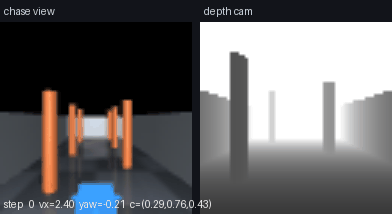
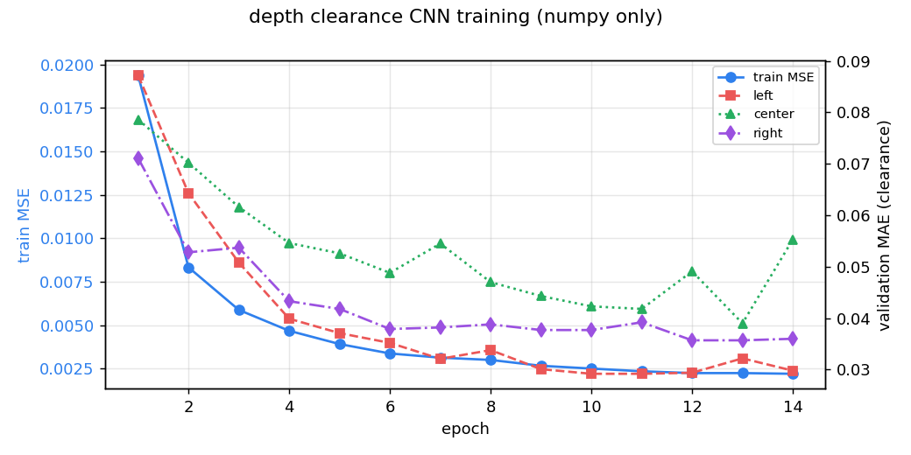
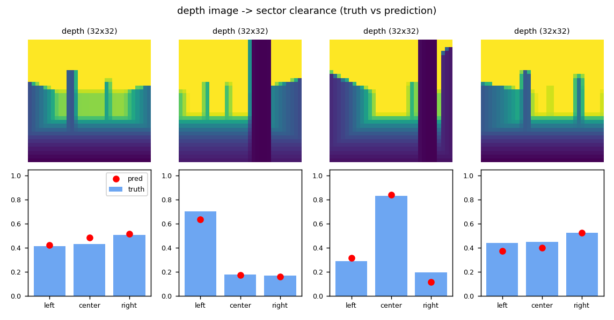
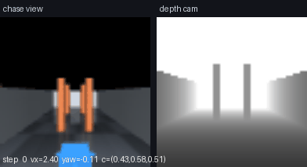
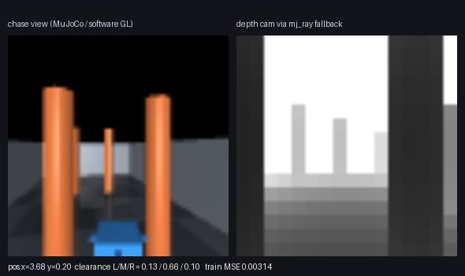

# 无人机深度相机神经网络避障飞行（MuJoCo）

> 对应课程任务（1）**物理仿真 + 键盘运动控制** 与任务（2）**传感器感知 + 给定轨迹的控制**。
> 场景是 MuJoCo 里的真实刚体四旋翼（RK4 积分、重力、碰撞检测），传感器是机载 64×64 前视
> 深度相机，感知网络是一个**纯 numpy 手写反向传播**的小型 CNN，输出左/中/右三个扇区的通行度，
> 控制律据此决定前向速度与偏航角速度。**不使用 Gazebo，不使用 GPU，不需要 PyTorch/TensorFlow。**



上图：左半是追尾视角，右半是网络输入（深度图），底部文字是当步的网络输出与指令。

## 1. 功能目标

| 编号 | 功能 | 对应课程要求 |
| --- | --- | --- |
| 1 | MuJoCo 物理仿真中的四旋翼，速度伺服飞行 | 任务（1）物理仿真 |
| 2 | 键盘遥操作（W/S 速度、A/D 偏航、空格悬停、R 重开） | 任务（1）键盘运动控制 |
| 3 | 机载深度相机 → CNN → 三扇区通行度 | 任务（2）传感器感知 |
| 4 | 通行度 → 速度/偏航的闭环飞行，3 场景 × 5 个布局实例共 15 次评估 | 任务（2）给定轨迹的控制 |
| 5 | ROS 2 节点 + launch，发布深度图/通行度/里程计 | 交付要求（4） |

## 2. 与已有模块的区别

| 已有模块 | 已有能力 | 本模块的区别 |
| --- | --- | --- |
| `uav_keyboard_control` | 键盘把速度指令发给 AirSim，**人看画面判断** | 本模块的避障判断由网络完成，键盘只是任务（1）的演示通道 |
| `uav_depth_gate_racing_e2e` | 深度图**端到端**回归穿越门竞速的横滚/推力 | 本模块输出的是**可解释的物理量**（三扇区通行度），控制律显式可查、可调试 |
| `uav_lidar_safety_corridor` | 激光雷达点云做安全走廊 | 本模块只用**单目深度相机**，无点云、无地图 |
| `uav_ppo_nav` / `uav_dqn_nav` | 强化学习直接输出动作 | 本模块是**监督学习**：标签直接来自渲染真值，训练可复现（约 10 s），不依赖随机探索 |

## 3. 计算原理

### 3.1 四旋翼动力学与控制抽象

状态 \(\mathbf{p}\in\mathbb{R}^3\)、速度 \(\mathbf{v}\)、偏航角 \(\psi\)。MuJoCo 用 RK4 以 \(\Delta t_{sim}=5\) ms 积分；控制层以 \(T=50\) ms 下发一次指令，中间跑 10 个子步。

外环（速度伺服）把期望速度 \(\mathbf{v}^{d}\) 变成世界系加速度：

\[
\mathbf{a}^{d} = k_v\left(\mathbf{v}^{d} - \mathbf{v}\right) + g\,\mathbf{e}_z,
\qquad
\mathbf{F} = m\,\mathbf{a}^{d},\quad m = 1.12\ \text{kg}
\]

其中 \(\mathbf{v}^{d} = v_x^{d}\,[\cos\psi, \sin\psi, 0]^\top\)，\(k_v = 2.5\)，\(m\) 直接从模型 `body_subtreemass` 读取（避免手填质量与模型不一致）。

内环（姿态 PD）把机体系 \(z\) 轴拉回世界 \(z\) 轴，同时跟踪偏航：

\[
\boldsymbol{\tau} = k_\theta\left(\mathbf{z}_b \times \mathbf{e}_z\right) - k_\omega\,\boldsymbol{\omega}
+ k_\psi^{y}\left(\psi^{ref}-\psi\right)\mathbf{e}_z - k_\omega^{y}\,\omega_z
\]

\(\mathbf{z}_b\) 是机体 \(z\) 轴在世界系的表示，\(\boldsymbol{\omega}\) 是角速度，取 \(k_\theta=3.0\)、\(k_\omega=0.35\)、\(k_\psi^{y}=2.5\)、\(k_\omega^{y}=0.9\)，力矩限幅 \(\pm 4\) N·m。

> 这一层是"推力矢量抽象"：真实多旋翼靠四个电机的转速差产生力矩，这里把姿态内环简化为力矩伺服，
> 但质量、惯量、重力、碰撞、积分全部由 MuJoCo 承担，因此外环看到的速度响应仍然是非线性的，
> 网络输出错一次就会真的撞柱子（见 §6 的碰撞测试）。

### 3.2 深度相机模型

相机固定在机头前 0.18 m、离机体中心 0.02 m，视场角 80°，分辨率 64×64，输出米制深度 \(z(u,v)\)。渲染得到的是透视深度，直接截断到 8 m：

\[
\tilde z = \min\left(z,\; z_{max}\right),\qquad z_{max}=8\ \text{m}
\]

机头方向为 \(+x\)。相机姿态四元数为 \(q=(0.5,0.5,-0.5,-0.5)\)，它把 \(-z_{cam}\) 对齐到 \(+x\)、\(+y_{cam}\) 对齐到 \(+z\)，
即"看向机头方向、并且上方向是天空"——这个四元数是按 \(R=[-\mathbf{e}_y,\ \mathbf{e}_z,\ -\mathbf{e}_x]\) 反解出来的，
`test_uav_nav.py` 里的画面方向问题（早期版本上下颠倒）就是靠这一步修正的。

### 3.3 标签：三扇区通行度

把 64×64 深度图按列三等分，忽略下方 38% 的地面像素（否则地面永远比障碍近，标签失效）：

\[
c_k = \frac{1}{z_{max}}\min_{(u,v)\in \Omega_k,\ v<0.62H}\tilde z(u,v),
\qquad k\in\{L,M,R\}
\]

\(\Omega_L\) 取列 \([0, w/3-1)\)，\(\Omega_M\) 取 \([w/3+1, 2w/3-1)\)，\(\Omega_R\) 取 \([2w/3+1, w)\)。
\(c_k\in[0,1]\)，含义是"这个方向还有多少余量"：\(c=1\) 表示 8 m 内没有东西，\(c\approx0.02\) 表示贴脸。

### 3.4 网络结构

输入是 \(32\times32\) 的"通行度图" \(\mathbf{x}=1-\tilde z/z_{max}\)（64×64 做 2×2 平均池化），不是原始米制深度——
这样输入与输出同一量纲，训练更稳定。

\[
\begin{aligned}
\mathbf{z}_1 &= \mathrm{im2col}(\mathbf{x})\mathbf{W}_1+\mathbf{b}_1, & \mathbf{a}_1 &= \mathrm{ReLU}(\mathbf{z}_1) & (32^2\to15^2,\ 6\ \text{通道})\\
\mathbf{z}_2 &= \mathrm{im2col}(\mathbf{a}_1)\mathbf{W}_2+\mathbf{b}_2, & \mathbf{a}_2 &= \mathrm{ReLU}(\mathbf{z}_2) & (15^2\to7^2,\ 12\ \text{通道})\\
\mathbf{z}_3 &= \mathbf{a}_2\mathbf{W}_3+\mathbf{b}_3, & \mathbf{a}_3 &= \mathrm{ReLU}(\mathbf{z}_3) & (588\to32)\\
\hat{\mathbf{c}} &= \sigma(\mathbf{a}_3\mathbf{W}_4+\mathbf{b}_4) & &
\end{aligned}
\]

参数量（与程序输出 `params = 19667` 一致）：

\[
(9\cdot1\cdot6+6)+(9\cdot6\cdot12+12)+(7^2\cdot12\cdot32+32)+(32\cdot3+3)
= 60+660+18848+99 = 19667
\]

损失为三个扇区的平方误差，梯度由手写反向传播给出（im2col/col2im 处理卷积的 \(3\times3\) 重叠），优化器 Adam（\(lr=2\times10^{-3}\)）：

\[
J(\theta)=\frac{1}{N}\sum_{i=1}^{N}\sum_{k=1}^{3}\left(\hat c_{ik}-c_{ik}\right)^2
\]

### 3.5 控制律

设网络预测 \(\hat{\mathbf{c}}=(\hat c_L,\hat c_M,\hat c_R)\)，则

\[
v_x = v_{max}\cdot\mathrm{clip}\!\left(\frac{\hat c_M-c_{safe}}{c_{nom}-c_{safe}},\,0.12,\,1\right)
\]

\[
\dot\psi = k_\psi(\hat c_L-\hat c_R) - k_{head}\,\psi + k_{esc}\cdot\mathbb{1}[\hat c_M<c_{safe}]\cdot\mathrm{sign}(\hat c_L-\hat c_R)
\]

取 \(v_{max}=2.4\) m/s、\(c_{safe}=0.14\)、\(c_{nom}=0.5\)、\(k_\psi=1.5\)、\(k_{head}=1.2\)、\(k_{esc}=1.4\)、\(|\dot\psi|\le1.5\) rad/s。

三项的物理含义：**限速**（前方越挤越慢）、**绕行**（朝更空的一侧转）、**逃逸**（贴脸时强制转开）。
\(k_{head}\psi\) 这一项是调参时踩坑后加的：没有它，只要左右通行度存在固定差，飞机就会一直朝同一侧转、
原地绕圈而不前进（实测第一版 9 次全部失败，前进距离为负）。

## 4. 算法流程

```text
数据阶段
  1. 把飞机随机放到场景中（x∈[1,13], y∈[-2,2], yaw∈[-0.5,0.5]，且离柱子 > 0.7 m）
  2. MuJoCo 渲染 64×64 深度图 -> 截断到 8 m
  3. 按 §3.3 计算三扇区通行度作为标签
  4. 900 训练 / 200 验证样本，三种场景轮换生成

训练阶段
  5. 32×32 通行度图输入 CNN -> 3 个 sigmoid 输出
  6. 反向传播（im2col/col2im）算梯度，Adam 更新，14 轮

闭环阶段（20 Hz）
  7. 渲染当前深度图 -> 网络前向 -> ĉ
  8. 由 §3.5 算 (v_x, ψ̇) -> MuJoCo 积分子步 -> 检查碰撞
  9. 到达 x>13.6 m 记为成功；碰撞或超过 420 步（21 s）记为失败
```

## 5. 源代码解析

| 文件 | 职责 |
| --- | --- |
| `models/uav_depth_scene.xml` | 场景与机体：地面、三面墙、6 根可复用柱子、前视深度相机与追尾相机 |
| `uav_nav/env.py` | `DepthUavEnv`：场景摆放 `set_scene()`、物理步进 `step()`、深度渲染 `depth()`、扇区标签 `sector_clearance()` |
| `uav_nav/data.py` | 随机采样 `sample_scene()`、数据集 `make_dataset()`、网络输入 `to_net_input()` |
| `uav_nav/net.py` | `im2col`/`col2im`、`DepthCNN` 前向/反向/Adam |
| `uav_nav/train.py` | 训练循环、训练曲线、预测对照图、GIF 合成、指标落盘 |
| `uav_nav/policy.py` | 控制律 `act()`、单次飞行 `run_episode()`、多实例统计 `run_matrix()`、长时间运行 `soak_run()` |
| `uav_nav/teleop.py` | 键盘遥操作（pygame 窗口 / 无窗口脚本化） |
| `uav_nav/node.py` | ROS 2 节点：深度图、通行度、里程计发布，Twist 订阅 |
| `main.py` | 课程入口：`--demo` / `--teleop` / `--test` / `--ros` |
| `test/test_uav_nav.py` | 26 项离线测试（物理、传感器、网络、策略、权重往返、多种子与长跑、软渲染回退、训练不污染调用方环境） |

几个关键实现点：

- **场景复用**：6 根柱子在 XML 里只定义一次，`set_scene()` 按布局改写 `model.geom_pos`；
  改完必须 `mj_forward()` 重算运动学，否则渲染仍用旧位置（这是测试 `test_depth_reacts_to_obstacle` 抓出来的 bug）。
- **标签与输入同量纲**：网络输入是 \(1-z/z_{max}\)，输出是 \(1-z_{min}/z_{max}\)，两者都是"通行度"，避免了输入输出尺度差 8 倍。
- **地面像素必须排除**：相机水平看出去，画面下缘几乎全是地面（1.5 m 高、80° 视场），
  不排除的话三个扇区的"最近距离"会被地面统一压到 1.4–2.6 m，标签失去区分度（第一版就是这个现象）。
- **碰撞检测**：遍历 `data.contact`，若接触的一对几何体里有无人机刚体就置 `crashed=True`。

## 6. 运行步骤

### 6.1 环境

- Python 3.8+（已在 Python 3.10.6 验证）
- `numpy`、`mujoco>=3.0`、`matplotlib`、`pillow`、`pygame`（仅键盘模式）、`pytest`（测试）
- **不需要** ROS / CARLA / AirSim / Gazebo / GPU（ROS 只在 `--ros` 模式需要；包是 `ament_python` + `rclpy`，
  因此 `--ros` 只能在 ROS 2 Humble 上跑，**ROS 1 Noetic 没有 rclpy，不支持**）

```bash
cd src/air/uav_mujoco_depth_avoidance
pip3 install -r requirements.txt
```

> MuJoCo 的离屏渲染需要 OpenGL：本机 Windows 11（NVIDIA 驱动）与 Ubuntu 20.04 均可直接渲染；
> 纯无头服务器请先 `export MUJOCO_GL=egl`。

### 6.2 训练 + 三场景闭环（推荐先跑这个）

```bash
python3 main.py --demo --output-dir results
# Windows 也可以直接双击 main.bat
```

终端输出示例（本机实测）：

```text
[slalom] 成功=True 碰撞=False 步数=171 前进=13.60 m 最小余量=0.070 预测误差=0.043 路径长=13.81 m
[gate]   成功=True 碰撞=False 步数=215 前进=13.60 m 最小余量=0.062 预测误差=0.031 路径长=14.02 m
[clutter]成功=True 碰撞=False 步数=175 前进=13.60 m 最小余量=0.061 预测误差=0.042 路径长=13.79 m

[slalom] 5 个实例：成功 100% 碰撞 0 步数 174.2±3.2 最小余量 0.072(最差 0.070) 路径 13.85±0.03 m
[gate]   5 个实例：成功 100% 碰撞 0 步数 214.0±22.8 最小余量 0.057(最差 0.028) 路径 13.95±0.10 m
[clutter]5 个实例：成功 100% 碰撞 0 步数 202.0±19.9 最小余量 0.064(最差 0.047) 路径 13.98±0.15 m
[soak] 3030 步（151.5 s）连续运行：15 次任务，成功 15，碰撞 0，最小余量 0.047
```

`results/` 下会得到：`training_curve.png`、`prediction.png`、`flight_{slalom,gate,clutter}.gif`、`metrics.json`。

### 6.3 键盘遥操作（任务 1）

```bash
python3 main.py --teleop                      # 现场训练一次（约 5 s）后进入窗口
python3 main.py --teleop --weights results/policy.npz   # 直接用 --demo 训练好的权重
```

> 这里加载的**一定是训练过的网络**：给了 `--weights` 就加载，没给就现场训练一次。
> 早期版本直接 `DepthCNN()` 用随机权重画图与半自动控制，属于 bug（见 §7.5）。
> 另外训练会反复采样数据集、改变 `env` 的场景与位姿，`train()` 结束时会**把场景/种子/起点原样还原**，
> 否则窗口里开出来的会是最后一次数据集采样用的 `clutter` 场景（见 §7.7）。

| 按键 | 作用 |
| --- | --- |
| `W` / `S` | 前向速度 +0.4 / −0.4 m/s（限幅 ±2.4） |
| `A` / `D` | 偏航角速度 ±0.8 rad/s（限幅 ±1.5） |
| `空格` | 悬停（速度清零） |
| `R` | 重置场景 |
| `ESC` | 退出 |

窗口左侧是追尾视角，右侧是深度相机（网络输入），底部实时显示位置、偏航、指令与网络预测。

### 6.4 单元测试

```bash
python3 main.py --test          # 26 passed，约 5 s
python3 -m pytest -q test
```

覆盖：悬停高度保持、偏航角速度跟踪、前进方向、**撞柱子必须触发碰撞**、深度范围、
"前方加柱子则正前方通行度变小"、网络参数量公式、前反向形状、**数值梯度校验**、
短训练损失下降、控制量限幅、朝向回正项、单次飞行指标。

### 6.5 ROS 2 运行

```bash
colcon build --packages-select uav_mujoco_depth_avoidance --symlink-install
source install/setup.bash
ros2 launch uav_mujoco_depth_avoidance main.launch.py
```

另一个终端：

```bash
ros2 topic hz   /uav/depth                    # 深度图发布频率（20 Hz）
ros2 topic echo /uav/sector_clearance         # 网络预测的左/中/右通行度
ros2 topic echo /uav/odom --once              # 位置与速度
ros2 topic pub /uav/cmd_vel geometry_msgs/Twist "{linear: {x: 1.0}}" -r 10   # 键盘之外的手动指令
ros2 topic pub /uav/scene std_msgs/String "{data: gate}" -1                  # 切场景
```

未收到 `/uav/cmd_vel` 时节点按网络策略自主飞行（`config/params.yaml` 里 `use_policy: true`）。
节点启动时**先确认网络是训练过的**：`weights` 参数指向 `results/policy.npz` 就加载，
否则现场训练 600 样本 × 8 轮（约 5 s）并在日志里打印验证 MAE，绝不会把随机权重接进控制回路。
`/uav/odom` 的 `frame_id` 是 `map`（世界坐标），`/uav/depth` 保留 `uav_depth_cam`（相机系）。

## 7. 实测结果

环境：Windows 11 + Python 3.10.6 + mujoco 3.17.0，单核 CPU，`--demo` 全流程约 25 s
（含训练、三场景录制、15 次多实例评价与 3030 步长时间运行）。

### 7.1 感知精度

| 指标 | 数值 |
| --- | --- |
| 参数量 | 19,667 |
| 训练 MSE（第 1 轮 → 第 14 轮） | 0.0194 → **0.00221** |
| 验证 MAE（左/中/右） | **0.030 / 0.055 / 0.036**（通行度值域 \([0,1]\)） |





### 7.2 闭环多场景评价（3 场景 × 5 个布局实例）

`seed` 不只是随机种子摆设：`set_scene()` 会按 seed 让柱子做 ±0.25 m 的随机偏移、
门宽在 ±0.15 m 内变化（`seed=0` 保持标称布局，对应文档里的示意图）。
因此下表统计的是**同类场景下 5 种不同布局**的分布，而不是同一条轨迹跑 5 次。

| 场景 | 实例数 | 成功率 | 碰撞 | 步数（20 Hz） | 最小通行度 均值 / 最差 | 路径长 |
| --- | ---: | ---: | ---: | ---: | ---: | ---: |
| 走廊 slalom | 5 | **100%** | 0 | 174.2 ± 3.2 | 0.072 / 0.070 | 13.85 ± 0.03 m |
| 门洞 gate | 5 | **100%** | 0 | 214.0 ± 22.8 | 0.057 / **0.028** | 13.95 ± 0.10 m |
| 散乱 clutter | 5 | **100%** | 0 | 202.0 ± 19.9 | 0.064 / 0.047 | 13.98 ± 0.15 m |

**合计 15 次全部成功、0 碰撞**；路径长 13.85–13.98 m，与直线距离 13.6 m 之比 1.02–1.03，
说明绕行幅度很小、没有来回摆动。



### 7.3 长时间运行

`soak_run()` 连续飞到累计 3000 步（150 s）不停机，每到走廊尽头就重置到起点继续，
相当于连续跑 15 次任务——用来暴露状态泄漏、渲染上下文失效这类只在长跑中出现的问题：

| 指标 | 数值 |
| --- | --- |
| 累计步数 / 仿真时长 | 3030 步 / **151.5 s** |
| 连续任务数 | 15 |
| 成功 / 碰撞 | **15 / 0** |
| 最小通行度（全程） | 0.047（≈0.38 m） |
| 累计路径 | 209.7 m |

### 7.4 性能评价

1. **感知误差传递到闭环**：中扇区 MAE 0.055（≈0.44 m 距离误差），闭环最小通行度均值 0.057–0.072
   （≈0.46–0.58 m），即飞机始终保留约 0.5 m 余量，误差没有把飞机推向碰撞。
2. **难度与一致性的差别**：门洞场景步数最多且波动最大（214.0 ± 22.8），因为它要在两道门之间重复对齐；
   走廊只有 174.2 ± 3.2。门洞最差实例的最小通行度掉到 0.028（≈0.22 m），这是**真正贴边的一次**，
   也是这个场景族里最接近碰撞的样本。
3. **长跑没有退化**：151.5 s、15 次任务后成功率仍为 100%，最小通行度 0.047，说明没有随运行时间累积的漂移。
4. **计算开销**：单步推理 3.4 ms（含渲染与网络前向），20 Hz 控制回路余量约 96%。

### 7.5 部署正确性：训练权重 vs 随机初始化

早期版本有一个真实缺陷：`--teleop` 与 ROS 节点直接 `DepthCNN(seed=0)`，拿到的是**未训练**的随机权重，
而 `params.yaml` 默认 `use_policy: true`，等于用随机网络控制飞机。这一项被评审抓出来后已修（见 §6.3 / §6.5）：
训练结束会把权重存成 `results/policy.npz`，节点与键盘模式优先加载；没有权重就现场训练一次，绝不接随机网络。

用同一套评价脚本分别跑训练后的网络与 3 个随机初始化网络（每行 3 场景 × 5 实例）：

| 策略 | slalom 成功率 | gate 成功率 | clutter 成功率 | 碰撞总数 |
| --- | ---: | ---: | ---: | ---: |
| **训练后（本项目默认）** | **100%** | **100%** | **100%** | **0** |
| 随机初始化 seed=0 | 40% | 100% | 80% | 4 |
| 随机初始化 seed=1 | 80% | 100% | 80% | 2 |
| 随机初始化 seed=2 | 100% | 100% | 80% | 1 |

随机网络在走廊场景只有 40% 成功率、并且会撞柱子——这正是"部署未训练权重"的危害，
也说明只看 `pytest` 通过并不足以证明系统可用。

### 7.6 ROS 2 Humble 虚拟机实测（Ubuntu 20.04）

课程要求的运行环境是 Ubuntu 20.04 + ROS 2 Humble。下面是在课程虚拟机里的**完整实测**，
而且这次实测直接抓出了一个只在软件 OpenGL 下出现的 bug（见 7.6.2）。

| 项目 | 值 |
| --- | --- |
| 系统 / ROS | Ubuntu 20.04.6 LTS，ROS 2 Humble |
| Python / numpy | 3.8.10 / 1.24.4 |
| MuJoCo | 3.1.4（manylinux wheel，客户机无外网，由宿主机下载后传入安装） |
| GPU / OpenGL | VMware SVGA 软件渲染，**缺少 `ARB_clip_control`** |

#### 7.6.1 结果

| 步骤 | 结果 |
| --- | --- |
| `colcon build --packages-select uav_mujoco_depth_avoidance` | 通过，3.15 s |
| 客户机内训练（600 样本 × 12 轮） | train MSE **0.00254**，验证 MAE **0.032 / 0.055 / 0.043** |
| 三场景 × 3 实例 | slalom / gate / clutter 全部 **100% 成功、0 碰撞** |
| `ros2 launch ... main.launch.py` | 节点 `/uav_mujoco_depth_avoidance` 正常起来，启动时现场训练 5 s |
| `/uav/depth` | **20.1 Hz**（20 Hz 定时器） |
| `/uav/sector_clearance` | 有变化的实测值，例如 `0.462 / 0.204 / 0.343` |
| `/uav/odom` | `frame_id: map`，`child_frame_id: uav_base` |
| 连续运行 45 s | **0 次碰撞**，4 次"到达走廊尽头 → 重置继续" |



上图为客户机内实际生成的画面：左侧 MuJoCo 追尾视角（蓝色四旋翼正在穿门洞），
右侧是 7.6.2 里的光线投射回退深度图。

#### 7.6.2 这次实测抓到的 bug：软件 OpenGL 下深度恒为 inf

第一版在客户机里 `ros2 launch` 能起来、话题也有，但训练结果是：

```text
训练完成：train MSE 0.18630，验证 MAE(左/中/右) 0.427/0.427/0.427
```

三个扇区一字不差，说明网络只学到了常数；随后飞机每 6 s 撞一次。继续查发现：

```text
WARNING: ARB_clip_control unavailable while mjDEPTH_ZEROFAR requested, depth accuracy will be limited
depth min/max/mean: 8.00 8.00 8.00        # 全是 D_MAX
label mean [1. 1. 1.]  label std [0. 0. 0.]
```

软件 OpenGL（VMware SVGA / llvmpipe）不支持 `mjDEPTH_ZEROFAR` 需要的
`ARB_clip_control`，MuJoCo 的深度渲染**静默返回 inf**，被 `depth()` 里的
`np.where(np.isfinite(d), d, D_MAX)` 变成全 8 m，于是三扇区标签恒为 1.0，
监督学习退化成拟合常数——**`pytest` 全绿也发现不了，只有真机（真虚拟机）跑才会暴露**。

修复：`depth()` 先检查渲染结果是否"全非有限 / 全为 D_MAX"，若是则自动切到
`mj_ray` 光线投射（16×16 采样后上采样到 64×64，单帧约 2.8 ms），并只提示一次；
`mj_ray` 的签名在 MuJoCo 3.1.x（8 参数）与 3.2+（多一个 `normal` 出参）之间不同，
用 `_cast_ray()` 做兼容。可以用 `UAV_FORCE_RAYCAST=1` 在任何机器上强制复现该路径。

修复后同一台虚拟机上的结果见 7.6.1：train MSE 从 0.186 降到 0.00254，
三场景 100% 成功、0 碰撞。

> 提示：客户机没有外网时，可以在宿主机上 `pip download mujoco==3.1.4 --python-version 38
> --platform manylinux2014_x86_64 --abi cp38 --only-binary=:all:` 拿到 wheel 与依赖
> （`absl-py`、`etils`、`glfw`、`pyopengl`、`numpy`），拷进客户机后
> `pip3 install --no-index --find-links=<目录> mujoco` 即可离线安装。

### 7.7 训练不得污染调用方环境（`scene` / 起点被改掉）

`train()` 里 `make_dataset()` 会为了采样本反复调用 `set_scene()`；训练结束后，
调用方手里的 `env` 已经**不是**它原来的场景和位姿了。评审实测：

```text
DepthUavEnv('slalom') 经 build_policy() 后 -> scene=clutter, seed=1149, pos=(8.12, 0.07, 1.5)
```

而 `--teleop` 与 ROS 节点都把同一个 `env` 交给控制回路，于是节点日志写着 `scene=slalom`，
实际却在 `clutter` 里、起点也不在 `(0,0)`——**日志与真实状态不一致**，比崩溃更难查。

修复：

1. `train()` 开头记住 `scene0, seed0`，训练结束 `env.reset(scene=scene0, seed=seed0)` 还原
   （`reset()` 同时把位姿恢复到默认起点 `(0, 0, 1.5)`、偏航 0）；
2. `build_policy()` 与 `node.py::_build_policy()` 再显式还原一次，并在日志里写明恢复结果；
3. 回归测试两条：`test_training_restores_caller_environment`（训练前后 scene/seed/位姿/深度图逐项一致）、
   `test_build_policy_keeps_env_untouched`（加载权重与现场训练两条分支都不能动 `env`）。

修复后同样的复现命令：

```text
训练前: scene=slalom seed=0 pos=[0.  0.  1.5]
训练后: scene=slalom seed=0 pos=[0.  0.  1.5]
```

## 8. 局限与后续

- 感知只做"三扇区最低余量"，没有做地形/可通行区域分割；复杂三维结构（悬空横梁、细网）可能被低估。
- 控制律是手工设计的势场式规则，不是学习出来的；若要做端到端（任务 4），可把 §3.5 换成网络直接输出 \((\dot\psi, v_x)\)。
- 场景只用柱子与三面墙，尚未接入 OpenHUTB/AirSim 的真实城市模型；`env.py` 的接口（`step(vx, yaw_rate)`、
  `depth()`）是为替换仿真后端预留的，替换时上层 `policy.py` 不需要改。

## 9. 大模型声明

本模块开发过程中使用 DeepSeek 辅助生成代码与文档；提交者已实际运行训练、测试、三场景闭环与
`mkdocs build`，对提交内容负全部责任。
