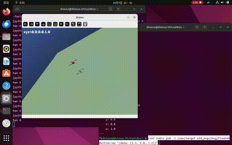

# Mujoco 四旋翼无人机键盘遥控

基于 Mujoco 物理仿真的自建模四旋翼无人机键盘遥控模块（ROS 课程任务1）。

## 功能

- 自建模四旋翼（PID 悬停 + 键盘控制 + ROS2 话题封装）
- fixed 俯瞰相机离屏渲染 + cv2 显示

## 演示

## 运行

python3 main.py
ros2 launch uav_mujoco_keyboard uav_keyboard.launch.py
