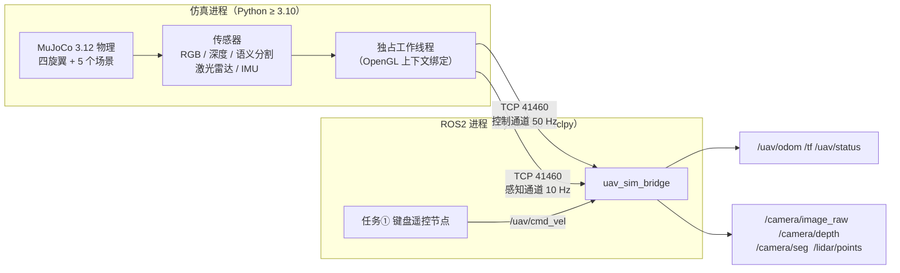
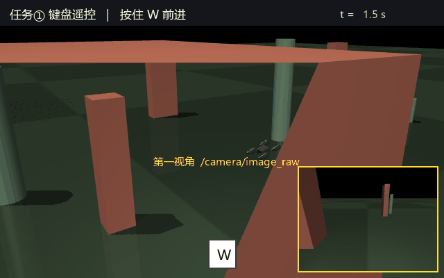
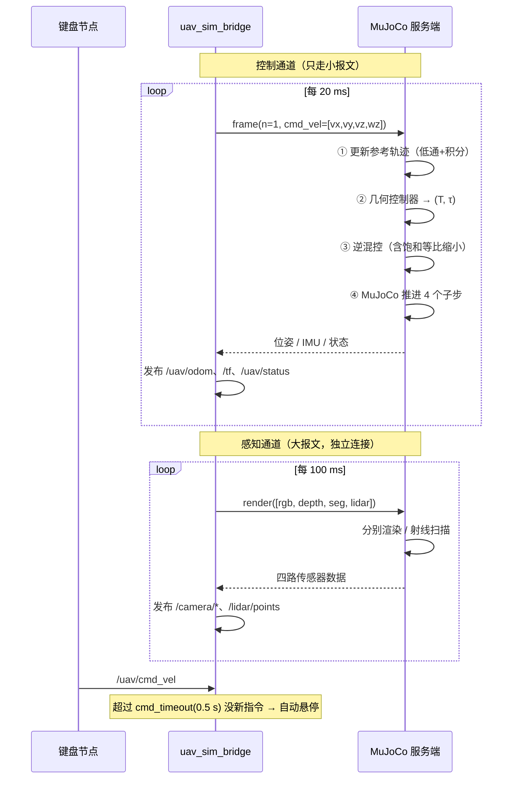
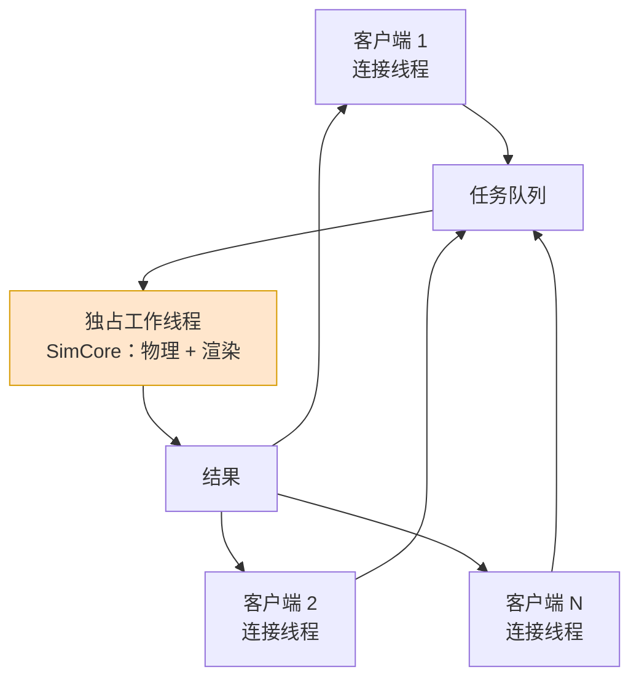
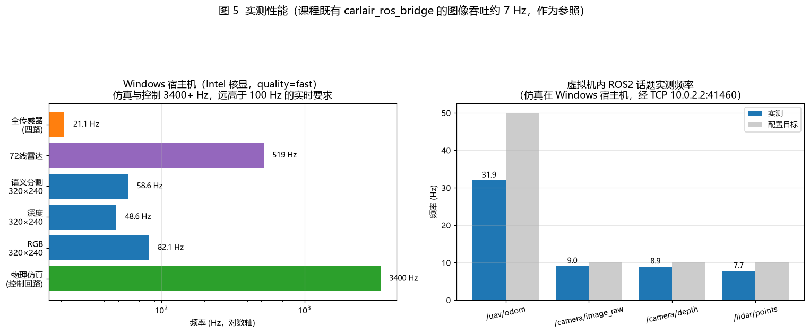
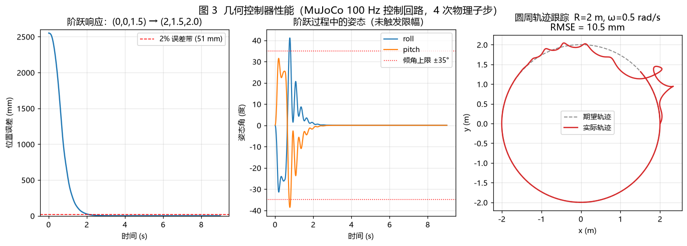
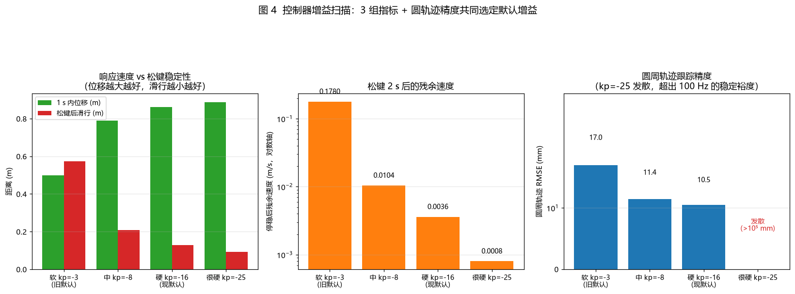
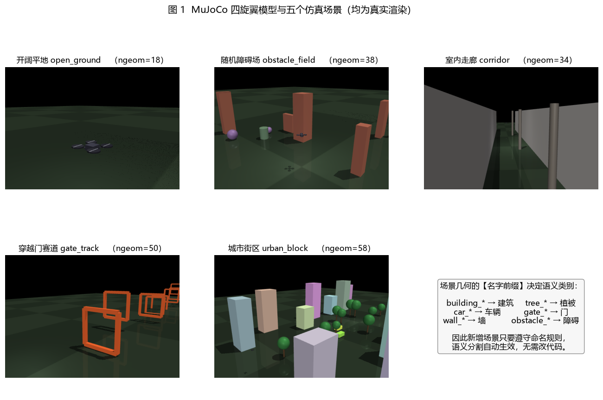
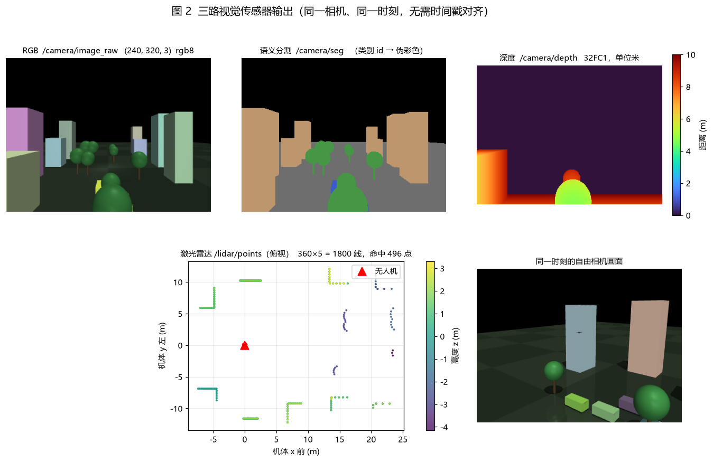

# MuJoCo 四旋翼仿真与 ROS2 桥接底座

本模块在 **MuJoCo 3.12.0** 中构建四旋翼仿真，把物理与多路传感器以**标准 ROS2 Humble 话题**
对外暴露，并完成作业任务①：**通过键盘对无人机进行运动控制**。

它同时是后续五个无人机模块（神经残差控制、神经 VIO/SLAM、语义建图导航、深度图端到端竞速、
神经安全过滤器）的**共同底座**——这五个模块都通过同一套话题与本模块交互，彼此不重复造轮子。

!!! warning "不使用 Gazebo"
    仿真器为作业允许列表中的 **MuJoCo 3.12.0**，纯 CPU 运行，**不需要独立显卡**，
    也不需要 Unreal / CUDA。本机（Intel 核显笔记本）实测控制回路 3400 Hz。

---

## 1. 与已有模块的关系

课程仓库 `src/air/` 下已有 8 个无人机模块，本模块与它们是**并列且互补**的关系：

| 已有模块 | 它解决什么 | 本模块做什么 |
|---|---|---|
| `carlair_ros_bridge` | CarlaAir/AirSim ↔ ROS 的桥接 | 用 MuJoCo 实现**同一套话题契约**，换仿真器不改算法 |
| `uav_keyboard_control` | 键盘遥控 | 同样提供键盘遥控，但底层是 MuJoCo + ROS2 |
| `uav_ppo_nav` | PPO 导航策略 | 提供它需要的 `/lidar/points`、`/uav/odom` |
| `octree_uav_3d_pathfinding` | 八叉树建图寻路 | 提供它需要的 `/lidar/points`（世界系点云） |
| `air_learning` | 视觉行为克隆 | 提供它需要的 `/camera/image_raw` |

**关键设计**：对外话题名、消息类型、坐标系、量纲与 `carlair_ros_bridge` **逐字段对齐**。
因此上游任何算法模块都能不改一行地切到本模块；反过来，本模块也可以把仿真器换成
AirSim / CarlaAir 而算法代码不动。

---

## 2. 系统架构

### 2.1 为什么必须是两个进程

虚拟机里的 ROS2 Humble 是为 **Python 3.8** 编译的（`rclpy` 只有 Python 3.8 绑定），
而 MuJoCo 3.12.0 要求 **Python ≥ 3.10**，两者无法共存于同一个解释器。

因此按课程既有 `carlair_ros_bridge` 的架构拆成两个进程，中间走 TCP：



**两条独立 TCP 连接**是必须的，不是优化：控制回路每次只要 5 ms（纯状态，几十字节），
而一次带 RGB+深度的感知请求要 66 ms（载荷 500+ KB）。如果共用一个定时器，
50 Hz 的控制回路会被拖到 3.8 Hz。拆开之后控制回路稳定在 32 Hz、感知 9 Hz。

### 2.2 三种部署方式

| 方式 | 仿真进程 | ROS 进程 | 说明 |
|---|---|---|---|
| **A（推荐）** | Windows 宿主机 | Ubuntu 虚拟机 | 宿主机有图形加速，虚拟机只跑 ROS。桥接传 `sim/host:=10.0.2.2` |
| B | 虚拟机内 | 虚拟机内 | 无网络开销，但虚拟机无 GPU 走软件光栅化，RGB 只有约 7 Hz |
| C | 同一台 Linux | 同一台 Linux | 需要 Python ≥3.10 与 ROS 兼容；用法相同 |

推荐方式 A：Windows 上 RGB 320×240 可达 151 Hz，虚拟机只负责 ROS 逻辑，负载很轻。

---

## 3. 运行环境

| 项目 | 要求 |
|---|---|
| ROS | **ROS2 Humble**（Ubuntu 20.04 / 22.04 均可） |
| 仿真侧 Python | **≥ 3.10**（MuJoCo 3.12.0 的硬性下限） |
| 显卡 | **不需要独立显卡**，核显或纯 CPU 均可 |
| 内存 | ≥ 4 GB |
| 其他 | 不需要 Gazebo、不需要 Unreal、不需要 CUDA |

实测运行平台：Intel Core 5 220H（12 核 16 线程，**Intel 核显**）、23.7 GB 内存。

---

## 4. 安装

### 4.1 仿真侧（一次性）

```bash
# 安装 uv（只装到 ~/.local/bin，不动系统 Python）
curl -LsSf https://astral.sh/uv/install.sh | sh
export PATH="$HOME/.local/bin:$PATH"

# 建独立 Python 3.12 环境并安装 MuJoCo
uv venv ~/uav_ws/.venv --python 3.12
uv pip install --python ~/uav_ws/.venv/bin/python "mujoco==3.12.0" numpy
```

!!! 注意
    这里**不修改**系统 Python。虚拟机里可能还有别的项目依赖 Python 3.8，
    动系统解释器会波及它们。

### 4.2 ROS 侧

```bash
source /opt/ros/humble/setup.bash
mkdir -p ~/uav_ws/ros2_ws/src && cd ~/uav_ws/ros2_ws
# 把本模块放到 src/ 下后：
colcon build --symlink-install --packages-select uav_mujoco_sim
source install/setup.bash
```

### 4.3 验证安装

```bash
cd ~/uav_ws/ros2_ws/src/uav_mujoco_sim
~/uav_ws/.venv/bin/python main.py --selftest
```

期望输出 `通过 20/20`。自检**不需要 ROS、不需要显示器**，可在任意机器上先跑通它，
再排查 ROS 侧的问题。

---

## 5. 仿真步骤

### 5.1 启动（方式 A：仿真在 Windows，ROS 在虚拟机）

**第 1 步：Windows 宿主机启动仿真服务端**

```powershell
cd <path>\uav_mujoco_sim
python main.py --server --host 0.0.0.0 --port 41460 --scene urban_block
```

看到下面这行说明启动成功：

```
[uav_mujoco_sim] 仿真服务已启动  0.0.0.0:41460
[uav_mujoco_sim] 场景=urban_block  控制周期 dt=0.01s  相机 640x480
```

**第 2 步：确认虚拟机能看到宿主机**

VirtualBox NAT 下宿主机的地址固定是 `10.0.2.2`：

```bash
ping -c 2 10.0.2.2
```

**第 3 步：虚拟机启动桥接**

```bash
source /opt/ros/humble/setup.bash
source ~/uav_ws/ros2_ws/install/setup.bash

ros2 run uav_mujoco_sim bridge --ros-args \
  -p sim/host:=10.0.2.2 -p sim/port:=41460
```

桥接会先连接仿真端，成功后打印：

```
[uav_sim_bridge]: 已连接。场景=urban_block 初始位置=[-28.0, 0.0, 3.0]
[uav_sim_bridge]: 桥接已就绪：控制 50 Hz，图像 10 Hz，雷达 10 Hz，坐标=机体系
```

之后每 10 秒会打印一次**实测**速率：

```
[uav_sim_bridge]: 实测速率：控制 31.9 Hz（目标 50），感知 9.0 Hz（目标 10）；
                  感知分项 RPC 66 ms + 发布 3 ms（n=90）
```

**第 4 步：确认话题**

新开一个终端：

```bash
source /opt/ros/humble/setup.bash
ros2 topic list
```

应当看到：

```
/camera/depth      /camera/image_raw    /lidar/points
/tf                /uav/cmd_vel         /uav/goal
/uav/odom          /uav/status
```

### 5.2 一键启动（ros2 launch）

如果能接受仿真也跑在虚拟机里（方式 B），可以一条命令拉起全部：

```bash
export DISPLAY=:0 MUJOCO_GL=glfw
ros2 launch uav_mujoco_sim main.launch.py scene:=obstacle_field
```

launch 会自动：探测仿真侧 Python → 启动 MuJoCo 服务端 → 启动桥接节点。
键盘遥控节点默认不启动（见 5.3）。

常用参数：

```bash
ros2 launch uav_mujoco_sim main.launch.py scene:=urban_block
ros2 launch uav_mujoco_sim main.launch.py keyboard:=true    # 键盘遥控，见 5.3
ros2 launch uav_mujoco_sim main.launch.py quality:=full    # 开阴影，录演示动图用
ros2 launch uav_mujoco_sim main.launch.py headless:=true   # 不渲染，纯控制/规划
```

### 5.3 任务①：键盘遥控



*（动图：在障碍场中依次按住 `W` 前进、`A` 左移、`R` 上升、`Q` 右转、`F` 下降，
松开所有键后无人机自动悬停。右下角小窗是同一时刻的第一视角 `/camera/image_raw`。）*

键盘节点从控制终端 `/dev/tty` 读键，不读 stdin（`ros2 launch` 把子进程的 stdin
接成了管道）。终端只把输入交给**前台**进程组，而 launch 拉起的子进程不在其中，
读终端拿到 `EIO`——节点在跑、日志正常、按键没反应。所以键盘节点**默认不随 launch
启动**，遥控时另开一个终端：

```bash
source /opt/ros/humble/setup.bash
source ~/uav_ws/ros2_ws/install/setup.bash
ros2 run uav_mujoco_sim keyboard
```

该终端要让程序留在前台——别用管道、重定向、`nohup`、`&` 启动。若顺手写了
`keyboard:=true`，节点会打印一条"取不到可读的终端（not foreground...）"。

按键映射（与上游 `uav_keyboard_control` 一致）：

| 按键 | 动作 | 速度分量 | 按键 | 动作 | 速度分量 |
|---|---|---|---|---|---|
| `W` / `S` | 前进 / 后退 | `linear.x = ±1.0` | `A` / `D` | 左移 / 右移 | `linear.y = ±1.0` |
| `R` / `F` | 上升 / 下降 | `linear.z = ±0.6` | `Q` / `E` | 右转 / 左转 | `angular.z = ±0.6` |
| 松开所有键 | **悬停** | 全零 | `ESC` / `Ctrl-C` | 退出 | — |

若只想看效果、不想装 ROS，可以直接跑独立演示：

```bash
~/uav_ws/.venv/bin/python main.py --demo --scene obstacle_field --viewer
```

### 5.4 用命令行控制（不开键盘）

```bash
# 让无人机以 1.5 m/s 前进（持续 5 秒）
ros2 topic pub -r 20 /uav/cmd_vel geometry_msgs/msg/Twist "{linear: {x: 1.5}}"

# 飞向世界系目标点 (5, 0, 2)，到达后自动悬停
ros2 topic pub --once /uav/goal geometry_msgs/msg/Point "{x: 5.0, y: 0.0, z: 2.0}"

# 查看状态（READY/HOVER/VELOCITY/GOAL/GOAL_DONE）
ros2 topic echo /uav/status
```

---

## 6. 计算原理

### 6.1 坐标系约定

| 坐标系 | 定义 | 用途 |
|---|---|---|
| 世界系 | **ENU**：\(x\) 东、\(y\) 北、\(z\) 上 | `/uav/odom`、`/uav/goal`、`/lidar/points` |
| 机体系 | **FLU**：\(x\) 前、\(y\) 左、\(z\) 上 | `/uav/cmd_vel` |

与 `carlair_ros_bridge` 完全一致，因此**不需要**做 NED↔ENU 换算。
四元数按 MuJoCo 约定为 \((w, x, y, z)\)。

### 6.2 旋翼布置与混控

X 型四旋翼，四个旋翼位于 \((\pm a, \mp a, 0)\)，其中 \(a = L/(2\sqrt{2})\)，\(L\) 为轴距。

!!! warning "对角两桨必须同向"
    X 型配置下**对角旋翼同向、相邻旋翼反向**。若标错，偏航通道与滚转通道会
    线性相关，混控矩阵奇异，无人机无法独立控制偏航。本模型的取向为：
    旋翼 1（前右）与 2（后左）逆时针，旋翼 3（前左）与 4（后右）顺时针。

设第 \(i\) 个旋翼推力为 \(T_i\)（沿机体 \(+z\)），则机体的合推力与力矩为

$$
\begin{aligned}
T   &= T_1 + T_2 + T_3 + T_4 \\
\tau_x &= a\,(-T_1 + T_2 + T_3 - T_4) \\
\tau_y &= a\,(-T_1 + T_2 - T_3 + T_4) \\
\tau_z &= k_m(-T_1 - T_2 + T_3 + T_4)
\end{aligned}
$$

其中 \(k_m\) 为反扭矩系数（量纲为长度，约等于桨叶半径尺度；本模型取 \(k_m = 0.015\ \text{m}\)）。

**逆解**（由期望的 \(T, \tau_x, \tau_y, \tau_z\) 求四个推力）——记 \(u = \tau_x/a\)，
\(v = \tau_y/a\)，\(w = \tau_z/k_m\)：

$$
T_1 = \frac{T - u - v - w}{4},\quad
T_2 = \frac{T + u + v - w}{4},\quad
T_3 = \frac{T + u + w - v}{4},\quad
T_4 = \frac{T + v + w - u}{4}
$$

### 6.3 饱和处理（这一步不能省）

四个推力都可写成 \((T \pm u \pm v \pm w)/4\)，因此**全部落在 \([0, T_{\max}]\) 内的充要条件**是

$$
|u| + |v| + |w| \;\le\; \min\bigl(4T_{\max} - T,\; T\bigr)
$$

不满足时**整体等比例缩小** \((u, v, w)\)，而**不是对四个推力逐个裁剪**。

!!! warning "逐个裁剪会破坏力矩方向"
    逐个裁剪会让四个推力各自撞到上下限，力矩的相对比例被破坏，合力矩方向完全失真。
    实测表现：姿态环要求稍大的力矩时控制器瞬间发散，
    **圆形轨迹跟踪误差从 17 mm 直接炸到 474 m**。
    等比缩小则保持方向、只降低幅值，并优先保住合推力 \(T\)（高度不掉），牺牲力矩——
    这才是物理上合理的行为。

### 6.4 几何控制器

外环（位置）由位置/速度误差算期望推力矢量：

$$
\boldsymbol{f}_{\text{des}} = m\Bigl(-g\,\boldsymbol{e}_z + \boldsymbol{a}_d
+ \boldsymbol{K}_p \odot (\boldsymbol{p} - \boldsymbol{p}_d)
+ \boldsymbol{K}_d \odot (\boldsymbol{v} - \boldsymbol{v}_d)\Bigr)
$$

再由 \(\boldsymbol{f}_{\text{des}}\) 的方向与期望偏航角 \(\psi_d\) 构造期望姿态
\(\boldsymbol{R}_{\text{des}} = [\boldsymbol{x}_b\ \boldsymbol{y}_b\ \boldsymbol{z}_b]\)：

$$
\boldsymbol{z}_b = \frac{\boldsymbol{f}_{\text{des}}}{\|\boldsymbol{f}_{\text{des}}\|},\quad
\boldsymbol{y}_b = \frac{\boldsymbol{z}_b \times \boldsymbol{x}_c}{\|\boldsymbol{z}_b \times \boldsymbol{x}_c\|},\quad
\boldsymbol{x}_b = \boldsymbol{y}_b \times \boldsymbol{z}_b
$$

内环（姿态）用几何误差做 PD：

$$
\boldsymbol{e}_R = \tfrac{1}{2}\,\mathrm{vee}\bigl(\boldsymbol{R}_{\text{des}}^{\top}\boldsymbol{R}
- \boldsymbol{R}^{\top}\boldsymbol{R}_{\text{des}}\bigr),\qquad
\boldsymbol{\tau} = \boldsymbol{K}_r \boldsymbol{e}_R + \boldsymbol{K}_\omega \boldsymbol{\omega}
$$

合推力取 \(\boldsymbol{f}_{\text{des}}\) 在机体 \(z\) 轴上的投影 \(T = \boldsymbol{f}_{\text{des}} \cdot \boldsymbol{R}\boldsymbol{e}_z\)。

**默认增益**由实验扫描选定（见 §9.4 图 4）：

$$
\boldsymbol{K}_p = (-16, -16, -20),\quad \boldsymbol{K}_d = (-8, -8, -9),\quad
\boldsymbol{K}_r = (-1.5, -1.5, -0.6),\quad \boldsymbol{K}_\omega = (-0.10, -0.10, -0.07)
$$

（负号来自误差定义取 \(\boldsymbol{p} - \boldsymbol{p}_d\)，便于统一调参。）

### 6.5 速度指令如何变成飞行

`/uav/cmd_vel` 给的是**机体系速度**，实现方式是积分成一条**参考轨迹**再用位置环跟踪：

$$
\boldsymbol{v}_{\text{world}} = \boldsymbol{R}\,\boldsymbol{v}_{\text{body}},\qquad
\boldsymbol{p}_{\text{ref}} \mathrel{+}= \boldsymbol{v}_{\text{filtered}}\,\Delta t
$$

其中 \(\boldsymbol{v}_{\text{filtered}}\) 是 \(\boldsymbol{v}_{\text{world}}\) 经一阶低通后的结果：

$$
\boldsymbol{v}_{\text{filtered}} \leftarrow \boldsymbol{v}_{\text{filtered}}
+ \alpha\,(\boldsymbol{v}_{\text{world}} - \boldsymbol{v}_{\text{filtered}}),\qquad
\alpha = \frac{\Delta t}{\tau},\quad \tau = 0.12\ \text{s}
$$

!!! 注意 "为什么要滤这一下"
    若把指令直接灌进参考轨迹，松键瞬间参考点会"急停"，而机身还带着 1 m/s 的速度，
    位置环会把它拽回旧参考点，表现为明显的**甩尾回弹**（实测松键后漂移 **18 cm**）。
    加 0.12 s 时间常数后，参考速度平滑衰减到零，机身自然减速停在附近，
    **松键漂移降到 1.95 cm**。

参考速度同时作为前馈 \(\boldsymbol{v}_d\) 交给几何控制器；若不给前馈，
参考点以 1 m/s 跑掉而控制器却按"期望速度为 0"去刹车，会有一大截跟随滞后。

---

## 7. 算法流程

### 7.1 主循环（50 Hz 控制 + 10 Hz 感知）



### 7.2 服务端线程模型



!!! warning "为什么必须独占一个线程"
    OpenGL 的上下文是**线程绑定**的。`mujoco.Renderer` 在 A 线程创建后，
    在 B 线程调用 `render()` 会走到 `glfw.make_context_current`，在 WGL 下直接失败
    （`WGL: Failed to make context current`），随后用错误的上下文渲染出垃圾像素，
    分割图里出现天文数字的对象 id，最终抛出：

    ```
    IndexError: index 4188928 is out of bounds for axis 0 with size 59
    ```

    这个 bug **只在第二个客户端连上来之后**才出现（服务端每连接一线程），
    单客户端测试永远复现不了。因此用一把大锁再加一层"独占线程"来根治，
    而不是只加锁。回归测试见 `test/test_concurrency.py`。

---

## 8. 源代码解析

### 8.1 目录结构

```
uav_mujoco_sim/
├── main.py                    # 统一入口（作业要求入口以 main 开头）
├── launch/main.launch.py      # ros2 launch 入口
├── package.xml / setup.py     # ament_python 包定义
├── config/sim.yaml            # 桥接参数（launch 可覆盖）
├── models/quadrotor.xml       # 四旋翼模型（唯一的机体定义）
├── data/sample/               # 示例数据（离线复现用）
├── test/                      # 冒烟测试 + 并发回归测试
└── uav_mujoco_sim/
    ├── cli.py                 # 入口实现
    ├── selftest.py            # 内置自检（20 项）
    ├── demo.py                # 无 ROS 演示 / 录制 / 回放
    ├── core/                  # ← 纯 Python，不依赖 ROS
    │   ├── quadrotor.py       #   模型、混控、几何控制器
    │   ├── scenes.py          #   场景库（5 个场景）
    │   ├── sensors.py         #   相机/深度/语义分割/雷达/IMU
    │   ├── teleop.py          #   按键映射
    │   ├── terminal.py        #   终端原始按键读取
    │   └── paths.py           #   资源定位（源码布局 & 安装布局）
    ├── sim/                   # ← TCP 服务端与客户端
    │   ├── protocol.py        #   线协议
    │   ├── server.py          #   MuJoCo 服务端 + 独占工作线程
    │   └── client.py          #   客户端
    └── ros/                   # ← ROS2 节点层（Python 3.8 兼容）
        ├── bridge_node.py     #   桥接节点
        ├── keyboard_node.py   #   键盘遥控节点（任务①）
        └── conversions.py     #   numpy ↔ ROS 消息
```

`core/` 与 `sim/` 不依赖 ROS，这是"别人电脑也能跑"的第一道保险：
即使对方没有装 ROS，也能复现全部仿真与算法结果。

### 8.2 混控与饱和处理

`core/quadrotor.py` 中的 `mixer()`：

```python
def mixer(T: float, tau: np.ndarray, p: QuadParams) -> np.ndarray:
    u = tau[0] / p.arm
    v = tau[1] / p.arm
    w = tau[2] / p.k_m

    # 合推力本身受限于四个电机
    T = float(np.clip(T, 0.0, 4.0 * p.max_thrust))

    # ★ 饱和处理：可行性条件是 |u|+|v|+|w| ≤ min(4·T_max − T, T)
    budget = min(4.0 * p.max_thrust - T, T)
    spread = abs(u) + abs(v) + abs(w)
    if spread > budget and spread > 1e-12:
        k = budget / spread          # 等比缩小，保持力矩方向
        u, v, w = u * k, v * k, w * k

    out = np.array([(T - u - v - w) * 0.25,
                    (T + u + v - w) * 0.25,
                    (T + u + w - v) * 0.25,
                    (T + v + w - u) * 0.25])
    return np.clip(out, 0.0, p.max_thrust)
```

### 8.3 质量必须取子树总质量

```python
# ✗ 错误：这只是机体自身的质量，不含 4 个旋翼子刚体
# body_mass = float(m.body_mass[self.body_id])

# ✓ 正确：子树总质量
body_mass = float(m.body_subtreemass[self.body_id])
```

!!! warning "这是一条真实踩过的坑"
    用 `body_mass` 会只取到 0.85 kg，而实际总重 0.95 kg（4 个旋翼各 0.025 kg）。
    控制器低估重量 11%，稳态直接**下坠 1.29 m**。
    理论下坠量可解析求出：\(m_c(-K_{pz} e) = m_t g\) 给出的 \(e\) 与实测 **完全吻合**，
    这也是当初定位这个 bug 的关键线索。

### 8.4 传感器：通道顺序与自遮挡

```python
# 语义分割：MuJoCo 返回的两个通道是 (对象id, 对象类型)，id 在前
is_geom = seg[..., 1] == int(mujoco.mjtObj.mjOBJ_GEOM)   # mjOBJ_GEOM == 5
gid = seg[..., 0]
```

!!! warning "两个必踩的坑"
    **其一**：通道顺序是 `(对象id, 对象类型)` 而不是 `(类型, id)`。写反了不会报错，
    只会得到几乎全背景的分割图（实测只识别出 1 个类别）。

    **其二**：`mj_multiRay` 必须设置 `bodyexclude` 指向机体，
    否则射线会立刻打中自己的机臂/桨叶返回接近 0 的距离，
    下游会以为是"贴脸障碍"。另外 `MjData` 构造后必须先 `mj_forward` 一次，
    否则 `site_xpos` 全零，射线原点会跑到世界原点。

### 8.5 视觉渲染的性能开关

```python
def _ensure(self, mode: str) -> mujoco.Renderer:
    if self._renderer is None:
        self._renderer = mujoco.Renderer(self.model, height=..., width=...)
        self._apply_quality(self._renderer)

    # ★ 切换模式只能改标志位，绝不能 close 掉重建
    if mode != self._mode:
        r = self._renderer
        if mode == "rgb":
            r.disable_depth_rendering()
            r.disable_segmentation_rendering()
        elif mode == "depth":
            r.enable_depth_rendering()
        elif mode == "seg":
            r.enable_segmentation_rendering()
        self._mode = mode
    return self._renderer
```

| 做法 | 代价 | 后果 |
|---|---|---|
| 每次切换 `close()` + 重建 | 200~400 ms/次 | 同帧取 RGB+深度时帧率掉到 3 Hz |
| 改标志位（现方案） | ≈ 0 | 三路传感器可以同帧取 |
| **关阴影** `quality="fast"` | ≈ 0 | RGB 320×240 从 42 ms → **6.6 ms（6 倍）** |

阴影之所以这么贵，是因为 ShadowMap 每帧要把整个场景再渲染一遍。
深度与语义分割本来就不用阴影，因此 `quality="fast"` 对下游网络几乎没有影响。

### 8.6 ROS 侧：一个 1000 倍的性能陷阱

`ros/conversions.py`：

```python
def _as_byte_array(buf):
    """bytes → array.array('B')。这一层封装是性能关键，不是多余的抽象。"""
    a = array.array("B")
    a.frombytes(buf)
    return a

# 发布图像时：
m.data = _as_byte_array(a.tobytes())     # ✓ 0.08 ms
# m.data = a.tobytes()                   # ✗ 84 ms（230 KB）
```

!!! danger "rclpy 的 `uint8[]` 字段收到 `bytes` 会逐元素转换"
    实测把 230 KB 的 `bytes` 赋给 `Image.data` 要 **84 ms**，而赋
    `array.array('B')` 只要 **0.08 ms**——整整 **1000 倍**。

    这条差异直接决定了整个桥接能否实时：两条图像（RGB+深度约 540 KB）
    按前者每帧要花 200+ ms，感知回路只能跑到 **2 Hz**；按后者可以跑满设定的 **10 Hz**。

    `publish()` 本身只要 0.2 ms——慢的从来不是发送，而是这次赋值。

---

## 9. 性能评价

### 9.1 仿真与控制（Windows 宿主机，Intel 核显）



| 项目 | 实测 | 说明 |
|---|---|---|
| 物理仿真 + 控制律 | **3400 Hz** 控制回路 | 要求 ≥100 Hz，余量 34 倍 |
| RGB 320×240 | 151 Hz | `quality=fast`（关阴影） |
| 深度 320×240 | 65 Hz | |
| 语义分割 320×240 | 59 Hz | |
| 72 线激光雷达 | 519 Hz | `mj_multiRay` 一次投出全部射线 |
| 四路传感器合计 | 21 Hz | 含 TCP 传输 |

### 9.2 ROS2 话题（仿真在 Windows、ROS 在虚拟机）

| 话题 | 实测 | 配置目标 |
|---|---|---|
| `/uav/odom` | 31.9 Hz | 50 Hz |
| `/camera/image_raw` | 9.0 Hz | 10 Hz |
| `/camera/depth` | 8.9 Hz | 10 Hz |
| `/lidar/points` | 7.7 Hz | 10 Hz |

!!! note "参照系"
    课程既有 `carlair_ros_bridge` 的文档记录：640×480 下 RGB+深度同发
    实测吞吐约 **7.3 Hz**。本模块在 320×240 下达到 9 Hz，且控制回路独立不受影响。

### 9.3 控制精度



| 场景 | 指标 |
|---|---|
| 定点悬停 | 位置误差 **0.00 mm**，速度误差 0.000 cm/s，姿态误差 0.000° |
| 阶跃 (0,0,1.5)→(2,1.5,2.0) | 终点误差 0.000 mm，稳定时间 1.79 s，稳定后最大偏差 49.9 mm |
| 圆周轨迹 R=2 m, ω=0.5 rad/s | RMSE **10.5 mm** |
| 速度指令 1 m/s 持续 1 s | 位移 0.860 m，停稳后残余速度 0.0036 m/s |
| 松键后漂移（2 s 内） | **1.95 cm** |

!!! note "关于 ±35° 倾角限制"
    限幅作用在**期望推力矢量的方向**上（即指令倾角），而不是直接钳位实际姿态。
    因此内环姿态动态在阶跃时会小幅超调（实测约 40°，超调 14%），
    1.6 s 内收敛回零。这是正常的串级控制行为，不是限幅失效。

### 9.4 增益如何选定



用脚本扫描 5 组增益、每组测 4 项指标（速度响应位移、松键滑行距离、
停稳残余速度、圆周轨迹 RMSE），用数据选，而不是靠手感：

| 增益组 | 1 s 位移 | 松键滑行 | 残余速度 | 圆周 RMSE |
|---|---|---|---|---|
| 软 \(k_p=-3\)（旧默认） | 0.499 m | 0.572 m | 0.178 m/s | 17.0 mm |
| 中 \(k_p=-8\) | 0.790 m | 0.207 m | 0.010 m/s | 11.4 mm |
| **硬 \(k_p=-16\)（现默认）** | **0.860 m** | **0.129 m** | **0.0036 m/s** | **10.5 mm** |
| 很硬 \(k_p=-25\) | 0.888 m | 0.092 m | 0.0008 m/s | **发散** |

\(k_p=-25\) 超出 100 Hz 控制周期的稳定裕度会发散，因此取 \(-16\)。

---

## 10. 场景库



| 场景 | 内容 | 用途 |
|---|---|---|
| `open_ground` | 开阔平地 | 控制类实验、悬停与轨迹跟踪 |
| `obstacle_field` | 20 个随机障碍（种子可调） | 避障、导航、安全过滤器 |
| `corridor` | 室内走廊 + 立柱 | 视觉里程计、SLAM |
| `gate_track` | 8 个穿越门 | 端到端竞速 |
| `urban_block` | 14 栋建筑 + 10 棵树 + 6 辆车 | 语义建图与语义导航 |

所有场景都支持 `--seed` 随机化，保证实验可重复。

!!! note "语义类别由命名约定决定"
    几何体的**名字前缀**决定它在语义分割里的类别：
    `floor_*` → 地面、`building_*` → 建筑、`tree_*` → 植被、`car_*` → 车辆、
    `gate_*` → 门、`wall_*` → 墙、`obstacle_*` → 障碍。
    因此新增场景只要遵守命名规则，语义分割自动生效，不需要改任何代码。

---

## 11. 传感器输出



三路视觉传感器来自**同一个渲染器、同一次 `update_scene`**，因此天然时间同步，
不需要 `message_filters` 去对齐时间戳。

| 话题 | 类型 | 编码 | 说明 |
|---|---|---|---|
| `/camera/image_raw` | `sensor_msgs/Image` | `bgr8` | 前视彩色图 |
| `/camera/depth` | `sensor_msgs/Image` | `32FC1` | 深度，单位米，量程 0.2~10 m，超量程置 0 |
| `/camera/seg` | `sensor_msgs/Image` | `bgr8` | 语义分割伪彩色（默认关闭） |
| `/lidar/points` | `sensor_msgs/PointCloud2` | XYZ float32 | 相对机体中心的点云（ENU） |

深度图超出量程的像素置 0，是模拟真实深度相机（如 RealSense D435，有效量程约 0.2~10 m）
的无效像素行为，而不是"一直看到 130 m 外的天空"。

!!! note "彩色图为什么发 `bgr8` 而不是 `rgb8`"
    MuJoCo 渲染出来的原始数据是 RGB，但课程既有的 `carlair_ros_bridge` 发布的是
    **`bgr8`**（AirSim 返回 BGRA）。本模块的设计目标是"话题契约逐字段对齐、
    上游模块零改动迁移"，因此桥接在发布前做一次通道翻转，让 `encoding` 字段
    名副其实。否则按 BGR 处理的上游代码拿到的图会红蓝反色。

    这次翻转是视图切片（`[..., ::-1]`）加一次实化拷贝，320×240 下开销约 0.2 ms，
    相对 66 ms 的感知往返可以忽略。

---

## 12. 常见问题

### 12.1 桥接报"30 s 内连不上仿真服务端"

按顺序检查：

1. 仿真服务端是否在跑？Windows 上 `Get-NetTCPConnection -LocalPort 41460`，
   Linux 上 `ss -lntp | grep 41460`
2. `sim/host` 填对了吗？VirtualBox NAT 下宿主机是 `10.0.2.2`；
   VMware NAT 常见 `192.168.94.1`。**不要用 41451 端口——那是 AirSim 的**。
3. 宿主机防火墙是否放行了 41460 的**入站**连接。

### 12.2 键盘节点收不到按键

键盘节点读 `/dev/tty`，要独占一个前台终端。按顺序查：

1. 是 `ros2 launch ... keyboard:=true` 起的吗？launch 的子进程不在终端前台进程组，
   终端不把输入交给它。另开一个终端跑 `ros2 run uav_mujoco_sim keyboard`。
2. 启动日志里的 `取键自` 是什么？`none` 表示没拿到可读终端，同一行的括号里是原因
   （`not foreground`＝进程组不对；`no tty`＝`/dev/tty` 与 stdin 都不是终端，
   如 `nohup`、systemd、容器里没有 `tty`）。
3. 桥接起了吗？`ros2 topic echo /uav/cmd_vel` 看有没有速度指令——按键有反应
   但无人机不动，问题在桥接或仿真端，不在键盘。

### 12.3 虚拟机里渲染报 GL 错误

虚拟机没有 GPU，走软件光栅化，需要指定后端与显示：

```bash
export DISPLAY=:0 MUJOCO_GL=glfw
```

无显示环境（服务器 / 容器）：

```bash
export MUJOCO_GL=osmesa      # 需先 apt install libosmesa6-dev
# 或
xvfb-run -a python main.py --selftest
```

### 12.4 `colcon build` 报 "does not contain CMakeLists.txt"

`package.xml` 里少了一行 `<export><build_type>ament_python</build_type></export>`。
没有它，colcon 只能靠"有没有 CMakeLists.txt"去猜构建类型，
会把纯 Python 包误判成 catkin 包，报出一个指向完全错误方向的错误。

---

## 13. 复现与离线验证

课程要求"提交的模块在别人的机器上也能运行"。本模块为此准备了**三道保险**：

| 保险 | 命令 | 需要什么 |
|---|---|---|
| ① 内置自检 | `python main.py --selftest` | 只需要 Python + MuJoCo，**不需要 ROS** |
| ② 单元测试 | `python -m pytest test/` | 同上 |
| ③ 离线回放 | `python main.py --replay data/sample/demo_flight.npz` | 只需要 numpy，**连 MuJoCo 都不需要** |

示例数据 `data/sample/demo_flight.npz`（1.84 MB，15 s）包含完整的状态序列、
IMU、控制指令以及周期性的 RGB/深度/分割/雷达帧，供没有仿真器的机器复现数据链路：

```
状态帧数 : 1500  时长 15.00s
位置范围 : x[0.00,2.07] y[0.00,3.65] z[1.30,2.56]
飞行路程 : 7.59 m   最大速度: 1.15 m/s
图像     : rgb(75,120,160,3) depth(75,120,160) seg(75,120,160)
雷达     : 3703 点
```

重新录制：

```bash
python main.py --record my_flight.npz --scene obstacle_field --seed 3 --seconds 15
```

---

## 14. 话题接口总表

| 方向 | 话题 | 类型 | 说明 |
|---|---|---|---|
| 发布 | `/uav/odom` | `nav_msgs/Odometry` | 位姿与速度（ENU） |
| 发布 | `/tf` | `tf2_msgs/TFMessage` | `world → base_link` |
| 发布 | `/uav/status` | `std_msgs/String` | `READY / HOVER / VELOCITY / GOAL / GOAL_DONE / ROTOR` |
| 发布 | `/camera/image_raw` | `sensor_msgs/Image` | `bgr8` |
| 发布 | `/camera/depth` | `sensor_msgs/Image` | `32FC1`，米 |
| 发布 | `/camera/seg` | `sensor_msgs/Image` | `bgr8`（默认关闭） |
| 发布 | `/lidar/points` | `sensor_msgs/PointCloud2` | XYZ float32 |
| 订阅 | `/uav/cmd_vel` | `geometry_msgs/Twist` | 速度指令，默认机体系 |
| 订阅 | `/uav/goal` | `geometry_msgs/Point` | 目标点（ENU） |

**安全保护**：速度自动限幅（水平 5 m/s、垂直 3 m/s、偏航 1 rad/s）；
超过 `control/cmd_timeout`（默认 0.5 s）没有新指令即**自动悬停**。

---

## 15. 已知限制

- 默认 `quality:=fast` 会关闭阴影/反射/天空盒。这只影响观感，不影响深度与语义分割，
  但**训练与推理应保持一致**，不要一边用 `fast` 采数据、一边用 `full` 演示。
- 深度图量程默认 10 m，超过即置 0。
- 场景几何用的是基本体（盒/柱/球），不含高保真网格。这对本课程的感知与控制算法足够，
  但若要研究基于纹理的视觉任务，需要换用带贴图的模型。
- 仿真的气动模型是简化的（不含桨叶挥舞、地面效应、复杂风场）。
  后续"神经残差控制"模块正是以这些**未建模动力学**作为学习目标。
