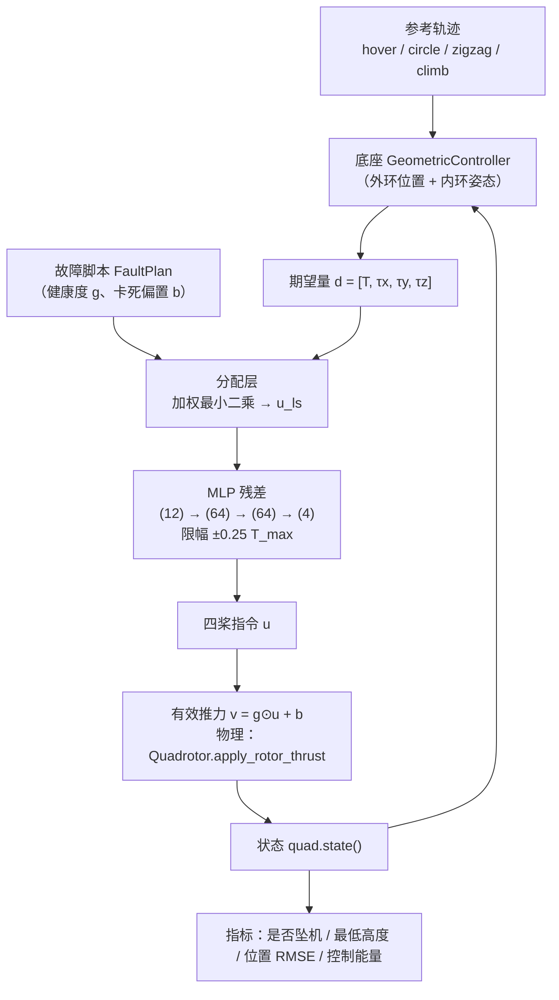
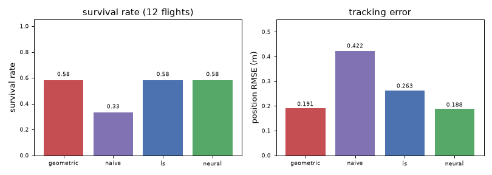
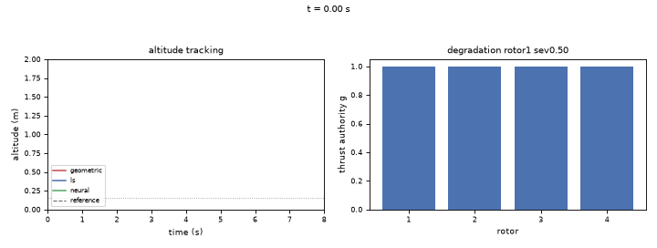
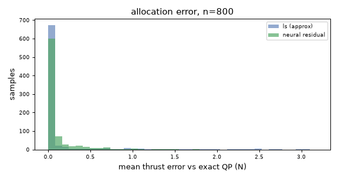

# 无人机桨故障下的神经容错控制

本模块在 [MuJoCo 四旋翼仿真与 ROS2 桥接底座](uav_mujoco_sim.md) 上做"桨坏了还能不能飞"的闭环控制：
底座控制器算出期望合推力与力矩，本模块负责把它**按故障后的可用推力重新分配到四个桨**，再用一个很小的
网络修正分配误差。

它对应课程任务的**任务②**（给定轨迹的控制）中的控制部分；同时为任务③的导航与任务④的端到端策略
提供"故障下仍能执行指令"的执行层。本模块是"神经容错飞行"系列的第三个：

| 模块 | 角色 |
| --- | --- |
| [无人机执行器故障注入与控制退化观测](uav_actuator_fault_sim.md) | 把故障注入进仿真，产出带故障的飞行与统一指标 |
| [无人机桨故障健康度估计（1D-CNN+GRU）](uav_rotor_fault_detector_nn.md) | 从机载 IMU 与控制器指令估计四桨还剩多少推力权限 |
| **本模块** | **拿到健康度之后，怎么分配推力、怎么控住姿态与轨迹** |

!!! note "为什么这一层必须存在"

    底座的几何控制器把期望合推力 `T` 与力矩 `τ` 用**固定**的逆混控摊到四个桨上。四桨健康时这是对的；
    一旦某个桨退化 50%，同一个摊法会让它只出得到一半推力，合力与力矩同时偏掉——实测单桨衰减 50%
    时高度停在 1.377 m 回不去；若再用"把丢掉的推力均摊给其余桨"的朴素补偿，3.17 s 就坠机。
    所以故障下的关键不是"改控制器"，而是**在分配层把约束与优先级重新算一遍**。

## 1. 问题：故障后到底难在哪

四旋翼的四个桨只提供四个合力量（`T, τx, τy, τz`），正常情况下这四个量都可以独立满足。
少一个桨以后，期望量之间出现约束。以单桨完全失效为例，剩下三个桨必须同时满足合推力与两个水平力矩，
**解唯一**——悬停处恰好落在箱约束边界上（有效推力 `v = [0, 4.66, 4.66, 0]`），一点反馈余量都没有。
更麻烦的是偏航力矩会被迫变成 `τz = k_m(T − τx/a − τy/a) ≈ 0.14 N·m`，而这个底座没有气动偏航阻尼，
机身自转从 131 °/s 单调加速到 1111 °/s，最后姿态发散。

这就是 Mueller & D'Andrea (ICRA 2014) 的结论：**少一个桨就必须主动放弃偏航控制**，让机身自转，
靠自转的反扭矩平衡偏航力矩。本模块把这个结论落成"按可控桨数切换优先级权重"。

## 2. 系统结构



整个模块只做三件事：**算效率矩阵**、**解带箱约束的分配**、**用网络补残差**。动力学、场景、控制器外环
全部复用底座，一行都不改。

## 3. 方法

### 3.1 控制效率矩阵

从底座 `mixer` 反推出四桨推力到合力量的线性映射。实测矩阵（`mass 0.95 kg`、`arm 0.106 m`、
`k_m 0.015`、`T_max 6.0 N`、悬停单桨 2.33 N）：

$$
\mathbf B =
\begin{bmatrix}
1 & 1 & 1 & 1 \\
-a & a & a & -a \\
-a & a & -a & a \\
-k_m & -k_m & k_m & k_m
\end{bmatrix},
\qquad
\begin{bmatrix} T \\ \tau_x \\ \tau_y \\ \tau_z \end{bmatrix}
= \mathbf B \begin{bmatrix} u_1 \\ u_2 \\ u_3 \\ u_4 \end{bmatrix}
$$

其中 $a = 0.106$、$k_m = 0.015$。`build_effectiveness()` 用 `mixer` 在悬停附近做差分实测，
所以换机体 XML 时矩阵自动跟着变，不需要手改。

### 3.2 加权最小二乘分配

记健康度 $\Lambda = \operatorname{diag}(g_1,\dots,g_4)$，则有效推力是 $v = \Lambda u + b$。分配问题写成

$$
\min_{u}\ \big\| \mathbf W^{1/2}(\mathbf B \Lambda u - d)\big\|_2^2 + \lambda \| \Lambda u\|_2^2
\quad \text{s.t.}\quad 0 \le u_i \le T_{\max}
$$

$\mathbf W$ 是四个期望量的优先级权重，$\lambda$ 是很小的正则项（让解在零空间里偏向省能量）。

!!! warning "两个踩过的坑"

    1. **包约束必须写在"有效推力"空间**。最初把指令裁到 $g_i T_{\max}$，结果衰减到 40% 的桨
       只能被指令到 2.4 N——错的。物理上它的指令空间仍是 $[0, T_{\max}]$，只是有效推力只有 $g_i$ 倍。
       正确的箱约束是 $0 \le v_i \le g_i T_{\max}$ 再反解 $u_i = (v_i - b_i)/g_i$。
    2. **上界写成 $T_{\max}$ 会让精确解比近似解更差**。自检里发现：`gains=[0.7, 0.5, 0, 0.7]` 时
       坐标 1 的可行上界只有 3.0 N，精确枚举却允许到 6.0 N，于是它给出的解目标函数反而更高。
       修正后自检的"精确解不劣于最小二乘解"才成立。

### 3.3 按可控桨数切换优先级

$$
\mathbf W = \begin{cases}
\operatorname{diag}(20, 1, 1, 1), & \text{四个桨都可用} \\
\operatorname{diag}(20, 10, 10, 0), & \text{有桨彻底失效（主动放弃偏航）}
\end{cases}
$$

放弃偏航不是偷懒：单桨失效时四个期望量已经互相约束，硬保偏航会让力矩互相抢预算，
姿态先崩、高度跟着丢；放弃偏航至少能把姿态与高度稳住（代价是机身慢慢自转）。

### 3.4 神经残差

加权最小二乘忽略了箱约束（解出来可能贴边甚至越界后再 clip），精确解要枚举有效集才能得到。
让网络学"精确解 − 近似解"这个残差：

$$
\hat u = u_{ls} + T_{\max}\cdot\operatorname{clip}\big(f_\theta(x),\ -\rho,\ \rho\big),
\qquad \rho = 0.25
$$

- $x \in \mathbb{R}^{12}$：期望量（归一化）、四桨健康度、近似解（归一化）
- $f_\theta$：`(12) → (64) → Tanh → (64) → Tanh → (4)`，**5252 个参数**
- **输出层零初始化**：未训练时残差恒为 0，等价于近似分配，部署上不可能比基线差
- **限幅 $\rho$**：网络在训练分布之外可能给出很大修正，贴着箱约束边界会把反馈余量吃光
  （实测"单桨卡死"工况曾因为不限幅在 6.75 s 坠机）

## 4. 数据与训练

- 数据由底座自动生成：80 次飞行、11979 个训练样本、40 次坠机，10 组"故障 × 轨迹"组合
  （含随机抖动 ±0.3 s 的注入时刻），每次飞行 8 s、每 4 步采一个样本。
- 标签是**精确枚举 QP 解** $u^*$（4 个变量、每个只有贴下界/自由/贴上界三种状态，最多 $3^4 = 81$ 种组合，
  比迭代求解稳定、不会落到不同局部解）。
- 训练：AdamW，lr `1e-3`、weight decay `1e-4`，`ReduceLROnPlateau(factor=0.5, patience=2)`，
  梯度裁剪 5.0，按验证 MAE 早停（patience 8）。**最佳 epoch 39，验证 MAE 0.0324，测试 MAE 0.0214，
  训练耗时 1.2 s（纯 CPU）**。
- 数据集**按飞行批次切分**而不是按样本随机切：同一条飞行里相邻样本几乎一样，按样本切会让测试集与
  训练集共享轨迹、指标虚高。

## 5. 源码解析

### 5.1 分配：`allocation.py`

```python
def ls_allocation(B, desired, params, gains, v_ref=None, row_weights=None,
                  ref_weight=REF_WEIGHT, bias=None):
    d_eff, bf, s, h, free, fixed_v, t_max, v_ref_f, upper = _split_problem(
        B, desired, params, gains, bias, v_ref, row_weights, ref_weight)

    rhs = bf.T @ s @ d_eff
    if v_ref_f is not None:
        rhs = rhs + ref_weight * v_ref_f
    v_free = np.linalg.solve(h, rhs) if free.any() else np.zeros(0)
    if free.any():
        v_free = np.clip(v_free, 0.0, upper[free])      # 有效推力的上界是 g_i·T_max

    v = fixed_v.copy()
    v[free] = v_free
    return command_from_effective(v, params, gains, bias)
```

`_split_problem()` 把"可控桨（未知量）"与"失效桨（固定量 `v_i = b_i`）"拆开，这样失效桨直接进
常数项、不占矩阵秩；`command_from_effective()` 再反解回指令 $u_i = (v_i - b_i)/g_i$。

### 5.2 控制：`controller.py`

```python
def act(self, quad, p_d, v_d, a_d, yaw_d):
    T, tau = self.base.compute(quad.state(), p_d, v_d, a_d, yaw_d)
    return self.allocate(np.array([T, *tau]))
```

与底座控制器同签名，所以评测与 ROS 节点里可以直接替换。`allocate()` 按 `mode` 分支：
`geometric`（原样逆混控，基线）、`naive`（丢的推力均摊）、`ls`（加权分配）、`neural`（加权分配 + 残差）。

### 5.3 故障脚本：`faults.py`

六种工况统一成"增益 + 偏置"：有效推力 $v_i = g_i(t)u_i + b_i(t)$。
`healthy / loss / degradation / stuck / dual_loss / progressive`，各自有过渡时间 `ramp`，
`progressive` 的 `severity` 语义是**每秒衰减量**（1/s），不是最终增益。

### 5.4 指标：`evaluate.py`

| 指标 | 定义 |
| --- | --- |
| 是否坠机 | 高度 $z < 0.15$ m |
| 坠机时刻 | 触地那一拍的时间 |
| 最低高度 | 全程 $z$ 的最小值，衡量"掉得多深" |
| 位置 RMSE | $\sqrt{\frac1N\sum_k \|p_k - p_k^{d}\|^2}$，衡量跟踪质量 |
| 控制能量 | $\sum_k \sum_i u_{k,i}^2$，衡量代价 |

## 6. 运行步骤

### 6.1 安装依赖

```bash
pip install torch --index-url https://download.pytorch.org/whl/cpu
pip install numpy 'mujoco>=3.0' matplotlib pillow
```

### 6.2 不用 ROS 直接跑

```bash
python main.py --selftest          # 27 项自检
python -m pytest test -q           # 45 个用例
python main.py --eval             # 四种模式 × 六工况
python main.py --demo results/fault_response.gif
```

只有权重、没有数据集时，`--eval` 与 `--demo` 也能直接跑（权重已入库，26 KB）。
想从头复现训练：

```bash
python main.py --gen-data results/allocator_dataset.npz --episodes 80
python main.py --train --threads 8
```

### 6.3 ROS2 Humble 启动

```bash
colcon build --packages-select uav_mujoco_sim uav_neural_fault_tolerant_control
ros2 launch uav_neural_fault_tolerant_control control.launch.py
```

参数分两层：`config/control.yaml` 是默认值真源（顶部键用通配 `/**`，写死节点名会静默失效），
launch 只覆盖场景/故障/时长。权重查找顺序是 cwd → 包目录 → `share/<pkg>/results`，
所以从任意目录启动都能找到。节点到 `duration` 自动退出。

| 话题 | 方向 | 类型 |
| --- | --- | --- |
| `/uav/odom` | 发布 | `nav_msgs/Odometry` |
| `/uav/status` | 发布 | `std_msgs/String`（`HOVER`/`FAULT`/`CRASHED`/`DONE`） |
| `/uav/health` | 发布 | `std_msgs/Float32MultiArray` |
| `/uav/rotor_cmd` | 发布 | `std_msgs/Float32MultiArray` |
| `/uav/fault` | 发布 | `std_msgs/String` |
| `/uav/goal` | 订阅 | `geometry_msgs/Point` |
| `/uav/cmd_vel` | 订阅 | `geometry_msgs/Twist` |

## 7. 结果



12 次飞行 = 6 工况（健康 / 衰减 50% / 衰减 70% / 卡死 / 单桨失效 / 双桨失效）× 2 条轨迹
（hover、zigzag），seed 0，每次 8 s：

| 模式 | 生存率 | 平均最低高度 m | 平均末端高度 m | 平均位置 RMSE m | 平均控制能量 |
| --- | --- | --- | --- | --- | --- |
| `geometric`（底座原样） | 0.583 | 0.873 | 0.900 | 0.191 | 21.7 |
| `naive`（丢的推力均摊） | 0.333 | 0.565 | 0.583 | 0.422 | 22.2 |
| `ls`（加权分配） | 0.583 | 0.894 | 0.922 | 0.263 | 25.5 |
| **`neural`（加权分配 + 残差）** | **0.583** | **0.906** | **0.935** | **0.188** | **23.7** |



三个结论：

1. **朴素补偿是最差的**。它不区分"衰减 50%"与"彻底失效"，还破坏了力矩平衡：生存率 0.333、
   位置误差 0.422 m。这正是很多"看起来能飞"的实现栽在哪里的地方。
2. **加权分配把生存率拉回基线水平**（0.583），代价是它主动放弃偏航、跟踪误差反而变大（0.263）。
3. **神经残差在同等生存率下把跟踪误差降到 0.188 m（相对加权分配降 29%）**，控制能量也更低
   （23.7 对 25.5）——因为它学的是"精确 QP 解与近似解之间的差"，把箱约束边界附近的分配误差吃掉了。



分配精度：600 个样本上，加权分配相对精确 QP 解的单桨指令平均误差 **0.113 N**，加上网络残差后
残差项自身的平均误差 **0.0189**；网络单步推理约 **1 μs**，完全跟得上 50 Hz 控制回路。

### 超出容错边界的情况

单桨完全失效与双桨失效，四种模式全部坠机（2.75–4.07 s）。这不是实现不够好：

- 单桨失效时三桨必须同时满足合推力与两个水平力矩，**解唯一、没有反馈余量**，而且偏航力矩被强制
  非零、底座没有气动偏航阻尼，机身自转单调加速到 1111 °/s，姿态必然发散；
- 双桨失效连姿态自由度都不够。

本模块在这个工况下的价值只是"把已知会坠的那段时间撑得久一点、跟踪误差更小"
（单桨失效时 `neural` 的 RMSE 0.605 对加权分配的 1.053）。真实系统里对应的是"用剩余时间触发迫降"，
这是后续 `uav_fault_emergency_landing` 要接的活。

## 8. 局限与后续

1. 健康度用的是**仿真真值**。接 `uav_rotor_fault_detector_nn` 的估计值会引入误差（该模块单桨失效
   召回 0.929、检测延时 0.10 s），闭环影响还没测。
2. 只做了单机悬停与简单轨迹，没有风场、没有载荷变化（底座文档明说不含风场）。
3. `stuck` 的卡死推力按悬停比例给，真实的卡死可能是任意占空比。
4. 残差网络是离线监督学习，没有在线自适应；换成在线微调或强化学习是自然的下一步。

## 9. 参考

1. T. Lee, M. Leok, N. H. McClamroch. *Geometric tracking control of a quadrotor UAV on SE(3)*. CDC 2010.
2. M. W. Mueller, R. D'Andrea. *Stability and control of a quadrocopter despite the complete loss of one,
   two, or three propellers*. ICRA 2014.
3. D. Malyuta et al. *Control allocation for fault-tolerant quadrotor flight*. 相关控制分配综述。
