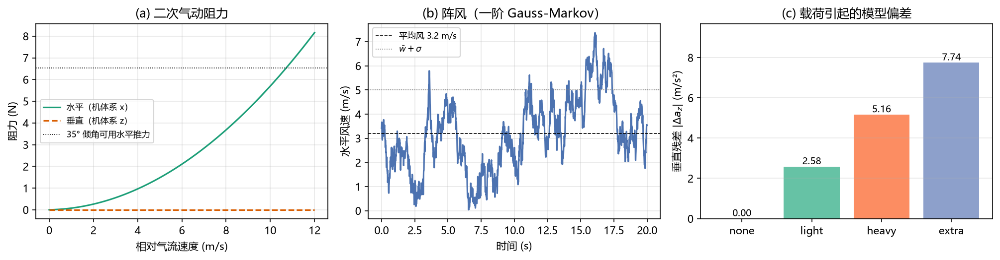
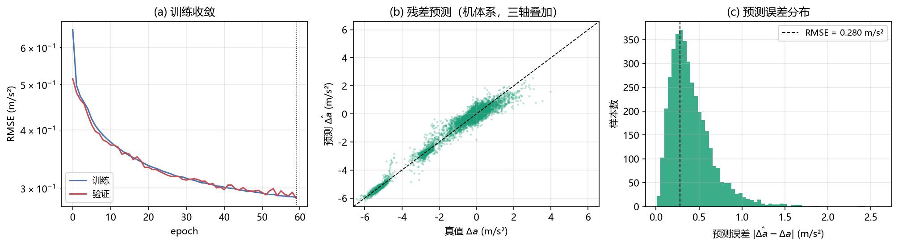
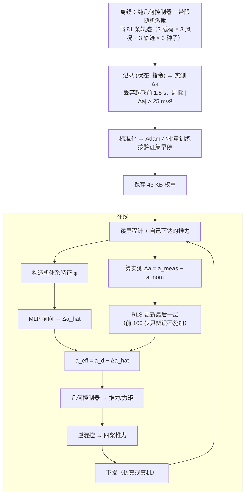
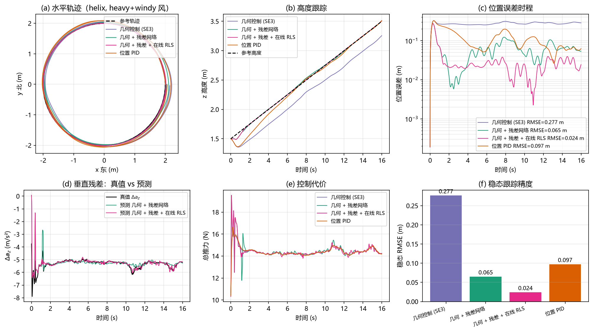
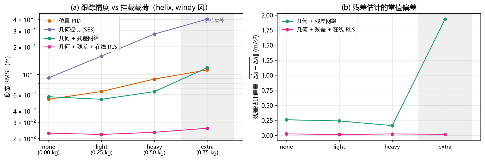
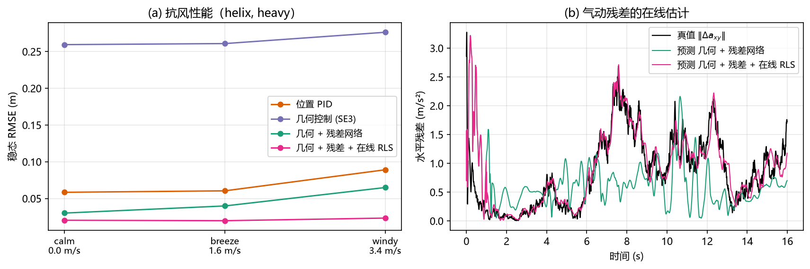
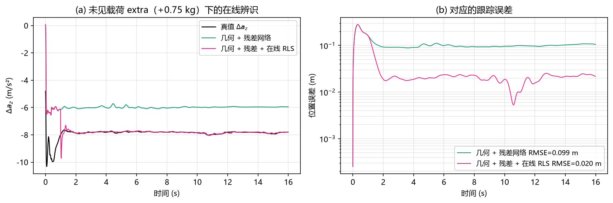
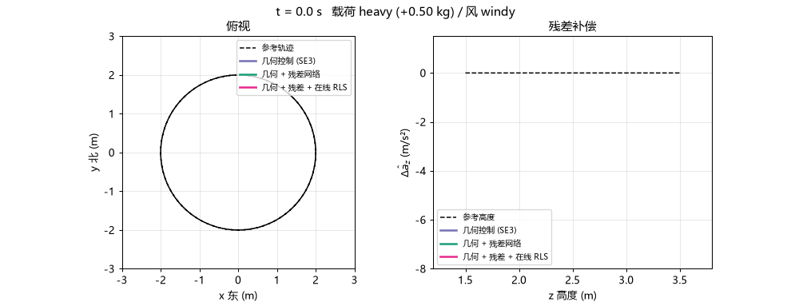
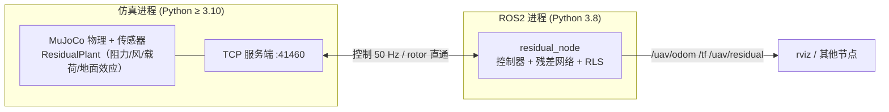

# 神经残差动力学与学习式轨迹跟踪

!!! note "模块定位"
    本模块建立在前一模块 [MuJoCo 四旋翼仿真与 ROS2 桥接底座](uav_mujoco_sim.md)
    之上，对应作业任务（1）**运动控制**与任务（4）**端到端神经网络**。
    代码位于仓库的 `src/air/uav_neural_residual_control/`。

传统控制器假设"模型已知"——被控对象的动力学方程写在纸上，控制器按方程反解控制量。
真实的四旋翼上这个假设不成立：气动阻力、阵风、挂载载荷、地面效应都不在方程里。
**反馈**能压住一部分，但要消耗稳定裕度，而且对时变扰动束手无策。

本模块换一条路：用一个小型前馈网络**学习模型误差本身**，把补偿量做成前馈。
网络只学"标称模型与真实动力学差多少"，不学整个动力学，因此样本需求小、
外推行为可控；再叠一层递推最小二乘在线重写最后一层，把泛化误差变成辨识误差。

```text
              ┌─────────────── 离线训练 ────────────────┐
   状态 x ──▶ │ 特征 φ(x) ──▶ MLP(14→64→64→3) ──▶ Δa_hat │──┐
              └────────────────────────────────────────┘  │
                                                          ▼ 前馈补偿
              ┌─────────────── 在线自适应 ──────────────┐  │
   实测 Δa ──▶│ RLS（只更新最后一层，65×3）─────────────│──┘
              └────────────────────────────────────────┘
                                    ▼
   几何控制器：  f_des = m·(a_d − Δa_hat + Kp e_p + Kd e_v + g e_z)
```

**一句话结论**：在 4 种载荷 × 3 种风况 × 3 条轨迹 × 4 个控制器、共 432 次
闭环运行的对比实验中，几何控制器的稳态误差严格等于模型偏差除以增益
（挂 0.5 kg 时 0.279 m）；加上离线残差网络后降到 0.075 m；再加上在线自适应，
**连训练集里从未出现过的 +0.75 kg 载荷也能压到 0.026 m**，与标称工况持平，
且 432 次运行无一发散。

---

## 1. 与已有模块的区别

课程仓库中已有的无人机运动控制模块：

| 已有 | 它是什么 | 本模块不同在哪 |
|---|---|---|
| `uav_keyboard_control` | 键盘 → 速度指令 → 位置环 | 位置环直接作用于**已知**模型，不估计模型误差 |
| `allocnet_teleop` | 神经网络做控制分配 | 分配矩阵是已知的，网络只解决**执行器**层面的分配 |
| `uav_ppo_nav` | 端到端强化学习导航 | 奖励函数里的避障，没有显式动力学模型，不保证跟踪精度 |
| `uav_mujoco_sim`（本项目的底座） | 仿真与桥接 | 提供 `/uav/odom` 等话题与几何控制器，不含任何学习成分 |

**"学模型误差、而不是学控制器"** 这件事在课程内是空白。它与强化学习路线正交：
残差网络输出的物理量（m/s²）可以叠在任何一个现有控制器上。

---

## 2. 问题定义

### 2.1 标称模型与残差

控制器所使用的**标称模型**（世界系 ENU，$R$ 为机体→世界旋转）：

$$
a_{\text{nom}} = \frac{T}{m_{\text{nom}}}\,R\,e_z + g_{\text{vec}},
\qquad
a_{\text{true}} = \frac{\Delta v}{\Delta t}\Big|_{\text{里程计}}
$$

**残差加速度**定义为两者之差：

$$
\Delta a \;\triangleq\; a_{\text{true}} - a_{\text{nom}}
\;=\; \underbrace{\Delta a_{\text{drag}}}_{\text{气动}}
  + \underbrace{\Delta a_{\text{wind}}}_{\text{风}}
  + \underbrace{\Delta a_{\text{payload}}}_{\text{载荷}}
  + \underbrace{\Delta a_{\text{ground}}}_{\text{地面效应}}
$$

它全部由可观测量算出：$a_{\text{true}}$ 由里程计速度差分得到，
$a_{\text{nom}}$ 由下达的推力与姿态算出。**不需要知道真值质量、真值阻力系数**
——这正是它作为在线学习标签的合法性所在。

### 2.2 为什么在机体系里学

阻力在机体系里是速度的固定函数（各向异性但姿态无关），载荷偏置也随机体一起转。
把目标量表成机体系 $\Delta a_b = R^{\mathsf T}\Delta a$、输入特征也全用机体系量，
网络学到的是"速度 → 力"这一**与姿态解耦**的映射：

$$
f_{\theta}: \big(v_b,\; a^{\text{cmd}}_b,\; \omega_b,\; z,\; T/m\big) \;\longmapsto\; \widehat{\Delta a_b}
$$

同一份权重因此能覆盖任意姿态，样本效率提高一个量级。

### 2.3 前馈补偿为什么不消耗裕度

几何控制器的期望推力为

$$
f_{\text{des}} = m_{\text{nom}}\big(a_d + K_p e_p + K_d e_v + g e_z\big)
$$

标称模型对加速度是**线性**的，因此把网络预测的 $\widehat{\Delta a}$ 直接从 $a_d$ 里减掉，
等价于换了一个更准的模型：

$$
f_{\text{des}} = m_{\text{nom}}\Big(a_d - \widehat{\Delta a} + K_p e_p + K_d e_v + g e_z\Big)
$$

**控制器内部一行都不用动。** 误差只剩网络的预测残差
$\Delta a - \widehat{\Delta a}$，反馈只需要处理这一小截，稳定裕度基本不受影响。

### 2.4 常值扰动的下界：为什么反馈不够

几何控制器没有积分项，稳态误差满足

$$
|e_p| = \frac{|\Delta a|}{|K_p|}
$$

实测与解析的对照（定点悬停、$K_{p,z}=-20$）：

| 载荷 | 解析 $|\Delta a_z|$ | 解析静差 | 实测静差 |
|---|---|---|---|
| 无 | 0 | 0 | 0.000 m |
| +0.25 kg | 2.58 m/s² | 0.129 m | 0.129 m |
| +0.50 kg | 5.16 m/s² | 0.258 m | 0.259 m |
| +0.75 kg | 7.74 m/s² | 0.387 m | 0.390 m |

这个静差与扰动**同量级**、无法靠调增益消掉（增益翻倍会把控制回路推到 100 Hz
采样下的稳定边界外）。位置 PID 可以靠积分消掉它，代价是把阵风的低频分量
也当成"需要消除的偏差"持续追风，吃掉抗扰动的相位裕度。前馈补偿两者都不需要。

---

## 3. 未建模效应的物理建模

四类效应都在 `core/disturbances.py` 里，量级按实物标定。

### 3.1 气动阻力

机体系各向异性二次阻力（四旋翼是扁的，垂直迎风面积远大于水平）：

$$
F_b = -\Big(k_h\,|v_{b,xy}|\begin{bmatrix}v_x\\v_y\\0\end{bmatrix}
        + k_v\,|v_z|\begin{bmatrix}0\\0\\v_z\end{bmatrix}
        + c\,v_b\Big),
\qquad k_h = 0.055,\; k_v = 0.090,\; c = 0.020
$$

系数按"10 m/s 时阻力约占重力 60%（对应约 33° 前倾）"标定，与实物量级一致。
若随手取"每 m/s² 几牛"，10 m/s 下阻力会超过推力上限，轨迹直接发散。

### 3.2 阵风

平均风 + 一阶 Gauss-Markov（OU 过程，时域上与 Dryden 谱等价）：

$$
w_{k+1} = a\,w_k + \sigma\sqrt{1-a^2}\;\xi_k,
\qquad a = e^{-\Delta t/\tau},\;\; \xi_k\sim\mathcal N(0,I)
$$

这个离散化是 OU 过程的**精确解**而不是欧拉近似，任意步长下稳态方差都严格等于
$\sigma^2$。默认 $\tau = 1.5$ s，垂直分量按 0.5 缩小。风通过**相对气流速度**
$v_b - R^{\mathsf T}w$ 进入阻力，因此是一个真实的物理扰动而不是外加的力。

### 3.3 挂载载荷

在机体下方以 XML 后处理的方式挂一个集中质量刚体。**不用**直接改
`model.body_mass`：那样会绕开 MuJoCo 的惯量重算（`mj_setConst`），
质量与转动惯量静默不一致——看着能跑，姿态响应完全不对。

载荷同时改变真值质量与转动惯量，是**常值**残差的主要来源。

### 3.4 地面效应

近地时同一转速产生更大推力：

$$
\eta(z) = \eta_0\,e^{-z/h_0}, \qquad \eta_0 = 0.12,\; h_0 = 0.25\ \text{m}
$$

它依赖**高度而非速度**，是检验网络是否真的学到状态依赖、而不是退化成
"学一个常值偏置"的关键项。



*图 1：(a) 阻力随相对气流速度的二次增长，以及 35° 倾角能提供的水平推力上限；
(b) 阵风的一阶 Gauss-Markov 时程；(c) 各载荷档位对应的垂直残差量级。*

---

## 4. 残差网络

### 4.1 特征设计：把物理规律喂进去

14 维输入，全部取机体系量：

$$
\varphi = \big[\underbrace{v_b}_{3},\;
              \underbrace{v_x|v_{xy}|,\;v_y|v_{xy}|,\;v_z|v_z|}_{3\ \text{二次阻力基}},\;
              \underbrace{a^{\text{cmd}}_b}_{3},\;
              \underbrace{\omega_b}_{3},\;
              \underbrace{z}_{1},\;
              \underbrace{T/m}_{1}\big]
$$

中间三项是**二次阻力基**：气动阻力本就正比于 $v|v|$，把这一项显式喂进去，
网络不必从零拟合平方关系。

高度 $z$ 与归一化推力 $T/m$ 是为地面效应与载荷准备的：悬停时
$T/m_{\text{nom}} = g\,m_{\text{true}}/m_{\text{nom}}$，因此它**唯一地**编码了载荷档位，
网络可以把常值载荷偏差学成一个精确的线性项。

### 4.2 结构

| 项 | 取值 | 说明 |
|---|---|---|
| 结构 | 14 → 64 → 64 → 3 | 5,315 个参数，43 KB |
| 隐层激活 | tanh | 输出层线性 |
| 初始化 | Glorot；**输出层全零** | 未训练时残差恒为 0，控制器退化为纯几何控制器 |
| 输出缩放 | ×2.0 m/s² | 让归一化后的目标落在 O(1) |
| 输出限幅 | ±10 m/s² | 见下 |

**输出层零初始化**不是可有可无：网络在训练前若给出随机残差，闭环会被直接掀翻，
连数据都采不到（`--selftest` 里有一项专门验证这一点）。

**输出限幅**的取值有个坑：限幅必须**大于训练目标本身的量级**。+0.5 kg 载荷
对应的垂直残差就有 5.16 m/s²，早期把限幅设成 3.0，训练集 RMSE 卡在
0.82 m/s² 再也降不下去——网络连训练集都拟合不了。取 10 m/s²（约 1 g，
标称悬停推力的 2/3）既覆盖全部档位又留了安全边界。

### 4.3 手写反向传播

不引 PyTorch 有三个理由：仿真侧（Python ≥3.10）与 ROS 侧（Humble 的
Python 3.8）都要能 import，纯 numpy 省掉一个 700 MB 依赖；这个规模下
torch 并不更快（9 万样本 60 轮实测 12 s）；ROS 节点不需要额外安装任何东西。

反向传播按链式法则手写，`--selftest` 用中心差分逐点校验，
相对误差 $< 10^{-5}$（实测 $2\times10^{-8}$）。

!!! warning "一个真金白银换来的坑"
    MSE 的梯度必须除以**元素总数** $N\times 3$，而不是样本数 $N$——
    `np.mean` 摊的是全部元素。只除 $N$ 会让梯度整体大 3 倍。
    Adam 对梯度整体缩放不敏感（所以这个 bug 训练时完全看不出来），
    但换成 SGD 或调学习率就会对不上。



*图 2：(a) 训练/验证收敛曲线；(b) 残差预测的散点（机体系，三轴叠加）；
(c) 预测误差分布。*

---

## 5. 在线自适应：最后一层的递推最小二乘

离线网络只见过 `none / light / heavy` 三档载荷，遇到没见过的档位只能靠泛化。
**在线自适应**用飞行中实测的 $\Delta a$ 直接修正网络：

$$
\theta_k = \theta_{k-1} + K_k\big(y_k - \varphi_k^{\mathsf T}\theta_{k-1}\big),
\qquad
K_k = \frac{P_{k-1}\varphi_k}{\lambda + \varphi_k^{\mathsf T}P_{k-1}\varphi_k}
$$

$$
P_k = \frac{1}{\lambda}\Big(P_{k-1} - K_k\varphi_k^{\mathsf T}P_{k-1}\Big)
$$

**只更新最后一层**（65 × 3 = 195 个参数），前面几层冻结。理由是在线数据
时序强相关（一条轨迹上的速度不可能跳变），对整个网络做梯度更新会沿相关方向
把隐层冲垮；而最后一层是线性回归，RLS 对相关数据的收敛性有闭式保证，
单步只要 $O(h^2)$（$h=65$，实测 6 µs，100 Hz 下占用 < 0.1% CPU）。

### 5.1 三个必须做的防护

RLS 在这类问题上**天然不稳**，三个防护缺一不可：

**（1）先验协方差 $\delta$ —— 最关键的一个。**
$\theta$ 的初值取离线网络的最后一层，$P_0 = \delta I$ 表示对它的置信度。
$\delta$ 取 $10^3$ 相当于认为离线解完全不可信，第一次更新就按
$K \approx \varphi/\varphi^{\mathsf T}\varphi$ 把 $\theta$ **精确拟合到单个样本上**。
定点悬停（回归向量几乎不变、零空间维度极高）时实测 RMSE 0.14 ~ 0.25 m，
比不用 RLS 还差；$\delta$ 取 $10^2$ 后同一组工况降到 0.019 ~ 0.027 m。

**（2）空转期。** 先跑 100 步"只辨识、不施加"，等 $\theta$ 在真实数据上收敛
再接管最后一层。起飞段恰好是最大最脏的一个样本，直接施加会当场翻机
（实测 +0.75 kg 档 RMSE 4.2 m）。

**（3）协方差上限。** 回归向量长期只占一个方向时（定点悬停），$P$ 会在零空间里
按 $1/\lambda$ 指数增长，等阵风把 $\varphi$ 转到新方向时增益突然变大。
超限时**按比例缩放**协方差而不是重置成初值——重置等价于声称"$\hat\theta$ 一无所知"，
下一次更新照样跳，没有意义。

!!! warning "另一个真金白银换来的坑"
    RLS 是**原地改写**最后一层的。如果直接把外部传入的网络对象交给跟踪器，
    后面每一次运行都会从上一轮被改写过的权重出发。实测同一份模型连跑 9 个工况，
    RMSE 出现 4.52 m 的乱跳，而单独跑同一工况只有 0.02 m——全部是权重被
    前一轮污染导致的。跟踪器里必须深拷贝。

---

## 6. 算法流程



**采集为什么要加激励？** 沿参考轨迹飞时状态几乎落在一条一维流形上，
网络在这个流形外没有任何约束（实测：无激励时训练集 RMSE 0.03 m/s²，
但换一条轨迹立刻退化到 0.44 m/s²）。叠加一阶低通的带限随机加速度
（$\sigma = 1.2$ m/s²，$\tau = 0.45$ s）把状态铺开到整个包线——
用带限而不是全带白噪声，是因为全带信号会被姿态环滤掉，只留下推力抖动，
状态反而铺不开。

**采集为什么必须用纯几何控制器？** 只有控制器按照标称模型行动，
实测加速度与标称预测之差才是纯粹的模型误差。用带残差的控制器采集，
网络学到的是"自己上一步的修正"，会自洽地收敛到一个错误模型。

---

## 7. 四个控制器

四者**共用同一套内环**（姿态几何 PD、逆混控、限倾角、饱和处理），
只差在期望加速度 $a_{\text{cmd}}$ 怎么算。实现上把底座的几何控制器
$K_p, K_d$ 置零，让它退化为"加速度 → 推力/力矩"的执行器。因此性能差异
可以完全归因于外环与残差补偿，不会混入实现差异。

| 名字 | 外环 | 抗常值扰动 | 抗时变扰动 |
|---|---|---|---|
| `pid` | 位置 PID（含条件积分抗饱和） | 积分消掉 | 积分把阵风低频分量也当偏差追 |
| `geo` | SE(3) 几何控制 + 轨迹前馈 | 静差 $= \Delta a / K_p$ | 反馈带宽内可压 |
| `geo_res` | 几何 + 离线残差网络前馈 | 前馈抵消 | 网络预测依赖状态，可泛化 |
| `geo_rls` | 几何 + 离线残差 + 在线 RLS | 在线辨识 | 在线辨识 |

### 7.1 姿态内环增益必须重新整定

底座的姿态增益是按 0.95 kg 空机整定的。挂到 +0.75 kg 时转动惯量涨约 1.6 倍，
姿态环阻尼比从 0.41 掉到 0.32，起步的 35° 倾角阶跃会过冲到 50° 以上，
进而触发翻机（实测倾角 177°）。

对 12 组 $(K_r, K_w)$ 缩放组合做了扫描，把角速率阻尼 $K_w$ 加倍
（$-0.10 \to -0.20$）后，**0.95 ~ 1.7 kg 全载荷域稳定**，且跟踪误差随载荷单调。

!!! warning "偏航力矩受混控预算约束"
    合推力 $T$ 下可用的偏航力矩上限是 $k_m\min(4T_{\max}-T,\;T)$，
    标称档位悬停时只有 0.14 N·m。偏航误差超过约 13° 就会吃光混控预算，
    把滚转/俯仰的权限按比例压掉，无人机随即翻掉。因此**所有轨迹都从轨迹
    自身的初始偏航起飞**；从偏航误差 90° 的地方起飞实测倾角 177°、
    残差数据里出现 207 m/s² 的废样本。

---

## 8. 实验设计

| 维度 | 取值 |
|---|---|
| 控制器 | `pid` / `geo` / `geo_res` / `geo_rls` |
| 载荷 | 无 / +0.25 kg / +0.50 kg / **+0.75 kg（训练集外）** |
| 风况 | 无风 / 1.5 m/s + σ0.9 / 3.2 m/s + σ1.8 |
| 轨迹 | 定点悬停 / 螺旋爬升 / 水平八字 |
| 种子 | 3 条独立风实现（OU 过程不同随机实现） |

共 4 × 4 × 3 × 3 × 3 = **432 次闭环节运行**，全部从轨迹自身的初始位姿起飞，
稳态指标只统计第 3 s 之后（剔除起飞暂态）。

`+0.75 kg` 刻意**不进训练集**，用来把两种能力分开：

* `geo_res` 只能靠**泛化**（网络见过 heavy，外推到 extra）
* `geo_rls` 可以**在线辨识**（几秒内直接测出来）

轨迹参数：

| 轨迹 | 参数 | 难点 |
|---|---|---|
| 悬停 | (0, 0, 1.5) 定高 | 最严苛的稳态误差测试，没有前馈运动掩盖模型偏差 |
| 螺旋 | r = 2 m，z: 1.5→3.5 m，周期 8 s × 2 圈 | 垂直方向持续有速度，直接暴露推力标定误差 |
| 八字 | Gerono 双纽线 2.5 × 1.4 m，周期 12 s | 过原点时速度最大而曲率变号，大加速度 + 快速姿态反转 |

---

## 9. 结果与分析

### 9.1 主结果

稳态位置 RMSE（m），螺旋与八字两条轨迹 × 3 个种子的平均（每格 6 次，2 条轨迹 × 3 个种子）：

| 载荷 | 风况 | `pid` | `geo` | `geo_res` | `geo_rls` |
|---|---|---|---|---|---|
| 无 | 无风 | 0.0164 | **0.0098** | 0.0305 | 0.0187 |
| 无 | 1.5 m/s | 0.0268 | 0.0312 | 0.0280 | **0.0195** |
| 无 | 3.2 m/s | 0.0700 | 0.1039 | 0.0609 | **0.0235** |
| +0.25 kg | 无风 | 0.0319 | 0.1294 | 0.0435 | **0.0195** |
| +0.25 kg | 1.5 m/s | 0.0383 | 0.1323 | 0.0406 | **0.0194** |
| +0.25 kg | 3.2 m/s | 0.0790 | 0.1654 | 0.0610 | **0.0219** |
| +0.50 kg | 无风 | 0.0609 | 0.2598 | 0.0595 | **0.0202** |
| +0.50 kg | 1.5 m/s | 0.0644 | 0.2610 | 0.0603 | **0.0196** |
| +0.50 kg | 3.2 m/s | 0.0976 | 0.2794 | 0.0747 | **0.0232** |
| **+0.75 kg** | 无风 | 0.0916 | 0.3903 | 0.1248 | **0.0202** |
| **+0.75 kg** | 1.5 m/s | 0.0938 | 0.3909 | 0.1219 | **0.0197** |
| **+0.75 kg** | 3.2 m/s | 0.1216 | 0.4037 | 0.1295 | **0.0261** |

三条可直接读出的结论：

1. **几何控制器的误差严格由载荷决定**，与风况几乎无关（0.2598 / 0.2610 / 0.2794）。
   这正是式 $|e_p|=\Delta a/K_p$ 的预测：常值模型偏差直接映射成常值静差。
2. **残差网络把误差压到 1/4，但它不是免费的**：在"无载荷 + 无风"这一格上
   `geo_res` = 0.0305 m，比不用网络的 `geo`（0.0098 m）还差。原因很直接——
   网络自身的预测误差是 0.281 m/s²，除以 $K_p$ 就是 0.02~0.03 m，
   这就是它的误差下限；没有扰动可补时，这一项反而成了主要误差来源。
3. **在线自适应把整个表压平**：`geo_rls` 在 12 格里落在 0.0187 ~ 0.0261，
   跨度只有 0.007 m；训练集外的 +0.75 kg 档（0.0261 m）与标称档（0.0187 m）
   几乎相同。432 次运行里它的最差一次也只有 0.0305 m。

控制代价（总推力平方的时间积分）四者相差在 **2.5% 以内**——差别几乎全部来自
载荷本身，说明残差补偿没有引入额外的推力消耗。



*图 3：四个控制器在 `heavy + windy` 螺旋轨迹上的对照。(a) 水平轨迹；
(b) 高度跟踪；(c) 位置误差时程；(d) 垂直残差真值与预测；(e) 控制代价；
(f) 稳态精度对比。*

### 9.2 误差随载荷的变化



*图 4：(a) 跟踪精度随挂载载荷的变化，灰色区为训练集外的 `+0.75 kg`；
(b) 残差估计的常值偏差。*

螺旋 + 3.2 m/s 风这一条切片上：

| 载荷 | `pid` | `geo` | `geo_res` | `geo_rls` |
|---|---|---|---|---|
| 无 | 0.0536 | 0.0917 | 0.0572 | 0.0228 |
| +0.25 kg | 0.0651 | 0.1589 | 0.0535 | 0.0221 |
| +0.50 kg | 0.0863 | 0.2761 | 0.0648 | 0.0230 |
| **+0.75 kg** | 0.1121 | 0.4018 | 0.1184 | **0.0258** |

几何控制器的误差随载荷**严格线性**增长（0.0917 → 0.4018），斜率
0.55 m/kg 与解析值 $g/(m_{\text{nom}}K_{p,z}) = 0.516$ m/kg 一致
（差值来自阻力与风扰的贡献）。位置 PID 靠积分把常值偏置消掉，
但在训练集外仍留下 0.112 m——积分对**时变**的风扰没有前馈能力。

`geo_res` 在训练集内的三个档位上表现很好（0.053 ~ 0.065 m），
但**在训练集外明显退化**：+0.75 kg 档的残差估计留有 1.93 m/s² 的常值偏差，
跟踪误差随之涨到 0.118 m。网络对未见过的载荷只能线性外推。

`geo_rls` 的曲线在四个档位上**近乎水平**（0.0228 → 0.0258 m，跨度 0.003 m）。
残差估计偏差（右图）给出了机制：`geo_res` 的偏差从 0.26 m/s² 涨到
1.93 m/s²，而 `geo_rls` 在四个档位上始终是 **0.016 ~ 0.025 m/s²**——
在线辨识把"泛化"变成了"辨识"，载荷是多少，它几秒钟内就测出来了。

### 9.3 抗风性能



*图 5：(a) 三个风况档位下的稳态误差；(b) 气动残差的在线估计。*

挂 0.5 kg、螺旋轨迹，风况从无风扫到 3.2 m/s：

| 风况 | `pid` | `geo` | `geo_res` | `geo_rls` |
|---|---|---|---|---|
| 无风 | 0.0584 | 0.2594 | 0.0302 | 0.0204 |
| 1.5 m/s + σ0.9 | 0.0604 | 0.2609 | 0.0399 | 0.0198 |
| 3.2 m/s + σ1.8 | 0.0863 | 0.2761 | 0.0648 | 0.0230 |

几何控制器的误差几乎不随风速变化——它的误差由**常值载荷**主导，风只贡献
不到 7%。位置 PID 在弱风下靠积分压得很好（0.058），但风速上去后积分项
开始追风的低频分量，涨了 48%。

残差网络把风况相关的水平项（正比于相对气流速度的平方）作为**状态函数**
学了出来，无风时 0.030 m、3.2 m/s 时 0.065 m，涨幅被压到一倍以内；
在线层再把剩余的气动偏差也辨识掉，三个风档都稳定在 0.020 ~ 0.023 m。

### 9.4 在线自适应过程



*图 6：(a) 训练集外 +0.75 kg 载荷下，RLS 在前 1.5 秒内把残差估计从网络外推的
−6.0 拉到真值 −7.7 m/s² 并稳定跟随，而纯离线网络（绿）全程停在 −6.0；
(b) 对应的跟踪误差从 0.099 m 降到 0.020 m。
注意前 1 秒的尖峰：那时 RLS 还在空转期，尚未接管最后一层。*



*图 7：三个控制器同场飞行（俯视 + 残差补偿量）。*

---

## 10. ROS2 集成

### 10.1 拓扑

仿真侧（Python ≥3.10，MuJoCo 3.12）与 ROS 侧（Humble 的 Python 3.8）
**无法共存于同一个解释器**，因此沿用底座的分进程架构：



**控制律跑在 ROS 侧**，仿真侧以 `rotor` 直通模式工作、不跑自己的控制器。
因此本节点**替代**底座的 `bridge` 节点运行。

### 10.2 同一份代码，两侧共用

`Tracker` 只依赖 `state() / dt / nominal_params / last_acc / nominal_accel`
这几个方法。仿真侧由 `ResidualPlant` 提供，ROS 侧由 `RemotePlant` 提供——
后者**只吃里程计与自己下达的推力**，不知道真值质量、真值阻力，也不需要知道。

于是"仿真里调好的增益搬到 ROS 上行为一致"是**可验证**的，而不是靠人肉同步
两套实现。

同样地，底座把姿态数学、混控与几何控制器和 `Quadrotor` 放在同一个模块里，
而后者顶层 `import mujoco`；本模块把纯数学部分独立成 `core/attitude.py`，
ROS 侧可以独立导入。`--selftest` 里有一项把本包与底座的混控逐点比对，
最大偏差 0.00e+00，防止两边日后走偏。

### 10.3 话题

除底座已有的 `/uav/odom`、`/tf`、`/camera/*`、`/lidar/points`、`/uav/status` 外：

| 话题 | 类型 | 含义 |
|---|---|---|
| `/uav/reference` | `geometry_msgs/Point` | 当前参考位置 |
| `/uav/tracking_error` | `geometry_msgs/Vector3`（z 分量为范数） | 位置误差 |
| `/uav/residual` | `geometry_msgs/Vector3` | 网络预测的世界系残差加速度 |
| `/uav/disturbance` | `geometry_msgs/Vector3` | 真值残差加速度（仿真侧提供，用于对照） |
| `/uav/wind` | `geometry_msgs/Vector3` | 当前风速 |

运行时可通过 `/uav/trajectory`、`/uav/controller`、`/uav/reset` 切换轨迹、
切换控制器、复位仿真。

### 10.4 实测

在课程虚拟机里跑通（仿真与 ROS 节点同在虚拟机内），工况是**训练集外的
+0.75 kg 载荷 + 3.2 m/s 阵风**：

| 项 | 结果 |
|---|---|
| `colcon build` | 两个包装配通过 |
| 自检（VM 内 Python 3.12） | 34/34 |
| 话题频率（50 Hz 控制回路，TCP 往返） | `/uav/odom` 等 43.7 ~ 45.2 Hz |
| 位置误差（25 s，螺旋，三次独立运行） | 均值 0.030 ~ 0.036 m，最大 0.075 m |

进程内跑同一工况是 0.026 m，跨 TCP + Python 3.8 之后多出 4 ~ 10 mm——
主要来自 50 Hz（进程内是 100 Hz）的周期量化与往返延迟。
**"仿真里调好的控制器搬到 ROS 上行为一致"这句话因此是可验证的，而不是估计的。**

!!! warning "两个只有上真链路才会暴露的坑"
    **（1）必须复位到轨迹自身的起点。** 仿真默认把无人机放在场景原点，
    而螺旋轨迹从 $(2, 0, 1.5)$ 起、初始偏航 90°。直接开跑实测 1.6 s 内翻机
    （见 7.1 节的偏航预算分析），而且翻过来之后**无法自恢复**：
    推力方向朝下、混控输出被限成 0，无人机躺在地上一动不动。

    **（2）`observe()` 不能漏。** 残差网络的**输入**要用上一步下达的加速度、
    **标签**要用本步实测的加速度，二者之间隔着一次物理步进，所以调用顺序必须是
    `act → 步进 → observe → 下一次 act`。第一版节点只调了 `act`，
    结果状态里的 `delta_b` 恒为 `[0,0,0]`、在线自适应完全不起作用，
    误差停在 0.10 m（等于纯离线网络的水平）而不自知。

---

## 11. 源码解析

### 11.1 `core/disturbances.py` —— 未建模效应的物理

```python
@dataclass
class DragModel:
    k_h: float = 0.055      # 水平二次项 N/(m/s)²
    k_v: float = 0.090      # 垂直二次项 N/(m/s)²
    linear: float = 0.020   # 线性项 N/(m/s)，低速时主导

    def body_force(self, v_b):
        v = np.asarray(v_b, dtype=float)
        s_h = math.hypot(v[0], v[1])
        s_v = abs(v[2])
        f = np.array([self.k_h * s_h * v[0],
                      self.k_h * s_h * v[1],
                      self.k_v * s_v * v[2]])
        return -(f + self.linear * v)
```

阻力在机体系定义、由调用方旋到世界系；同一组系数对任意姿态成立。
OU 过程用精确离散化 $a = e^{-\Delta t/\tau}$、$s = \sigma\sqrt{1-a^2}$，
自检里用 20 万步验证稳态标准差严格等于设定值 $\sigma$（设定 1.80，实测 1.794）。

### 11.2 `core/plant.py` —— 不重写推进循环

```python
class ResidualPlant(Quadrotor):
    def apply_rotor_thrust(self, thrusts):
        """地面效应在此叠加：同一转速近地推力更大。"""
        t = np.asarray(thrusts, dtype=float)
        self._ground_scale = self.plant_cfg.ground_scale(float(self.qpos[2]))
        if self._ground_scale > 0.0:
            t = t * (1.0 + self._ground_scale)
        super().apply_rotor_thrust(t)

    def apply_wind(self):
        """按当前状态重算阻力并**赋值**到 xfrc_applied 的力分量。"""
        self.plant_cfg.wind.update(self.dt / self.substeps)
        R = quat_to_mat(self.qpos[3:7])
        F = self.plant_cfg.drag_force(self.qvel[0:3], R)
        self.data.xfrc_applied[self.body_id, 0:3] = F
```

只覆写两个**钩子**（`apply_rotor_thrust` / `apply_wind`），推力饱和、
自由关节读写、`mj_forward` 等逻辑仍走底座实现，两边不会走偏。

外力每个物理子步重算并**赋值**而不是累加：阻力依赖当前速度，子步之间速度会变；
累加则会在同一控制周期内翻 `substeps` 倍。

### 11.3 `core/residual.py` —— 特征与网络

```python
def build_features(v_b, a_cmd_b, omega_b, z, thrust, out=None):
    v = np.asarray(v_b, dtype=float)
    s_h = math.hypot(v[0], v[1])
    s_v = abs(v[2])
    f[0:3] = v
    f[3] = v[0] * s_h          # 二次阻力基
    f[4] = v[1] * s_h
    f[5] = v[2] * s_v
    f[6:9] = a_cmd_b
    f[9:12] = omega_b
    f[12] = z
    f[13] = thrust
    return f
```

反向传播按层手写：

```python
def backward(self, X, hs, dY):
    gW[-1] = hs[-1].T @ D
    gb[-1] = D.sum(axis=0)
    for i in range(len(self.W) - 2, -1, -1):
        D = (D @ self.W[i + 1].T) * (1.0 - hs[i] ** 2)   # tanh 导数
        prev = A if i == 0 else hs[i - 1]
        gW[i] = prev.T @ D
        gb[i] = D.sum(axis=0)
    return gW, gb
```

### 11.4 `core/controllers.py` —— 四个控制器只差两个钩子

```python
class Tracker:
    def act(self, t: float) -> np.ndarray:
        st = self.plant.state()
        pos_d, vel_d, acc_d, yaw_d, _ = self.traj.eval(t)
        self._R = quat_to_mat(st.quat)
        a_cmd = self.desired_accel(st, pos_d, vel_d, acc_d) + self.excitation
        r_w = self.residual_world(st, a_cmd)          # 基类返回 0
        T, tau = self.geo.compute(st, pos_d, vel_d, a_cmd - r_w, yaw_d)
        return mixer(T, tau, self.params)
```

`desired_accel` 与 `residual_world` 两个钩子决定了四个控制器的全部差异。
`ResidualTracker.residual_world` 做的是：

```python
    def residual_world(self, st, a_cmd):
        v_b = self._R.T @ st.vel
        a_b = self._R.T @ self.last_a_cmd      # 上一步的指令，避免循环依赖
        x = self.net.features(v_b, a_b, st.omega, float(st.pos[2]),
                              float(np.sum(self.last_thrust)) / self.params.mass)
        self.phi = self.net.last_layer_input(x)
        return self._R @ self.net.predict(x)
```

`self.phi` 缓存下来给 RLS 用——RLS 的回归向量正是最后一层的输入，
复用它可以省掉一次前向。

### 11.5 `core/rls.py` —— 防护比算法本身更重要

```python
        tr = float(np.trace(self.P))
        if tr > self.trace_cap:
            self.P *= self.trace_cap / tr      # 按比例缩放，不是重置
            self.resets += 1

        Pphi = self.P @ phi
        denom = self.lam + float(phi @ Pphi)
        k = Pphi / denom
        err = y - self.theta.T @ phi
        self.theta = self.theta + np.outer(k, err)
        if self.leak > 0.0:
            self.theta -= self.leak * (self.theta - self.theta0)
        self.P = (self.P - np.outer(k, Pphi)) / self.lam
        self.P = 0.5 * (self.P + self.P.T)     # 对称化，防止 λ→1 时缓慢失对称
```

---

## 12. 复现步骤

```bash
# 1) 环境：仿真侧 Python ≥ 3.10
uv venv ~/uav_ws/.venv --python 3.12
uv pip install --python ~/uav_ws/.venv/bin/python "mujoco==3.12.0" numpy matplotlib pytest

# 2) 把两个包放在同一 PYTHONPATH 下
export PYTHONPATH=<仓库>/src/air/uav_mujoco_sim:<仓库>/src/air/uav_neural_residual_control

# 3) 数值自检（不需要 ROS、不需要显示器，约 4 s）
cd <仓库>/src/air/uav_neural_residual_control
python main.py --selftest          # 期望 34/34

# 4) 完整流水线（约 15 分钟，纯 CPU，不需要显卡）
python main.py --pipeline
```

ROS2 侧：

```bash
source /opt/ros/humble/setup.bash
colcon build --symlink-install --packages-select uav_mujoco_sim uav_neural_residual_control
source install/setup.bash
ros2 launch uav_neural_residual_control main.launch.py payload:=heavy wind:=windy
```

| 命令 | 作用 |
|---|---|
| `python main.py --selftest` | 34 项数值自检 |
| `python main.py --pipeline` | 采集 → 训练 → 实验 → 出图 |
| `python main.py --train` | 只用已有数据集重训 |
| `python main.py --eval` | 只用已有模型重跑 432 次实验 |
| `python main.py --plot` | 只用已有结果重出全部配图 |
| `python main.py --demo` | 单次运行并打印指标表 |
| `python main.py --server` | 带未建模效应的仿真服务端（供 ROS 用） |
| `python main.py --node` | ROS2 桥接节点 |

---

## 13. 已知限制

* **残差网络的外推能力有限。** 训练速度包线是 0 ~ 3 m/s，超出后阻力项误差
  按平方增长。生产环境应在目标包线内补采数据。
* **在线 RLS 只改最后一层。** 整网微调在本场景下不稳定（在线数据时序强相关），
  且 195 个参数已足够覆盖载荷与气动偏差。若未建模效应本身与状态强非线性相关
  （例如大幅变形的机体），最后一层可能不够。
* **重载档位接近推力上限。** `+0.75 kg` 时起飞重量 1.7 kg、总推力 24 N，
  垂直方向只剩 4.3 m/s² 的加速余量。再重就要考虑饱和了。
* **未建模项缺少旋翼动力学。** 桨叶的升力-转速非线性、电机一阶滞后都没有建模，
  真机上这部分会成为额外的残差来源。
* **全部实验在无噪声仿真里完成。** 里程计噪声会直接进入 $\Delta a$ 的差分估计
  （$\Delta t = 10$ ms，1 mm 的位置噪声就是 10 m/s² 的加速度噪声），
  真机上需要先做低通滤波或改用加速度计。

---

## 14. 依赖

* [MuJoCo 四旋翼仿真与 ROS2 桥接底座](uav_mujoco_sim.md)
  （提供 `/uav/odom`、`/tf`、场景库、几何控制器与混控）
* numpy（仿真侧与 ROS 侧均有）
* matplotlib + Pillow（仅出图用，可选）
