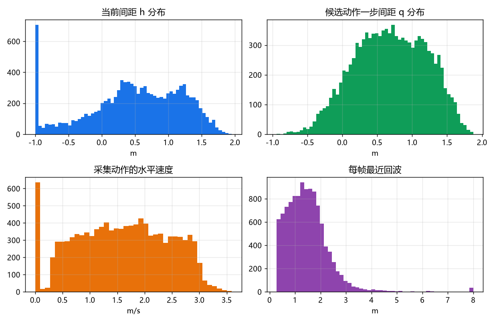
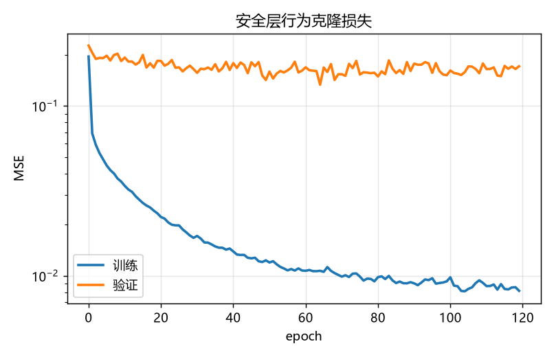
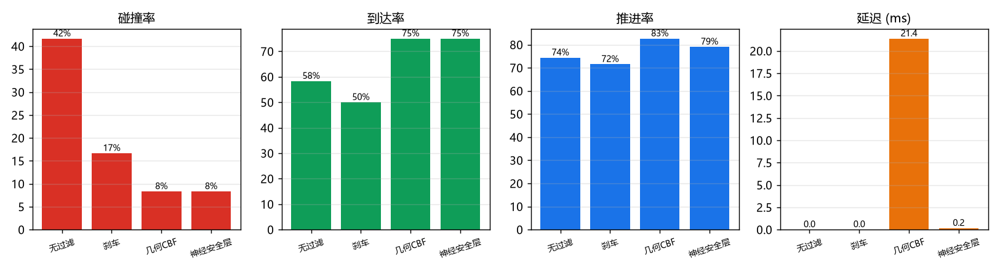
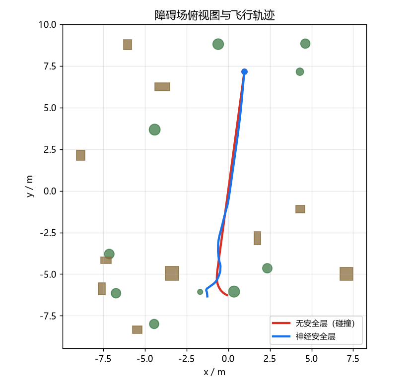
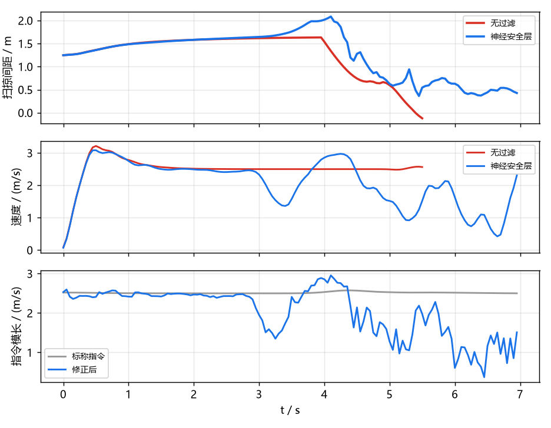
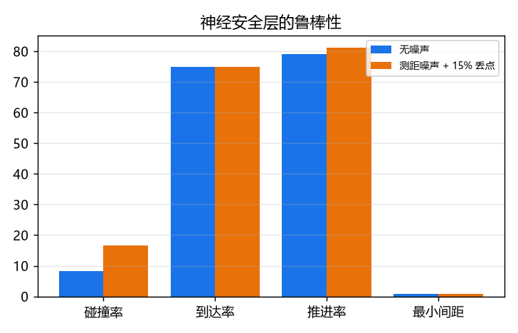

# 神经安全过滤器

对应作业任务（2）**传感器感知**与任务（3）**导航控制**的安全层。

标称控制器只朝目标飞，不避障。本模块在指令层加一道安全过滤：360° 激光
距离栅格 + 当前速度 → 候选动作的一步间距 → 修正指令。几何 CBF 层作为监督
信号与上界，神经网络用行为克隆学习它。

---

## 1. 模块定位

课程内的无人机项目都是"一个控制器/策略直接输出指令"，没有独立的指令级
安全层：

| 已有模块 | 区别 |
|---|---|
| `uav_ppo_nav` | 端到端 RL，策略本身承担避障，无独立安全约束 |
| `uav_depth_gate_racing_e2e` | 端到端策略，碰撞率随训练波动 |
| `octree_uav_3d_pathfinding` | 几何规划，默认位姿已知，不处理底层指令 |

---

## 2. 架构

```
/lidar/points ──→ 3×36 距离栅格 ─┐
/uav/odom ─────→ 机头系速度 ──────┼─→ 116 维观测 ──┬─→ 几何 CBF（教师）
/uav/goal ─────→ 目标方向 ────────┘                 └─→ 神经安全层（部署）
/uav/cmd_vel_nominal ──→ 标称指令 ──────────────────────→ 修正指令
```

两个实现共用同一套观测与动作语义：

| | 几何 CBF | 神经安全层 |
|---|---|---|
| 间距来源 | 场景真值 SDF | 网络前向 |
| 决策 | 候选集 + 0.6 s rollout | 一次回归 |
| 延迟 | 19 ms | 0.14 ms |
| 用途 | 教师 / 上界 | 部署 |

---

## 3. 环境与数据

`SafetyEnv`：`safety_field` 场景，20 个盒/柱障碍，高度 1.2–2.8 m，范围 ±9 m。
障碍高度下限保证三层激光（−15°/0°/+15°）都能打到；底座自带的
`obstacle_field` 有 0.6 m 的低柱，在雷达锥之间是盲区。

动作是机头系速度，经一阶低通（`tau=0.12 s`）与航向跟随（2.5 rad/s）
变成参考轨迹，再由几何控制器跟踪。

| 项 | 值 |
|---|---|
| 控制频率 | 20 Hz |
| 雷达 | 36 方位 × 3 俯仰，8 m |
| 机体半径 | 0.16 m |
| 标称速度 | 2.5 m/s |
| 训练场景 | seed 0–15 |
| 测试场景 | seed 100–111 |

**评价器数据**（`safety_dataset.npz`）：10 个场景、每场景 12 集，随机动作
+ 标称扰动，11126 帧。标签 `h` 是沿当前速度的 0.6 s rollout 间距，`q` 是
给定动作后的 rollout 间距。

**行为克隆数据**（`safety_imitation.npz`）：几何层闭环飞行 16 个场景 × 4 集，
10057 帧，左右镜像后 20114 条。



---

## 4. 几何 CBF 层

对候选速度 $u$，按环境动力学外推 0.6 s：

$$
v_{k+1} = v_k + \frac{\Delta t}{\tau}(R_z(\psi_k)u - v_k),\quad
p_{k+1} = p_k + v_{k+1}\Delta t
$$

航向按速度方向以 2.5 rad/s 跟随，每一步取到障碍表面与地面的最小距离，
$q(u)$ 是整段路径的最小值。约束

$$
q(u) \ge 0.8\ \text{m}
$$

可行候选里取离标称指令最近的一个，代价里加 0.2 的目标方向项；无可行候选时
输出零指令。候选集为速度缩放 × 方位角偏转（0/±30°/±60°/±90°）× 高度偏置，
共 89 个。

rollout 必须与环境的低通和航向跟随一致。早期用直线扫掠代替，安全层会把
转弯后的路径当成安全，碰撞率反而上升到 38%；换成同动力学 rollout 后
降到 8%。

---

## 5. 神经安全层

输入 116 维观测 + 3 维标称指令，输出 3 维修正指令：

```
Linear(119,128) → ReLU → Linear(128,128) → ReLU → Linear(128,3)
```

32259 个参数，纯 numpy 前向，CPU 单帧 0.14 ms。

训练用行为克隆，按 episode 切验证集（12%），MSE，Adam（lr=2e-3，
weight decay=1e-4），120 轮，保留验证最优。



训练集 MSE 0.009，验证 0.15：16 个场景的覆盖仍然有限，换场景类型需要重采。

---

## 6. 闭环评测

12 个未见场景（seed 100–111），每个场景一集，起点/终点对穿障碍场，初始
扫掠间距 >1.0 m。碰撞判据是机体中心到障碍表面 <0.16 m；到达判据是离目标
<0.8 m；推进率 $= (d_0-d_\text{end})/d_0$。

---

## 7. 实测结果

| 过滤器 | 碰撞率 | 到达率 | 推进率 | 最小间距 | 延迟 |
|---|---|---|---|---|---|
| 无过滤 | 42% | 58% | 74% | 0.63 m | 0.01 ms |
| 刹车 | 17% | 50% | 72% | 0.62 m | 0.01 ms |
| 几何 CBF | 8% | 75% | 83% | 0.84 m | 19.0 ms |
| **神经安全层** | **8%** | **75%** | **79%** | **0.77 m** | **0.14 ms** |

神经层与教师层的碰撞率、到达率相同，推进率低 4 个百分点，延迟低 136 倍。



单集时序（无过滤在 5.6 s 撞上障碍，神经层减速绕过）：





测距噪声 0.08 m + 15% 丢点：

| 条件 | 碰撞率 | 到达率 | 推进率 | 最小间距 |
|---|---|---|---|---|
| 无噪声 | 8% | 75% | 79% | 0.77 m |
| 噪声 + 丢点 | 17% | 75% | 81% | 0.53 m |



---

## 8. 源码解析

```
uav_neural_safety_filter/core/
├── geometry.py   盒/柱/球 SDF、批量点间距、rollout 间距
├── ranges.py     3×36 距离栅格、方向距离、激光下界
├── env.py        SafetyEnv、safety_field、episode 生成
├── dataset.py    评价器数据、行为克隆数据、镜像增广
├── network.py    SafetyNet（h/q）与 PolicyNet（指令）
├── training.py   两类训练、按 episode 切验证集
├── filter.py     候选集、几何层、神经层、评价器层
└── experiment.py 闭环评测与汇总
```

### 8.1 `geometry.py`：rollout 间距

`rollout_clearance_many` 按环境的低通与航向跟随逐点外推，每步调用
`clearance_points`（向量化 SDF）。这是教师层与数据标签的共同来源。
用直线扫掠代替时，转弯后的路径被高估，闭环碰撞 38%。

### 8.2 `ranges.py`：零指令的方向约束

`direction_range` 对水平速度小于 0.2 m/s 的指令返回 (1,1)，不施加方向
约束。早期对所有指令都取全局最近回波，刹停候选被误判为不安全，安全层
转而加速，碰撞率 75%。

### 8.3 `env.py`：场景与起点

`safety_field` 的障碍高度下限 1.2 m，保证三层雷达都能打到。起点/终点
生成时检查初始扫掠间距 >1.0 m，避免"一出生就注定碰撞"的评测样本。

### 8.4 `filter.py`：候选集与退路

候选集覆盖速度缩放、方位偏转与高度偏置，共 89 个。可行集为空时输出零
指令，而不是"离标称最近"——后者在近距状态会把无人机继续推向障碍。

### 8.5 评价器路线（对照）

`SafetyNet` 同时预测当前间距 `h` 与候选动作间距 `q`，在候选集上求
`q >= 0.8 m`。训练集 MAE 0.09 m，但闭环碰撞 25–75%：短视界约束对
0.1 m 级预测误差非常敏感。这条路线保留在代码里，作为"为什么不直接用
学习式评价器"的对照。

---

## 9. 复现步骤

```bash
# 仿真侧（Python ≥3.10）
python main.py --collect           --out data/safety_dataset.npz
python main.py --train             --data data/safety_dataset.npz --out data/safety_net.npz
python main.py --collect-imitation --out data/safety_imitation.npz
python main.py --train-policy      --data data/safety_imitation.npz \
                                   --out data/safety_policy.npz --epochs 120

# 任意机器（只需 numpy）
python main.py --selftest
python main.py --evaluate --model data/safety_policy.npz \
               --episodes 12 --max-time 20 --eval-seed 100 --out results.json
python main.py --figures  --model data/safety_policy.npz --results results.json \
               --outdir ../docs/img/air/uav_neural_safety_filter
```

ROS2 在线运行见包内 `README.md`。

---

## 10. 依赖

* [MuJoCo 四旋翼仿真与 ROS2 桥接底座](uav_mujoco_sim.md)
  （提供 `/lidar/points`、`/uav/odom` 与 `/uav/cmd_vel`）
