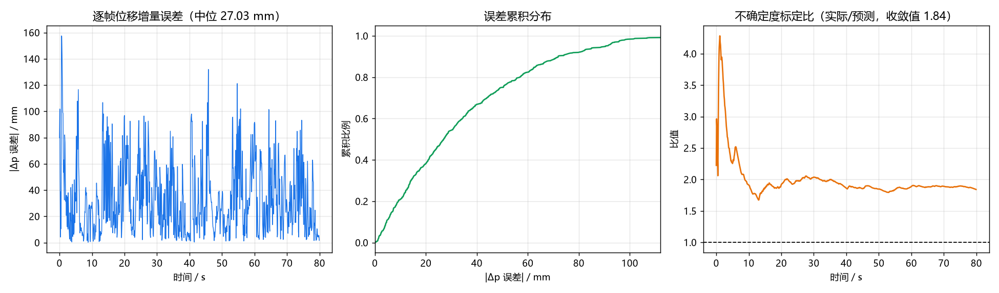
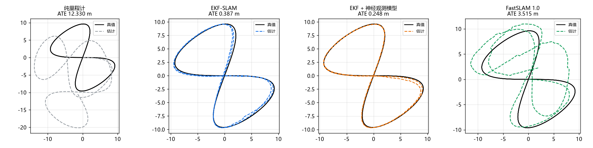
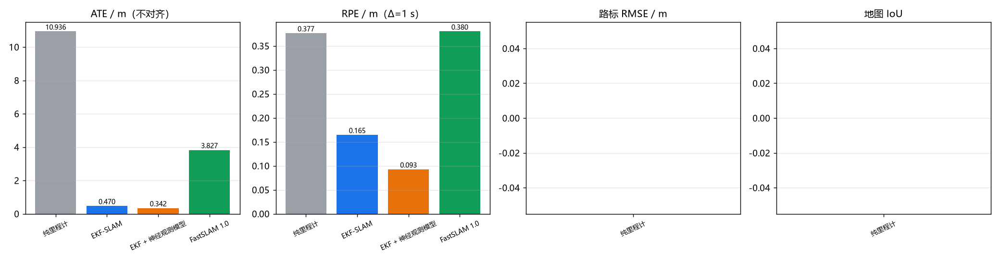

# 神经视觉惯性里程计与三后端 SLAM 对比

对应作业任务（2）**传感器感知**与任务（3）**建图导航 + SLAM 同步仿真**，
命中老师要求的对比实验①：**同样模型、不同 SLAM 算法**。

前端是 CNN + GRU 的神经视觉惯性里程计，纯 numpy 手写前向与反向；三个后端
共用同一前端、同一数据集，只换后端，对比定位精度、地图一致性与 GPS 拒止下的退化。

---

## 1. 模块定位

GPS 拒止环境（室内、隧道、城市峡谷）下，位姿只能靠机载传感器推。本模块用
深度相机 + IMU 做神经 VIO，再在**同一前端**上比较三种 SLAM 后端：

| 后端 | 观测量 | 地图表示 | 复杂度 |
|---|---|---|---|
| EKF-SLAM | 立柱的 (距离, 方位) | 单高斯，位姿 + 路标联合 | $O(M^2)$ |
| EKF-SLAM + 神经观测模型 | 同上，噪声由网络给 | 同上 | $O(M^2)$ |
| FastSLAM 1.0 | 同上 | 粒子云 + 逐粒子路标 EKF | $O(PM)$ |

课程内已有的 `octree_uav_3d_pathfinding` 直接用仿真器给的真值位姿建图，
没有状态估计；`carla_slam_gmapping` 是车、且 gmapping 是黑箱，做不了"同前端
换后端"的受控对比。**把状态估计与建图分开评测**在课程内是空白。

---

## 2. 架构

```
深度图 160×128 ─┐
                ├─ CNN(3 层, stride 2) ─┐
IMU 100 Hz ─────┘                       ├─ GRU(64) ─┬─ head_p → Δp_b (3)
                                        │            ├─ head_r → Δrpy_b (3)
                                        │            └─ head_s → log σ² (6)
                                        │
                                        └─→ ┬ EKF-SLAM
                                            ├ EKF-SLAM + 神经观测模型
                                            └ FastSLAM 1.0
                                                     │
                                                     └→ 位姿 + 路标 → 占用栅格
```

前端与后端之间只有 `(Δp_b, Δrpy_b, σ)` 一条接口，换后端不动前端一行。

`/camera/depth` 与 IMU 由底座 `uav_mujoco_sim` 提供；激光雷达的立柱观测由
`landmarks.py` 从射线距离里检测。

---

## 3. 神经前端

### 3.1 网络结构

| 层 | 形状 | 参数 |
|---|---|---|
| Conv1 | 2×48×64 → 8×22×30，5×5 /2 | 2 通道输入（深度 + 有效掩码）|
| Conv2 | 8×22×30 → 16×10×14，3×3 /2 | |
| Conv3 | 16×10×14 → 16×4×6，3×3 /2 | |
| IMU 分支 | 10×6 → 64 → 64 | 全连接 + ReLU |
| 融合 | 64 + 64 → GRU(64) | |
| head_p / head_r | 64 → 3 | 位移 / 姿态增量 |
| head_s | 64 → 6 | log σ²，限幅 [−8, 4] |

深度输入是**两通道**：归一化深度 + 有效掩码。超量程像素为 0，不分"没有回波"
和"距离为 0"会让墙面和天空变成同一个输入。

### 3.2 损失

位移与姿态增量都用**异方差高斯负对数似然**：

$$
\mathcal{L} = \frac{1}{2}\sum_i \left[\frac{(y_i - \hat y_i)^2}{\sigma_i^2} + \log \sigma_i^2\right]
$$

网络同时预测 $\sigma_i$，既给后端提供逐帧不确定度，也让损失对离群帧不敏感
（残差大的帧自动被降权）。$\log\sigma^2$ 限幅在 $[-8,4]$，不加限幅时训练会
把 $\sigma$ 推向 0 换 loss（实测 20 轮内单帧精度退到 32 mm）。

### 3.3 训练

按**定长片段**（32 帧）切：片段内 GRU 隐状态连续、片段间清零。梯度只回传
一步，等价于把隐状态当成额外输入特征——这正是实时 VIO 的处境：任何时刻
只能看到"到当前为止"的信息。优化器 Adam（$\text{lr}=2\times10^{-3}$，
梯度范数限幅 1.0），25 轮，验证集为第 3 集。

### 3.4 前端精度

| 指标 | 值 |
|---|---|
| 逐帧位移增量 RMSE | 2.8 mm |
| 逐帧姿态增量 RMSE | 0.11° |
| 位移不确定度标定比 | 6.6（偏保守）|

标定比偏大是因为网络的高斯假设覆盖不了偶发的无效深度帧；偏保守对后端是安全的
方向（宁可信其有）。



---

## 4. 三个后端

### 4.1 EKF-SLAM

状态 $\mu = [x, y, \theta, m_{1x}, m_{1y}, \dots, m_{Mx}, m_{My}]^T$，
协方差 $\Sigma \in \mathbb{R}^{(3+2M)^2}$。三件事必须一起做：

**预测**只推进位姿，但雅可比 $F$ 要把位姿与路标的互协方差一起传：

$$
\mu \leftarrow g(\mu, u), \qquad \Sigma \leftarrow F\Sigma F^\top + Q
$$

均值走**非线性**转移，$F$ 只用于协方差。把 $F$ 乘到 $\mu$ 上是一阶近似，
单帧 0.17 m 的位移看不出来，整条轨迹累积下来会引入系统性偏差。

**观测更新**用完整的联合协方差：

$$
S = H\Sigma H^\top + R, \quad K = \Sigma H^\top S^{-1}, \quad
\mu \leftarrow \mu + K\nu, \quad \Sigma \leftarrow (I-KH)\Sigma
$$

**新路标初始化**要把位姿不确定度传播进去，并补上与已有状态的互协方差：

$$
\Sigma_{\text{new}} = \begin{bmatrix}
\Sigma & \Sigma J^\top \\ J\Sigma & J\Sigma J^\top + G_z R G_z^\top
\end{bmatrix}
$$

只写对角块会让滤波器在回环时把路标当成真值，位姿永远拉不回来。

### 4.2 学习式观测噪声模型

经典 EKF 用固定 $R = \mathrm{diag}(\sigma_r^2, \sigma_b^2)$，但实测测距噪声
强烈依赖距离：

| 距离段 | 真实 σ_r | 常数模型 | 学习模型 |
|---|---|---|---|
| 0.8–2 m | 0.017 m | 0.100 m（**悲观 5.8×**）| 0.027 m |
| 2–4 m | 0.025 m | 0.100 m | 0.028 m |
| 4–6 m | 0.028 m | 0.100 m | 0.032 m |
| 6–8 m | 0.047 m | 0.100 m | 0.043 m |
| 8–10.5 m | 0.052 m | 0.100 m | 0.049 m |

模型在**真值**上训练：用真值位姿与真值路标配对，残差就是纯传感器误差。
网络拟合的是 $\mathbb{E}[\log \mathrm{err}^2]$，换算成 $\sigma$ 要补一个偏置：

$$
\log \sigma^2 = \mathbb{E}[\log \mathrm{err}^2] - \mathbb{E}[\log \chi^2_1],
\qquad \mathbb{E}[\log \chi^2_1] = \psi(1/2) + \log 2 = -1.2704
$$

写成 $\gamma=0.5772$（欧拉常数）会少补 0.693，$\sigma$ 系统性低估
$\sqrt{2}$ 倍——实测标定比 0.69 而不是 1.0，就是这一项。

方位残差是重尾的（1 m 处散布 2.3°，但大多数样本接近 0），
$\mathbb{E}[\log \mathrm{err}^2]$ 拟合的是"典型"误差而不是标准差，
所以训练后再做一个标量方差标定
$k = \overline{\mathrm{err}^2} / \overline{\hat\sigma^2}$。

### 4.3 FastSLAM 1.0

粒子滤波表示轨迹，每个粒子带自己的一套路标 EKF。与 EKF-SLAM 的根本差别是
**位姿的表示**：EKF 用单个高斯，只能近似单峰分布；FastSLAM 用一组粒子，
天然能表示多峰。粒子权重按观测似然连乘：

$$
w^{(i)} \propto \prod_k \mathcal{N}(z_k; \hat z_k^{(i)}, S_k^{(i)})
$$

两个工程细节：**数据关联跨粒子共享**（用加权平均地图做最近邻），
**路标更新用采样出的位姿当精确值**（FastSLAM 1.0 的固有近似）。

### 4.4 关键设计：关联门限与观测噪声解耦

χ² 门限的协方差是 $S = H\Sigma H^\top + R$，**依赖 $R$**。这带来一个反直觉的
后果：观测噪声模型变准以后，$R$ 变小 → $S$ 变小 → 同一个创新的马氏距离变大
→ 更多真实观测被门限拒绝 → 每个被拒的观测都变成一根永久存在的假柱子。

实测（第 0 集，3591 条观测）：

| 观测噪声 | 关联成功 | 新建路标 | 真值 30 个 | 接受时的 χ² 中位 | ATE |
|---|---|---|---|---|---|
| 常数 R | 3517 | 74 | 44 个虚警 | 0.55 | 0.45 m |
| 学习 R（门限耦合）| 3375 | **216** | **186 个虚警** | 1.21 | 0.94 m |

把门限用的协方差换成**固定几何尺度**
($\sigma_r^{\text{gate}}=0.15$ m, $\sigma_b^{\text{gate}}=0.045$ rad)，
关联行为就与噪声模型无关，两种后端之间只剩"观测噪声模型"这一个差异，
对比才是受控的。这也是真实 SLAM 系统的通行做法（固定搜索半径）。

---

## 5. 建图

位姿 + 激光雷达射线 → 2D 对数几率占用栅格。整帧向量化：所有射线的采样点
一次性算出来，用 `np.bincount` 把同一格的命中累加，每帧 4~6 ms。

地图一致性用 IoU 评价，同时给两个分辨率：

* **0.10 m 原生**：墙只有一格宽，位姿差 0.4 m 就整体错开，量的是位姿误差
* **0.50 m 降采样**：块内取最大（占据优先），才是"地图画得对不对"

---

## 6. 评测指标

| 指标 | 定义 |
|---|---|
| ATE 原始 | 估计轨迹与真值轨迹逐点误差的 RMSE，不做任何对齐 |
| ATE 对齐 | 先做 SE(2) 最优对齐（Umeyama）再算，排除整体漂移自由度 |
| RPE | 隔 $\Delta=1$ s 比较相对运动：$E_i = (Q_i^{-1}Q_{i+\Delta})^{-1}(P_i^{-1}P_{i+\Delta})$ |
| 路标 RMSE | 估计路标与真值路标的最近邻配对误差 |
| 形状误差 | 配对点对做 SE(2) 对齐后的残差，只反映地图形状 |
| 地图 IoU | 占用栅格与真值栅格的交并比 |

**估地图与真值地图必须换到同一个第一帧坐标系。** 估计器从原点出发，而真值
轨迹在世界系里有自己的起点；只换轨迹不换路标，两者会差一个第一帧偏航的旋转
（本数据集 `yaw=0.965 rad`，10 m 外的路标直接错开 9 m），最近邻配对退化成
随机配对——实测 rmse 0.71 m，恰好等于 1 m 配对半径下均匀随机配对的期望值
$1/\sqrt2 = 0.7071$。修正后 0.30 m，形状误差 0.148 m。

---

## 7. 实测结果

平台：仿真侧 Windows 11 + Intel Core 5 220H（核显）；ROS 侧 Ubuntu 20.04 +
Humble 虚拟机（`colcon build` 通过）。
数据：5 集八字闭环航线，每集 80 s @10 Hz，每帧约 4.5 条立柱观测，30 根真值立柱。

### 7.1 GPS 正常（每 1 s 一次，σ=0.5 m）

| 后端 | ATE 原始 | ATE 对齐 | RPE | 路标 RMSE | 地图 IoU(0.5 m) | 耗时 |
|---|---|---|---|---|---|---|
| 纯里程计（前端）| 10.936 m | 5.475 m | 0.377 m | — | 0.08 | 0 s |
| EKF-SLAM | 0.470 m | 0.271 m | 0.165 m | 0.254 m | 0.44 | 6 s |
| **EKF-SLAM + 神经观测模型** | **0.342 m** | **0.146 m** | **0.093 m** | **0.249 m** | **0.55** | 5 s |
| FastSLAM 1.0 | 3.827 m | 2.945 m | 0.380 m | 0.638 m | 0.18 | 1 s |

* 神经观测模型相对常数 R：ATE −27%，RPE −44%，地图 IoU +25%，
  5 集里赢 4 集（第 2 集 0.603 vs 0.291 落后）
* EKF-SLAM 相对纯里程计：ATE 降低 23 倍
* FastSLAM 明显落后，且**耗时只有 1 s**（EKF 是 $O(M^2)$，FastSLAM 是 $O(PM)$）





### 7.2 GPS 中断退化

| 中断时长 | 纯里程计 | EKF-SLAM | EKF+神经观测 | FastSLAM |
|---|---|---|---|---|
| 0 s | 10.936 | 0.470 | 0.342 | 3.827 |
| 5 s | 10.936 | 0.487 | 0.372 | 5.005 |
| 15 s | 10.936 | 0.514 | 0.479 | 6.940 |
| 30 s | 10.936 | 0.568 | 0.534 | **7.758** |

EKF 两个后端对 30 s 中断只退化 21%/56%（前端的位移增量精度本就到毫米级，
时间足够长时靠路标观测就能维住）；FastSLAM 退化 103%，对绝对观测最敏感。

### 7.3 FastSLAM 为什么落后

诊断数据（第 0 集，160 粒子）：

| 量 | 值 |
|---|---|
| 粒子位姿散布 | σ ≈ 0.03–0.08 m |
| 需要覆盖的不确定度 | 0.4 m 量级 |
| 重采样次数 / 800 帧 | 432 |
| 有效粒子数 $N_\text{eff}$ | 118/160（权重接近均匀）|

粒子云只有 3~8 cm 宽，而它需要覆盖的位姿不确定度是 0.4 m 量级。云宽由
"过程噪声 × √(重采样间隔)" 决定：每帧过程噪声 0.018 m，每约 2 帧重采样一次，
云宽就被锁死在 3 cm 左右。**GPS 的似然在整个云上几乎相同**（0.5 m 的观测噪声
对上 3 cm 的云宽），权重区分不出来，$N_\text{eff}$ 因此一直接近满值。

加大过程噪声、加粒子数（160→2500）、调重采样比都试过，ATE 始终在
1.0~2.8 m 区间波动没有单调改善——这是 FastSLAM 1.0 用里程计提议分布时的
结构性局限，不是调参问题。

---

## 8. 源码解析

```
uav_neural_vio_slam/core/
├── nn.py           手写 Conv2d / GRUCell / Linear / Adam
├── network.py      VioNet：前向、反向、高斯 NLL、限幅
├── world.py        SLAM 基准世界（30 立柱）+ 八字闭环航线
├── landmarks.py    激光雷达 → (距离, 方位) 观测
├── dataset.py      数据采集与存取
├── training.py     训练与在线推理
├── ekf_slam.py     EKF-SLAM
├── fastslam.py     FastSLAM 1.0
├── obs_model.py    学习式观测噪声模型
├── mapping.py      占用栅格
├── metrics.py      ATE / RPE / 路标误差 / 地图 IoU
└── experiment.py   四后端对比与 GPS 中断
```

### 8.1 `landmarks.py`：从射线距离里挑出立柱

判据是"**细**"：一根立柱在方位向只占极少几个波束，墙面、地面、大方柱会连成
一片。再加上跨俯仰层的距离一致性（同一根柱子被 ±15° 两层打到时距离几乎相同，
地面不是），就能把柱子从环境里挑出来。这套判据不需要知道无人机的高度和姿态，
在线估计器可以原样使用。

两个容易错的点：

**水平距离**。`detect` 报出的必须是水平距离（乘过 cos 俯仰角），才能进二维
观测模型 $r = \sqrt{(m_x-x)^2 + (m_y-y)^2}$。−15° 那一层的三维距离比水平距离大
$\sec 15° - 1 = 3.5\%$，8 m 处就是 0.28 m 的系统偏差，直接顶掉整个路标地图的精度。

**整组生长**。不能逐格判"孤立"——近处的柱子横跨多个方位波束，逐格判会把中间
那些格子全丢掉、只剩两侧边缘，一根柱子被拆成两条观测（实测 1 m 处拆成
1.01 m/+9° 与 1.02 m/+1°）。要按候选簇整组生长再判孤立。

### 8.2 `nn.py`：im2col 的维度顺序

`as_strided` 的**维度顺序必须与 reshape 的目标一致**，否则 reshape 会按内存序
重新分组，得到一个被搅乱的布局。更阴的是：这时前向和反向仍然互为转置，
**数值梯度校验照样通过**（层变成了"核权重被置换过的卷积"），只有伴随恒等式

$$
\langle A, \text{col2im}(B)\rangle = \langle \text{im2col}(A), B\rangle
$$

能把它揪出来（实测 8.11 vs 6.94）。`--selftest` 里这一项就是为它准备的。

### 8.3 `metrics.py`：形状误差的迭代最近点

估地图与真值地图之间差一个刚体变换，直接用原坐标做最近邻会因整体平移/旋转
而配错。`landmark_shape_rmse` 做三步：点数量相同时先整体 SE(2) 粗对齐 →
最近邻配对 → 用配对点估变换再作用到全部点上，迭代 3 次。这样
"整体漂移"被扣掉，剩下的才是"地图画歪了"。

### 8.4 `ekf_slam.py`：轨迹记录不能带初始位姿

`reset()` 里写 `traj = [mu.copy()]` 会让估计轨迹相对真值整体错开一帧
（1.4 m/s 巡航下 0.14 m 的系统滞后）。正确做法是只在 `record()` 里追加，
与帧数一一对应。

---

## 9. 复现步骤

```bash
# 仿真侧（Python ≥3.10）
python main.py --collect --out data/vio_dataset.npz
python main.py --train   --data data/vio_dataset.npz --out data/

# 任意机器（只需 numpy）
python main.py --selftest
python main.py --evaluate --data data/vio_dataset.npz --model data/ \
               --out results.json --outage 5,15,30
python main.py --figures  --data data/vio_dataset.npz --model data/ \
               --outdir ../docs/img/air/uav_neural_vio_slam --outage 5,15,30
```

ROS2 在线运行见包内 `README.md`。

---

## 10. 依赖

* [MuJoCo 四旋翼仿真与 ROS2 桥接底座](uav_mujoco_sim.md)
  （提供 `/camera/depth`、`/lidar/points`、IMU 与真值位姿）
