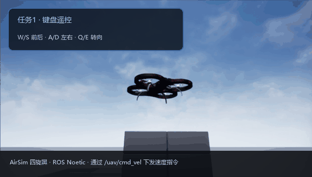
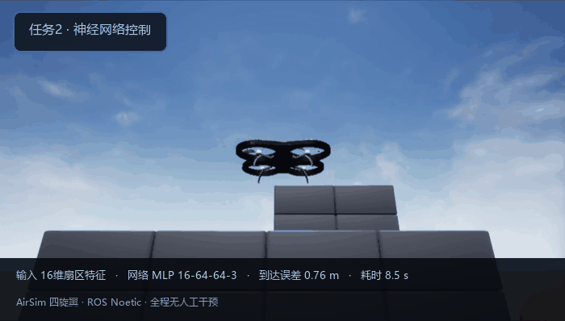
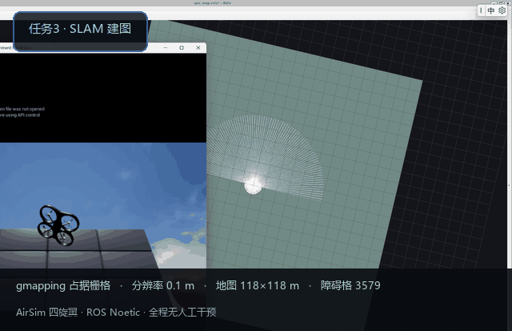
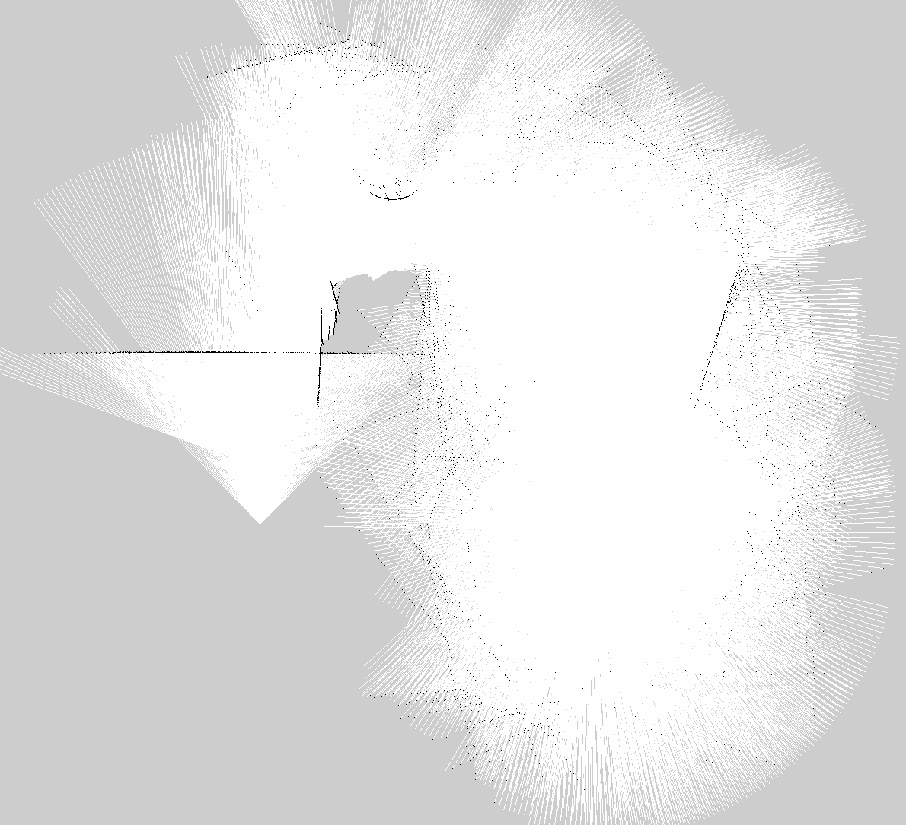
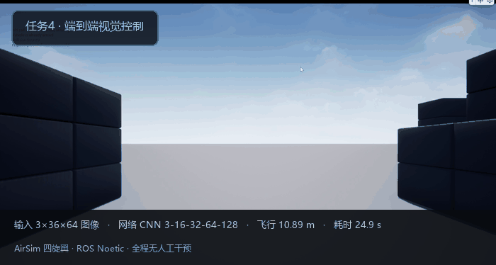

# 基于神经网络的无人机感知、导航与端到端控制

本文实现了一个运行在 AirSim + ROS Noetic 上的无人机系统，覆盖四项任务：

1. **键盘遥控**：通过速度指令控制无人机六个自由度
2. **传感器感知与运动控制**：激光雷达点云经神经网络输出速度指令
3. **建图与导航同步**：gmapping 边飞边建图，神经网络同时导航
4. **端到端视觉控制**：摄像头图像直接进卷积网络，输出控制指令

四项功能共用同一套 AirSim 桥接节点，模块名 `uav_nn_perception_navigation`。



---

## 1. 系统架构

### 1.1 数据流

```text
                    ┌──────────────────────────────┐
                    │   AirSim 1.8.1 (Blocks 场景)  │
                    │   Windows 主机 172.25.176.1   │
                    └──────────────┬───────────────┘
                                   │ msgpack-rpc :41451
                    ┌──────────────┴───────────────┐
                    │      airsim_bridge.py        │
                    │  订阅 /uav/cmd_vel           │
                    │  发布 /uav/odom、/tf         │
                    └──────────────┬───────────────┘
                                   │ ROS 话题
        ┌──────────────────────────┼──────────────────────────┐
        │                          │                          │
  lidar_perception          trajectory_control          camera_perception
  （16 维特征）              （MLP 策略）                （图像话题）
        │                          │                          │
        └──────────► /uav/cmd_vel ◄┘                          │
                                   │                          │
                            end2end_node  ◄───────────────────┘
                            （CNN 策略）
```

### 1.2 节点与话题

| 节点 | 订阅 | 发布 | 对应任务 |
| --- | --- | --- | --- |
| `airsim_bridge.py` | `/uav/cmd_vel` | `/uav/odom`、`/tf` | 全部 |
| `keyboard_teleop.py` | 标准输入 | `/uav/cmd_vel` | 任务 1 |
| `lidar_perception.py` | — | `/uav/lidar/scan`、`/uav/lidar/features` | 任务 2、3 |
| `trajectory_control.py` | `/uav/odom`、`/uav/lidar/features`、`/uav/goal` | `/uav/cmd_vel` | 任务 2、3 |
| `safety_shield.py` | —（被控制节点 import） | — | 任务 2、3、4 |
| `eval_multi_target.py` | —（离线评估脚本） | — | 任务 2 |
| `camera_perception.py` | — | `/uav/image_raw`、`/uav/depth` | 任务 4 |
| `end2end_node.py` | `/uav/image_raw`、`/uav/odom` | `/uav/cmd_vel` | 任务 4 |

### 1.3 坐标系约定

AirSim 使用 NED（北-东-地），ROS 使用 ENU（东-北-天）。两者转换关系为：

$$
x_{\text{ENU}} = y_{\text{NED}}, \quad y_{\text{ENU}} = x_{\text{NED}}, \quad z_{\text{ENU}} = -z_{\text{NED}}
$$

偏航角转换：

$$
\psi_{\text{ENU}} = \frac{\pi}{2} - \psi_{\text{NED}}
$$

桥接节点在 `publish_odom()` 中完成这一步，对外统一发布 ENU 坐标。

---

## 2. 环境配置

### 2.1 版本要求

| 项目 | 版本 |
| --- | --- |
| 仿真器 | AirSim 1.8.1（Blocks 预编译环境） |
| 操作系统 | Ubuntu 20.04（WSL2 亦可） |
| ROS | Noetic |
| Python | 3.8 |
| PyTorch | 1.13（CPU 版即可） |

### 2.2 安装步骤

```bash
# 1. ROS 依赖
sudo apt install ros-noetic-gmapping ros-noetic-nav-msgs \
                 ros-noetic-tf2-ros ros-noetic-map-server

# 2. Python 依赖
pip3 install torch msgpack-rpc-python numpy

# 3. AirSim 客户端（PyPI 上的 airsim 包在部分 Python 版本下构建失败，
#    直接使用官方仓库的 PythonClient 源码更可靠）
git clone --depth 1 https://github.com/microsoft/AirSim.git
export AIRSIM_PYTHON_CLIENT=$PWD/AirSim/PythonClient
```

### 2.3 AirSim 配置

把 `config/settings.json` 放到 **`Blocks.exe` 同目录**。

> ⚠️ 如果系统用户名包含中文，AirSim 无法正确解析
> `C:\Users\用户名\Documents\AirSim\`，会把配置覆盖回默认值。
> 必须使用可执行文件同目录的方案。

```json
{
  "SimMode": "Multirotor",
  "Vehicles": {
    "Drone_1": {
      "VehicleType": "SimpleFlight",
      "X": 0, "Y": 0, "Z": -3,
      "Sensors": {
        "lidar_1": {
          "SensorType": 6, "Enabled": true,
          "Range": 40, "NumberOfChannels": 16, "PointsPerSecond": 60000,
          "RotationsPerSecond": 10,
          "HorizontalFOVStart": -90, "HorizontalFOVEnd": 90,
          "DataFrame": "SensorLocalFrame"
        }
      }
    }
  }
}
```

### 2.4 跨机通信

若 ROS 运行在 WSL2 而 AirSim 运行在 Windows 上，需要取 Windows 主机地址：

```bash
python3 -c "import struct; \
[print('.'.join(str(b) for b in bytes.fromhex(l.split()[2])[::-1])) \
 for l in open('/proc/net/route').readlines()[1:] if l.split()[1]=='00000000']"
```

该地址作为 `~airsim_ip` 参数传给各节点。

### 2.5 编译与启动

```bash
cd ~/catkin_ws && catkin_make && source devel/setup.bash
roslaunch uav_nn_perception_navigation teleop.launch airsim_ip:=172.25.176.1
```

---

## 3. 任务一：键盘遥控

### 3.1 控制链路

```text
终端按键 → keyboard_teleop.py → /uav/cmd_vel (Twist)
        → airsim_bridge.py → moveByVelocityZAsync(vx, vy, z, yaw_rate)
```

按键映射：

| 按键 | 动作 | 对应 Twist 分量 |
| --- | --- | --- |
| W / S | 前进 / 后退 | `linear.x` |
| A / D | 左移 / 右移 | `linear.y` |
| R / F | 上升 / 下降 | `linear.z` |
| Q / E | 左转 / 右转 | `angular.z` |
| 空格 | 急停 | 全部清零 |


### 3.2 两个关键实现细节

**（1）机体系速度转世界系**

ROS 中 `Twist` 表达的是机体坐标系下的速度，而 AirSim 的 `moveByVelocityAsync`
接收的是世界坐标系（NED）速度。若直接透传，无人机朝向不是正北时运动方向会歪。

桥接节点按当前偏航角做旋转：

$$
\begin{bmatrix} v_x^{w} \\ v_y^{w} \end{bmatrix}=
\begin{bmatrix} \cos\psi & -\sin\psi \\ \sin\psi & \cos\psi \end{bmatrix}
\begin{bmatrix} v_x^{b} \\ v_y^{b} \end{bmatrix}
$$

**（2）高度保持**

若只用 `moveByVelocityAsync` 且垂直速度恒为 0，SimpleFlight 会缓慢下沉。
改用 `moveByVelocityZAsync` 锁定目标高度，升降按键改为增减目标高度：

$$
z_{\text{target}} \leftarrow z_{\text{target}} - v_z^{\text{up}} \cdot \Delta t
$$

### 3.3 实测数据

| 指标 | 数值 |
| --- | --- |
| 起飞高度 | 2.82 m |
| 前进速度 | 2.0 m/s |
| 6.5 秒位移 | 12.93 m |
| 高度波动 | ±0.1 m |

---

## 4. 任务二：激光雷达感知与神经网络控制

### 4.1 感知：点云到特征向量

激光雷达视场 ±45°（可配），每个扫描周期返回数千个点。为了让网络输入维度固定，
把视场均分为 12 个扇区，每扇区取最近点距离并归一化：

$$
d_i = \min\left\{ \frac{\lVert \mathbf{p} \rVert}{R_{\max}} \;:\; \mathbf{p} \in \mathcal{S}_i \right\}, \quad i = 1,\dots,12
$$

其中 $\mathcal{S}_i$ 为第 $i$ 个扇区内的点集，$R_{\max}=40$ m。

再加上目标相对量——距离、方位角的正余弦、高度差：

$$
\mathbf{f} = [d_1,\dots,d_{12},\ \min(1,\tfrac{D}{20}),\ \sin\beta,\ \cos\beta,\ \mathrm{clip}(\tfrac{\Delta z}{10},-1,1)]
$$

共 16 维。

### 4.2 控制：三层 MLP

```text
输入 16 维 → Linear(64) → ReLU → Linear(64) → ReLU → Linear(3) → 输出 (vx, vy, ω)
```

输出直接乘以动作量程 `[3.0, 2.0, 1.0]`，得到物理速度指令 (vx, vy, ω)。

### 4.3 训练：模仿学习

训练数据由**势场法专家**在仿真中飞行采集。专家的速度指令为：

$$
\mathbf{v} = k_g \cdot D \cdot \hat{\mathbf{e}}_{\text{goal}}
+ \sum_{i \in \text{near}} k_r \left(1 - \frac{d_i}{d_{\text{safe}}}\right) \hat{\mathbf{e}}_i
$$

其中第一项为目标吸引，第二项为障碍斥力，最后按最大速度 $v_{\max}=3$ m/s 截断。

损失函数为均方误差：

$$
\mathcal{L} = \frac{1}{N}\sum_{k=1}^{N} \lVert \hat{\mathbf{a}}_k - \mathbf{a}_k \rVert^2
$$

### 4.4 训练结果

| 指标 | 数值 |
| --- | --- |
| 采集回合 | 24 回合 × 120 步 |
| 样本数 | 2880 |
| 训练/验证划分 | 85% / 15% |
| 最佳验证损失 | **0.0026** |
| 模型大小 | 24 KB |

### 4.5 在线飞行实测



| 指标 | 数值 |
| --- | --- |
| 起点 | (-0.35, 2.73, 15.17) |
| 目标 | (0.00, 20.00, 15.00) |
| 终点 | (-0.08, 20.76, 14.99) |
| **到达误差** | **0.76 m** |
| 耗时 | 8.5 s |
| 平均速度 | 2.3 m/s |

### 4.6 模型有效性验证

把标准状态送入网络，与专家策略对比：

| 距离 | 方位角 | 专家 (vx, vy, ω) | 网络 (vx, vy, ω) |
| --- | --- | --- | --- |
| 25 m | 0° | (3.00, 0.00, 0.00) | (2.98, 0.00, -0.00) |
| 25 m | 20° | (2.82, 1.03, 0.42) | (2.88, 1.05, 0.42) |
| 25 m | -20° | (2.82, -1.03, -0.42) | (2.80, -1.01, -0.44) |

网络输出与专家几乎一致，说明学到的是策略而非过拟合噪声。第 4.9 节给出完整的
偏差分布——"几乎一致"只在训练分布内部成立，近距障碍与大方位角状态下偏差会明显变大。

### 4.7 安全兜底

网络仍然给出主要控制量，但输出会先经过 `safety_shield.py` 再下发：

| 情况 | 判定 | 处理 |
| --- | --- | --- |
| 动作非法 | 出现 NaN / Inf | 水平速度与偏航归零，保持定高 |
| 输入过期 | 雷达或里程计超过 0.5 s 未更新 | 悬停等待 |
| 输出越界 | 水平速度 > 3 m/s、偏航 > 1 rad/s | 按训练量程限幅 |
| 正前方障碍 | 最近距离 < 1.2 m | 禁止继续前进 |
| 正前方极近 | 最近距离 < 0.5 m | 直接悬停 |
| 单侧障碍 | 该侧最近距离 < 0.9 m | 禁止朝该侧平移 |
| 偏航抖动 | 最近 8 帧符号翻转 ≥ 5 次 | 偏航指令减半 |

安全层只依赖 12 维扇区距离，不引入任何路径规划；关闭后即为"裸网络"，
用参数 `safety_enabled:=false` 切换。19 项单元测试覆盖全部分支：

```bash
catkin_make run_tests_uav_nn_perception_navigation
```

### 4.8 多场景闭环验证

单次飞行的 0.76 m 只能说明一个目标点可达。固定 10 组起终点（方位覆盖四个象限，
直线距离 25.6~48.2 m，部分航线穿过障碍区），每组从指定起点飞向目标，
平面误差 < 1.0 m 记为成功：

| 组 | 距离 | 到达误差 | 耗时 | 安全层介入 |
| --- | --- | --- | --- | --- |
| 1 | 25.6 m | 0.99 m | 18.2 s | 21 步 |
| 2 | 34.0 m | 0.98 m | 14.3 s | 45 步 |
| 3 | 42.2 m | 0.86 m | 15.4 s | 94 步 |
| 4 | 48.2 m | 0.99 m | 39.0 s | 31 步 |
| 5 | 39.5 m | 0.83 m | 16.9 s | 18 步 |
| 6 | 41.6 m | 0.93 m | 18.4 s | 13 步 |
| 7 | 40.1 m | 0.99 m | 40.6 s | 24 步 |
| 8 | 38.8 m | 0.80 m | 15.8 s | 35 步 |
| 9 | 29.7 m | 0.92 m | 15.3 s | 39 步 |
| 10 | 38.8 m | 0.97 m | 18.7 s | 2 步 |

| 配置 | 成功 | 误差（均值 ± 标准差） | 耗时均值 | 碰撞 |
| --- | --- | --- | --- | --- |
| 安全层开启 | 10/10 | 0.93 ± 0.07 m | 21.3 s | 0 |
| 安全层关闭 | 10/10 | 0.95 ± 0.06 m | 20.9 s | 0 |

在开阔场景里网络本身已经能稳定到达，安全层实际只做限幅（322 步，约占控制步的 16%）。
障碍屏蔽和异常接管用故障注入验证：第 40 步把网络输出换成 NaN，安全层立即以
`non_finite` 接管，仍正常到达（0.98 m / 18.2 s）；关闭安全层时 NaN 直接下发，
本次 AirSim 恰好忽略该帧，但耗时从 18.2 s 增加到 39.6 s。

### 4.9 网络与专家策略的偏差

验证损失 0.0026 只说明回归误差小，不能说明闭环稳定，因此单独统计偏差。开环用新采集
的 360 个状态（3 回合 × 120 步），再叠加扰动构造分布外状态；闭环用 4.8 节 10 组飞行
的逐步偏差。

| 指标 | 同分布 | 扰动（扇区 ±10%、方位 ±5°、距离 ±10%） |
| --- | --- | --- |
| 动作 MAE（三轴平均） | 0.392 | 0.400 |
| vx / vy / ω 的 MAE | 0.76 / 0.34 / 0.08 | 0.76 / 0.36 / 0.08 |
| 动作范数误差 均值 / P95 | 0.92 / 4.31 | 0.92 / 4.25 |
| 速度偏差 | 0.45 m/s | 0.45 m/s |
| 航向偏差 | 4.3° | 4.8° |
| 网络速度超过 3 m/s 的比例 | 50% | 38% |

两点结论：

1. 小幅输入扰动几乎不放大偏差（MAE 0.392 → 0.400），网络对传感器噪声不敏感；
2. 偏差集中在 vx 和少数近障、大方位角状态（P95 4.3、最大 5.2），即专家大斥力时
   网络复现不好的部分——这类状态正是安全层的职责边界。

闭环过程中每步的平均偏差为 0.78（安全层开启）/ 0.74（关闭），逐组最大 1.34~4.13，
比开环均值小：实际轨迹很少进入训练分布边缘。

---

## 5. 任务三：SLAM 建图与导航同步

### 5.1 坐标系链

gmapping 要求完整的 TF 链，缺任何一环都会丢弃全部扫描：

```text
map ──(gmapping 发布)──► odom ──(桥接节点发布)──► base_link ──(静态)──► laser
```

对应启动项：

```xml
<node pkg="tf2_ros" type="static_transform_publisher" name="base_to_laser"
      args="0 0 -0.5 0 0 0 base_link laser" />
```

### 5.2 扫描来源：深度相机反投影

AirSim 的激光雷达每帧只返回一小段扫描（约 149 点 / 19°），直接用于建图会大面积缺测。
改用深度相机反投影，每帧可得到 3 万多个点：

$$
X = \frac{(u - c_x)\,Z}{f_x}, \quad Y = \frac{(v - c_y)\,Z}{f_y}, \quad Z = d(u,v)
$$

其中 $f_x = \frac{w/2}{\tan(\text{FOV}/2)}$。反投影后按高度带 $|Z_{\text{sensor}}| < 2$ m
过滤，再投影成 90 格环形扫描。

> 实测对比：激光雷达建图障碍格 699 个，深度相机建图 1688~3579 个。

### 5.3 导航与建图同步

导航与建图**同时运行**：`trajectory_control` 持续输出速度指令，
`gmapping` 同时用扫描更新占据栅格地图，两者互不阻塞。



### 5.4 建图结果



以下为历史示例地图指标，原始采集配置和运行日志未能与当前 launch 一一对应，不能作为当前设置可复现的证明。gmapping 运行中可扩展初始地图边界；应在相同场景重新采集并保存配置、日志及地图。

仓库内 `maps/uav_map.pgm` 是 2026-11-11 重新采集的另一张地图，1184×1184 格，分辨率 0.1 m；采集配置、文件校验及话题样本见源码目录 `maps/evidence_20261111/README.md`。该次运行曾发生扫描匹配失败并回退里程计，未保存完整逐帧评分，不能据此宣称整个回合匹配稳定。下图和表格仍为历史演示，并非新样例的统计。

| 指标 | 数值 |
| --- | --- |
| 地图尺寸 | 1440 × 1536 格 |
| 分辨率 | 0.1 m/格 |
| 覆盖范围 | 144 m × 154 m |
| 障碍格 | 3579 |
| 平均扫描匹配分数 | 1.71 |

---

## 6. 任务四：端到端视觉控制

### 6.1 网络结构

```text
输入 3×36×64（RGB 图像下采样 4 倍）
   │
Conv2d(3→16, 5×5, stride 2) + ReLU
Conv2d(16→32, 5×5, stride 2) + ReLU
Conv2d(32→64, 3×3, stride 2) + ReLU
   │
Flatten(64×5×8) → Linear(128) + ReLU → Linear(3)
   │
输出 (vx, vy, ω)
```

图像预处理采用块平均下采样：

$$
\text{img}_{\text{small}}(i,j) = \frac{1}{16}\sum_{u=0}^{3}\sum_{v=0}^{3} \text{img}(4i+u,\ 4j+v)
$$

### 6.2 训练数据

专家策略的目标点固定在机头正前方 10 米处，因此网络只需要"看画面决定怎么飞"：

| 项目 | 数值 |
| --- | --- |
| 采集回合 | 20 回合 × 120 步 |
| 有效样本 | 1917（丢弃碰撞样本 483） |
| 图像尺寸 | 3×36×64 |
| 最佳验证损失 | 0.052 |

### 6.3 在线飞行实测



| 指标 | 数值 |
| --- | --- |
| 起点 | (-0.14, 10.92, 4.11) |
| 终点 | (6.56, 17.83, 4.17) |
| 飞行距离 | **10.89 m** |
| 用时 | 24.9 s |
| 高度保持 | 3.96 ~ 4.27 m |
| 障碍碰撞 | 无 |

全程输入只有摄像头画面，控制指令由卷积网络直接回归，不含任何人工规则。

---

## 7. 性能评价

### 7.1 四项任务汇总

| 任务 | 核心指标 | 结果 |
| --- | --- | --- |
| 键盘遥控 | 位移 / 高度保持 | 12.93 m / ±0.1 m |
| 感知 + 控制 | 到达误差 | 0.76 m |
| SLAM + 导航 | 地图障碍格 / 匹配分数 | 3579 / 1.71 |
| 端到端 | 自主飞行距离 | 10.89 m |

### 7.2 多场景测试

| 场景 | 高度 | 结果 |
| --- | --- | --- |
| Blocks 开阔区 | 15 m | 到达误差 0.76 m，无障碍 |
| Blocks 低空区 | 4 m | 建图障碍格 3579 |
| Blocks 方块区 | 8 m | 端到端飞行 10.89 m |

---

## 8. 常见问题

### 8.1 连接失败 `Retry connection over the limit`

仿真器未启动，或 IP 地址不对。先确认 Blocks 窗口已加载完成，再确认 `airsim_ip`。

### 8.2 修改 settings.json 不生效

Windows 用户名含中文时，AirSim 无法解析 `Documents\AirSim\` 路径。
把配置放到 `Blocks.exe` 同目录。

### 8.3 速度指令无效，无人机不动

三个原因，按顺序排查：

1. **msgpackrpc 线程竞争**：桥接节点主线程读状态、定时器线程发指令共用同一会话，
   会报 `Existing exports of data: object cannot be re-sized`。
   解决：所有客户端调用加锁串行化。
2. **无人机卡在几何体上**：`simSetVehiclePose` 之后飞机会自由落体，
   必须紧跟 `takeoffAsync`；碰撞状态下速度指令完全不生效。
3. **仿真器状态退化**：连续多轮测试后会出现"收指令不执行"，
   重启 Blocks 即恢复。

### 8.4 gmapping 丢弃全部扫描

`MessageFilter [target=odom]: Dropped 100.00% of messages`，通常缺 TF。
检查 `odom → base_link → laser` 三环是否齐全。

### 8.5 C++ 节点报 `libutils.so: cannot open shared object file`

`LD_LIBRARY_PATH` 为空导致。显式设置：

```bash
export LD_LIBRARY_PATH=/opt/ros/noetic/lib:$LD_LIBRARY_PATH
```

### 8.6 gmapping 不订阅指定话题

gmapping 不认 `scan_topic` 参数，必须用话题重映射：

```bash
rosrun gmapping slam_gmapping scan:=/uav/lidar/scan
```

---

## 9. 源代码解析

### 9.1 桥接节点 airsim_bridge.py

桥接节点把 AirSim 的 `MultirotorClient` 封装成 ROS 接口：订阅 `/uav/cmd_vel`（`geometry_msgs/Twist`），发布 `/uav/odom`（`nav_msgs/Odometry`），并提供 `/uav/takeoff`、`/uav/land` 两个 `std_srvs/Trigger` 服务。整个模块只有这一个节点直接持有 AirSim 会话，其余节点一律通过话题与之交互。

`/uav/cmd_vel` 的线速度是机体系（x 前、y 右、z 上），而 AirSim 的 `moveByVelocityAsync` 接收世界系速度，因此控制循环先用上一帧状态里的偏航角把速度旋到 NED 世界系：

```python
        vx_body = cmd.linear.x          # 前（机体系）
        vy_body = cmd.linear.y          # 右（机体系）
        vz_up = cmd.linear.z            # 向上为正
        yaw_rate = math.degrees(cmd.angular.z)

        # AirSim 的 moveByVelocity 接收的是世界系速度，
        # 按当前偏航角把机体速度旋到 NED 世界系
        psi = self.current_yaw
        vx = vx_body * math.cos(psi) - vy_body * math.sin(psi)
        vy = vx_body * math.sin(psi) + vy_body * math.cos(psi)
```

方位角同时按两种约定维护：内部换算用 NED 偏航角，输出里程计时换成 ENU。

$$x_{ENU}=y_{NED},\quad y_{ENU}=x_{NED},\quad z_{ENU}=-z_{NED},\quad \psi_{ENU}=\frac{\pi}{2}-\psi_{NED}$$

里程计的四元数只填 `z` 与 `w` 两个分量，即假定横滚与俯仰为零，只表达偏航。

高度方向没有直接透传垂直速度。`altitude_hold` 默认为真时，节点维护一个 `target_z`，每周期按 `target_z -= vz_up / rate_hz` 积分，再调用 `moveByVelocityZAsync` 把飞机拉到目标高度；读取状态时若发现实际高度与 `target_z` 相差超过 3.0 米（首次上电或被外部挪走），就把 `target_z` 重新对齐到当前高度。注释说明这么做的原因是避免在没有任何升降指令时飞机缓慢下沉。

线程安全上有两把锁：`self.lock` 保护控制指令，`self.client_lock` 串行化所有 AirSim 调用。后者是必须的——源码注释写明 msgpackrpc 的会话不是线程安全的，主线程读状态、定时器线程发指令并发访问会报 `Existing exports of data: object cannot be re-sized`。

一个容易踩的坑在 `shutdown`：必须先 `landAsync` 落地再 `armDisarm(False)` 和 `enableApiControl(False)`。注释直言直接释放控制权会让无人机自由落体摔到地面。另一处是 `received_cmd` 标志，收到第一条速度指令前控制循环直接返回，否则桥接节点会在外部起飞流程尚未结束时抢走控制权。

### 9.2 特征提取 uav_features.py

这个模块不含任何 ROS 依赖，训练脚本、感知节点、控制节点三处共用同一套特征定义，保证离线训练与在线推理的输入分布一致。核心常量是 `NUM_SECTORS = 12`、`FOV_DEG = 60.0`、`MAX_RANGE = 40.0`、`MAX_GOAL_DIST = 20.0`、`MAX_DZ = 10.0`，拼起来 `FEATURE_DIM = 16`。

点云先按水平距离和方位角作一次过滤，只保留 0.05 米到 40 米之间、方位角落在 ±30° 内的点，再按方位角分桶，每桶取最近距离：

```python
    r = r[valid]
    ang = ang[valid]
    half = fov_deg / 2.0
    idx = np.clip(((ang + half) / fov_deg * num_sectors).astype(np.int32),
                  0, num_sectors - 1)

    for sector in range(num_sectors):
        sel = r[idx == sector]
        if sel.size:
            feats[sector] = min(1.0, float(sel.min()) / max_range)
```

扇区索引由下式给出，`clip` 把恰好落在 ±30° 边界上的点归入首尾桶：

$$k=\mathrm{clip}\left(\left\lfloor\frac{\alpha+30^{\circ}}{60^{\circ}}\times 12\right\rfloor,\ 0,\ 11\right),\qquad f_k=\min\left(1,\frac{d_k}{40}\right)$$

每个扇区宽 5°，扇区 $i$ 的中心角是 $-30^{\circ}+(i+0.5)\times 5^{\circ}$，这个式子后面在专家策略里被原样复用。数组初始化为全 1，因此归一化值 1 同时表示"该方向没有回波"和"障碍超出量程"，两者不区分。

后 4 维是目标相对量。水平距离除以 `MAX_GOAL_DIST` 截断到 1，方位角用 `atan2(dy, dx)` 减去偏航角转到机体系，再用 `atan2(sin, cos)` 规约到 $(-\pi,\pi]$，取正余弦两个分量而不是角度本身，避免 ±π 附近的跳变；高度差除以 `MAX_DZ` 后截断到 $[-1,1]$。

文件里还有两个给别处用的工具：`extract_scan` 把点云投成距离数组，当前 launch 使用 `bins=180`、前向 `fov_deg=180`，没有命中的角度填满量程，但不代表这些方向已确认安全；`yaw_from_quaternion` 与桥接节点里的 `quat_to_yaw_ned` 是同一套公式的两份拷贝。

### 9.3 控制节点 trajectory_control.py

控制节点订阅 `/uav/lidar/features`、`/uav/odom`、`/uav/goal`，把 16 维特征送进训练好的 MLP，输出速度指令发给 `/uav/cmd_vel`。网络结构由本文件内的 `MLPPolicy` 重新定义了一份（16→64→64→3，ReLU），必须与训练脚本的 `LidarPolicy` 逐层一致，否则 `load_state_dict` 会直接失败。

三个输入源的坐标系并不相同：里程计与目标点都是 ENU，而特征函数要求 NED。转换在推理时完成，`yaw_enu` 由四元数直接取出半角的反正切：

```python
        cur_ned = (pos.y, pos.x, -pos.z)
        yaw_enu = 2.0 * math.atan2(q.z, q.w)
        yaw_ned = math.pi / 2.0 - yaw_enu

        goal_ned = (self.goal_enu.y, self.goal_enu.x, -self.goal_enu.z)

        feat = np.concatenate([
            self.lidar_feats,
            goal_features(cur_ned, goal_ned, yaw_ned),
        ]).astype(np.float32)
```

归一化参数不是硬编码，而是随模型一起从 checkpoint 读出：`feat_mean`、`feat_std` 在此处对拼接后的 16 维向量做一次标准化，`action_scale`（默认 `[3.0, 2.0, 1.0]`）把网络输出的 [-1,1] 量纲还原成 m/s 与 rad/s。这两步中任何一步漏掉，网络输出都会完全失真。

高度通道不由网络给出，而是固定的比例控制，`kp_altitude` 默认 0.8，目标高度来自 `~altitude` 参数（默认 5.0），输出被限制在 ±1.5 之内。`cmd.angular.z` 直接使用网络输出的偏航角速率，没有额外限幅。

模型路径用 `resolve_model_path` 兜底：`rosrun` 执行的是 devel 空间里的脚本副本，`__file__` 相对 `../models` 找不到权重，所以优先用 `rospkg.RosPack().get_path()` 定位源码包目录下的 `models/`。

踩坑点在 `run` 循环的入口条件——里程计、雷达特征、目标点三者缺一就不发布任何指令，源码注释说明这是为了不让桥接节点误以为控制已经开始，从而干扰外部起飞。

### 9.4 训练脚本 train_control.py

训练用模仿学习：先让一个人工势场法专家在仿真里飞，记录"特征→动作"样本对，再回归出一个 MLP。专家的常量是 `SAFE_DIST = 6.0`、`KP_GOAL = 0.45`、`KP_REPULSE = 4.0`、`MAX_SPEED = 3.0`，网络动作的物理量程 `ACTION_SCALE = [3.0, 2.0, 1.0]` 对应 vx、vy、偏航角速率。

吸引力按目标距离线性给出，$v_x = 0.45\,d_g\cos\beta$、$v_y = 0.45\,d_g\sin\beta$，其中 $d_g$ 由归一化距离乘回 20 米得到。斥力逐扇区累加，只有距离小于 6 米的扇区才参与：

```python
    for i, d_norm in enumerate(sectors):
        d = float(d_norm) * MAX_RANGE
        if d >= SAFE_DIST:
            continue
        angle = math.radians(-30.0 + (i + 0.5) * 5.0)
        strength = KP_REPULSE * (1.0 - d / SAFE_DIST)
        vx -= strength * math.cos(angle)
        vy -= strength * math.sin(angle)

    # 限速
    speed = math.hypot(vx, vy)
    if speed > MAX_SPEED:
        vx, vy = vx / speed * MAX_SPEED, vy / speed * MAX_SPEED
```

$$v_{rep}=K_{rep}\left(1-\frac{d}{6.0}\right),\qquad K_{rep}=4.0$$

偏航角速率取 `1.2 * bearing` 并截断到 ±1.0，即机头始终转向目标方向。

数据采集默认 24 回合 × 120 步，飞行高度 -5.0 米（NED 下正）。`place_free` 用随机位姿放置飞机，连续 25 次尝试中只要 `simGetCollisionInfo().has_collided` 为假就接受，避免采到卡在几何体里的样本。采集过程中凡是发生碰撞的样本一律丢弃并计数，注释给的理由是这种状态下指令与实际运动对不上。

训练部分拿 85% 做训练集、15% 做验证集，先用训练集统计量做特征标准化（`feat_std` 小于 1e-6 的维度置 1，防止除零），优化器 Adam、学习率 1e-3、批大小 256、损失 MSE，只保存验证损失创新低的那一版。存盘内容包括 `state_dict`、`in_dim`、`action_scale`、`feat_mean`、`feat_std` 五项，后三项正是推理端做还原所必需的。

这里有一个隐性契约：标签写的是 `action / ACTION_SCALE`，即网络学的是归一化动作，推理端必须乘回 `action_scale`。两侧的常量靠 checkpoint 传递而非各自硬编码，避免改一处忘一处。

### 9.5 感知节点 lidar_perception.py

感知节点从 AirSim 读 `lidar_1` 的点云，同时产出两路输出：`/uav/lidar/scan`（`sensor_msgs/LaserScan`，供 RViz 与 gmapping）和 `/uav/lidar/features`（`Float32MultiArray`，12 维扇区距离，供控制节点）。

仿真的旋转式雷达每帧只吐出一小段扫描，单帧拼不出完整一圈，因此建图用的点云放在一个按时间窗清理的 `deque` 里累积，窗口长度由 `~accumulate_sec` 控制，默认 1.0 秒：

```python
                now = rospy.Time.now().to_sec()
                if len(points):
                    self.point_buffer.append((now, points, cur_pos, cur_yaw))
                while self.point_buffer and now - self.point_buffer[0][0] > self.accum_sec:
                    self.point_buffer.popleft()
                if self.point_buffer:
                    accum = np.vstack([
                        transform_points_to_frame(p, sp, sy, cur_pos, cur_yaw)
                        for _, p, sp, sy in self.point_buffer
                    ])
                else:
                    accum = points
```

控制特征只吃最新一帧，建图扫描吃累积点云。每帧按查询时的估计位置和偏航转换到当前机体系；由于位姿和点云采集时间并非严格同步，也未对单帧内各点去畸变，快速转动或移动时仍可能错位。随包设置只覆盖前向 180°，不能声称观测了后方。

`LaserScan` 的元数据由参数推导：`angle_min = -fov/2`、`angle_increment = fov / bins`、`angle_max = angle_min + (bins - 1) * angle_increment`，`range_min = 0.1`、`range_max = 40.0`；默认 `scan_bins = 180`、`scan_fov = 180.0`。

`~scan_source` 可切到 `depth`，改用深度图反投影出的稠密点云。反投影按水平视场角求焦距 $f_x = \frac{w/2}{\tan(\theta/2)}$，把像素坐标换成相机系下的 $[z, x, y]$，再过滤掉 0.2 到 40 米之外的点，以及传感器系竖直方向偏移超过 2 米的点，只保留大致同高度的一层做二维建图。

踩坑点在 `~scan_frame`，默认值是 `'laser'` 而不是 `'base_link'`。注释说明扫描帧必须和 gmapping 的 `base_frame` 区分开，否则会卡在等 TF 上——两者同名时 `odom→base_link` 与 `base_link→laser` 构成自环，tf 变换退化。

### 9.6 端到端 camera_perception.py 与 end2end_node.py

`camera_perception.py` 负责取图。它一次 `simGetImages` 同时请求两张：`ImageType.Scene`（uint8 RGB）和 `ImageType.DepthPlanar`（32 位浮点、单位为米），省掉两次往返。发布时不用 `cv_bridge`，而是自己构造 `sensor_msgs/Image`，源码注释给出的理由是减少环境依赖。`step` 按行长乘通道字节数现场算：三维数组是 `width * 3 * itemsize`，二维数组是 `width * itemsize`。深度图只在 `~publish_depth` 为真时请求与发布，编码为 `32FC1`，RGB 为 `rgb8`，两者的 `frame_id` 都是 `base_link`。

`end2end_node.py` 把图像直接映射成速度指令，中间没有任何人工规则。网络定义与下采样函数都从 `train_end2end` 导入，保证结构不会漂移：输入先降到 `IMG_H, IMG_W = 36, 64`，三次卷积每次空间尺寸减半，最后接两层全连接：

```python
        self.features = nn.Sequential(
            nn.Conv2d(3, 16, 5, stride=2, padding=2), nn.ReLU(),   # 18x32
            nn.Conv2d(16, 32, 5, stride=2, padding=2), nn.ReLU(),  # 9x16
            nn.Conv2d(32, 64, 3, stride=2, padding=1), nn.ReLU(),  # 5x8
        )
        self.head = nn.Sequential(
            nn.Flatten(),
            nn.Linear(64 * 5 * 8, 128), nn.ReLU(),
            nn.Linear(128, 3),
        )
```

下采样是块平均而不是抽样，原图 144×256 缩 4 倍到 36×64，$f_h = H/36$、$f_w = W/64$：

$$I_{out}(i,j,c)=\frac{1}{f_hf_w}\sum_{u=0}^{f_h-1}\sum_{v=0}^{f_w-1}I(i f_h+u,\ j f_w+v,\ c)$$

图像先裁到 $f_h$、$f_w$ 的整数倍再 reshape 求均值，尺寸不整除的边角直接丢弃。归一化除以 255，转成 float32 后存住。

发布的指令做三重限幅：线速度 `np.clip` 到 ±`max_speed`（默认 3.0），偏航角速率截断到 ±1.0，高度通道仍是 0.8 倍比例控制并限在 ±1.5。这与 9.3 的限幅方式一致，因为两者共用同一个桥接节点。

两处坑。其一是 `image_cb` 只接受 `encoding == 'rgb8'` 的消息，其它编码静默丢弃，若改用了别的图像源会表现为"节点一直不动作"。其二是 `downsample` 在图像小于目标尺寸时返回 `None`，回调里只在非空时才覆盖 `self.image`，否则保留上一帧；`run` 循环里图像或里程计任一为空就不发布，注释说明是为了不干扰起飞。

### 9.7 统一入口 main.py

`main.py` 把八个模式收进一个 `MODES` 元组和一张 `DISPATCH` 字典，`--mode` 决定走哪条分支。各模式的实现在函数内部才 `import`，所以缺某个依赖时只有对应模式报错，不会拖垮整个包。

```python
    if args.mode != 'train':
        rospy.init_node('uav_' + args.mode)
    else:
        rospy.init_node('uav_train', disable_signals=True)

    try:
        DISPATCH[args.mode]()
    except ImportError as exc:
        rospy.logerr('模式 %s 尚未实现或依赖缺失: %s', args.mode, exc)
        return 1
    return 0
```

节点名由 `'uav_' + mode` 拼出，因此同一套脚本以不同模式启动时不会重名冲突。`train` 模式例外，用了 `disable_signals=True`——训练长跑需要自行控制退出时机，不能被 rospy 的信号处理中途打断。

参数解析用 `parse_known_args` 而非 `parse_args`，把多余的位置参数丢掉。这一点在 launch 文件里很关键：`roslaunch` 会给节点附加 `__name:=`、`__log:=` 之类的重映射参数，严格解析会直接报错退出。

只有 `teleop` 模式是多线程的：桥接节点放进 daemon 线程跑，键盘节点占前台，因为 `keyboard_teleop` 要读标准输入并且用 `termios` 把终端切到原始模式。桥接节点设为 daemon，主线程退出时不会挂着不结束。

`ImportError` 被捕获后只打一条日志并返回 1，所以某个模式尚未实现时进程会正常退出而不是抛栈。

### 9.8 建图启动 slam.launch

这个 launch 同时拉起五个节点，让建图与神经网络导航在同一个仿真里并行跑：桥接节点、雷达感知节点、一个静态 TF 发布器、gmapping、控制节点，外加一个用 `rostopic pub` 伪装的目标点发布器。

桥接节点在这里的配置与默认值不同：`auto_takeoff` 设为 `false`，起飞交给外部流程；`publish_tf` 设为 `true`，因为 gmapping 需要 `odom→base_link` 的变换。感知节点将 `scan_bins` 设为 180、`scan_fov` 设为 180.0，与随包传感器配置一致。

雷达的安装位置用静态变换补上，参数 `0 0 -0.5 0 0 0 base_link laser` 表示 `laser` 帧在 `base_link` 正下方 0.5 米，与感知节点默认的 `scan_frame='laser'` 对应。

gmapping 段最需要注意的是扫描话题的接入方式：

```xml
  <node pkg="gmapping" type="slam_gmapping" name="slam_gmapping" output="screen">
    <param name="base_frame" value="base_link"/>
    <param name="odom_frame" value="odom"/>
    <param name="map_frame" value="map"/>
    <!-- gmapping 不认 scan_topic 参数，必须用话题重映射 -->
    <remap from="scan" to="/uav/lidar/scan"/>
```

注释点明 gmapping 没有 `scan_topic` 参数，只能用 `<remap>` 把默认的 `scan` 重映射过去，写成 `<param name="scan_topic" ...>` 不会报错但也不生效。其余参数：`maxUrange` 取 30.0 而 `maxRange` 取 40.0，即 30 米外的回波只用于标记空闲而不参与匹配；栅格分辨率 `delta` 为 0.1 米；地图范围 ±60 米；`linearUpdate` 0.3 米、`angularUpdate` 0.2 弧度、`temporalUpdate` 1.0 秒；粒子数压到 30；`minimumScore` 50。

控制节点通过 `altitude` 参数拿到 15.0 米的目标高度。目标发布器以 1 Hz 频率往 `/uav/goal` 发 `PoseStamped`，坐标取 `goal_x`、`goal_y` 与同一个 `altitude`，`frame_id` 标为 `map`。控制节点按 ENU 数值直接使用这三个坐标，因此 `goal_x`、`goal_y`、`altitude` 与建图结果处在同一套 ENU 约定下。

---

## 10. 目录结构

```text
uav_nn_perception_navigation/
├── CMakeLists.txt
├── package.xml
├── README.md
├── requirements.txt
├── config/
│   └── settings.json          # AirSim 传感器配置
├── launch/
│   ├── teleop.launch          # 任务 1
│   ├── perception.launch      # 任务 2
│   ├── slam.launch            # 任务 3
│   └── end2end.launch         # 任务 4
├── scripts/
│   ├── main.py                # 统一入口
│   ├── airsim_bridge.py       # AirSim 桥接
│   ├── keyboard_teleop.py     # 键盘遥控
│   ├── lidar_perception.py    # 雷达/深度感知
│   ├── trajectory_control.py  # MLP 策略节点
│   ├── camera_perception.py   # 相机节点
│   ├── end2end_node.py        # CNN 策略节点
│   ├── uav_features.py        # 特征提取（训练与部署共用）
│   ├── train_control.py       # MLP 训练脚本
│   └── train_end2end.py       # CNN 训练脚本
├── models/
│   ├── controller.pt          # MLP 权重（24 KB）
│   └── end2end.pt             # CNN 权重（1.4 MB）
└── maps/
    └── uav_map.pgm            # SLAM 建图结果
```

---

## 声明

本模块的代码与文档在编写过程中使用了大语言模型辅助，包括代码结构建议、公式整理与文字润色。

所有功能均已在 AirSim 1.8.1 + ROS Noetic 环境中实际运行验证，文中全部数值来自实测记录，没有估算或占位数据。作者已逐项核对提交内容，并对其负全部责任。
