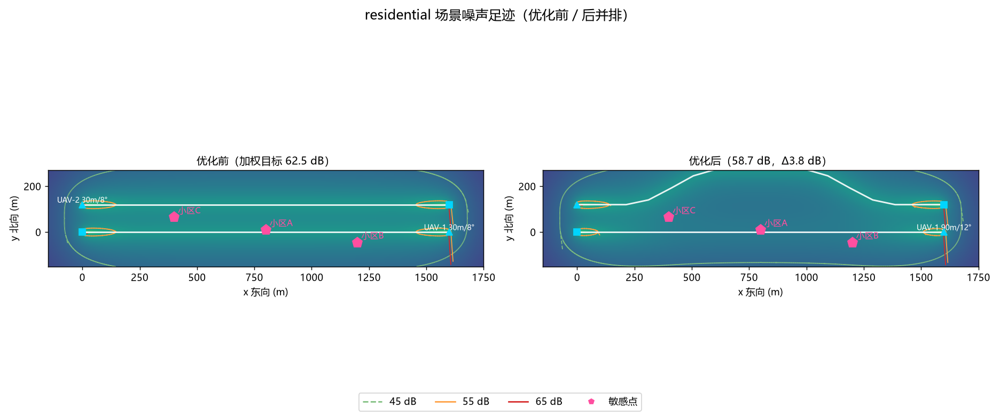
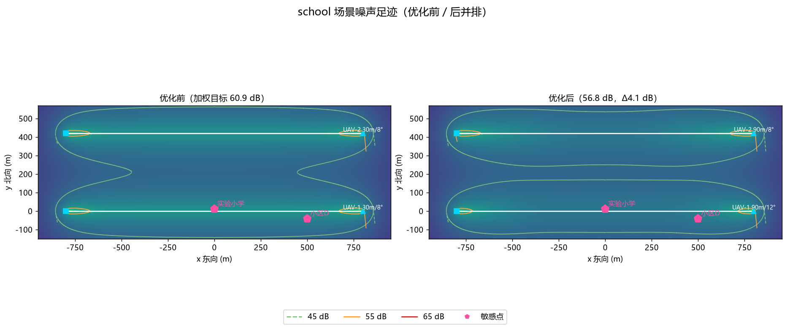
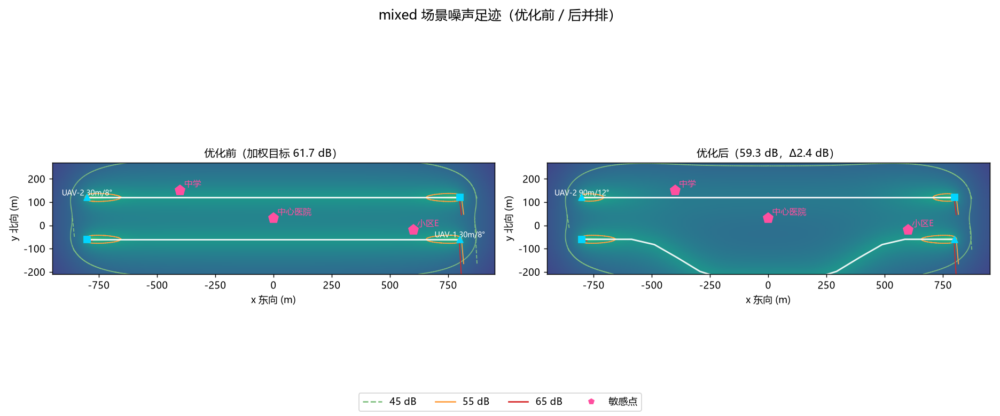

# 城市低空噪声足迹评估与航线降噪（MuJoCo 闭环验证）

## 1. 背景与定位

城市上空的点对点配送与巡检航线密集起来之后，**噪声扰民**成了低空经济落地
的主要阻力之一。同一片城区，航线从学校操场上空掠过还是偏出去 200 m、
巡航 60 m 还是 120 m，敏感点的等效连续 A 声级（LAeq,T）能差出好几 dB，而
昼间限值往往只差 1 dB 就超标。

配套模块 [`uav_deconflict`](./uav_deconflict.md) 管空中机机间隔，
[`uav_vertiport_queue`](./uav_vertiport_queue.md) 管地面起降位资源；本模块
往下补**环境噪声**这一层：

* 输入：若干条航线、若干敏感点（学校/医院/居民区）及其限值、小时航班密度；
* 输出：每个敏感点的 LAeq,T、45/55/65 dB 足迹等值线，以及一份"噪声达标、
  航程代价受控"的降噪方案；
* 证明：降噪方案经 MuJoCo 刚体闭环真飞后，用**真实位置日志回灌声学模型**
  重算 LAeq，结论不变。

## 2. 声学与暴露模型

### 2.1 声源与传播

桨盘输入功率 P 换算 A 计权声功率级（工程近似，标定常数 K=70.73，使基准
机型 P=300 W 时 100 m 处约 55 dB）：

```
Lw = 10·log10(P) + K
```

传播取自由场球面扩散 + 大气吸收两项：

```
Lp(r) = Lw − 20·log10(r) − α·r        (α ≈ 0.5 dB/100 m @ 500 Hz)
```

### 2.2 LAeq 与噪声足迹

航迹按 2 m 采样（斜爬升/平飞/斜下降全程），每个采样点对每个敏感点算 Lp，
能量叠加后按场景的小时航班密度归一到 1 小时观测期，得到 LAeq,T；多机按
能量相加。足迹在航迹包络外扩 150 m 的矩形上取 200×200 栅格逐格计算，
用自实现的 marching squares（纯 numpy）提取 45/55/65 dB 等值线段与超限面积。

敏感点限值（昼间，dB(A)）：居民区 60、学校 55、医院 55。

## 3. 降噪优化

三种手段，按"目标改善量 / 航程代价"贪心择优，每架每手段至多一次：

1. **抬升巡航高度** +30/+60 m——球面扩散直接拉低敏感点 Lp；
2. **侧向平移航线**——巡航段余弦台阶横移，与敏感点保持 ≥200 m 缓冲；
3. **起降段爬升更陡** 8°→12°——更快离开起降点附近的敏感点。

目标函数为各敏感点 LAeq 的能量加权（最吵的点主导），约束为**航程增幅
≤ 15%**，几何不可行的候选自动跳过并记录原因。

## 4. 实测结果

### 4.1 三场景降噪前后

| 场景 | 敏感点布置 | 加权目标 前 | 后 | 改善 | 航程增幅 |
| --- | --- | ---: | ---: | ---: | ---: |
| residential | 两条航线沿居民区同走廊对飞，小区 A 几乎在航迹正下方 | 62.5 dB | 58.7 dB | 3.8 dB | +2.04% |
| school | 航线从学校操场上空掠过，处于 200 m 缓冲区内 | 60.9 dB | 56.8 dB | 4.1 dB | +0.00% |
| mixed | 医院 + 学校 + 居民区混合，两机交叉穿越 | 61.7 dB | 59.3 dB | 2.4 dB | +2.43% |







school 场景的降噪动作是纯侧向平移（航程不变），把航线从操场上方挪出
200 m 缓冲区，学校点从 55.0 dB（限值 55，超标）降到 51.7 dB；mixed 场景
三个动作组合后中学点从 55.0 超标降到 51.7 达标，医院降 3.1 dB。

### 4.2 MuJoCo 闭环

每个场景抽对敏感点贡献最大的一架，降噪前后各真飞一次（复用
`uav_mujoco_sim` 的 Quadrotor + GeometricController；参考速度前馈加一阶
低通 τ=0.5 s、姿态阻尼 kw=−0.18）：

| 场景 | 最大跟踪误差 | 终点误差 | 真实高度重算 LAeq 与计划偏差 |
| --- | ---: | ---: | ---: |
| residential | 3.86 m（限 8 m） | 0.84 m | 0.0 dB |
| school | 3.86 m（限 8 m） | 0.84 m | 0.0 dB |
| mixed | 3.86 m（限 8 m） | 0.85 m | 0.0 dB |

真飞位置 20 Hz 记录后逐点回灌声学模型重算，敏感点 LAeq 与计划值最大偏差
0.0 dB——说明降噪结论不是纸面推算，闭环后依然成立。

## 5. 复现

```bash
pip install numpy matplotlib pyyaml
cd src/air/uav_noise_footprint
bash tools/ci_tests.sh      # 44 项测试（无 MuJoCo 时闭环用例自动跳过）
python main.py --no-sim     # 三场景算法层（约 3 s）
python main.py              # 三场景 + MuJoCo 闭环真飞（约 110 s）
```

结果写入 `results/`，足迹图写入 `images/`。
