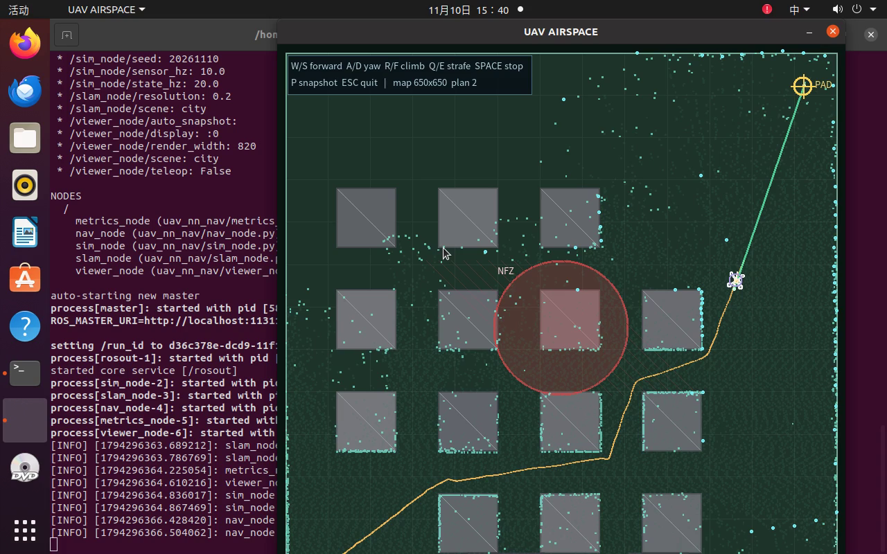
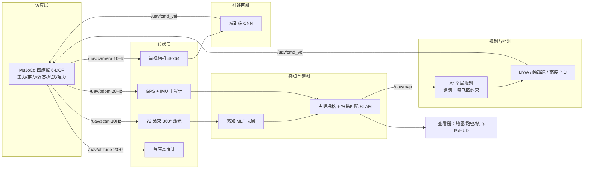
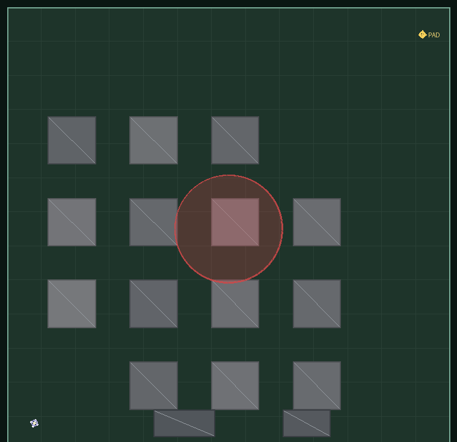
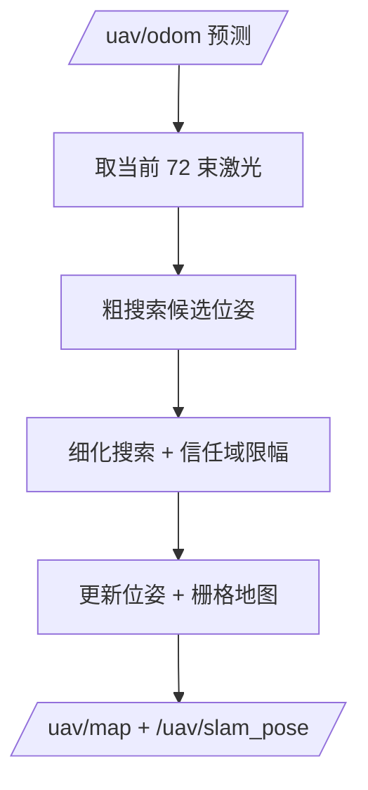

# 四旋翼无人机 UAVNN：MuJoCo 物理仿真、激光 SLAM 与纯 NumPy 神经网络导航

> 模块源码：[`src/air/uav_numpy_nn_slam`](https://github.com/OpenHUTB/ros2/tree/master/src/air/uav_numpy_nn_slam)
> 运行环境：Ubuntu 20.04.6 + ROS Noetic + MuJoCo 3.1–3.2 + Python 3.11（项目私有 venv）
> 关键词：四旋翼、6-DOF、禁飞区、激光 SLAM、A*、DWA、行为克隆、端到端 CNN、DQN、REINFORCE



## 1. 概述

空域载具（无人机）在物流配送、巡检、应急救援等任务中需要在**城市楼宇、峡谷地形与机场禁飞区**之间安全穿行，同时面对风扰、无 GPS 拒止与传感器噪声。本模块给出一套可在普通笔记本虚拟机（无 GPU、无独立显卡）中完整运行的四旋翼无人机示例，覆盖从**物理仿真**到**神经网络闭环导航**的完整链路：

1. **物理仿真与键盘运动控制**：MuJoCo 3.1–3.2 建立 6 自由度四旋翼刚体：真实重力、机体 z 轴推力、姿态 PD、气动阻力与风扰（1.6/0.7 m/s + 阵风），`W/A/S/D/R/F/Q/E` 遥控；
2. **多传感器感知**：72 波束 360° 激光雷达（距离噪声、野值、丢点）、气压高度计、GPS、IMU 与前视相机；感知 MLP 对激光去噪；
3. **建图与导航**：对数几率占据栅格 + 相关性扫描匹配 SLAM；A* 全局规划把**建筑与禁飞区**都作为硬约束（4 m 规划缓冲 + 6 m 安全网），DWA 局部规划 + 纯跟踪 + 高度 PID；
4. **端到端模型**：相机图像（48×64×3）→ 2 层 CNN → 速度指令 `(v_x, ω_z)`；
5. **神经网络训练/测试/ROS 封装**：纯 NumPy 实现 MLP/CNN/Adam/DQN/REINFORCE，7 个模型、8 个 ROS 节点、6 个 launch；
6. **多场景性能评价**：`city`（城市）、`canyon`（峡谷）、`airport`（机场）三场景闭环 benchmark，含禁飞区侵入指标与 RL 算法/网络结构对比。

## 2. 系统架构



## 3. 四旋翼动力学与传感器模型

### 3.1 六自由度刚体动力学

仿真开启真实重力，机体推力沿机身 z 轴，姿态由力矩控制：

$$
m\dot{\mathbf{v}} = \mathbf{R}\,\mathbf{e}_z T + \mathbf{F}_{\text{drag}} + \mathbf{F}_{\text{wind}} - m g \mathbf{e}_z,\qquad
\mathbf{I}\dot{\boldsymbol{\omega}} = \boldsymbol{\tau} - \boldsymbol{\omega}\times(\mathbf{I}\boldsymbol{\omega})
$$

其中 $T\in[0, T_{\max}]$ 为总推力（4 旋翼合计上限 26 N，悬停约 13.7 N），$\mathbf{R}$ 为机体到世界旋转矩阵。控制器为速度环 + 姿态环级联：

$$
\mathbf{a}_{\text{des}} = \mathbf{K}_p(\mathbf{v}_{\text{cmd}}-\mathbf{v}) + \mathbf{K}_i\!\int(\mathbf{v}_{\text{cmd}}-\mathbf{v})dt
$$

$$
T = \left\| m(\mathbf{a}_{\text{des}} + g\mathbf{e}_z)\right\|,\qquad
\mathbf{b}_{z,\text{des}} = \frac{m(\mathbf{a}_{\text{des}} + g\mathbf{e}_z)}{\left\|\cdot\right\|}
$$

姿态误差采用 SO(3) 形式 $e_R = \frac12\left(\mathbf{R}_{\text{des}}^\top\mathbf{R} - \mathbf{R}^\top\mathbf{R}_{\text{des}}\right)^{\vee}$，力矩 $\boldsymbol{\tau} = -k_R e_R - k_\omega\boldsymbol{\omega} + k_\psi(\omega_z^{\text{cmd}}-\omega_z)\mathbf{e}_z$。

### 3.2 气动阻力与风扰

$$
\mathbf{F}_{\text{drag}} = -\left(\mathbf{C}_l(\mathbf{v}-\mathbf{v}_w) + \mathbf{C}_q\left|\mathbf{v}-\mathbf{v}_w\right|(\mathbf{v}-\mathbf{v}_w)\right)
$$

风场由均值（1.6, 0.7）m/s 与 Ornstein–Uhlenbeck 阵风过程组成（相关时间 6 s，幅值 1.2 m/s），模拟城市/峡谷中的湍流。

### 3.3 传感器模型

- **激光雷达**：360°、72 波束、量程 0.5–60 m，射线求交后叠加 0.05 m 高斯噪声、0.8% 比例误差、4% 野值、3% 丢点；
- **气压高度计**：高度 + 0.06 m 噪声；**GPS**：位置 + 0.45 m 噪声与慢漂移；**IMU**：偏航角/角速度噪声；
- **相机**：由前向激光深度剖面渲染天空/地面/建筑剪影得到 48×64 RGB 图像。

### 3.4 场景与禁飞区

| 场景 | 尺寸 | 巡航高度 | 主要障碍 | 禁飞区 |
| --- | --- | --- | --- | --- |
| `city` | 130 × 130 m | 32 m | 4×4 街区高楼 + 低矮仓库 | 1 块（中心，r=16 m） |
| `canyon` | 120 × 140 m | 28 m | 两侧绝壁、南北崖壁、4 座岩柱 | 1 块（中央，r=12 m） |
| `airport` | 150 × 120 m | 34 m | 航站楼、塔台、机库 | 2 块（r=20 m / r=13 m） |



## 4. SLAM：占据栅格建图与扫描匹配定位

每个栅格维护对数几率 $L_t=\log\frac{p}{1-p}$，沿激光波束用射线遍历：终点加占据证据、途经格加空闲证据，并截断到 $[0.12,0.88]$：

$$
L_t(m_i) = L_{t-1}(m_i) + \begin{cases}
\log\frac{p_{\text{hit}}}{1-p_{\text{hit}}} & \text{命中}\\
\log\frac{p_{\text{miss}}}{1-p_{\text{miss}}} & \text{穿过}
\end{cases}
$$

在里程计预测位姿附近做粗到细相关性扫描匹配：

$$
(\hat x,\hat y,\hat\theta) = \arg\max_{\Delta}\sum_{k=1}^{72} p_{\text{occ}}\!\left(\mathcal{T}(x_t+\Delta x,\ y_t+\Delta y,\ \theta_t+\Delta\theta)\cdot r_k\right)
$$

无效波束（丢点/野值）不参与匹配；输出 `/uav/map` 与 `/uav/slam_pose`。



## 5. 规划与控制

### 5.1 禁飞区约束的 A*

规划栅格 0.4 m，圆形膨胀 1.8 m（≥ 无人机安全半径 1.2 m），建筑与禁飞区都计入 `planning_map()`；对禁飞区额外保留 4 m 规划缓冲。代价与启发式采用八方向 octile 距离，路径经 supercover 视线平滑（禁止斜穿障碍角点）。

### 5.2 纯跟踪与高度 PID

前视距离 $L_d=2.6$ m 处目标点产生期望航向：

$$
\omega_z = k_\psi\frac{2 v_x \sin\alpha}{L_d},\qquad
v_x=\mathrm{clip}(v_{\max}\cos\alpha,\,0,\,v_{\max})
$$

高度保持采用 PID（±3 m/s 限幅，8–55 m 包络）：

$$
u_z = K_p e_z + K_i\!\int e_z dt + K_d\dot e_z,\qquad e_z = z^{\text{target}}-z
$$

### 5.3 禁飞区安全网与安全滤波

前向 55° 扇区激光余量 < 3.2 m 时减速、< 1.6 m 时禁止前进；当与禁飞区边界距离 < 6 m 时施加向外 3.0 m/s 的排斥速度（增益 2.2），确保即使规划异常也不会侵入禁飞区。

## 6. 神经网络

全部网络以**纯 NumPy** 实现（前向/反向传播、Adam、CNN im2col），不依赖 PyTorch/TensorFlow。

| 网络 | 结构 | 任务 | 实测指标 |
| --- | --- | --- | --- |
| `perception_mlp` | 72→160→160→72 | 激光去噪（残差回归） | RMSE **7.127 → 5.635 m（−20.9%）**（source: `results/benchmark.json`） |
| `control_mlp` | 46→160→160→3 | 行为克隆（vx, vy, ω） | vx MAE **0.372 m/s**、yaw MAE **0.093 rad/s** |
| `planner_mlp` | 46→128→128→8 | 8 方向局部决策 | 准确率 **77.9%** |
| `e2e_cnn` | 3×48×64→8×16→64→2 | 图像→速度指令 | vx MAE 1.29 m/s，闭环 0% |
| `rl_dqn` / `rl_pg` | 2×64 / 3×64 MLP | 离散空域导航 RL | DQN 2×64 **100%**、DQN 3×64 **100%**、REINFORCE **93.3%** |

训练数据由 A* + 反应式专家在三种场景采集，并按 episode 划分验证集；总训练时间约 15 分钟（CPU）。

## 7. ROS 接口

| 话题 | 类型 | 说明 |
| --- | --- | --- |
| `/uav/cmd_vel` | `geometry_msgs/Twist` | `linear.x/y` 世界系速度、`linear.z` 升降、`angular.z` 偏航角速度 |
| `/uav/scan` | `sensor_msgs/LaserScan` | 72 波束 360° 激光（含噪声） |
| `/uav/scan_filtered` | `sensor_msgs/LaserScan` | 感知网络去噪后的激光 |
| `/uav/odom` | `nav_msgs/Odometry` | GPS+IMU 里程计 |
| `/uav/altitude` | `std_msgs/Float64` | 气压高度（m） |
| `/uav/imu` | `sensor_msgs/Imu` | 姿态与角速度 |
| `/uav/camera/image_raw` | `sensor_msgs/Image` | 48×64 `bgr8` 图像 |
| `/uav/map` | `nav_msgs/OccupancyGrid` | 占据栅格地图 |
| `/uav/slam_pose` | `geometry_msgs/PoseStamped` | SLAM 估计位姿 |
| `/uav/plan` | `nav_msgs/Path` | A* 全局路径 |
| `/uav/state` | `std_msgs/String` | JSON 状态（查看器/评测使用） |

启动文件：`teleop.launch`、`slam_nav.launch`、`perception.launch`、`e2e.launch`、`benchmark.launch`、`bringup.launch`。

## 8. 运行效果

### 8.1 城市空域键盘遥控


### 8.2 激光 SLAM + A* 自主导航（峡谷场景）


### 8.3 端到端 CNN 导航（机场场景）

> 端到端 CNN 的动图未随仓库提供（体积较大），可运行 `bash main.sh e2e city` 复现。

### 8.4 Ubuntu 桌面实操录屏

> 桌面实操录屏（2 分 58 秒）体积较大，未随仓库提供；下方为运行截图。


## 9. 多场景性能评价

| 场景 | 控制器 | 成功率 | 平均耗时 (s) | 碰撞 | 禁飞区侵入 | 终点误差 (m) | 高度误差 (m) | 路径长度 (m) |
| --- | --- | --- | --- | --- | --- | --- | --- | --- |
| city | 经典 SLAM+A*+纯跟踪 | 100% | 35.0 | 0 | 0 | 2.98 | 0.005 | 175.8 |
| canyon | 经典 SLAM+A*+纯跟踪 | 100% | 16.3 | 0 | 0 | 3.00 | 0.013 | 77.9 |
| airport | 经典 SLAM+A*+纯跟踪 | 100% | 31.4 | 0 | 0 | 2.90 | 0.006 | 168.8 |
| canyon | 神经控制（行为克隆） | 100% | 17.6 | 0 | 0 | 2.97 | 0.175 | 80.7 |
| airport | 神经控制（行为克隆） | 100% | 32.3 | 0 | 0 | 2.76 | 0.071 | 170.7 |
| city | 神经控制（行为克隆） | 0% | 45.0 | 4 | 0 | 104.42 | 1.248 | 83.5 |
| canyon | 神经两级控制 | 100% | 34.1 | 0 | 0 | 2.81 | 0.138 | 120.3 |
| city / airport | 神经两级控制 | 0% | 45.0 | 0 | 0 | 103.4 / 124.4 | 1.24 / 1.39 | 75.4 / 123.8 |
| 三场景 | 端到端 CNN | 0% | 45.0 | 0 | 0 | 117.2 / 67.7 / 57.2 | — | — |

**SLAM 与规划**：三场景 ATE RMSE 0.276 / 0.266 / 0.354 m（均值 0.298 m），建图覆盖率 22.8 / 30.0 / 45.2 %（覆盖率按整幅地图统计，未含未探索区域）；A* 路径 181.1 / 80.3 / 169.7 m，最小离障 1.80 / 2.20 / 2.06 m，规划耗时 646 / 148 / 415 ms。

**RL 对比**：同一离散空域环境（55 维状态、8 动作）下 DQN 2×64 与 3×64 均达到 100% 成功率（平均回报 38.59 / 38.56），REINFORCE 93.3%（37.21）；2 层网络训练 42 s，3 层网络训练 127 s，说明该任务不需要更深网络。

**失败分析**：单级神经控制与端到端 CNN 属于局部策略，缺少全局路径记忆；city 场景需要连续绕楼与禁飞区规避，局部策略容易陷入死角。两级神经控制（`planner_mlp` 选方向 + `control_mlp` 跟踪）在 canyon 达到 100%，但 planner 的监督标签以直行为主，city/airport 转角样本不足。改进方向：随机朝向采集 planner 标签、增加转弯样本，并让 planner 使用 A* 子目标而非固定 1.5 m 前瞻点。

## 10. 复现步骤

```bash
cd src/air/uav_numpy_nn_slam
bash main.sh setup
bash main.sh test
bash scripts/build_ros.sh
bash main.sh teleop city
bash main.sh slam_nav canyon
bash main.sh train
.venv/bin/python tools/evaluate.py --scenes city,canyon,airport
```

结果 JSON 写入 `results/`（训练指标、三场景 benchmark、ROS 运行记录）。

## 11. 已知限制

- 6-DOF 刚体 + 显式气动模型未经真实风洞参数辨识；激光为几何射线仿真，未建模反射/多径；
- 端到端 CNN 与单级神经控制闭环成功率低（0%），原因与改进方向见第 9 节；
- 视觉相机为激光深度剖面着色，非真实光学渲染；
- 未使用 GPU，CNN 训练与推理均为 CPU 版本。

## 12. 参考

- MuJoCo 官方文档：<https://mujoco.readthedocs.io/>
- ROS Noetic：<https://wiki.ros.org/noetic>
- 本仓库已有空域示例：`docs/air/` 下 AirSim / PX4 相关教程
- 教材参考：OpenHUTB ros2 文档仓库、ROS 教材相关章节

> 本模块由课程作业独立实现，未使用他人代码；AI 工具仅用于代码实现与文档撰写辅助，提交内容由作者负责。
