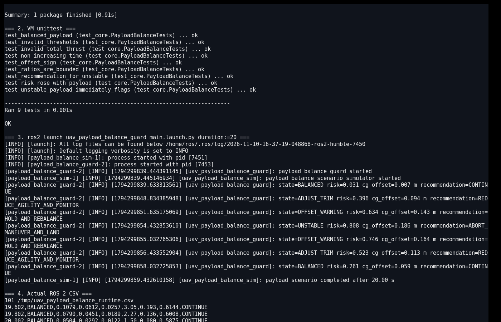
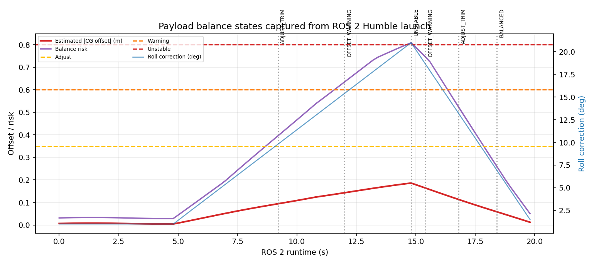

# 无人机载荷重心偏移与配平监测

本项目面向挂载载荷后左右方向重量分布变化、悬停姿态修正增大或横摆增大的情况。模块根据左右推力差、滚转修正量、横摆速度和载荷利用率，估计横向重心偏移并判断配平是否超过安全包线。

与 `无人机载荷质量估计` 的区别：

- 质量估计模块关注总载荷重量；
- 本模块关注载荷横向位置和配平压力；
- 不要求知道载荷绝对几何位置，只利用飞行动力学响应给出偏移估计。

## 1. 重心偏移估计

推力不平衡比例：

\[
q=\frac{T_L-T_R}{T_L+T_R}
\]

横向重心偏移的简化估计：

\[
\hat x_{cg}=qL
\]

其中 \(L=0.42\) m 是有效横向力臂参数。风险同时考虑：

\[
R=0.38R_{thrust}+0.29R_{roll}+0.23R_{sway}+0.10R_{payload}
\]

当推力不平衡 ≥ 0.85，且滚转修正或横摆速度明显时，立即进入 `UNSTABLE`。

## 2. ROS 2 接口

| 话题 | 类型 | 方向 | 说明 |
|---|---|---|---|
| `/uav_payload/balance_sample` | `std_msgs/String` | 输入 | 左右推力、滚转修正、横摆和载荷质量 |
| `/uav_payload/balance_assessment` | `std_msgs/String` | 输出 | 推力不平衡、估算重心偏移和风险 |
| `/uav_payload/balance_advice` | `std_msgs/String` | 输出 | 继续、降低机动、保持配平或中止降落 |

## 3. 构建与运行

```bash
source /opt/ros/humble/setup.bash
colcon build --symlink-install --packages-select uav_payload_balance_guard
source install/setup.bash
ros2 launch uav_payload_balance_guard main.launch.py duration:=20
```

CSV 默认写入 `/tmp/uav_payload_balance_runtime.csv`。

## 4. Humble 虚拟机实测

Ubuntu 22.04.5 / ROS 2 Humble 下真实构建成功，VM 内 9 项 `unittest` 全部通过。`ros2 launch` 启动两个节点，运行 20 秒并记录 100 条状态。

实际状态迁移：

```text
BALANCED → ADJUST_TRIM → OFFSET_WARNING → UNSTABLE
→ OFFSET_WARNING → ADJUST_TRIM → BALANCED
```

故障段估算横向重心偏移约 0.186 m，滚转修正超过 20°，横摆速度约 1.5 m/s；恢复后偏移降至 0.012 m。

VM 内实际终端截图同时记录了 Ubuntu/ROS 版本、`colcon build`、9 项单元测试、两个节点启动、重心状态迁移和 CSV 尾部：



根据同一轮 CSV 生成的载荷重心曲线：



## 5. 限制

1. 输入和重心偏移由确定性仿真生成，未在真实多旋翼或测力台上标定。
2. 0.42 m 横向力臂是示例参数，实际值依赖机架、电机位置和载荷安装方式。
3. 未区分阵风、机体气动不对称和载荷偏移造成的滚转修正。
4. 当前只估计横向一维重心偏移，尚未估计前后和垂直方向。
5. 模块不重新分配载荷，也不直接控制姿态或降落。

## 6. 大模型使用声明

使用 OpenAI Codex 辅助完成代码、测试、文档和运行图生成；作者已逐项复核代码、参数和结果，并对提交内容、数据真实性和后续维护负责。
