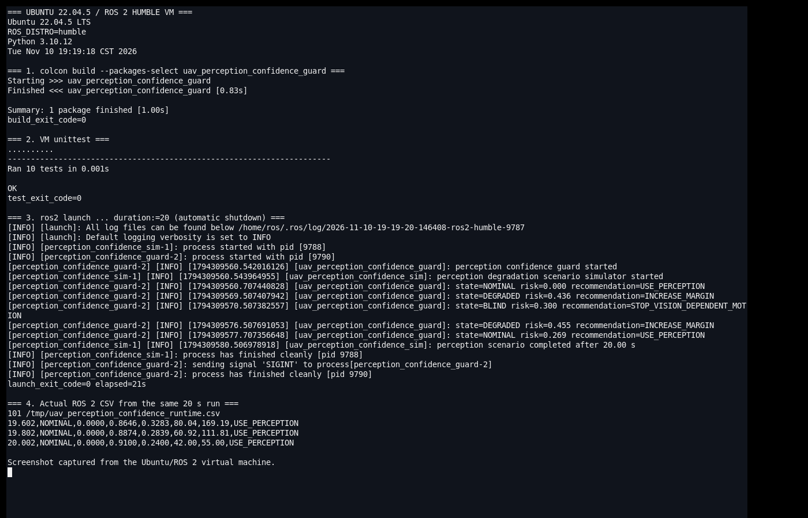
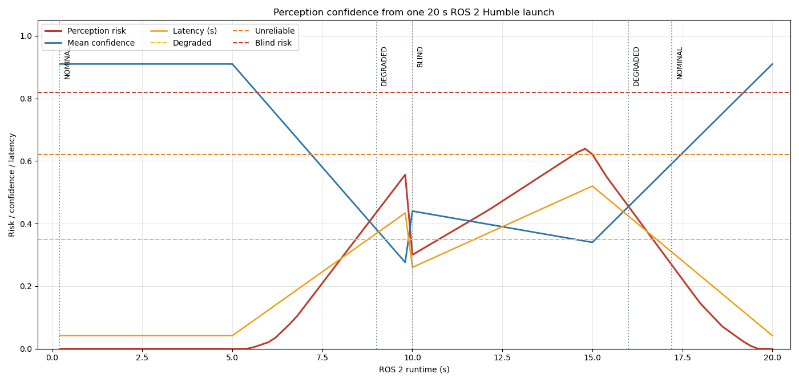

# 无人机视觉感知置信度退化保护

本项目用于无人机视觉任务运行时的感知健康监测。模块综合目标是否应存在、检测数量、平均置信度、预测熵、推理延迟、帧年龄和照度，判断模型输出是否还能用于运动控制。

与云台重捕获模块的区别：

- 云台重捕获模块处理目标丢失后的搜索与视轴误差；
- 本模块不跟踪目标位置，而是评估整条视觉感知结果是否可信；
- 输出可用于暂停视觉依赖机动、扩大安全距离或切换备用策略。

## 1. 风险模型

\[
R=0.30R_{confidence}+0.22R_{entropy}+0.20R_{latency}
\quad +0.16R_{freshness}+0.07R_{light}+0.05R_{missing}
\]

当任务预期存在目标但检测数为零时，`R_missing=0.55`，按公式贡献 `0.05×0.55=0.0275` 的风险并立即进入 `BLIND`。帧年龄超过 1.4 秒、推理延迟超过 480 毫秒也会立即进入盲区状态。

状态：

| 状态 | 建议 |
|---|---|
| `NOMINAL` | 正常使用感知结果 |
| `DEGRADED` | 增大安全距离 |
| `UNRELIABLE` | 保持或返航 |
| `BLIND` | 停止依赖视觉的运动 |

## 2. ROS 2 接口

| 话题 | 类型 | 方向 | 说明 |
|---|---|---|---|
| `/uav_perception/confidence_sample` | `std_msgs/String` | 输入 | 检测统计、熵、延迟、帧年龄和照度 |
| `/uav_perception/confidence_assessment` | `std_msgs/String` | 输出 | 风险、置信度不足和实时性风险 |
| `/uav_perception/confidence_advice` | `std_msgs/String` | 输出 | 继续、增加裕度、保持/返航或停止视觉机动 |

## 3. 构建与运行

```bash
source /opt/ros/humble/setup.bash
colcon build --symlink-install --packages-select uav_perception_confidence_guard
source install/setup.bash
ros2 launch uav_perception_confidence_guard main.launch.py duration:=20
```

CSV 默认写入 `/tmp/uav_perception_confidence_runtime.csv`。

当 `duration` 大于 0 时，模拟器结束会触发整个 launch 自动关闭；默认 `duration:=0.0` 表示持续运行，此时使用 `Ctrl+C` 手动停止。

## 4. Humble 虚拟机实测

Ubuntu 22.04.5 / ROS 2 Humble / Python 3.10.12 下真实构建成功，VM 内 10 项 `unittest` 全部通过。`ros2 launch ... duration:=20` 启动两个节点并在约 20 秒后自动退出。

实际状态迁移：

```text
NOMINAL → DEGRADED → BLIND → DEGRADED → NOMINAL
```

故障段预测目标存在但检测数为零，推理延迟接近 520 ms，帧年龄超过 1.4 s；恢复后置信度回到 0.91，延迟降至 42 ms。

VM 内实际终端截图同时记录了 Ubuntu/ROS 版本、`colcon build`、10 项单元测试、两个节点启动、感知状态迁移、自动退出和 CSV 尾部：



根据同一轮 CSV 生成的感知置信度曲线：



## 5. 限制

1. 检测数量、置信度、熵和延迟来自确定性仿真，没有运行真实神经网络。
2. 预测熵是输入值，没有实现 MC Dropout、深度集成或温度标定。
3. 不同检测器的置信度尺度不同，阈值必须按模型验证集重新标定。
4. 照度只作为简单风险因子，未处理雨雾、运动模糊、镜头污渍和曝光失效。
5. 模块不直接暂停飞控，只输出感知健康建议。

## 6. 大模型使用声明

使用 OpenAI Codex 辅助完成代码、测试、文档和运行图生成；作者已逐项复核代码、参数和结果，并对提交内容、数据真实性和后续维护负责。
