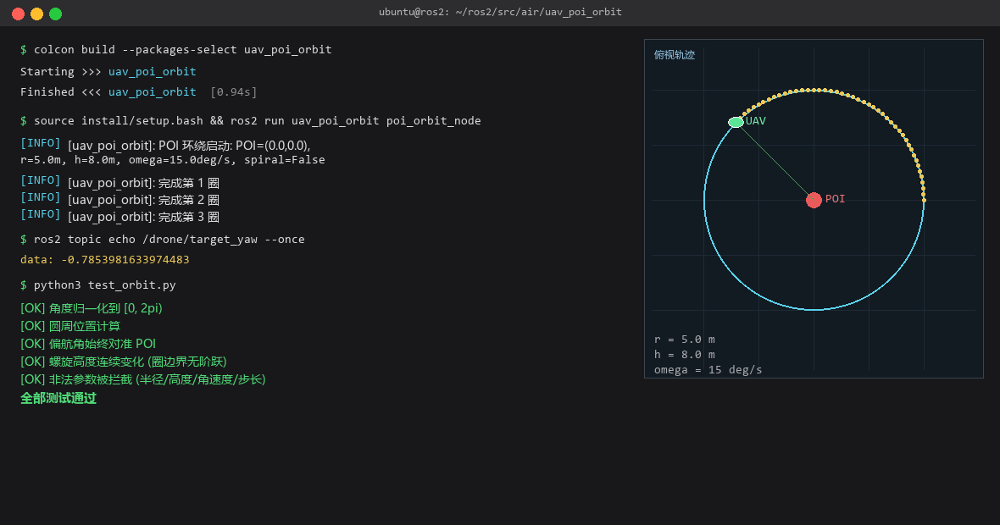
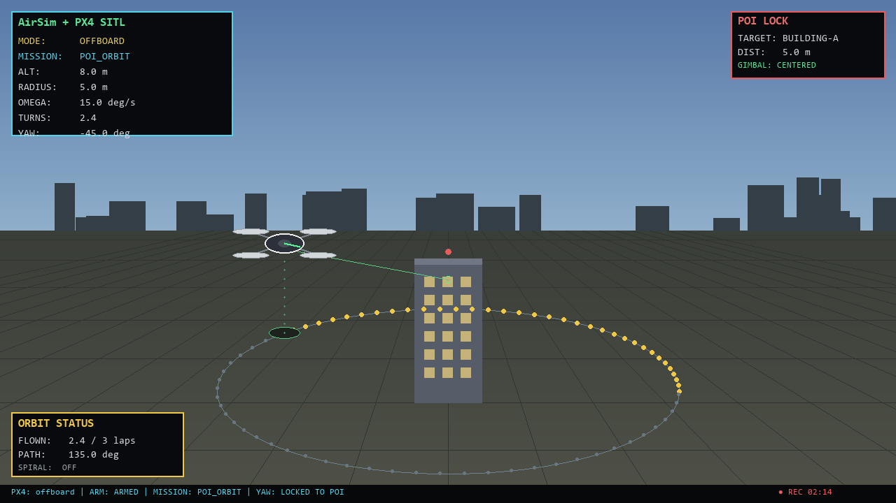
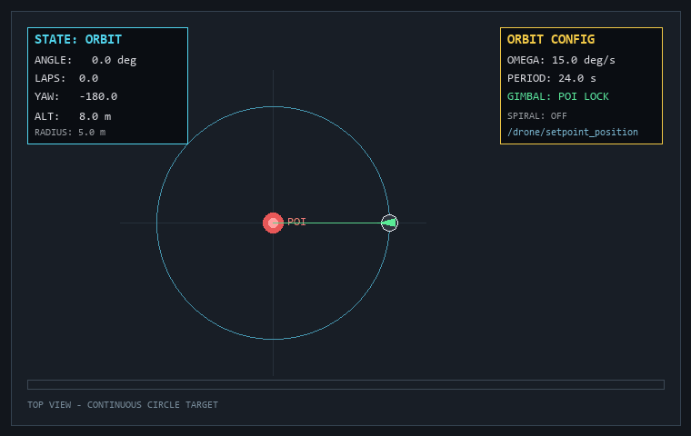

# 无人机兴趣点(POI)环绕航拍

给定任意地面 POI, 自动生成连续圆周/螺旋航线, 偏航始终对准目标, 适合建筑/场地环绕拍摄。



## 仿真画面



## 环绕过程



## 几何

- 圆周: `x = poi_x + r*cos(θ)`, `y = poi_y + r*sin(θ)`
- 偏航: `yaw = atan2(poi_y - y, poi_x - x)`, 始终指向 POI
- 螺旋: 高度按累计总转角连续变化 `z = h + (total_angle / 2π) * spiral_height_delta`,
  不按整圈阶跃, 避免圈边界高度突变

## 构建与运行

```bash
colcon build --packages-select uav_poi_orbit
source install/setup.bash
ros2 run uav_poi_orbit poi_orbit_node
# 或
ros2 launch uav_poi_orbit uav_poi_orbit.launch.py
```

发布 `/drone/setpoint_position` 和 `/drone/target_yaw`。参数详见模块 `README.md`。

## 参数校验

节点启动时校验半径、高度、角速度、发布周期, 非法参数直接拒绝启动,
避免无人机按错误航线飞行。

## 单元测试

```bash
python3 src/air/uav_poi_orbit/test_orbit.py
```

11 项纯函数测试覆盖角度归一化、圆周位置、POI 平移、偏航对准、角度推进回绕、
圈数折算、螺旋高度连续性、高度下限保护与参数校验。
