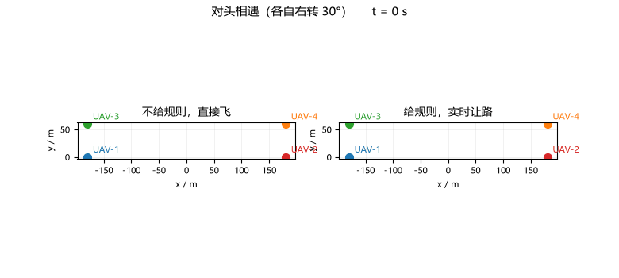
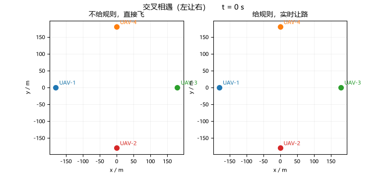
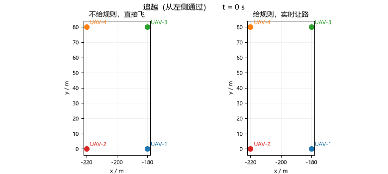
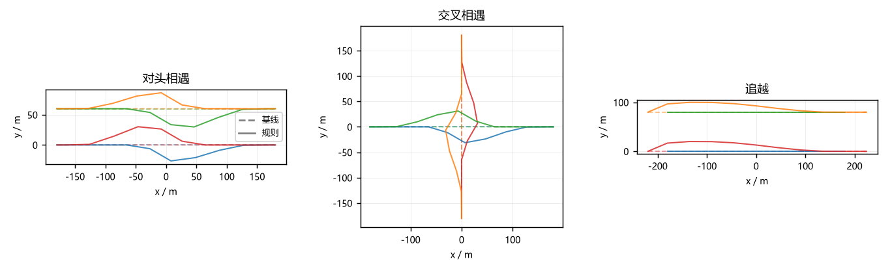

# 低空多机路权判定与让路恢复（MuJoCo 真飞）

## 1. 这是什么

低空无人机按计划飞，但航路交叉、对头、追越免不了在空中碰到一起。
`uav_deconflict` 在起飞前把计划层的冲突解掉，可计划赶不上变化：
风、计时误差、临时任务都会让两机实际靠得很近。这个模块补的就是
飞行中这一层——两机 8 秒内最近距离会小于 40 m 时，当场决定谁让谁、
怎么让，并把每条决策的理由记下来，事后可以逐条对账。

它不管起飞前的事，也不改飞行计划；让路动作作用在参考速度上，
飞完这一段就恢复原计划。

## 2. 运行效果

三个场景，每架机用 `uav_mujoco_sim` 的四旋翼刚体模型真飞
（几何控制器 + 刚体积分，指标取自真实位置而不是计划点）。

### 对头相遇

左栏不开规则直飞，右栏开规则。看得出来右侧两对机在相遇前各自
右转拉开了距离：



### 交叉相遇

同优先级按左让右处理，右侧机先走：



### 追越

前机保速保向，追越机左偏 20 m 从左侧通过：



### 轨迹总览

三场景的基线（虚线）与规则启用（实线）俯视对比：



### 数字

全程机对间最小三维距离：

| 场景 | 不开规则 | 开规则 | 决策次数 |
|---|---|---|---|
| 对头 | 1.68 m | 14.56 m | 6 |
| 交叉 | 1.19 m | 33.44 m | 8 |
| 追越 | 0.42 m | 19.98 m | 4 |

代价是航迹偏离计划的平均值从 2~3 m 涨到 4~8 m。

每条决策长这样（`results/<场景>_result.json` 里的 `decision_log`）：

```text
规则③对头相遇：与 UAV-2 航向差 180°、CPA 37m@8.0s，各自右转30°
规则②交叉相遇左让右：UAV-2 位于本机右侧（叉积 -44.1），右转30°让行（CPA 40m@8.0s）
规则④追越：从左侧追越 UAV-1，左偏20m保持间隔（正后方，CPA 25m@8.0s）
```

## 3. 做法

**判定（`core/detect.py`）**：双方近似匀速直线，相对运动解析求 CPA：

```
t_cpa = -Δp·Δv / |Δv|²,   d_cpa = |Δp + Δv·t_cpa|
```

`0 < t_cpa ≤ 8 s` 且 `d_cpa < 40 m` 才算威胁。正在远离（`t_cpa ≤ 0`）
不算，否则追越通过之后永远恢复不了。

**规则（`core/rules.py`）**：优先级 → 左让右 → 对头各右转 → 追越左侧，
和船只避碰规则一脉相承。几何分类：航向差 > 150° 对头、< 10° 追越、
其余交叉；左右侧看航向叉积符号。让路动作四种：右转 30°、降高 10 m、
减速 30%、左侧追越偏置，全部作用在参考速度上，控制器本身不动。

**恢复（`core/recover.py`）**：威胁消失后先观察 3 s，再按余弦剖面
`(1 + cos πs)/2` 把偏移收回去，两端速度为零，不激励姿态环。恢复期间
每个决策周期照常检测，有二次冲突立刻中止恢复重新决策。

**闭环（`core/sim.py`）**：每架机独立实例化 `uav_mujoco_sim` 的
`Quadrotor` + `GeometricController`，参考速度前馈经一阶低通
（τ = 0.5 s）、姿态阻尼 kw ≈ −0.18，写法与 `uav_deconflict` 的
`core/sim.py` 一致，防止航向阶跃把姿态打震荡。`--no-sim` 时退化成
纯运动学参考点，判定/规则/恢复走同一套代码。

## 4. 复现

```bash
cd src/air/uav_right_of_way
python main.py                  # 三场景基线+规则 6 次真飞，本机约 70 s
python main.py --scenario headon
python tools/make_gif.py        # 重新录上面三个动图
python -m pytest test/ -q       # 48 项测试
```

安装、ROS 节点话题说明见模块
[README](https://github.com/OpenHUTB/ros2/tree/master/src/air/uav_right_of_way)。

## 5. 已知限制

- 判定假设两机短时间匀速直线，对方急机动时预测会偏；
- 只算两两相遇，三机以上同时触发时靠优先级字段兜底，没有做组合让路；
- 让路幅度（30° / 10 m / 30%）是固定参数，没有按相遇几何自适应。
