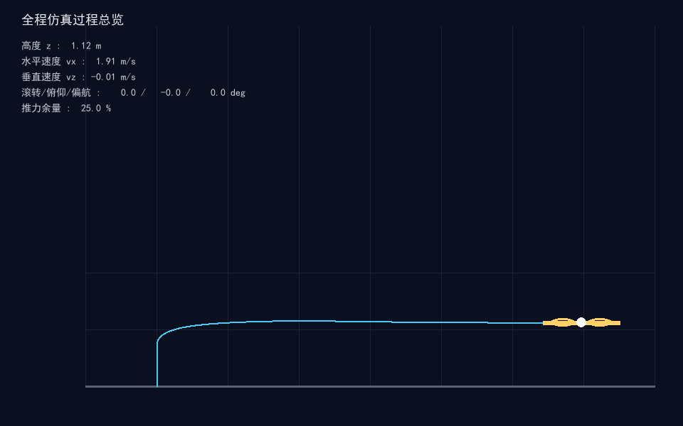
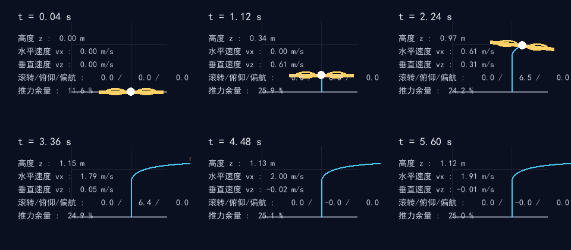
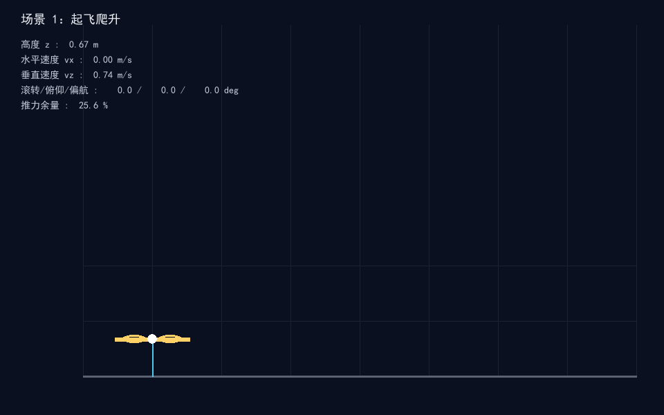
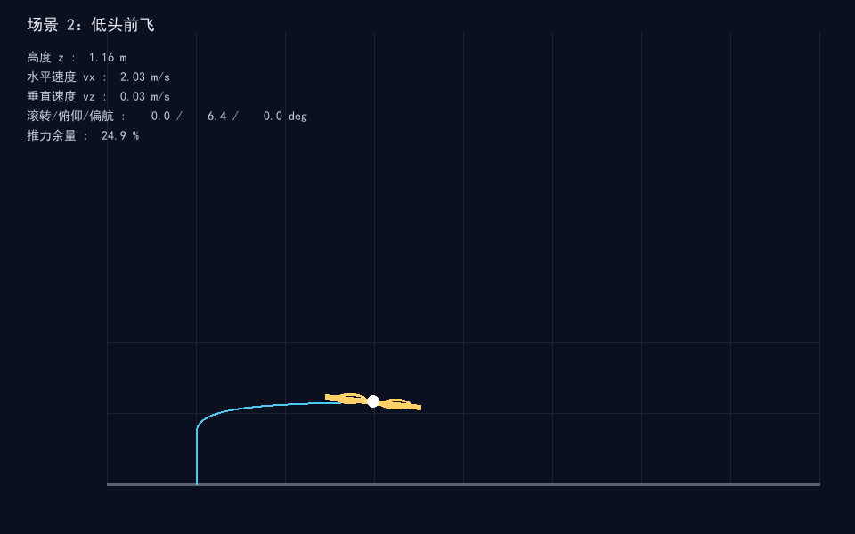

# 四旋翼刚体动力学键盘遥控仿真（uav_rigidbody_keyboard_teleop）

## 概览

| 项目 | 内容 |
| --- | --- |
| 作业类别 | 任务 1：物理仿真 + 键盘运动控制 |
| 仿真器 | 自研四旋翼 6 自由度刚体动力学仿真器（Python 3.13 + pygame 2.6.1） |
| 运行环境 | Ubuntu 20.04 / ROS 2 Humble；离线仿真可在 Windows Python 3.13 直接运行 |
| 编程语言 | Python 3 |
| 第三方依赖 | numpy、pygame（离线）；rclpy、nav_msgs、geometry_msgs、sensor_msgs（ROS 节点） |
| 话题/节点 | 订阅 `/cmd_vel`（Twist）；发布 `/odom`（Odometry）、`/imu`（Imu） |
| 运行方式 | `ros2 launch uav_rigidbody_keyboard_teleop main.launch.py`；离线 `python main.py --shots` |

## 1. 实验目标

1. 建立四旋翼六自由度刚体动力学模型，包含旋翼推力、反扭矩、重力与线性气动阻力。
2. 实现推力-力矩混合分配：把期望总推力与三轴力矩分配到四个旋翼。
3. 实现高度保持与姿态 PD 稳定内环，使键盘杆量能够转化为平稳的姿态与垂速控制。
4. 在离线仿真中完成「起飞爬升 → 低头前飞 → 松杆保持」全过程，并保存全过程轨迹总览、时间轴分帧与阶段关键帧截图。

## 2. 系统原理与公式

### 2.1 坐标系

- 机体系：`x` 向前、`y` 向左、`z` 向上。
- 世界系：ENU（东 `x`、北 `y`、上 `z`）。
- 四旋翼为 X 型布置，旋翼编号依次为 FR（前右）、FL（前左）、RL（后左）、RR（后右）。

### 2.2 旋翼推力与反扭矩

第 `i` 个旋翼的推力与反扭矩为：

```
T_i = k_f · ω_i²
τ_i = k_tau · ω_i² · s_i
```

其中 `ω_i` 为旋翼转速，`s_i ∈ {+1, −1}` 为自旋方向（俯视逆时针为 +1）。

### 2.3 混合分配

记期望合力/合力矩为 `w = [T, τ_x, τ_y, τ_z]ᵀ`，旋翼推力为 `t = [T_1, T_2, T_3, T_4]ᵀ`，正向映射为 `w = A·t`，逆混合矩阵 `M = A⁻¹`，则：

```
t = M · w
```

- `τ_x`（滚转）由左右旋翼推力差产生；
- `τ_y`（俯仰）由前后旋翼推力差产生；
- `τ_z`（偏航）由逆时针与顺时针旋翼反扭矩差产生。

### 2.4 刚体动力学

平动方程（世界系）：

```
m · v̇ = F_world = R(q)·F_body + m·g + F_drag
```

转动方程（机体系）：

```
I · ω̇ = M_body − ω × (I·ω) − c·ω
```

其中 `I = diag(I_xx, I_yy, I_zz)` 为转动惯量矩阵，`c·ω` 为旋转阻尼。

### 2.5 稳定控制环

- 高度环：油门杆量映射为垂速期望 `v_z,des`，垂速误差补偿总推力：

```
T = m·g + k_p,vz · (v_z,des − v_z)
```

- 姿态环：杆量映射为目标倾斜角 `φ_des, θ_des`，姿态 PD 输出三轴力矩：

```
τ_x = k_p,att · (φ_des − φ) − k_d,att · ω_x
τ_y = k_p,att · (θ_des − θ) − k_d,att · ω_y
```

偏航通道以角速度阻尼为主，偏航杆量作为偏航速率前馈。

## 3. 算法流程

```
初始化四旋翼状态（位置/速度/姿态/角速度/旋翼转速）
  │
  ├─ 读取键盘杆量（throttle / pitch / roll / yaw）
  │
  ├─ 控制器：杆量 → 垂速期望、目标姿态 → 合力/合力矩
  │
  ├─ 混合分配：合力/力矩 → 四个旋翼目标推力 → 目标转速
  │
  ├─ 电机一阶响应：ω_cmd 跟踪目标转速
  │
  ├─ 动力学积分：推力/重力/阻力 → 平动；力矩/陀螺耦合/阻尼 → 转动
  │
  └─ 地面约束：z ≥ 0，落地后垂直速度置零
```

## 4. 源代码解析

| 文件 | 职责 |
| --- | --- |
| `uav_rigidbody_keyboard_teleop/dynamics.py` | `QuadParams` 物理参数；`State` 状态；`Quadrotor` 刚体动力学、混合分配、推力-转速换算、地面约束；`validate_params` 参数校验 |
| `uav_rigidbody_keyboard_teleop/controller.py` | `ControllerParams` 控制参数；`TeleopController.update` 高度保持与姿态 PD 稳定环，输出合力/合力矩 |
| `uav_rigidbody_keyboard_teleop/teleop.py` | 按键集合到杆量指令字典的映射，同通道多键取代数和并裁剪到 `[−1, 1]` |
| `uav_rigidbody_keyboard_teleop/teleop_node.py` | ROS 2 节点：订阅 `/cmd_vel`，定时推进仿真，发布 `/odom`、`/imu`；rclpy 延迟导入，离线测试不依赖 ROS |
| `main.py` | 离线一键实验入口：`--shots` 离屏运行三段场景并保存截图；`--demo` 打开交互遥控窗口 |
| `test/test_mixer.py` | 悬停推力均分、混合矩阵互逆、偏航力矩方向校验 |
| `test/test_dynamics.py` | 参数校验、重力合力、零推力下落、地面约束、角度归一化、状态不可变校验 |

关键实现说明：

- 电机一阶响应：`ω_cmd += α·(ω_target − ω_cmd)`，`α = dt / motor_tau`，限制在 `[0, 1]`。
- 姿态稳定内环以姿态角回正力矩与角速度阻尼实现，保证松杆后姿态回正、不发生翻转。
- 离屏渲染使用 `SDL_VIDEODRIVER=dummy`，无需图形界面即可生成关键帧。

## 5. 仿真运行步骤

### 5.1 Ubuntu 20.04 / ROS 2 Humble

```bash
# 进入工作区源码目录
colcon build --packages-select uav_rigidbody_keyboard_teleop --symlink-install
source install/setup.bash
ros2 launch uav_rigidbody_keyboard_teleop main.launch.py
```

另开终端发送遥控指令（Twist 映射到油门/俯仰/滚转/偏航）：

```bash
ros2 topic pub /cmd_vel geometry_msgs/Twist "{}"
```

### 5.2 离线仿真（Windows / Linux，无需 ROS）

```bash
cd src/air/uav_rigidbody_keyboard_teleop
python main.py --shots    # 生成全过程截图到 docs/img/
python main.py --demo     # 交互窗口：W/S 俯仰，A/D 滚转，↑/↓ 油门，Q/E 偏航
```

### 5.3 单元测试

```bash
python -m pytest test/ -q
```

## 6. 仿真结果

全过程场景：起飞爬升（油门 +0.8，1.6 s）→ 低头前飞（俯仰 +0.6，2.0 s）→ 松杆保持（中立指令，2.0 s）。

| 指标 | 数值 |
| --- | --- |
| 最大飞行高度 | 1.16 m |
| 最大前飞距离 | 5.98 m |
| 最大水平/合速度 | 2.08 m/s |

### 6.1 全程轨迹总览



### 6.2 全过程时间轴分帧



### 6.3 阶段关键帧

| 场景 | 截图 |
| --- | --- |
| 场景 1：起飞爬升 |  |
| 场景 2：低头前飞 |  |
| 场景 3：松杆保持 |  |

## 7. 文件结构

```
src/air/uav_rigidbody_keyboard_teleop/
├── launch/uav_rigidbody_keyboard_teleop.launch.py
├── uav_rigidbody_keyboard_teleop/
│   ├── __init__.py
│   ├── dynamics.py
│   ├── controller.py
│   ├── teleop.py
│   └── teleop_node.py
├── test/
│   ├── test_mixer.py
│   └── test_dynamics.py
├── resource/uav_rigidbody_keyboard_teleop
├── conftest.py
├── main.py
├── package.xml
├── setup.py
├── setup.cfg
└── README.md
docs/air/uav_rigidbody_keyboard_teleop.md
docs/img/uav_rigidbody_keyboard_teleop_*.png
```

## 8. 话题、节点与参数

### 8.1 话题

| 话题 | 类型 | 方向 | 说明 |
| --- | --- | --- | --- |
| `/cmd_vel` | `geometry_msgs/Twist` | 订阅 | 遥控杆量：linear.z 油门，linear.x 俯仰，linear.y 滚转，angular.z 偏航 |
| `/odom` | `nav_msgs/Odometry` | 发布 | 机体位置与线速度 |
| `/imu` | `sensor_msgs/Imu` | 发布 | 机体角速度 |

### 8.2 参数

| 参数 | 默认值 | 说明 |
| --- | --- | --- |
| `sim_rate` | 250.0 | 仿真控制频率 Hz |

## 9. 与现有模块的区别

- 与 `uav_keyboard_control`（AirSim 桥接键盘遥控）不同：本模块在纯 Python 刚体动力学台架上完成推力-力矩解算与稳定环验证，不依赖外部飞真平台。
- 与 `quad_cascade_pid_hover_wind`（串级 PID 航点悬停抗风）不同：本模块面向手动遥控的刚体响应与姿态稳定，不做航点轨迹跟踪。

## 10. 来源与许可

- 刚体动力学与混合分配公式为通用多旋翼建模方法；代码为本模块原创实现。
- 许可证：MIT。

## 大模型使用声明

过程中借助大模型工具辅助代码编写、整理包目录结构与本描述排版，核心逻辑与操作、场景参数设定与实际运行调试为本人完成，作者对提交内容负责。
