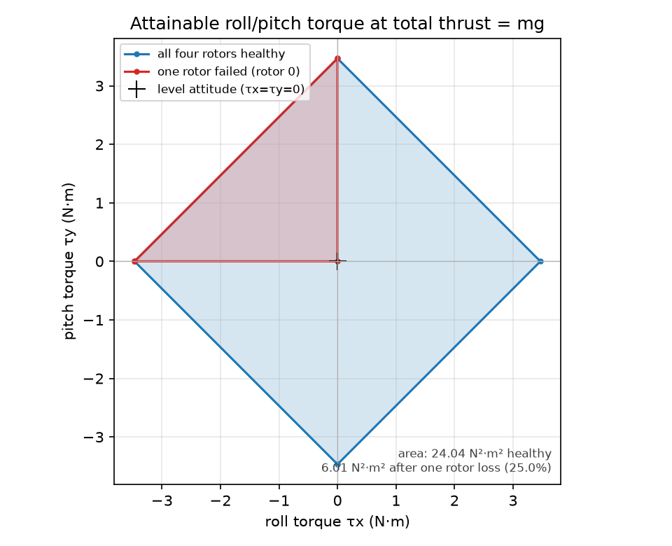
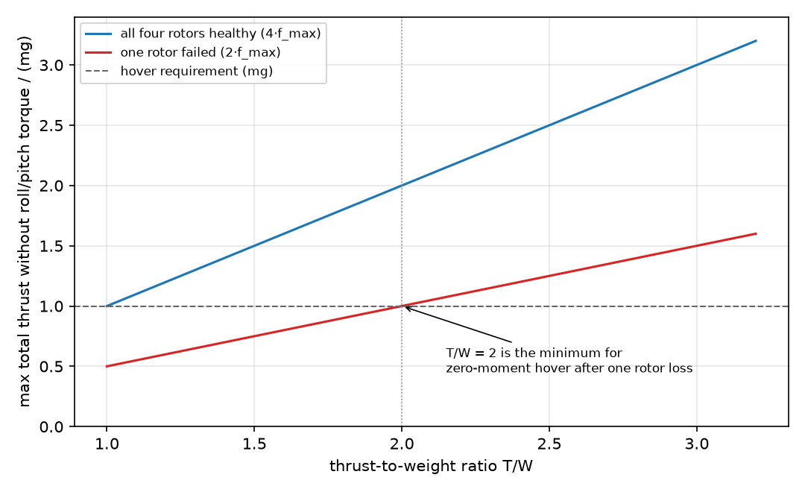
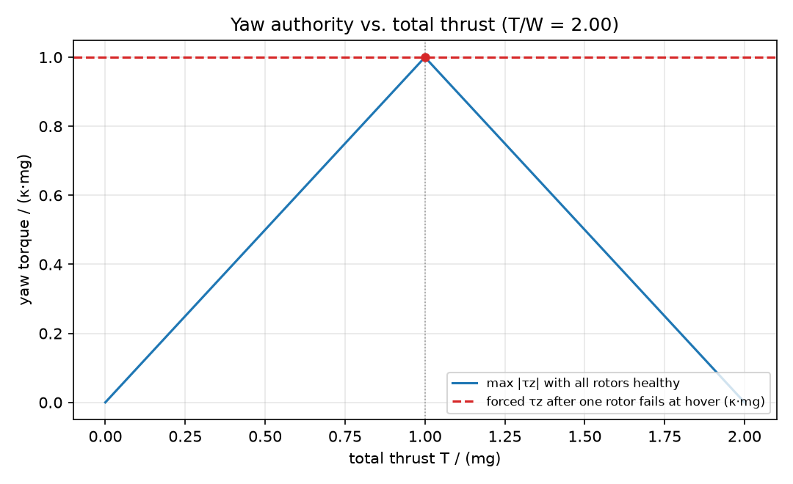
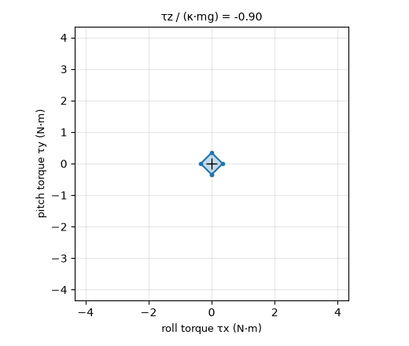

# 四旋翼单桨失效后的推力分配可行域与姿态权限评估

多旋翼的「单桨失效还能不能飞」经常被简化成一句「四旋翼掉一桨必坠」。这个判断对一半：**推力够不够**和**还能控住什么**是两件事。本模块用静态推力分配模型把两件事分开算——给定机型（质量、力臂、反扭矩系数、单桨推力上限），直接算出四桨完好与单桨失效两种状态下还能产生的总推力、滚转/俯仰力矩与偏航力矩，以及需要留多大推重比。

模型只描述推力到力/力矩的映射与单桨推力上限，不含电机动态、桨叶挥舞、气动干扰和姿态环带宽。因此结论用于**选型与余量评估**，不代替带动力学的仿真或试飞。



默认机型（2 kg、力臂 0.25 m、反扭矩系数 0.016 m、单桨上限 9.81 N，即 T/W = 2）的结论：

| 指标 | 四桨完好 | 单桨失效（悬停状态） |
| --- | --- | --- |
| 悬停每桨推力 | 4.90 N（占上限 50.0%） | 对角线两桨各 9.81 N（占上限 100%），第三桨 0 |
| 零力矩（不产生滚转/俯仰）最大总推力 | 39.23 N（2.00 mg） | 19.61 N（1.00 mg，悬停余量 0） |
| 滚转/俯仰力矩上限 | ±3.467 N·m | ±3.467 N·m（但滚转与俯仰不能再任意组合） |
| 偏航力矩 | 可达 0.3138 N·m（κ·mg） | 被动产生 0.3138 N·m，不可控 |
| $(τ_x,τ_y)$ 可达集合 | 菱形，面积 24.04 N²·m² | 三角形，面积 6.01 N²·m²（25.0%） |

两个结论最值得记住：

1. **单桨失效后只剩一条对角线有效**，零力矩最大推力从 $4f_{max}$ 掉到 $2f_{max}$，正好减半；
2. 于是「失效后仍能零力矩悬停」的条件是 $2f_{max} \ge mg$，即 **T/W ≥ 2**。T/W = 2 时余量为 0（两桨必须满推力），工程上按 20% 推力余量取 T/W ≥ 2.4 更合适。

## 1. 运行环境

离线部分需要 Python 3.8 及以上、NumPy 与 Matplotlib，不需要 ROS、飞控或仿真器：

```bash
cd src/air/uav_rotor_failure_allocation
python3 -m pip install -r requirements.txt
python3 main.py --gif
```

默认参数下依次打印余量表、写出 `feasible_set.png`、`yaw_authority.png`、`authority_margin.png` 与 `report.json`，`--gif` 另加 `feasible_set.gif`。本文所有数字与图都由这条命令生成：

```text
参数: m=2.00 kg, L=0.250 m, κ=0.0160 m, f_max=9.81 N (单桨), T/W=2.00, mg=19.61 N

[完好] 悬停每桨 4.90 N (占单桨上限 50.0%)
       零力矩最大总推力 39.23 N (2.00 mg)
       滚转/俯仰力矩权限 ±3.467 / ±3.467 N·m
       偏航力矩权限 0.3138 N·m (κ·mg = 0.3138)
       可达力矩集合面积 24.043 N²·m²

[失效#0] 悬停解 f = [0.00, 9.81, 0.00, 9.81] N (可行)
        零力矩最大总推力 19.61 N (1.00 mg), 悬停余量 0.0%
        不可控偏航 +0.3138 N·m
        滚转/俯仰力矩权限 ±3.467 / ±3.467 N·m
        可达力矩集合面积 6.011 N²·m² (完好时的 25.0%)
```

改机型只需换参数：`python3 main.py --mass 3.0 --arm-length 0.35 --max-thrust 18.0`。

## 2. 模型

机体坐标系按 REP-103：$x$ 指机头、$y$ 指左侧、$z$ 向上，旋翼推力沿 $+z$。X 型布局的旋翼位于

$$\varphi_i = 45°+90°i,\quad (x_i,y_i) = (L\cos\varphi_i,\ L\sin\varphi_i),\quad i=0,1,2,3 .$$

旋翼 0/2 与 1/3 分别同向旋转，反扭矩记为 $\tau_{z,i}=\sigma_i\kappa f_i$，$\sigma=(-1,+1,-1,+1)$。于是推力向量 $f$ 到 wrench $w=[T,\tau_x,\tau_y,\tau_z]^\top$ 的映射是线性的：

$$
A=\begin{bmatrix}
1 & 1 & 1 & 1\\
y_0 & y_1 & y_2 & y_3\\
-x_0 & -x_1 & -x_2 & -x_3\\
\sigma_0\kappa & \sigma_1\kappa & \sigma_2\kappa & \sigma_3\kappa
\end{bmatrix},\qquad w = A f .
$$

四桨完好时 $A$ 可逆，$f=A^{-1}w$ 唯一；每个桨还要满足 $0\le f_i\le f_{max}$，超出即判为不可行。
悬停 $w=[mg,0,0,0]^\top$ 的解是对称的 $f_i=mg/4$，与机型和 $\kappa$ 无关。

## 3. 单桨失效：放弃偏航，保住推力与姿态

一个旋翼失效后只剩 3 个执行器，无法同时满足 4 个 wrench 分量。工程上的处理是**优先保推力与姿态，放弃偏航控制**：丢掉 $A$ 中失效桨对应的列，用剩余三列解 $(T,\tau_x,\tau_y)$，再把被动产生的 $\tau_z$ 当作不可控偏航报出来。

若要求悬停时 $\tau_x=\tau_y=0$、总推力为 $mg$，几何关系会把解逼到唯一形式：**只有失效桨之外那条对角线上的两桨出力，各 $mg/2$，第三桨为 0**。两桨同向旋转，反扭矩叠加得

$$\tau_{z,\text{fail}}=\kappa\cdot mg ,$$

符号取决于失效的是哪一对。默认参数下就是 ±0.3138 N·m，方向无法用剩余桨抵消——这正是单桨失效后飞行器会持续偏航的原因。

上面这个「剩下的是一条对角线」来自对称 X 型布局（四桨 45°/135°/225°/315°，互为对角的两桨同向旋转）。换成 H 型、非对称力臂或共轴双桨，分配矩阵不同，结论要重算；本模块固定这一布局，`ROTOR_ANGLES_DEG` 与 `SPIN_SIGNS` 写在 `core.py` 里。

## 4. 零力矩最大推力与 T/W 门槛

把「不产生滚转/俯仰」作为约束，求最大总推力，就是判断还能不能平飞悬停的关键量：

| 状态 | 有效桨 | 零力矩最大总推力 | 默认机型数值 |
| --- | --- | --- | --- |
| 四桨完好 | 4 | $4f_{max}$ | 39.23 N = 2.00 mg |
| 单桨失效 | 2（一条对角线） | $2f_{max}$ | 19.61 N = 1.00 mg |

单桨失效后第三个桨在零力矩条件下必然为 0，所以上限正好减半，而不是只剩 $3f_{max}$。由此得到门槛：

$$2f_{max}\ge mg \iff \frac{T}{W}=\frac{4f_{max}}{mg}\ge 2 .$$



按推重比扫描（每架飞机质量不变、只改单桨上限）：

| T/W | 失效后零力矩最大推力 / mg | 失效后能否悬停 |
| --- | --- | --- |
| 1.2 | 0.600 | 不能 |
| 1.4 | 0.700 | 不能 |
| 1.6 | 0.800 | 不能 |
| 1.8 | 0.900 | 不能 |
| 2.0 | 1.000 | 能（余量 0） |
| 2.4 | 1.200 | 能（余量 20%） |
| 3.0 | 1.500 | 能（余量 50%） |

## 5. 偏航权限

只约束总推力与单桨上限时，最大偏航力矩有闭式解。一组旋转方向有两桨，其推力上限记为 $c=2f_{max}$，把尽可能多的推力压在这一组上：

$$
\tau_{z,\max}(T)=\kappa\bigl(2\min(c,T)-T\bigr),\qquad 0\le T\le 4f_{max}.
$$



曲线在 $T=mg$ 处取最大值 $\kappa\cdot mg$：默认参数下为 0.3138 N·m，恰好等于单桨失效后被迫承受的偏航力矩。也就是说，**四桨完好时能打出的最大偏航力矩，正好是掉一个桨后不得不承受的那个值**——失效瞬间没有多余的偏航权限去抵消它。

## 6. 可达力矩集合：菱形与三角形

固定总推力为 $mg$、偏航力矩为 0 时，把 $(τ_x,τ_y)$ 看作平面坐标，单桨推力上限给出 8（失效后 6）个半平面，其交集就是可达集合。四桨完好时是对称菱形，失效后退化为三角形：

- 菱形：顶点在坐标轴上 $(\pm L\,mg/\sqrt2,0)$、$(0,\pm L\,mg/\sqrt2)$，面积 $2a^2=24.04$ N²·m²；
- 三角形：顶点为 $(0,0)$ 与两个轴向极值点，面积 $0.5a^2=6.01$ N²·m²，正好是菱形的 1/4。

注意三角形的直角边贴着坐标轴：**单桨失效后滚转与俯仰不能再任意组合**——想要正向滚转就没法同时要正向俯仰。轴向权限看起来没变（仍是 ±3.467 N·m），但可用组合少了很多。



上面这段动图把四桨完好时的期望偏航力矩从 $-0.9\kappa mg$ 扫到 $+0.9\kappa mg$：偏航需求越大，可分给滚转/俯仰的余量越少，集合向原点收缩，到 $\pm\kappa mg$ 时只剩一个解（同向两桨满推力）。

## 7. ROS 2 接口

```bash
source /opt/ros/humble/setup.bash
cd ~/ros2
colcon build --packages-select uav_rotor_failure_allocation
source install/setup.bash
ros2 launch uav_rotor_failure_allocation main.launch.py
# 单独指定失效桨
ros2 launch uav_rotor_failure_allocation main.launch.py failed_rotor:=2
```

节点订阅 `uav/desired_wrench`（`geometry_msgs/WrenchStamped`，只取 `force.z` 作为总推力，水平力不参与分配），发布 `uav/rotor_thrust`（`std_msgs/Float64MultiArray`，四桨推力，N）与 `uav/allocation_status`（`std_msgs/String`，`ok` / `infeasible`）。参数为 `mass`、`arm_length`、`torque_ratio`、`max_thrust`、`failed_rotor`；`failed_rotor=-1` 表示四桨完好，`0..3` 表示该桨失效，`max_thrust=0` 时按 T/W = 2 反推。

这个节点只做分配计算，不直接驱动电调：真实接入需要在飞控里做同样的分配，并把 `infeasible` 状态接到降级策略（降高度、转前飞、开伞或就近迫降）。

## 8. 测试与验证范围

```bash
cd src/air/uav_rotor_failure_allocation
python3 -m pip install -r requirements-dev.txt
python3 -m pytest test -v
```

14 项检查全部通过，期望值都能手算对上：分配矩阵与 mg/4 悬停解、分配往返一致、推力上限判定、$4f_{max}$/$2f_{max}$ 两个上限、单桨失效的悬停解与 ±κ·mg 被动偏航（四个桨逐一验证，符号交替）、T/W = 1.6 时失效不可悬停、偏航权限公式的三段取值、菱形/三角形可行域的面积与顶点、可行域与逐点分配的一致性（两组各 2000 点随机采样，无一例矛盾），以及参数校验。

- 已验证：Windows 11 / Python 3.12.14 / NumPy 2.3.5 / Matplotlib 3.11.2 下 `python3 main.py --gif` 与 `python3 -m pytest test -v`；
- 未验证：ROS 2 节点没有在本机运行（本机无 ROS 环境，只做了 `py_compile` 语法检查），Ubuntu 22.04 / Humble 的构建与话题收发需要另一位使用者复现；
- 未覆盖：双桨及以上失效、桨叶卡死（风车阻力）、气动干扰、姿态环动态与电池功率限制。这些都是静态模型之外的问题，要做得靠带动力学的仿真或试飞。

## 使用声明

使用 DeepSeek Harness（deepseek-flash）辅助实现、测试与文档；作者对提交内容负责。
