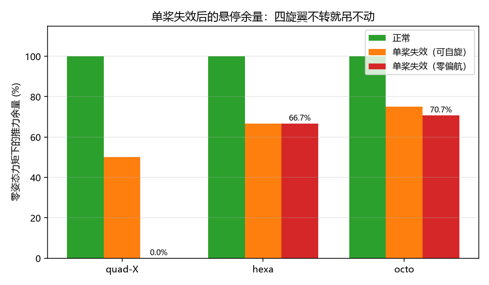

# 多旋翼单桨失效后的悬停可行域：四旋翼为什么必须自旋

「掉一个桨还能飞吗」是多旋翼最实际的安全问题，但答案往往停留在"四旋翼掉桨就完了"这种经验说法上。
本模块把它变成一个可以算出来的数：**在零姿态力矩约束下，剩下的桨最多能产生多少总推力**，
以及**这个最大推力是否要求车体自旋**。属于**空域载具**方向。

与仓库已有模块的分工：

| 模块 | 做什么 | 本模块的不同 |
|---|---|---|
| `uav_hover_wind_limit` | 抗风能力（倾角与推重比余量） | 那是正常飞行，这里研究**桨失效** |
| `uav_battery_rth_failsafe` | 电量不足时的返航策略 | 决策层；这里算的是**物理可行性** |
| `uav_mission_safety_manager` | 任务级安全状态机 | 同上，不涉及控制分配 |
| 本模块 | 失效后的**可达扳手集**与悬停余量 | 纯线性约束 + 顶点枚举，不含控制律 |

## 运行效果



三种机型在"正常 / 单桨失效·可自旋 / 单桨失效·零偏航"下的推力余量。
四旋翼的红柱是 **0**——不是"余量很小"，而是**零偏航约束下根本无解**。

## 功能包结构

```
src/air/uav_rotor_failure_env/
├── package.xml  setup.py  setup.cfg  requirements.txt
├── main.py                      # 脚本入口（不需要 ROS）
├── uav_rotor_failure_env/
│   ├── core.py                  # 桨布局、可行域顶点枚举、零偏航约束（纯 numpy）
│   ├── cli.py                   # 结果排成 Markdown 表格
│   ├── main.py                  # 命令行参数与输出
│   └── ros_node.py              # 诊断节点：发布余量与结论
├── config/params.yaml
├── launch/main.launch.py
├── tools/make_figures.py        # 生成上面那张图（需要 matplotlib）
└── test/test_core.py            # 12 项单元测试
```

## 运行环境

| 项 | 版本 | 说明 |
|---|---|---|
| OS | 任意 | 纯 Python |
| Python | 3.10 / 3.12 | 只用 `numpy` |
| ROS 2（可选） | Humble | 仅 `ros_node.py` 需要 |

已实测：**Windows 11 + Python 3.12.14 + NumPy 2.5.4**。

## 编译与运行

```bash
# A. 不需要 ROS
cd src/air/uav_rotor_failure_env
python3 main.py
python3 -m unittest discover -s test -p "test_*.py" -v     # 12 passed

# B. ROS 2
colcon build --packages-select uav_rotor_failure_env --symlink-install
source install/setup.bash
ros2 launch uav_rotor_failure_env main.launch.py config:=quad failed_rotor:=0
```

## 原理

### 1. 桨的力与力矩

第 i 个桨只产生沿机体 +z 的推力 f_i，位置 (x_i, y_i)，则

```
Fz = Σ f_i
Mx = Σ y_i · f_i
My = −Σ x_i · f_i
Mz = Σ s_i · κ · f_i        （s_i 为旋向，κ 为反扭矩系数）
```

### 2. 悬停条件

水平悬停要求姿态力矩为零：

```
Σ f_i = mg,   Σ y_i f_i = 0,   Σ (−x_i) f_i = 0,   f_i ∈ [0, f_max]
```

`Mz` 不要求为零：车体可以自旋，稳态自旋由气动阻尼平衡。若同时要求 `Mz = 0`，
就多一条等式——这就是「不能自旋」的工况。

### 3. 为什么顶点枚举就够

可行域是 `{0 ≤ f ≤ f_max, A·f = 0}`，一个凸多面体；目标是线性函数 `Σf`，
最大值必在顶点取得。顶点 = "n−2 个变量取边界值"（零偏航时是 n−3 个），
枚举 `C(n,2)×2^(n−4)` 种组合、解小规模线性方程组即可，n ≤ 8 时最多几千次，
不需要通用 LP 求解器，也不会陷入数值退化。

## 结果（单桨 10 N、机重 2 kg）

| 机型 | 桨数 | 正常 | 单桨失效（可自旋） | 单桨失效（零偏航） | 结论 |
|---|---|---|---|---|---|
| quad-X | 4 | 100.0% | 50.0% | **0.0%** | 必须自旋，否则 0% |
| hexa | 6 | 100.0% | 66.7% | 66.7% | 不转也能悬停 |
| octo | 8 | 100.0% | 75.0% | 70.7% | 自旋多 4.3 个百分点 |

四旋翼逐桨明细（任何一桨失效结果相同）：

| 失效桨 | 总推力 (N) | 载重上限 (kg) | 余量 | 残余 Mz (N·m) | 自旋角速度 (rad/s) |
|---|---|---|---|---|---|
| #0 | 20.0 | 2.04 | 50.0% | −0.4000 | 10.0 |
| #1 | 20.0 | 2.04 | 50.0% | +0.4000 | 10.0 |
| #2 | 20.0 | 2.04 | 50.0% | −0.4000 | 10.0 |
| #3 | 20.0 | 2.04 | 50.0% | +0.4000 | 10.0 |

失效 #0 时的最优分配（对角的两只桨满推力，第三只归零）：

| 桨 | 推力 (N) | 占比 |
|---|---|---|
| #0（失效） | 0.00 | 0% |
| #1 | 10.00 | 100% |
| #2 | 0.00 | 0% |
| #3 | 10.00 | 100% |

## 三条结论

1. **四旋翼掉桨不是"推力变三分之二"，是"只剩一对对角桨"**：零偏航约束下无解，
   必须靠自旋才能悬停，余量正好 50%；这也解释了为什么实机上四旋翼掉桨后是"转着往下掉"。
2. **六旋翼是性价比拐点**：单桨失效后余量 66.7%，而且**不需要自旋**——
   剩下 4 只桨可以做零偏航平衡。这条不是拍脑袋，是约束方程给出的。
3. **八旋翼自旋只多买 4.3 个百分点**：零偏航已经能到 70.7%，
   为自旋付出姿态稳定的代价并不划算——安全冗余应该花在"桨数与布局"上，而不是"允许自旋"。

## 方法边界

- 静止悬停模型：不含姿态倾角、气动干扰与瞬态响应；倾角会让可行域变复杂（也可能变宽松）；
- `Mz = κ·f` 是线性近似，真实桨的扭矩-推力关系随来流与转速变化；
- 顶点枚举针对"总推力最大"，等推力解里优先取 |Mz| 最小者（不自旋优先）；
- 给出的是**可行域**，不是控制律：能不能实现该分配、需要多快的姿态环，是另一个问题。

## 可以继续做的实验

- 把 `κ` 调大（大桨径/低转速），看四旋翼的自旋角速度需求如何变化；
- 加入"相邻两桨失效"，比较 quad/hexa/octo 的存活边界；
- 允许姿态倾角 θ，把 `mg` 换成 `mg/cosθ` 并放开部分横向力矩约束，得到"倾斜悬停"的可行域；
- 把 `ros_node.py` 接上真实电调反馈，做在线"掉桨检测 → 余量重算"。
