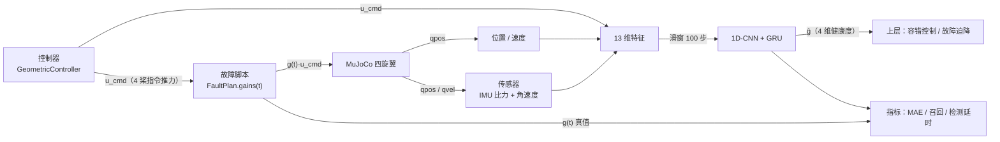
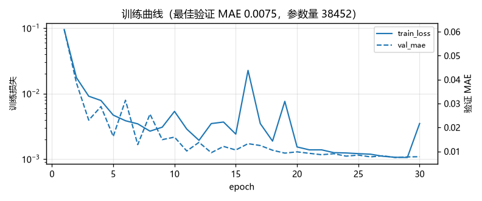
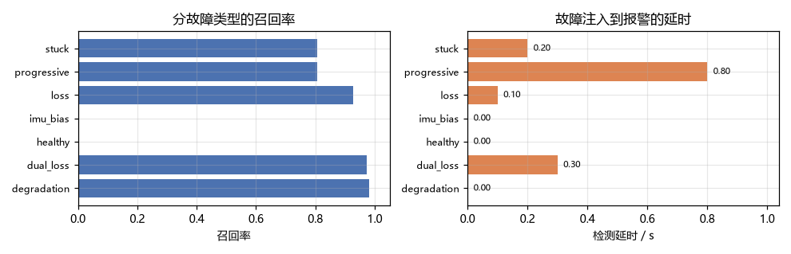
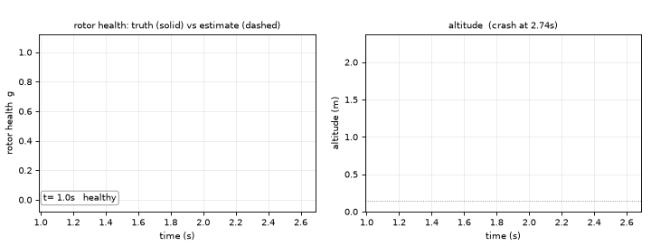

# 无人机桨故障健康度估计

本模块用机载 IMU 与控制器指令实时估计四旋翼**每个桨还剩多少推力权限**，对应课程任务②
中"传感器感知"的部分：把"飞机坏没坏、坏得多重"变成可以喂给上层控制器的连续量。

它和「无人机执行器故障注入与控制退化观测」是一对：前者负责
把故障造出来并量化有多致命，本模块负责**在坠机之前把故障认出来**。

!!! note "本模块不做容错控制"
    输出只有四维健康度 `ĝ ∈ (0, 1]⁴`，不直接改桨速。怎么用这四维去做控制分配是下一个模块的事。
    这样切分的好处是：检测器的好坏可以单独用 MAE、召回率、检测延时间来评价，
    不需要和某个具体控制律绑在一起。

## 1. 问题：只有 0.64 秒

悬停 1.5 m 时四条旋翼总推力约等于重力，单桨承担 25%。某条桨突然停转，剩余三桨即使按原指令
出力，合力方向也会立刻偏斜，同时产生无法抵消的滚转力矩。实测从注入故障到触地只有 **0.64 s**
（见故障注入模块的对比表）。

要在那 0.64 s 里做出反应，控制器必须先用传感器数据回答三个问题：**哪一桨、坏到什么程度、
多久之前坏的**。靠姿态误差过阈值判断做不到：

* 推力衰减 40% 时姿态几乎看不出来，但剩余权限已经只有 0.6；
* 桨卡死与完全失效在姿态上表现接近，但前者还给了一个恒定偏置。

所以这里把问题定义成**回归**而不是分类：对每一桨输出一个 `(0, 1]` 的连续增益，
分类（坏没坏）只是对它取阈值。

## 2. 数据流



模块只做两件事：把一次飞行的全部观测整理成滑窗样本（`data.py`），以及从滑窗里回归出四桨增益
（`model.py` + `train.py`）。动力学、场景、控制器全部复用
[MuJoCo 四旋翼仿真底座](./uav_mujoco_sim.md)，一行不改。

## 3. 特征构建

### 3.1 机身比力

仿真能直接给出世界系速度，但机载只有加速度计。加速度计测的是"除重力外的比力"，
所以由速度差分反推，再旋到机体系：

$$
\mathbf{f}^{b} = \mathbf{R}(\mathbf{q})^{\top}\left(\frac{\mathbf{v}_k - \mathbf{v}_{k-1}}{\Delta t} + g\hat{\mathbf{z}}\right),
\qquad g = 9.80665\ \mathrm{m/s^2}
$$

静止时无论姿态如何，机体系读数都是 `Rᵀ(g ẑ)`，这就是自检里"比力方向正确"那一项验证的东西。

### 3.2 13 维特征

$$
\mathbf{x}_k = \Big[\underbrace{a_x, a_y, a_z}_{\text{比力}},
\underbrace{\omega_x, \omega_y, \omega_z}_{\text{角速度}},
\underbrace{v_x, v_y, v_z}_{\text{速度}},
\underbrace{\frac{u_0}{u_{max}}, \dots, \frac{u_3}{u_{max}}}_{\text{指令推力}}\Big]
$$

四个指令推力是**故障之前**控制器想给的推力，除以最大推力归一化到 `[0, 1.5]`。
这一项是网络能提前报警的关键：故障发生时实际加速度与"按指令本该有的加速度"不符，
这个差值是网络要学的主要线索。没有它，只能等姿态误差积累到明显，会晚得多。

各维量纲差得远，按下面的尺度归一化后送进网络：

| 通道 | 尺度 | 通道 | 尺度 |
| --- | --- | --- | --- |
| 比力 x / y | 12 | 速度 x / y | 4 |
| 比力 z | 20 | 速度 z | 3 |
| 角速度 | 6 | 指令推力 | 1（已除 `u_max`） |

### 3.3 滑窗与标签

$$
\mathbf{X}_i = \mathbf{x}_{e_i - W + 1 : e_i}, \qquad
\mathbf{y}_i = \mathbf{g}(t_{e_i}), \qquad
e_i = W - 1 + iS
$$

窗口 $W = 100$ 步（1 s），步长 $S = 10$ 步。标签取窗口**末帧**的真值——检测任务关心
"现在这一刻四桨健康度是多少"，而不是这段时间的平均。

!!! warning "按 episode 切分"
    同一段飞行相邻的窗口高度相关。如果按样本随机切训练/测试，测试集会混进训练集的近邻，
    指标会虚高。`split_by_episode()` 按飞行次数切（8:1:1），保证同一段飞行的窗口只落在一个集合里。

## 4. 网络与训练

```
(B, 100, 13)
  → Conv1d(13→32, k5) + BN + ReLU      # 提取局部时序模式
  → Conv1d(32→32, k5) + BN + ReLU
  → MaxPool1d(2)                       # 100 → 50
  → Conv1d(32→48, k3) + BN + ReLU
  → MaxPool1d(2)                       # 50 → 25
  → GRU(48 → 64)                       # 记忆更长的依赖
  → 取末隐状态 h_T
  → Linear(64→64) + ReLU + Dropout(0.1)
  → Linear(64→4) + Sigmoid             # 四桨健康度
```

参数量 **38452**。卷积层负责"这一小段波形正常不正常"，GRU 负责"从正常到异常是怎么过渡的"
——渐进退化靠的就是后者：单帧看什么都正常，只有趋势变了。

损失用故障加权 MSE：

$$
\mathcal{L} = \frac{1}{N}\sum_{i=1}^{N} w_i\,\big\|\hat{\mathbf{g}}_i - \mathbf{g}_i\big\|_2^2,
\qquad
w_i = \begin{cases} 4, & \min_j g_{i,j} < 0.9 \\ 1, & \text{否则} \end{cases}
$$

加重故障样本是因为它们只占少数（随机采样里健康样本 22%），不加重的话网络会退化成
"永远输出 1"也能拿到很低的平均误差。优化器 AdamW（lr `2e-3`，weight decay `1e-4`），
`ReduceLROnPlateau(factor=0.5, patience=2)`，按验证集 MAE 早停（patience 6）。

## 5. 源码解析

### 5.1 `features.py`：比力与滑窗

```python
def specific_force(vel, prev_vel, dt, quat):
    a_world = (np.asarray(vel) - np.asarray(prev_vel)) / dt
    f_world = a_world + np.array([0.0, 0.0, GRAVITY])
    return quat_to_matrix(quat).T @ f_world
```

`quat_to_matrix` 是自带的一份实现（`(w, x, y, z)` 机体→世界），与底座
`core.quadrotor.quat_to_mat` 同约定。**自带而不 import 底座**，是为了让数据集、训练、
纯推理这三件事都能在没装 MuJoCo 的机器上跑。

`make_windows` 里 `ends = np.arange(window - 1, n_steps, stride)`，返回
`(X, Y, end_index)`，第三个输出在算检测延时时用来把样本序号换算回仿真时间。

### 5.2 `data.py`：故障脚本

```python
@dataclass(frozen=True)
class FaultPlan:
    kind: str            # healthy / loss / degradation / stuck / dual_loss / progressive / imu_bias / imu_noise
    rotor: int = 0
    onset: float = 2.0   # 注入时刻
    severity: float = 1.0
    ramp: float = 0.0    # 过渡时长，0 表示阶跃
```

`gains(t)` 返回当前时刻四桨增益。`_alpha(t)` 是过渡因子：

$$
\alpha(t) = \begin{cases}
0, & t < t_0 \\
\min\!\left(1, \dfrac{t - t_0}{r}\right), & t \ge t_0,\ r > 0 \\
1, & t \ge t_0,\ r = 0
\end{cases}
$$

四型故障的增益：`loss` / `degradation` 为 $1 - s\alpha$，`stuck` 与 `dual_loss` 为 $1 - \alpha$，
`progressive` 为 $\max(0.05,\ 1 - s(t - t_0))$——注意这里的 `severity` 是**衰减速率**（1/s），
不是最终增益，0.25 表示 4 s 掉光。

仿真主循环每步做四件事：控制器给出 `u_cmd` → 乘故障增益 → `quad.apply_rotor_thrust()` →
`quad.step(1)`。坠机判据 `pos[2] < 0.15`，默认 `stop_on_crash=True` 在触地时截断序列
（再往后飞机穿到地面以下，数据没有意义）。

### 5.3 `model.py`：检查点

```python
payload = {
    "arch_version": ARCH_VERSION,
    "feature_dim": model.feature_dim,
    "rotor_count": model.rotor_count,
    "arch": {"channels": [...], "gru_hidden": 64, "head_dim": 64, "dropout": 0.1},
    "state_dict": model.state_dict(),
    "meta": meta,     # 特征名 / 窗口 / 步长 / dt / 训练超参 / history
}
```

结构超参一并存盘，`load_checkpoint` 才能把换过尺寸的网络读回来（这个 bug 是写单元测试时
撞出来的：早期版本只存了 `feature_dim`，小网络存进去、按默认尺寸读出来，直接 shape mismatch）。

### 5.4 `train.py`：加权损失

```python
def _sample_weights(targets, fault_weight):
    faulty = (targets.min(dim=1).values < FAULT_GAIN_THRESHOLD).float()
    return 1.0 + (fault_weight - 1.0) * faulty
```

训练完成后把最佳 epoch、验证 MAE、测试 MAE、参数量、耗时全部写进检查点的 `meta`，
评测和文档里引用的数字都从这里来，不靠手抄。

### 5.5 `infer.py`：在线估计

`HealthEstimator` 内部维护一个长度 `window` 的环形缓冲，`push(step_features)` 每次塞一帧；
缓冲没满返回 `None`，满了之后每帧返回一个 `(4,)` 估计。ROS 节点就是每仿真步调一次 `push`。

### 5.6 `metrics.py`：检测延时

"召回率"是在**帧**级别算的：真值里任意一桨 `< 0.9` 即为故障帧，估计里任意一桨 `< 0.8` 即为
报警帧。检测延时从真值第一次低于阈值算起，到估计第一次低于阈值结束：

$$
\Delta = t_{\text{first}\ i \ge i_0 : \hat g_{i,r^*} < 0.8} - t_{i_0},
\qquad
i_0 = \min\{i : \min_j g_{i,j} < 0.9\},\quad r^* = \arg\min_j g_{i_0,j}
$$

一直不报警返回 `inf`，全程没有故障返回 `nan`——两者在报告里分别是 `n/a` 和 `–`。

## 6. 运行步骤

### 6.1 安装依赖

```bash
pip install -r requirements.txt     # torch / numpy / mujoco / matplotlib / pillow
```

torch 装 CPU 版即可：

```bash
pip install torch --index-url https://download.pytorch.org/whl/cpu
```

### 6.2 不用 ROS 直接跑

```bash
python main.py --selftest                        # 51 项自检
python main.py --gen-data results/detector_dataset.npz --episodes 240
python main.py --train --threads 8
python main.py --eval test
python main.py --demo results/detection_demo.gif
```

Windows / Ubuntu 都能跑，`main.bat` / `main.sh` 是等价入口。

### 6.3 ROS2 Humble 启动

```bash
colcon build --packages-select uav_mujoco_sim uav_rotor_fault_detector_nn --parallel-workers 4
source install/setup.bash
ros2 launch uav_rotor_fault_detector_nn detector.launch.py
```

节点内部闭环仿真并在线估计，同时把真值 `/uav/health_true` 和估计 `/uav/health_est` 发出来，
方便在 rviz2 / rqt 里直接对照。换故障类型：

```bash
ros2 launch uav_rotor_fault_detector_nn detector.launch.py \
    fault:=degradation rotor:=2 severity:=0.4 duration:=12.0
```

话题表见 [模块 README](https://github.com/OpenHUTB/ros2/tree/master/src/air/uav_rotor_fault_detector_nn)。

## 7. 实验结果

数据集：240 次飞行（4 种物理场景 × 8 类故障随机组合），11600 个滑窗样本，其中 140 次坠机。
训练 30 epoch，最佳 epoch 28，验证 MAE **0.0075**，参数量 38452。

测试集（按飞行切分，1039 个样本）：

| 故障类型 | 样本 | MAE | 召回 | 误报 | 检测延时/s |
| --- | --- | --- | --- | --- | --- |
| 单桨推力衰减 | 169 | 0.010 | 0.980 | 0.000 | 0.000 |
| 双桨失效 | 138 | 0.019 | 0.974 | 0.000 | 0.300 |
| 健康 | 142 | 0.004 | – | 0.000 | – |
| IMU 零偏 | 213 | 0.003 | – | 0.000 | – |
| 单桨完全失效 | 152 | 0.009 | 0.929 | 0.000 | 0.100 |
| 渐进退化 | 121 | 0.008 | 0.806 | 0.000 | 0.800 |
| 桨卡死 | 104 | 0.011 | 0.806 | 0.000 | 0.200 |

整体：召回率 **0.910**、精确率 **1.000**、误报率 **0.000**、准确率 **0.976**，
混淆矩阵 TP=253 FP=0 TN=761 FN=25。





动图：左侧四桨真值（实线）与估计（虚线），竖线是故障注入时刻与报警时刻；
右侧是高度曲线，说明"必须在坠地之前报出来"。



几点解读：

* **单桨完全失效延时 0.10 s**，而坠地只剩 0.64 s，留给容错控制约 0.5 s 的窗口；
* **渐进退化延时最长（0.80 s）**，因为早期每秒只掉 20% 推力，单帧变化小于噪声幅度，
  必须等趋势积累出来。这是信息量本身的限制，不是网络容量不够；
* **误报率 0**，健康飞行与 IMU 零偏两种情况都没有报警。这两类样本占了测试集三分之一，
  却一次都没误报，说明网络没有简单地把"姿态抖"当成故障；
* **双桨失效 MAE 最大（0.019）**，因为两桨同时掉时剩余两桨已经无法维持姿态，
  飞机会翻滚，特征分布与训练集里的悬停工况偏离较远。

## 8. 局限与后续

1. **数据来自仿真**。IMU 噪声按白噪声建模，真实机架的振动、桨叶损伤机理不同，
   迁移到实机需要重新标定噪声模型，必要时做域随机化。
2. **只估计推力权限，不区分故障类型**。桨卡死和完全失效在增益上都表现为 0；
   要区分需要电调反馈（电流/转速），本仿真没有这一路信息。
3. **依赖指令推力**。真实机载系统里这个量在飞控内部，需要额外透传，
   或者改成本模块的接口只吃 IMU（代价是延时会变大）。
4. **单机、悬停为主**。机动飞行下比力与姿态耦合更强，特征分布会漂移，
   目前的数据生成里目标点随机在 2.5 m 半径内，覆盖有限。
5. 下一步：把 `ĝ` 接进加权控制分配（`uav_neural_fault_tolerant_control`），
   以及故障迫降时用深度图找可降落区域（`uav_fault_emergency_landing`）。

## 9. 参考

1. Mueller, M. W., D'Andrea, R. *Stability and control of a quadrocopter despite the complete loss
   of one, two, or three propellers.* IEEE International Conference on Robotics and Automation (ICRA), 2014.
2. Zhang, Y., et al. *Learning-based fault diagnosis for rotorcraft: a review.*（综述：基于学习的旋翼飞行器故障诊断）
3. 李航. *统计学习方法*（第 2 版）. 清华大学出版社, 2019.（CNN / GRU / 加权损失的推导）
4. `uav_actuator_fault_sim`：故障注入与评测台，本模块的数据来源（该模块正在另一个 PR 中评审，
   合并后两篇文档可以互相链接）
5. [uav_mujoco_sim](./uav_mujoco_sim.md)：MuJoCo 四旋翼仿真与 ROS2 桥接底座
