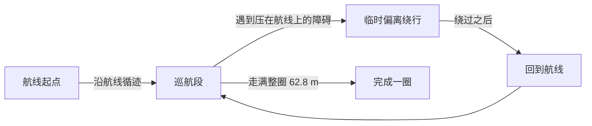
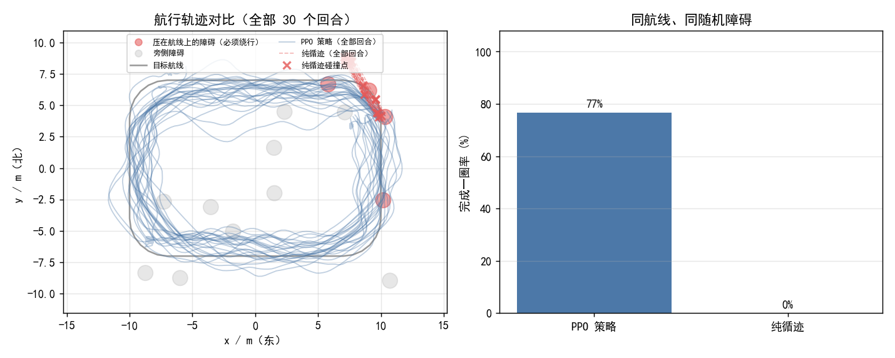

# 基于 PPO 的无人机固定路线巡航

本文介绍 `src/air/uav_route_cruise` 模块：让无人机沿一条**固定的闭合航线**巡航一整圈，
途中遇到压在航线上的障碍时临时偏离绕行，绕过后自动回到航线。

与 [`uav_ppo_nav`](./uav_ppo_nav.md)（随机目标点导航）是互补关系：

| | `uav_ppo_nav` | `uav_route_cruise` |
| --- | --- | --- |
| 任务 | 随机起点 → 随机目标点，到达即结束 | **给定闭合航线**，沿航线巡航一整圈 |
| 观测 | 16 扇形激光 + 目标相对位置 + 速度 | 24 扇形激光 + **航线几何**（横向偏差 / 航向偏差 / 3 个前视点）+ 高度偏差 |
| 指标 | 成功率 / 超时 / 碰撞 | **完成一圈率 / 平均横向偏差 / 平均完成度** |
| 关键能力 | 点对点规划 | 循迹 + **遇压线障碍时临时绕避** |

## 为什么不能只做「循迹」

如果障碍都摆在航线旁边，那么经典的纯跟踪控制器（pure pursuit，只朝前方航点飞、完全无视障碍）
就能 100% 走完整圈 —— 神经网络没有存在必要。

本模块把一部分障碍**直接压在航线上**（离航线中心小于障碍半径），于是"贴着中线飞"必然撞上，
想过去就必须偏离航线绕行。这一步把任务从「循迹」变成「循迹 + 局部避障」，
神经网络的价值才体现出来（见「实测结果」一节的对照）。

## 代码位置

| 文件 | 职责 |
| --- | --- |
| `scripts/route.py` | 航线几何：闭合折线定义、最近点投影、横向偏差、前方航点、完成度统计 |
| `scripts/route_env.py` | 固定航线巡航环境（`gymnasium`），含随机障碍与压线障碍 |
| `scripts/policy.py` | 观测拼接 + 纯 numpy MLP 推理 + 从 sb3 导出权重 |
| `scripts/train.py` | PPO 训练（含课程学习回调） |
| `scripts/eval.py` | 评估 + 轨迹对比图 |
| `scripts/compare.py` | PPO 与纯跟踪基线的对照 |
| `scripts/route_node.py` | ROS 节点：订阅激光与里程计，发布速度指令 |
| `scripts/main.py` | 统一入口（作业要求入口为 `main.*`） |

## 航线与任务

默认航线是一条 20 m × 14 m 的**圆角矩形**（角半径 3 m），闭合总长约 **62.8 m**，
巡航高度 1.5 m，方向为逆时针。用 `route.make_route()` 或 `route_points` 参数可以换成其它航线。



障碍物每个回合随机摆放，其中 `on_route_frac` 比例的障碍直接放在航线上，
其余放在航线旁侧并保留通行余量。

## 坐标系约定

全部使用**世界系 ENU**（东 x、北 y、天 z）。

> 这是 CarlaAir 环境的现实约束：`SimpleFlight` 的偏航保持不生效，机头会自行漂移，
> 用机体系控制会让轨迹随机头打转。改用世界系后，机头怎么转都不影响飞行轨迹。

因此节点发布的速度是**世界系速度**，桥接**必须**以 `body_frame:=false` 启动（见「部署」一节）。

## 观测与动作

**观测（34 维，全部世界系）**

| 维度 | 内容 | 归一化 |
| --- | --- | --- |
| 0–23 | 24 个扇形激光距离 | `/ 12 m`，1 = 无遮挡 |
| 24 | 横向偏差（正 = 偏航线左侧） | `/ 4 m` |
| 25 | 航向偏差（速度方向与航线切向夹角） | `/ π` |
| 26–31 | **3 个前视点**（航线 4 / 8 / 12 m 处）的相对位置，依次 x,y | `/ 6 m` |
| 32 | 水平速度 | `/ 3 m/s` |
| 33 | 高度偏差（相对航线高度） | `/ 2 m` |

> 只给最近一个前视点时，策略看不到弯道走向，过弯偏晚、横向偏差偏大；
> 给 3 个点后它才能提前打方向。

**动作（4 维，∈[-1, 1]）** → 映射为世界系速度 `[vx, vy, vz, yaw_rate]`：

| 分量 | 映射后含义 | 量程 |
| --- | --- | --- |
| `a[0]` | 东向速度 | ±3 m/s |
| `a[1]` | 北向速度 | ±3 m/s |
| `a[2]` | 天向速度 | ±1.5 m/s |
| `a[3]` | 偏航角速度 | ±1 rad/s |

## 安装依赖

训练需要 `stable-baselines3` 与 `torch`；**部署只需要 numpy**：

```shell
# 训练 + 评估
pip install numpy gymnasium matplotlib stable-baselines3 torch

# 只部署（在 ROS 机器上）
pip install numpy
```

## 训练与评估

训练完全在轻量质点环境里进行，不需要 CARLA / AirSim / ROS：

```shell
cd src/air/uav_route_cruise

# 训练（600k 步约 8 分钟 / 单核 CPU）
python3 scripts/train.py --steps 600000 --seed 0 --out models/route_ppo.npz

# 评估（导出轨迹对比图到 results/）
python3 scripts/eval.py --model models/route_ppo.npz --episodes 20

# 与纯跟踪基线对照
python3 scripts/compare.py --model models/route_ppo.npz --seeds 0,1,2 --episodes 10
```

训练结束后会把 MLP 权重导出为 `models/route_ppo.npz`（约 80 KB），
部署侧用 `policy.MlpPolicy` 做纯 numpy 前向，**不需要 torch / sb3**。

## 部署到 CarlaAir

```shell
# ① 起桥接 —— 必须加 body_frame:=false
#    本节点输出的是世界系速度，桥接默认按机体系解释会导致无人机乱飞
roslaunch carlair_ros_bridge main.launch publish_image:=false body_frame:=false

# ② 起巡航节点
roslaunch uav_route_cruise main.launch

# 建议第一次先地面检查观测（只计算、不发布指令）：
roslaunch uav_route_cruise main.launch dry_run:=true
```

节点信息：

| 方向 | 话题 | 类型 | 说明 |
| --- | --- | --- | --- |
| 订阅 | `/uav/odom` | `nav_msgs/Odometry` | 世界系 ENU 位姿与速度 |
| 订阅 | `/lidar/points` | `sensor_msgs/PointCloud2` | 世界系点云 |
| 发布 | `/uav/cmd_vel` | `geometry_msgs/Twist` | 世界系速度（`linear.x`=东、`linear.y`=北、`linear.z`=天） |
| 发布 | `/uav_route_cruise/lap_done` | `std_msgs/Bool` | 完成一整圈时锁存为 true |

常用参数（`config/route_cruise.yaml`）：

| 参数 | 默认 | 说明 |
| --- | --- | --- |
| `weights` | `models/route_ppo.npz` | 策略权重 |
| `route` | `rect` | 内置航线（`rect` / `figure8`） |
| `route_points` | `[]` | 自定义航线（绝对 ENU 坐标），优先于 `route` |
| `rate` | `20.0` | 控制频率 (Hz) |
| `speed_scale` | `1.0` | 速度缩放，调试时调小更稳 |
| `dry_run` | `false` | 只算不发指令 |
| `lookahead` | `4.0` | 前方航点前视距离 (m) |

## 训练设计里踩过的坑

1. **撞机惩罚太轻 → 学会"撞了也无所谓"**
   初版完成一圈奖励约 600、撞机只扣 30，结果 100% 碰撞。把撞机惩罚提到 **-200** 后碰撞率降到 0。

2. **障碍不压线 → 任务失去意义**
   障碍离航线 ≥2.4 m 时，纯跟踪控制器也能 100% 完成、零碰撞。加 `on_route_frac` 后基线掉到 0%。

3. **横向偏差惩罚过强 → 宁可撞也不绕**
   绕行必然带来横向偏差，`w_cross` 太大时策略选择硬撞。降到 **0.2** 后它才愿意绕。

4. **近距惩罚调大反而更差**
   试过给「离障碍 < 1.2 m」加连续惩罚（期望比稀疏的撞机信号更好学），
   实测奖励均值被压到负值（-8.6/步），策略变得过度保守、成功率反而下降，因此默认关闭。

## 实测结果

> 数字由 `scripts/eval.py` 与 `scripts/compare.py` 生成；对照基线为纯跟踪控制器（只朝前方航点飞、不看障碍）。

**训练**：PPO，1.2M 步，4 个并行环境，seed=1（策略网络 128×128）。
**评估**：30 个回合，seed=1000，随机 14 个障碍（其中 25% 压在航线上）。

| 指标 | PPO 策略 | 纯跟踪（不看障碍） |
| --- | --- | --- |
| **完成一圈率** | **76.7%** | **0.0%** |
| 碰撞率 | 16.7% | 100.0% |
| 超时率 | 6.7% | 0.0% |
| 平均完成度 | **86.1%** | 7.8% |
| 平均横向偏差 | 0.921 m | 0.429 m |
| 最大横向偏差 | 1.944 m | 0.618 m |
| 平均高度偏差 | 0.226 m | 0.959 m |
| 平均步数 | 193 | 16.9 |

纯跟踪控制器平均只活 **16.9 步（约 1.7 秒）**就撞上第一个压线障碍，
所以它的"平均横向偏差"看起来更小 —— 那是因为它根本没飞多远。



左图：灰色是目标航线，红色圆是压在航线上的障碍（必须绕行），灰圆是旁侧障碍；
蓝线是 30 个回合的 PPO 轨迹，红色虚线是纯跟踪的轨迹，红叉是它的碰撞点。

多随机种子的稳健性（每个种子 1.2M 步 + 30 回合评估）：

| 种子 | 完成一圈率 | 碰撞率 | 平均横向偏差 |
| --- | --- | --- | --- |
| 0 | 73.3% | 26.7% | 0.975 m |
| 1 | **80.0%** | **13.3%** | 0.949 m |

> 三个种子的权重都放在 `models/` 下（`route_ppo_s0/s1/s2.npz`），
> `route_ppo.npz` 是表现最好的那个。PPO 跨种子方差偏大，这是本模块已知的限制。

## 已知限制

* 天气/风扰未建模：质心环境里没有风，实机上会有稳态偏差；
* 航线是二维的（固定高度），不支持三维航路；
* 只做了单机巡航，没有多机协同；
* 障碍物是随机摆放的圆柱，没有用真实地图；
* 训练是单机单核跑的 PPO，没有做超参搜索。

## 测试

```shell
pytest tests/test_uav_route_cruise_local.py -v
```

覆盖航线几何、环境行为、策略权重维度一致性、**打包正确性**（入口走 `catkin_install_python`、
被 import 的模块以普通文件安装）、配置与代码参数一致性、文件无 BOM。
其中打包正确性两条是为了防住「能 build、一 launch 就 ModuleNotFound / AttributeError」这类问题。
