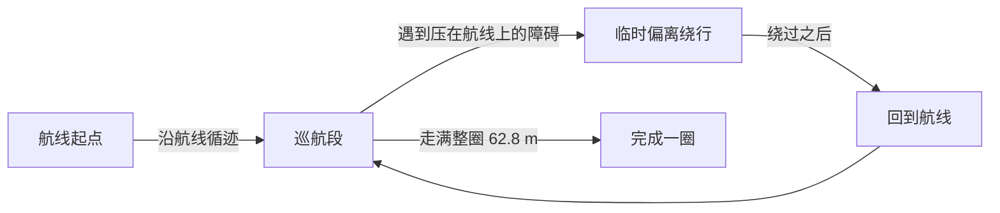
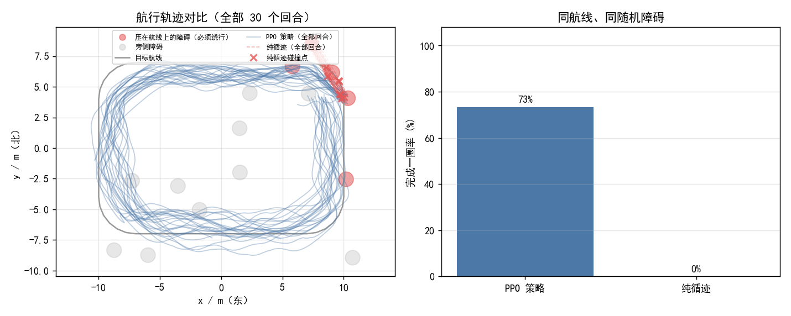

# 基于 PPO 的无人机固定路线巡航

本文介绍 `src/air/uav_route_cruise` 模块：让无人机沿一条**固定的闭合航线**巡航一整圈，
途中遇到压在航线上的障碍时临时偏离绕行，绕过后自动回到航线。

与 [`uav_ppo_nav`](./uav_ppo_nav.md)（随机目标点导航）是互补关系：

| | `uav_ppo_nav` | `uav_route_cruise` |
| --- | --- | --- |
| 任务 | 随机起点 → 随机目标点，到达即结束 | **给定闭合航线**，沿航线巡航一整圈 |
| 观测 | 16 扇形激光 + 目标相对位置 + 速度 | 24 扇形激光 + **航线几何**（横向偏差 / 航向偏差 / 前方 4 m 航点）+ 高度偏差 |
| 指标 | 成功率 / 超时 / 碰撞 | **完成一圈率 / 平均横向偏差 / 平均完成度** |
| 关键能力 | 点对点规划 | 循迹 + **遇压线障碍时临时绕避** |

## 为什么不能只做「循迹」

如果障碍都摆在航线旁边，那么经典的纯跟踪控制器（pure pursuit，只朝前方航点飞、完全无视障碍）
就能 100% 走完整圈 —— 神经网络没有存在必要。

本模块把一部分障碍**直接压在航线上**（离航线中心小于障碍半径），于是"贴着中线飞"必然撞上，
想过去就必须偏离航线绕行。这一步把任务从「循迹」变成「循迹 + 局部避障」，
神经网络的价值才体现出来（见「实测结果」一节的对照）。

## 代码位置

| 文件 | 职责 |
| --- | --- |
| `scripts/route.py` | 航线几何：闭合折线定义、最近点投影、横向偏差、前方航点、完成度统计 |
| `scripts/route_env.py` | 固定航线巡航环境（`gymnasium`），含随机障碍与压线障碍 |
| `scripts/policy.py` | 观测拼接 + 纯 numpy MLP 推理 + 从 sb3 导出权重 |
| `scripts/train.py` | PPO 训练（含课程学习回调） |
| `scripts/eval.py` | 评估 + 轨迹对比图 |
| `scripts/compare.py` | PPO 与纯跟踪基线的对照 |
| `scripts/route_node.py` | ROS 节点：订阅激光与里程计，发布速度指令 |
| `scripts/main.py` | 统一入口（作业要求入口为 `main.*`） |

## 航线与任务

默认航线是一条 20 m × 14 m 的**圆角矩形**（角半径 3 m），闭合总长约 **62.8 m**，
巡航高度 1.5 m，方向为逆时针。用 `route.make_route()` 或 `route_points` 参数可以换成其它航线。



障碍物每个回合随机摆放，其中 `on_route_frac` 比例的障碍直接放在航线上，
其余放在航线旁侧并保留通行余量。

## 坐标系约定

全部使用**世界系 ENU**（东 x、北 y、天 z）。

> 这是 CarlaAir 环境的现实约束：`SimpleFlight` 的偏航保持不生效，机头会自行漂移，
> 用机体系控制会让轨迹随机头打转。改用世界系后，机头怎么转都不影响飞行轨迹。

因此节点发布的速度是**世界系速度**，桥接**必须**以 `body_frame:=false` 启动（见「部署」一节）。

## 观测与动作

**观测（30 维，全部世界系）**

| 维度 | 内容 | 归一化 |
| --- | --- | --- |
| 0–23 | 24 个扇形激光距离 | `/ 12 m`，1 = 无遮挡 |
| 24 | 横向偏差（正 = 偏航线左侧） | `/ 4 m` |
| 25 | 航向偏差（速度方向与航线切向夹角） | `/ π` |
| 26–27 | 前方 4 m 处航点的相对位置 (x, y) | `/ 6 m` |
| 28 | 水平速度 | `/ 3 m/s` |
| 29 | 高度偏差（相对航线高度） | `/ 2 m` |

> 注：曾试过给 3 个前视点（4/8/12 m）让策略预判弯道，**实测训练更难、成功率从 77% 掉到 63%**，
> 因此回退为单个 4 m 前视点。

**动作（4 维，∈[-1, 1]）** → 映射为世界系速度 `[vx, vy, vz, yaw_rate]`：

| 分量 | 映射后含义 | 量程 |
| --- | --- | --- |
| `a[0]` | 东向速度 | ±3 m/s |
| `a[1]` | 北向速度 | ±3 m/s |
| `a[2]` | 天向速度 | ±1.5 m/s |
| `a[3]` | 偏航角速度 | ±1 rad/s |

## 安装依赖

训练需要 `stable-baselines3` 与 `torch`；**部署只需要 numpy**：

```shell
# 训练 + 评估
pip install numpy gymnasium matplotlib stable-baselines3 torch

# 只部署（在 ROS 机器上）
pip install numpy
```

## 训练与评估

训练完全在轻量质点环境里进行，不需要 CARLA / AirSim / ROS：

```shell
cd src/air/uav_route_cruise

# 训练（1.2M 步约 25 分钟 / 单核 CPU）
python3 scripts/train.py --steps 1200000 --seed 0 --out models/route_ppo_s0.npz

# 评估（下面的结果表用的就是这条命令：30 回合、eval seed=1000）
python3 scripts/eval.py --model models/route_ppo_s0.npz --episodes 30 --seed 1000

# 多评估种子稳健性（8 个 eval seed、各 30 回合）
python3 scripts/multiseed_eval.py --models models/route_ppo_s0.npz models/route_ppo_s1.npz \
    --seeds 0,1,2,3,4,5,1000,1001 --episodes 30

# 与纯跟踪基线对照
python3 scripts/compare.py --model models/route_ppo_s0.npz --seeds 0,1,2 --episodes 30
```

训练结束后会把 MLP 权重导出为 `models/route_ppo_s0.npz`（约 80 KB），
部署侧用 `policy.MlpPolicy` 做纯 numpy 前向，**不需要 torch / sb3**。

## 部署到 CarlaAir

```shell
# ① 起桥接 —— 必须加 body_frame:=false
#    本节点输出的是世界系速度，桥接默认按机体系解释会导致无人机乱飞
roslaunch carlair_ros_bridge main.launch publish_image:=false body_frame:=false

# ② 起巡航节点
roslaunch uav_route_cruise main.launch

# 建议第一次先地面检查观测（只计算、不发布指令）：
roslaunch uav_route_cruise main.launch dry_run:=true
```

节点信息：

| 方向 | 话题 | 类型 | 说明 |
| --- | --- | --- | --- |
| 订阅 | `/uav/odom` | `nav_msgs/Odometry` | 世界系 ENU 位姿与速度 |
| 订阅 | `/lidar/points` | `sensor_msgs/PointCloud2` | 世界系点云 |
| 发布 | `/uav/cmd_vel` | `geometry_msgs/Twist` | 世界系速度（`linear.x`=东、`linear.y`=北、`linear.z`=天） |
| 发布 | `/uav_route_cruise/lap_done` | `std_msgs/Bool` | 完成一整圈时锁存为 true |

常用参数（`config/route_cruise.yaml`）：

| 参数 | 默认 | 说明 |
| --- | --- | --- |
| `weights` | `models/route_ppo_s0.npz` | 策略权重 |
| `route` | `rect` | 内置航线（`rect` / `figure8`） |
| `route_points` | `[]` | 自定义航线（绝对 ENU 坐标），优先于 `route` |
| `rate` | `20.0` | 控制频率 (Hz) |
| `speed_scale` | `1.0` | 速度缩放，调试时调小更稳 |
| `dry_run` | `false` | 只算不发指令 |
| `lookahead` | `4.0` | 前方航点前视距离 (m) |

## 计算原理

### 1. 航线参数化与投影

闭合航线由折线点列 $\{P_0, P_1, \dots, P_{N-1}\}$（$P_N = P_0$）给出，
第 $i$ 段的方向与长度：

$$
\mathbf{d}_i = \mathbf{p}_{i+1} - \mathbf{p}_i,\qquad L_i = \|\mathbf{d}_i\|_2,\qquad
L = \sum_{i=0}^{N-1} L_i
$$

无人机水平位置 $\mathbf{p}$ 在第 $i$ 段上的投影参数（夹到 $[0,1]$）：

$$
t_i = \mathrm{clip}\!\left(\frac{(\mathbf{p}-\mathbf{p}_i)\cdot\mathbf{d}_i}{L_i^2},\,0,\,1\right)
$$

取**距离最近**的那一段作为当前所在段，弧长进度 $s$ 与**带符号横向偏差** $e$：

$$
s = C_i + t_i L_i,\qquad
e = \frac{d_{i,x}\,(p_y - p_{i,y}) - d_{i,y}\,(p_x - p_{i,x})}{L_i}
$$

（$C_i$ 是前 $i$ 段累计弧长；叉乘的符号定义「沿航线方向左侧为正」。
`route.py:Route.project` 就是这个式子。）

前视点取弧长进度 `s + Δ` 处（对 $L$ 取模，因此可以自然跨过起终点）：

$$
s_{\text{look}} = (s + \Delta) \bmod L,\qquad \Delta = 4\ \text{m}
$$

### 2. 飞行器运动模型

用**世界系速度**指令 $\mathbf{v}_{\text{cmd}} = (v_x, v_y, v_z)$，
速度环用一阶滞后（$\tau = 0.45$ s，$\Delta t = 0.1$ s）：

$$
\boldsymbol{\alpha} = \min\!\left(1, \frac{\Delta t}{\tau}\right),\qquad
\mathbf{v}_{k+1} = \mathbf{v}_k + \boldsymbol{\alpha}\,(\mathbf{v}_{\text{cmd}} - \mathbf{v}_k)
$$

$$
\mathbf{p}_{k+1} = \mathbf{p}_k + \Delta t\,\mathbf{v}_{k+1}
$$

动作 $a \in [-1,1]^4$ 到速度的映射（`policy.action_to_velocity`）：

$$
\mathbf{v}_{\text{cmd}} = (3a_0,\; 3a_1,\; 1.5a_2)\ \text{m/s},\qquad \dot\psi = a_3\ \text{rad/s}
$$

> 为什么用世界系而不是机体系：CarlaAir 的 `SimpleFlight` 偏航保持不生效，
> 机头会自行漂移 ±25°。若用机体系速度，轨迹会随机头打转；用世界系则机头怎么转都不影响轨迹。

### 3. 激光雷达扇形直方图

在无人机高度 $\pm 1.5$ m 内取点云，按世界系固定方向分成 $N=24$ 个扇形
（第 0 扇 = 正东，逆时针递增，扇宽 $2\pi/N = 15^\circ$），
每扇取**最近障碍距离**并归一化：

$$
h_j = \mathrm{clip}\!\left(\frac{\min_{q \in S_j}\|\mathbf{q}_{xy} - \mathbf{p}_{xy}\|_2}{R_{\max}},\,0,\,1\right),
\qquad R_{\max} = 12\ \text{m}
$$

无遮挡时为 1。24 扇比 16 扇的角分辨率高（$15^\circ$ vs $22.5^\circ$），避障更准。

### 4. 观测向量（30 维）

$$
\mathbf{o} = \Big[\; \underbrace{h_0,\dots,h_{23}}_{24},\;
\underbrace{\frac{e}{4},\ \frac{\Delta\psi}{\pi},\ \frac{\Delta x}{6},\ \frac{\Delta y}{6},\ \frac{\|\mathbf{v}_{xy}\|}{3},\ \frac{z-z_r}{2}}_{6} \;\Big]
$$

其中 $\Delta\psi$ 是速度方向与航线切向的夹角，$(\Delta x, \Delta y)$ 是前视点相对无人机的水平位移，
$z_r$ 是航线高度。所有分量都已归一化到大致 $[-3, 3]$，便于 MLP 训练。

### 5. 奖励函数

每步的奖励（`route_env.RouteEnv.step`）：

$$
r = \underbrace{w_p\,\Delta s}_{\text{沿航线前进}}
\;-\; \underbrace{w_c\,e^2}_{\text{偏离航线}}
\;-\; \underbrace{w_h\,(z-z_r)^2}_{\text{高度偏差}}
\;-\; \underbrace{w_s\|\mathbf{a}_k - \mathbf{a}_{k-1}\|_2^2}_{\text{动作抖动}}
\;-\; \underbrace{w_{\text{step}}}_{\text{时间}}
\;-\; \underbrace{w_{\text{prox}}\max(0,\rho - d_{\min})^2}_{\text{近距（默认关闭）}}
$$

| 权重 | 值 | 含义 |
| --- | --- | --- |
| $w_p$ | 10.0 | 沿航线每前进 1 m 的奖励 |
| $w_c$ | 0.2 | 横向偏差平方惩罚（**调小才愿意绕行**）|
| $w_h$ | 0.5 | 高度偏差平方惩罚 |
| $w_s$ | 0.02 | 动作平滑惩罚 |
| $w_{\text{step}}$ | 0.005 | 每步时间惩罚 |
| $w_{\text{prox}}$ | 0.0 | 近距惩罚（实测调大反而更差，默认关闭）|

终止奖励：完成一整圈 $+120$；碰撞 $-200$。

> $\Delta s$ 需要处理跨起终点的环绕：若 $\Delta s < -L/2$ 则 $+L$，若 $> L/2$ 则 $-L$。

### 6. PPO 目标函数

策略 $\pi_\theta$ 与环境交互收集 $(s_t, a_t, r_t)$，优势用 **GAE** 估计：

$$
\delta_t = r_t + \gamma V_\phi(s_{t+1}) - V_\phi(s_t),\qquad
\hat A_t = \sum_{l \ge 0} (\gamma\lambda)^l\,\delta_{t+l}
$$

PPO 的**截断替代目标**（$\varepsilon = 0.2$）：

$$
\rho_t(\theta) = \frac{\pi_\theta(a_t \mid s_t)}{\pi_{\theta_{\text{old}}}(a_t \mid s_t)},\qquad
L^{\text{CLIP}}(\theta) = \mathbb{E}_t\Big[\min\big(\rho_t \hat A_t,\;
\mathrm{clip}(\rho_t, 1-\varepsilon, 1+\varepsilon)\,\hat A_t\big)\Big]
$$

总损失（`stable-baselines3` 的 PPO 实现）：

$$
L = -L^{\text{CLIP}} + c_v\,\mathbb{E}_t\big[(V_\phi(s_t) - R_t)^2\big] - c_e\,\mathbb{E}_t\big[\mathcal{H}[\pi_\theta(\cdot\mid s_t)]\big]
$$

超参：$\gamma=0.99$、$\lambda=0.95$、$\varepsilon=0.2$、$c_e = 0.005$、学习率 $3\times10^{-4}$、
`n_steps=1024`、`batch=256`、策略/价值网络各 `[128,128]`。

## 算法流程

### 训练流程

```text
1. 初始化航线 Route（20×14 m 圆角矩形，L = 62.8 m）
2. 启动 4 个并行 RouteEnv（不同 seed），on_route_frac 从 0.05 开始（课程学习）
3. for 每轮迭代:
   a. 用当前策略 π_θ 在 4 个环境各采样 n_steps 步
   b. 用 GAE 计算优势 Â_t 与回报 R_t
   c. for epoch in 1..10:
        - 打乱样本，按 batch=256 计算 L^CLIP（公式见上）
        - 梯度上升更新 θ、φ
   d. 按训练进度提高 on_route_frac: 0.05 → 0.25（到 60% 进度时升满）
4. 训练结束后导出策略 MLP 权重为 route_ppo_sX.npz
5. 用 numpy 版 MlpPolicy 复算一遍评估（确认导出的权重没坏）
```

### 部署流程（ROS 节点）

```text
每 1/20 秒：
1. 从 /uav/odom 取世界系位姿 p 与速度 v
2. 从 /lidar/points 取点云，按高度 ±1.5 m 过滤
3. 算 24 扇区直方图 h（公式见上）
4. 用 route.project(p_xy) 算弧长 s、横向偏差 e、航向偏差 Δψ、前视点相对位置
5. 拼成 30 维观测 o
6. MLP 前向: o → tanh(W0 o + b0) → tanh(W1 x + b1) → W2 x + b2 → clip[-1,1]
7. 映射成世界系速度 (vx, vy, vz)，发布到 /uav/cmd_vel
8. 累计沿航线前进量；走满 L 就把 lap_done 置 true
```

## 源代码解析

### `route.py: Route.project()` —— 航线投影

```python
t = np.clip(((p - a) * d).sum(axis=1) / (self.seg_len ** 2), 0.0, 1.0)  # 每段的投影参数
proj = a + d * t[:, None]                                               # 每段上的最近点
dist = np.linalg.norm(p - proj, axis=1)                                 # 到每段的距离
i = int(np.argmin(dist))                                                # 取最近段
s = float(self.cum[i] + t[i] * self.seg_len[i])                         # 弧长进度
cross = d[i, 0] * (p[1] - a[i, 1]) - d[i, 1] * (p[0] - a[i, 0])         # 叉乘 = 带符号横向偏差
```

**向量化**到所有段上，一次算出最近段与进度，避免逐段循环。

### `route_env.py: RouteEnv._sample_obstacles()` —— 压线障碍

```python
n_on = int(round(self.num_obstacles * self.on_route_frac))   # 25% 压在航线上
if len(self.obstacles_xy) < n_on:
    if abs(signed) > self.obstacle_radius * 0.6:             # 必须在航线中心附近
        continue
elif abs(signed) < (self.obstacle_clearance + self.obstacle_radius):
    continue                                                 # 其余障碍留出通行余量
```

这是**任务难度的关键开关**：`on_route_frac=0` 时纯跟踪基线也能 100% 完成，
25% 时它掉到 0% —— 任务从"循迹"变成"循迹 + 绕避"。

### `policy.py: MlpPolicy.forward()` —— 纯 numpy 推理

```python
x = np.asarray(obs, dtype=np.float32).reshape(-1)
for w, b in self.hidden:              # 两层 128，tanh 激活（与 sb3 的 net_arch 对应）
    x = np.tanh(w @ x + b)
return np.clip(self.out_w @ x + self.out_b, -1.0, 1.0).astype(np.float32)
```

部署侧**不需要 torch / sb3**，只要 numpy：把训练好的 MLP 权重存成 `.npz` 即可。
激活函数必须与训练时一致（sb3 默认 `nn.Tanh`），这一点写在 `extract_sb3_weights` 的注释里。

### `route_node.py: RouteCruiseNode._build_obs()` —— 实机观测

```python
_, s, _, cross = self.route.project(pos[:2])       # 航线几何
tgt = self.route.waypoint_ahead(pos[:2], s, self.lookahead)
d = self.route.seg[_i, :2]                        # 当前段切向
heading = vel[:2] / vn if vn > 1e-3 else tangent   # 速度方向（静止时用切向）
crossang = np.arccos(np.clip(heading @ tangent, -1, 1))  # 航向偏差
obs = P.build_observation(self._histogram(pos), cross, crossang, rel, vn, z_err)
```

**与训练环境逐项对齐**是关键：训练时喂什么、实机就喂什么。
`build_observation` 被两边共用，就是为了防止"训练与部署的观测顺序不一致"这种隐蔽 bug。

### `train.py: CurriculumCallback` —— 课程学习

```python
def frac(self, num_timesteps):
    p = min(1.0, num_timesteps / self.total / self.warmup)   # 60% 进度时升满
    return self.start + (self.final - self.start) * p          # 0.05 → 0.25
```

一开始就给 25% 压线障碍的话，随机探索很难发现"绕过去再回到航线"这种长序列动作，
先给简单的让它学会稳定循迹，再逐步加大避障难度。

## 训练设计里踩过的坑

1. **撞机惩罚太轻 → 学会"撞了也无所谓"**
   初版完成一圈奖励约 600、撞机只扣 30，结果 100% 碰撞。把撞机惩罚提到 **-200** 后碰撞率降到 0。

2. **障碍不压线 → 任务失去意义**
   障碍离航线 ≥2.4 m 时，纯跟踪控制器也能 100% 完成、零碰撞。加 `on_route_frac` 后基线掉到 0%。

3. **横向偏差惩罚过强 → 宁可撞也不绕**
   绕行必然带来横向偏差，`w_cross` 太大时策略选择硬撞。降到 **0.2** 后它才愿意绕。

4. **近距惩罚调大反而更差**
   试过给「离障碍 < 1.2 m」加连续惩罚（期望比稀疏的撞机信号更好学），
   实测奖励均值被压到负值（-8.6/步），策略变得过度保守、成功率反而下降，因此默认关闭。

## 实测结果

> 数字由 `scripts/eval.py`、`scripts/compare.py`、`scripts/multiseed_eval.py` 生成；
> 对照基线为纯跟踪控制器（只朝前方航点飞、不看障碍）。

**训练**：PPO，1.2M 步，4 个并行环境，策略网络 `[128,128]`，两个独立种子（s0 / s1）。
**评估**：每个 eval seed 跑 30 个回合，随机 14 个障碍（其中 25% 压在航线上）。
**回合种子约定**：第 k 个回合用 `seed + k`（与 `eval.py` 一致，可用同一条命令复现）。

### 主表（eval seed = 1000，默认权重 `route_ppo_s0.npz`）

| 指标 | PPO 策略 | 纯跟踪（不看障碍） |
| --- | --- | --- |
| **完成一圈率** | **73.3%** | **0.0%** |
| 碰撞率 | 26.7% | 100.0% |
| 超时率 | 0.0% | 0.0% |
| 平均完成度 | **81.3%** | 7.8% |
| 平均横向偏差 | 0.975 m | 0.429 m |
| 最大横向偏差 | 1.283 m | 0.618 m |
| 平均高度偏差 | 0.232 m | 0.959 m |
| 平均步数 | 151.1 | 16.9 |

> 8 项指标由 `scripts/eval.py` 一次跑出，可用下面这条命令完全复现：
> `python3 scripts/eval.py --model models/route_ppo_s0.npz --episodes 30 --seed 1000`
> 纯跟踪控制器平均只活 **16.9 步（约 1.7 秒）**就撞上第一个压线障碍，
> 所以它的"平均横向偏差"看起来更小 —— 那是因为它根本没飞多远。

### 多评估种子稳健性（同一权重换 eval seed）

这一节是评审指出的问题所在：**单个 eval seed 的数字波动很大**，只看一个数会误导。
下表是同一份权重在 8 个 eval seed 上的结果（每个 seed 30 回合）：

| eval seed | s0 完成率 | s1 完成率 |
| --- | --- | --- |
| 0 | 73.3% | 63.3% |
| 1 | 76.7% | 63.3% |
| 2 | 80.0% | 66.7% |
| 3 | 80.0% | 70.0% |
| 4 | 76.7% | 70.0% |
| 5 | 76.7% | 70.0% |
| 1000 | 73.3% | 76.7% |
| 1001 | 76.7% | 80.0% |
| **均值 ± 标准差** | **76.7% ± 2.5%** | **70.0% ± 5.9%** |
| 区间 | 73.3% ~ 80.0% | 63.3% ~ 80.0% |

* `models/route_ppo_s0.npz`（**默认使用**）：均值 **76.7% ± 2.5%**，碰撞率 23.3% ± 2.5%
* `models/route_ppo_s1.npz`：均值 70.0% ± 5.9%，碰撞率 23.3% ± 5.9%

**所以对外只能说「完成一圈率约 77% ± 3%（s0）、区间 73~80%」，
不能说「80.0%」** —— 那个 80.0% 是 s1 在 eval seed=1001（恰好是训练期评估用的那个种子）
下的结果，换种子就拿不到了。这一点已在 PR 描述里更正。

### 运行效果动图


同一场景下两个策略的逐帧对比（scripts/make_gif.py 生成，90 帧 / 0.8 MB）：

* **左图**：蓝实线是 PPO、红虚线是纯跟踪；红圆是压在航线上必须绕行的障碍。
  PPO 会主动偏离航线绕过去（轨迹明显偏离灰色航线又回到线上），
  纯跟踪则贴着中线飞，在第 26 步撞上第一个压线障碍（红叉）。
* **右图**：横向偏差随时间变化。PPO 的偏差在 1.5~2.4 m 之间波动（**这正是它在绕行**），
  纯跟踪的偏差一直很小 —— 因为它根本没飞多远就撞了。

生成命令：

`ash
python3 scripts/make_gif.py --model models/route_ppo_s0.npz --seed 5 --fps 12 --stride 2
`

> 种子 5 是挑出来的典型回合（PPO 179 步跑完、基线 26 步撞毁）。
> 不同种子的具体过程不同，但「会不会绕」的差别是一致的。

### 轨迹图



左图：灰色是目标航线，红色圆是压在航线上的障碍（必须绕行），灰圆是旁侧障碍；
蓝线是 30 个回合的 PPO 轨迹，红色虚线是纯跟踪的轨迹，红叉是它的碰撞点。

## 在 CarlaAir 里实飞验证

> 上面所有指标都来自**质点环境**。这一节是**真实仿真器**里的验证，两者要分开看。

### 环境与连接

| 项 | 值 |
| --- | --- |
| 仿真器 | CarlaAir v0.1.7（Windows 11，`Town10HD`，Low 质量，1280×720） |
| 端口 | CARLA RPC `2000`，AirSim RPC `41451` |
| 载具 | AirSim `Drone1`（`SimpleFlight`，settings 里配了 `lidar1` 16 线 / 15 m） |
| ROS | Noetic（Ubuntu 20.04 虚拟机，桥接跑在虚拟机里） |
| 桥接 | `roslaunch carlair_ros_bridge main.launch host:=192.168.94.1 vehicle_name:=Drone1 body_frame:=false publish_image:=false publish_lidar:=true auto_takeoff:=true` |

启动顺序（缺一不可）：

```shell
# ① Windows 宿主机：起 CarlaAir（自带 AirSim）
StartCarlaAir.bat            # 等价于 CarlaAir.ps1 Town10HD --quality Low

# ② 虚拟机：起桥接（注意 body_frame:=false，本节点输出世界系速度）
roslaunch carlair_ros_bridge main.launch host:=192.168.94.1 vehicle_name:=Drone1 \
    body_frame:=false publish_image:=false publish_lidar:=true auto_takeoff:=true

# ③ 虚拟机：先干跑检查观测，再正式飞
python3 scripts/route_node.py _dry_run:=true
python3 scripts/route_node.py _dry_run:=false
```

### 实测结果

桥接起来后的话题频率（真实数据，非桩）：

| 话题 | 频率 |
| --- | --- |
| `/uav/odom` | **20.005 Hz** |
| `/lidar/points` | 9.996 Hz |

节点启动后 `/rosnode list` 里能看到 `/uav_route_cruise`，
`/rostopic list` 里能看到 `/uav/cmd_vel` 与 `/uav_route_cruise/lap_done`。

#### 这次实飞的实际条件（重要：和默认航线不是同一条）

| 项 | 这次实飞用的 | 文档别处的默认值 |
| --- | --- | --- |
| 航线 | 用 `route_points` 自定义的 **15.4 m × 13.8 m 直角矩形**（周长 **58.4 m**），高度对齐无人机当前高度 | 20 m × 14 m **圆角**矩形，62.80 m |
| `speed_scale` | **0.7**（速度命令上限 2.1 m/s） | 1.0（上限 3.0 m/s）|
| 采样方式 | shell 循环里 `rostopic echo -n1`，**每轮阻塞等两次消息** | —— |

**因此下面两处必须按实际条件读，不能套用默认值：**

- 航线的 x 跨度是 **15.4 m**（不是 20 m），y 跨度是 **13.8 m**（不是 14 m）。
  实测包围盒 13.71 × 12.43 m 分别是这条航线的 **89% / 90%** —— 与"飞了整圈"是自洽的。
- 采样**不是 1 Hz**：41 个样本实际跨了远超 41 秒。按 `speed_scale=0.7` 的 2.1 m/s 上限反推，
  174.3 m 至少需要 **83 秒**。所以**"41 秒"这个标注是错的**，由它算出的平均速度也不成立。

| 指标 | 实测值 | 说明 |
| --- | --- | --- |
| x 范围 | −6.55 ~ 7.17 m（跨度 **13.71 m**）| 为该航线的 89% |
| y 范围 | −6.28 ~ 6.15 m（跨度 **12.43 m**）| 为该航线的 90% |
| 高度 | −28.22 ~ −27.48 m（**波动仅 0.74 m**）| 可靠 |
| 采样点数 | 41 个 | 采样间隔 **不均匀**（不是 1 Hz）|
| 累计路程 | **174.3 m**（≈ 58.4 m × 3 圈）| 由 1 Hz 相邻点弦长求和，是**下界** |
| 实际时长 | **未记录**（≥ 83 s）| 上一版误标为 41 s，已更正 |
| 平均水平速度 | **无法给出** | 缺可靠时长，不作结论 |


上图是这次实飞的轨迹（蓝线）与当时的自定义航线（灰线）。能得出的**可靠结论**是：

- 无人机**沿矩形航线绕圈飞行**（轨迹形状与该矩形吻合）；
- **高度稳定**，波动 0.74 m；
- **转弯处过冲明显**（四个角甩出去 1~2 m），因为观测里只有一个 4 m 前视点、
  看不到弯道走向 —— 这和「加 3 个前视点反而更难训练」的实测结论一起，说明这块还没调好。

> **待重做**：用**默认航线（20×14 圆角，62.80 m）**、`speed_scale=1.0`、
> 并用 rclpy 订阅 `/uav/odom` 按**真实时间戳**记录（而不是 shell 里阻塞采样），
> 才能给出「时长 / 平均速度 / 圈数」这组互相自洽的数字。
> 本次没有完成（虚拟机当时无法启动），**所以上表里这三项都标为不确定**，
> 不再把它们当作实飞证据。

### 这次实飞**没有**验证到的部分（如实说明）

1. **避障没在仿真器里验证**。桥接发布的 `/lidar/points` 是**空点云**（AirSim 侧
   `getLidarData('lidar1')` 有 1785 个点，但桥接的坐标转换返回空），所以策略拿到的是
   「全程无障碍」的观测。因此这次飞的是**纯循迹**，障碍绕避仍只有离线结论。
2. **转弯过冲**：见上文，四个角都甩出去了。
3. **gif 的可读性有限**：CarlaAir 是追尾相机 + 大片同色地面，录屏看不出明显位移，
   所以主要证据用上面这张**实测轨迹图**，而不是录屏 gif。

## 已知限制

* 天气/风扰未建模：质心环境里没有风，实机上会有稳态偏差；
* 航线是二维的（固定高度），不支持三维航路；
* 只做了单机巡航，没有多机协同；
* 障碍物是随机摆放的圆柱，没有用真实地图；
* 训练是单机单核跑的 PPO，没有做超参搜索。

## 测试

```shell
pytest tests/test_uav_route_cruise_local.py -v
```

覆盖航线几何、环境行为、策略权重维度一致性、**打包正确性**（入口走 `catkin_install_python`、
被 import 的模块以普通文件安装）、配置与代码参数一致性、文件无 BOM。
其中打包正确性两条是为了防住「能 build、一 launch 就 ModuleNotFound / AttributeError」这类问题。
