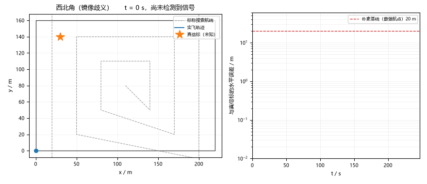
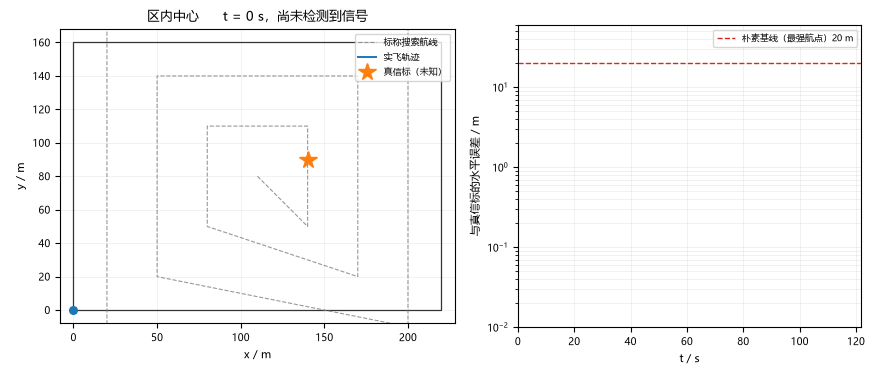
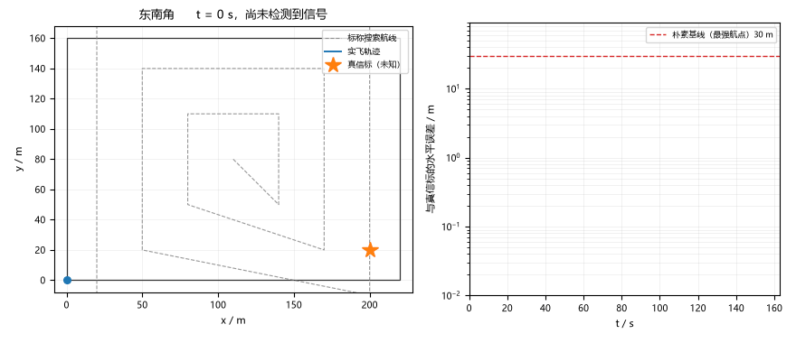
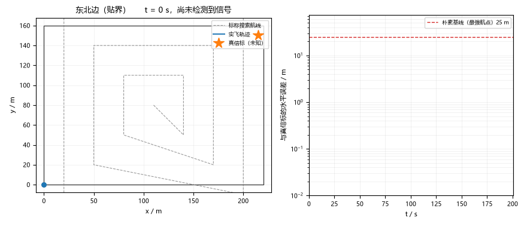
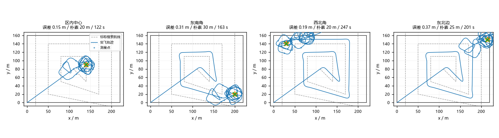

# 隐藏无线信标的搜索与 RSSI 三边定位

"某处有一个会发信号的设备，飞过去找到它"——搜不是难点，难在**一次 RSSI
读数到底值几米**：0.5 dB 的量化步长在 40 m 处就是 ±1.3 m 的单点测距误差，
接收机还有 −76 dBm 的底噪，43 m 以外根本收不到。本模块把这条物理链路完整
建模，然后在它上面做三边定位：扩张方形搜索到首次检测，收缩测量圈凑齐几何，
阻尼最小二乘解出信标位置，最后 MuJoCo 闭环真飞验证。

## 先看效果

左栏是俯视实飞轨迹：灰色虚线是扩张方形标称航线，蓝线是 MuJoCo 真实轨迹，
小圆点是测量点，橙色星是真信标（算法不知道），绿叉是最小二乘估计；右栏是
定位误差随时间的收敛曲线，红色虚线是"取最强信号航点"朴素基线的误差水平。



其余三个算例：







四算例俯视总览（星为真信标，叉为最终估计）：



## 问题拆解

**一次读数值几米？** 对数距离路损模型 rssi(d) = rssi0 − 10·n·log10(d/d0)，
rssi0 = −40 dBm@1 m、n = 2.2、底噪 −76 dBm（对应 43.3 m 可检测半径）。量化
取整方向是第一个坑：向下取整会让读数系统性偏低、反演距离整体偏大 ~2%，
最小二乘吸收不掉固定偏差——必须就近取整。

**样本高度能不能压扁？** 不能。RSSI 来自信标的真实 3D 距离，把 20 m 高度的
测量点压到地面再解，反演距离凭空短了 ~6 m，解整体外移 20 m（实测）。样本
必须存 3D，残差里显式带上高度差 h_i，只解 (bx, by)。

**单侧弧的镜像歧义。** 首次检测发生在可检测半径边界上，探圈往往只圈到一小
段信号弧；近共线样本让最小二乘在样本主轴两侧各有一个解，幽灵解残差反而更小
（实测偏 57 m、残差 0.05 m vs 真解 0.4 m）。三道闸：估计出界即沿样本主轴
镜像（真信标必在区内）、逼近段信号越飞越差或长时间无信号即镜像、精圈整圈
无信号退回逼近重新翻。

**最小二乘的局部极小。** 同一组样本，初值差一点就收敛到残差 6.3 m 的假点
（多起点下同一组样本残差 0.4 m）——质心 + 先验 + 8 方向网格撒起点，取残差
最小者。

## 实现与验证

**闭环（`core/flyer.py`）**：uav_mujoco_sim 的 Quadrotor +
GeometricController 真飞，dt = 0.01 s 与控制周期一致。参考点用时间参数化
直线腿推进并拴 3 m 拴绳（直接追远处测量点会让位置误差项顶到倾角上限，实测
俯冲掉高）。阶段机：爬升 → 方形搜索 → 探圈 → 逼近 → 精圈收缩（每轮只用
本轮样本）→ 复核。复核在估计点上空实测 RSSI，与"估计点即信标"做 3D 距离
自洽检查。

**ROS 节点（`ros/scan_node.py`）**：薄壳，订阅 `/uav/odom` 与 `/rssi`
（Float32 dBm），攒够 8 条样本后周期解算，在
`/uav_rssi_source_locate/estimate` 发 JSON（x / y / residual / n）；几何
全部在 `core/locator.py`，节点只做消息转换与样本簿记。

**结果**（MuJoCo 真飞，四个信标算例）：

| 算例 | 信标位置 | 首次检测 | 定位误差 | 样本数 | 朴素"最强航点" |
| --- | --- | --- | --- | --- | --- |
| center | (140, 90) | 23.0 s | 0.15 m | 30 | 20 m |
| southeast | (200, 20) | 66.3 s | 0.31 m | 31 | 30 m |
| northwest | (30, 140) | 96.1 s | 0.19 m | 27 | 20 m |
| east_edge | (215, 150) | 81.9 s | 0.37 m | 31 | 25 m |

四算例全部通过复核；"朴素最强航点"列不做事后解算、只挑信号最强的方形航
点，误差被 30 m 网格步长锁死——三边定位把它压到米级，两个数量级的差距。

测试 19 项：路损模型（单调性、量化、底噪、反演对称、量化偏差无系统性正偏）、
三边定位（干净圈复现、共线拒绝、3D 高度差回归、坏初值鲁棒）、搜索几何（方
形扩张、测量圈半径）、镜像翻转（自逆、主轴上不动）、3 项 MuJoCo 冒烟
（中心算例米级收敛、西北角镜像算例不留幽灵解、全程不掉高）。

## 复现

```bash
cd src/air/uav_rssi_source_locate
python main.py                 # 四个算例各真飞一次，墙钟约 12 s
python main.py --no-sim        # 仅算法层（链路面 + 解算自检 + 朴素基线）
python tools/make_gif.py       # 重录五张图
python -m pytest test/ -q      # 19 项
```

## 与仓库已有模块的关系

| 模块 | 关注点 | 本模块的区别 |
| --- | --- | --- |
| `uav_waypoint_tracking` | PID 跟给定航点 | 搜索航点由"哪里收到信号"在线生成 |
| `uav_poi_orbit` | 绕已知点盘旋 | 目标位置未知，靠测量反解 |
| `uav_moving_target_follow` | 跟移动已知目标 | 目标静止但位置未知，核心是测距与解算 |
