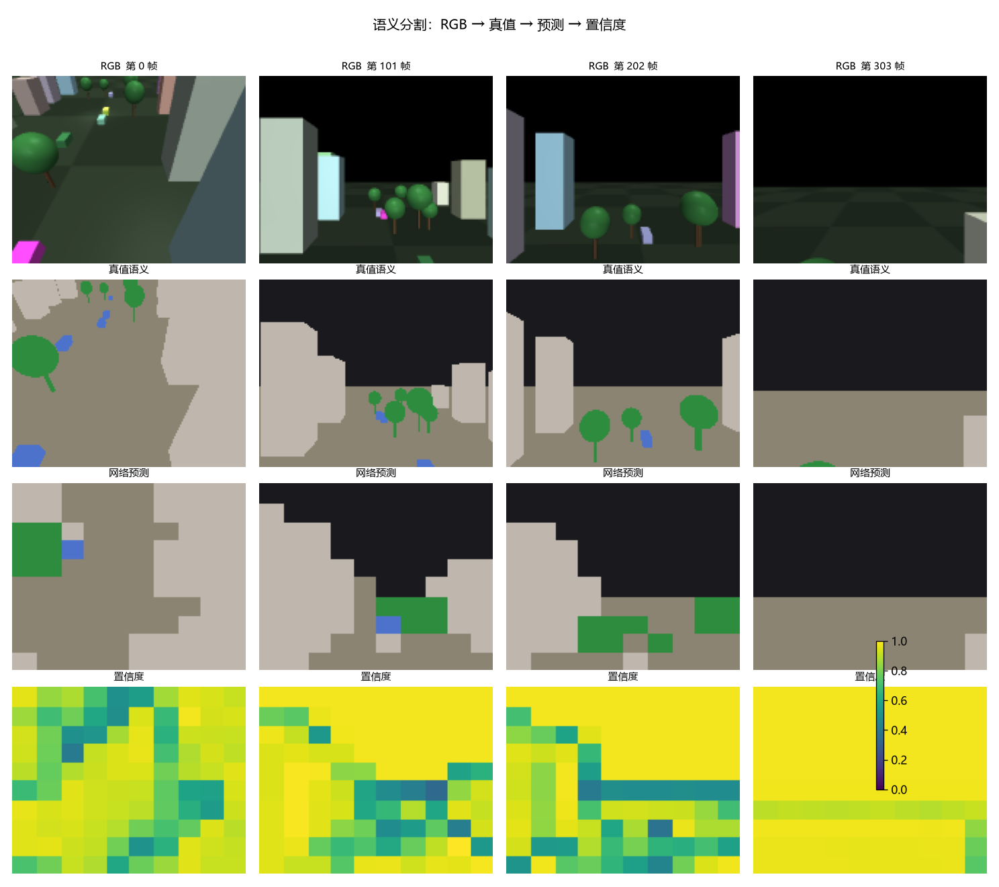
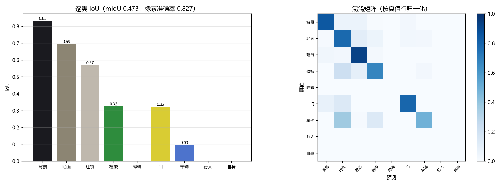
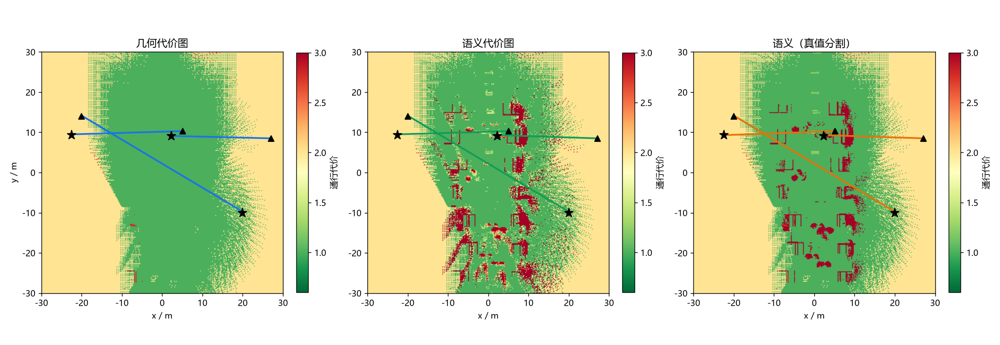
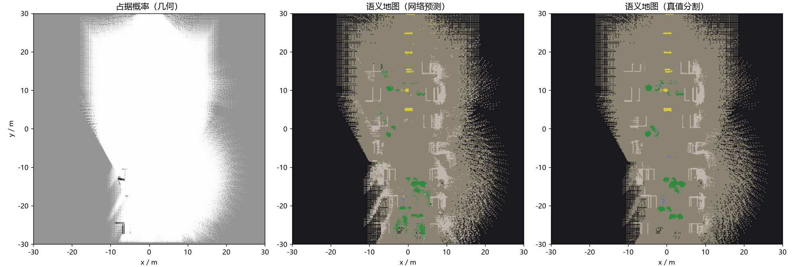

# 语义分割建图与语义路径规划

对应作业任务（2）**传感器感知**与任务（3）**建图与导航**。

几何地图只知道"哪里有障碍"，不知道"那是什么"。本模块用语义分割构建语义地图，
使无人机能完成"沿可通行区域飞、绕开植被、从门框穿过"这类需要理解环境的任务。

分割网络是纯 numpy 手写前向与反向的小型编解码网络（不依赖深度学习框架），
在仿真真值分割上训练；语义栅格把占据概率与类别分布**分开估计**；规划器在
语义代价图上跑 A*。对比实验：几何代价图 / 语义代价图 / 真值分割语义图。

---

## 1. 模块定位

课程内的无人机建图全部是纯几何的（八叉树 / 栅格），没有任何语义建图：

| 已有模块 | 区别 |
|---|---|
| `octree_uav_3d_pathfinding` | 几何八叉树占用地图，只有占据/空闲，没有类别 |
| `unmanned_aerial_car_perception` | 是车，且不做地图 |
| `carla_slam_gmapping` | 是车，纯几何 |

分割网络本身也满足"感知算法需为神经网络"的要求。

---

## 2. 架构

```
RGB 160×128 ─→ 分割网络（3 层 stride-2 编码器 + 1×1 头 + 最近邻上采样）
                    │
                    ├─ 9 类语义图
                    └─ 逐像素置信度
                          │
深度 160×128 ─────────────┴─→ 针孔逆投影 ─→ 语义栅格
                                              │  占据对数几率（几何）
                                              │  类别投票（语义）
                                              │
                                       语义代价图 ─→ A* ─→ 视线捷径 ─→ 路径
```

---

## 3. 分割网络

### 3.1 结构

| 层 | 形状 | 说明 |
|---|---|---|
| Conv1 | 3×64×64 → 16×30×30，5×5 /2 | valid 卷积，不补零 |
| Conv2 | 16×30×30 → 24×14×14，3×3 /2 | |
| Conv3 | 24×14×14 → 32×6×6，3×3 /2 | |
| 分类头 | 32×6×6 → 9×6×6，1×1 | |
| 上采样 | 9×6×6 → 9×64×64 | 最近邻，无参数 |

上采样放在 **logits** 上而不是特征图上：解码器不需要参数，输入尺寸也不必是
2 的幂——全卷积结构让同一份权重既能跑训练的 64×64，也能跑板端的其他分辨率。
上采样的目标尺寸取自**本次输入**的空间尺寸，钉死在构造时会让 logits 与标签
尺寸对不上（实测 96×96 的 logits 对上 64×64 的标签）。

### 3.2 损失

逐像素加权交叉熵，权重取类别频率的逆平方根：

$$
w_c = \left(\frac{\sum_{c'} n_{c'}}{n_c}\right)^{1/2},
\qquad \mathcal{L} = -\frac{1}{N}\sum_{i} w_{y_i}\log p_{i,y_i}
$$

类别极不平衡（地面与天空占多数像素），不加权时网络会把所有像素判成多数类，
像素准确率看着很高而 mIoU 接近 0。权重归一化到均值为 1。

### 3.3 训练

Adam（$\text{lr}=2\times10^{-3}$，权重衰减 $10^{-6}$，梯度范数限幅 1.0），
30 轮，每集最多取 150 帧。数据从仿真真值分割采，RGB 用分箱平均下采样到
64×64，标签用最近邻。分箱平均会把类别索引平均成不存在的类别：训练 loss
下降而 mIoU 停在随机水平（实测）。

源尺寸与目标尺寸不成整数倍时，退回裁剪会错位：标签贯穿全图最近邻采样，输入只取左上角。
160×128 → 96×96 时 RGB 裁掉 44% 画面、标签未裁，mIoU 崩。

**验证集按帧留出（15%），不按集留。** 四个采集 episode 分属三个场景，留一集
时验证集与训练集分布不同：实测验证损失上升、训练损失下降（域偏移，非过拟合）。

### 3.4 类别分布

| 类别 | 像素占比 | 类别 | 像素占比 |
|---|---|---|---|
| 背景 | 50.65% | 门 | 1.65% |
| 地面 | 34.46% | 车辆 | 0.22% |
| 建筑 | 10.80% | 障碍 / 行人 / 自身 | 0（本批场景无样本）|
| 植被 | 2.22% | | |

三类无样本的类不参与 mIoU 统计（$0/0$ 不是 0 分）。车辆只占 0.22% 像素，
是六类里最难的。



---

## 4. 语义栅格

每格维护三样东西：

| 量 | 更新方式 |
|---|---|
| `logodds` | 射线穿过减 $l_{\text{free}}=-0.40$，命中加 $l_{\text{occ}}=+0.85$，限幅 ±4 |
| `votes[c]` | 命中点的分类结果投一票 |
| `hits` / `free` | 命中、穿过的次数（区分"没看过"和"看过是空的"）|

**占据与语义分开估计**：占据由几何射线决定，语义由分类结果投票决定。把两者
耦合（例如"只有建筑类像素才标占据"）会让分割错误直接变成避障错误；分开之后
语义错了只影响代价，不影响安全。

两个实现细节：

**射线空域采样不含终点。** 终点是命中格，空域票会抵消刚加的占据票：同一堵墙
被几百条射线打中时对数几率变负，概率图上整面墙消失。

**2.5D 反投影的深度按视线几何给。** 同一 (u,v) 上不同俯仰角的像素若深度相同，
会映射到同一格，二维上塌缩成一条线（合成测试场景实测）。

---

## 5. 语义代价图与规划

$$
\text{cost}(r,c) = \begin{cases}
\infty & \text{占据概率} > 0.7 \\
c_{\text{class}} & \text{已知且置信度} \ge 0.6 \\
0.5\,c_{\text{class}} + 0.5\,c_{\text{unknown}} & \text{置信度} < 0.6 \\
c_{\text{unknown}} & \text{未观测}
\end{cases}
$$

| 类别 | 通行代价 $c$ |
|---|---|
| 地面 | 1.0（基准）|
| 门 | 1.2 |
| 植被 | 3.0（可穿越但代价高）|
| 建筑 / 障碍 / 车辆 / 行人 / 背景 | 20（不该走，但走得通）|

**只有几何占据给 $\infty$。** 语义是估计，把它当硬约束会让一次误分类直接堵死
通路（见 §7.3）。

代价定义在**格**上，8 邻域的边权取两端格代价的均值乘以步长：

$$
e(a \to b) = \|a - b\| \cdot \tfrac{1}{2}\big(\text{cost}(a) + \text{cost}(b)\big)
$$

启发式用欧氏距离。规划完成后再做一次**视线捷径**：能直线通达就跳过中间点，
去掉栅格 A* 的锯齿。

置信度低时把代价往中性值拉，避免"猜错的语义"把代价压得过低——这一项是
语义地图比几何地图多出来的自由度，也是它需要被单独评测的原因。

---

## 6. 对比实验设计

同一份扫描数据、同一套 A*，只换代价图：

| 代价图 | 语义来源 |
|---|---|
| 几何 | 只用占据概率（基线）|
| 语义 | 网络预测的分割 |
| 语义（真值分割） | 仿真真值分割，用来分离"网络的错"与"语义本身的收益" |

**场景按区分度挑。** 起终点随便取时三张代价图给出同一条路径（实测三条路径
长度均为 46.37 m，真值语义代价均为 1.00）。`make_scenarios` 计算直线段在真值
语义图上的平均代价，优先取"几何上通畅、语义上不该走"的场景。

**打分统一用真值语义图。** 按规划器自己的代价图打分没有可比性：语义图把满路
判成建筑时，它给自己的路径打 10.50。

指标：成功率、路径长度、撞上几何占据格的采样点数、沿途语义不确定性、
A* 展开节点数、**真值语义代价**。

---

## 7. 实测结果

平台：Windows 11 + Intel Core 5 220H（核显，无独显）。训练 30 轮 702 s。
ROS2 侧在 Ubuntu 20.04 + Humble 虚拟机中 `colcon build` 通过。

### 7.1 分割精度

| 指标 | 值 |
|---|---|
| mIoU（6 个非空类） | **0.4730** |
| 像素准确率 | 0.8265 |
| 建图后语义一致 mIoU | 0.4688 |
| 建图后语义一致像素准确率 | 0.9313 |

| 类别 | IoU | 类别 | IoU |
|---|---|---|---|
| 背景 | 0.8332 | 门 | 0.3220 |
| 地面 | 0.6948 | 车辆 | 0.0946 |
| 建筑 | 0.5691 | 障碍 / 行人 / 自身 | 无样本 |
| 植被 | 0.3245 | | |

车辆只占 0.22% 像素，是六类里最难的；门（1.65%）次之。地面与建筑决定
可通行性，两者都在 0.57 以上。



### 7.2 规划对比

| 代价图 | 成功率 | 路径长度 | 碰撞 | 语义不确定性 | 展开节点 | 真值语义代价 |
|---|---|---|---|---|---|---|
| 几何 | 100% | 32.80 m | 0.00 | 0.151 | 4697 | **7.33** |
| 语义（网络） | 100% | 32.80 m | 0.00 | 0.144 | 6073 | **4.17** |
| 语义（真值分割） | 100% | 32.80 m | 0.00 | 0.069 | 4989 | **1.00** |

网络语义图把真值语义代价从 7.33 压到 4.17（−43%），真值分割能到 1.00。
差距就是分割精度的损失。

逐场景（代价越低越好）：

| 场景 | 几何 | 语义（网络） | 语义（真值） |
|---|---|---|---|
| 对角 | 1.00 | 1.00 | 1.00 |
| 判别14 | 10.50 | 10.50 | 1.00 |
| 判别213 | 10.50 | **1.00** | 1.00 |



语义图在"判别213"上找出了干净路线，在"判别14"上没有——网络在那一处漏检了。
整张语义图上建筑格 4494 个，真值只有 2440 个：建筑召回高、**精确率低**，
多出来的都是误检。



### 7.3 语义代价不能给 `inf`

初版把"建筑/障碍"的通行代价设成 `inf`，结果网络预测的语义图**成功率 0%**
（几何图与真值语义图都是 100%）：网络把场景起点格判成"建筑"、置信度 1.00，
起点代价 `inf`，A* 直接无解。

语义是**估计**，当硬约束时一次误分类即可堵死通路。现在只有几何占据（深度
射线打中）给 `inf`，语义高代价取有限值 20；绕不开时可穿过，代价计入"真值
语义代价"。

---

## 8. 源码解析

```
uav_semantic_mapping_nav/core/
├── nn.py            手写 Conv2d / Linear / Upsample2x / Adam / 交叉熵
├── segnet.py        SegNet：前向、反向、加权交叉熵
├── labels.py        9 类语义表、配色与通行代价
├── segdata.py       数据采集（弓字形扫描航线 + 半圆掉头）
├── training.py      训练与推理
├── semantic_map.py  SemanticGrid：逆投影、占据更新、类别投票、代价图
├── planner.py       A* 与视线捷径
├── metrics.py       mIoU / 像素准确率 / ECE / 路径指标
└── experiment.py    三张代价图的受控对比
```

### 8.1 `nn.py`：im2col 的维度顺序

`as_strided` 的维度顺序与 reshape 的目标一致。顺序不一致时 reshape 按内存序
重新分组；此时前向与反向仍互为转置、数值梯度校验通过，只有伴随恒等式
$\langle A, \text{col2im}(B)\rangle = \langle \text{im2col}(A), B\rangle$
能发现（自检含这一项）。

### 8.2 `segdata.py`：扫描航线的几何约束

航线按场景的**实际可通行空间**给。以 `urban_block` 为例：

* 建筑中心在 $|y| \in [7, 13]$、半深 ≤ 1.75 → 建筑外沿 $|y| \ge 5.25$
* 树冠顶约 5.1 m

所以走廊取 $|y| \le 4.5$、$z \ge 6.0$。起始点落进障碍时几何控制器会发散
（实测飞到 3.5 km 外），帧率与类别占比都正常；`collect_episode` 末尾因此加了
范围守卫，超范围直接报错。

换道段最初写成"位置平移 + 偏航阶跃"，速度和偏航在段边界同时跳变，姿态环饱和后
把机身甩出航线。改成**半圆掉头**：相邻两条横道的端点本来就重合，在同一个点上做
180° 掉头、半径只有半个道距，位置、速度、偏航全部连续，圆弧的切向自动就是机头
方向（实测参考轨迹的相邻点跳变从 29.5 m 降到 0.335 m，跟踪误差 < 0.17 m）。

### 8.3 `semantic_map.py`：分开估计的代价

`cost_map()` 里三处修正按顺序叠加：

```python
base[~obs] = unknown_cost          # 未观测
base[low]  = 0.5 * base + 0.5 * unknown_cost   # 低置信度
base[probability > 0.7] = inf      # 已知占据
```

顺序不能反：先判占据再插值会把 $\infty$ 插值成有限值，规划器就会往墙里走。

---

## 9. 复现步骤

```bash
python main.py --selftest                        # 30 项，不需要 ROS
python main.py --collect --out data/seg_dataset.npz
python main.py --train   --data data/seg_dataset.npz --out data/
python main.py --evaluate --data data/seg_dataset.npz --model data/ --out results.json
python main.py --figures  --data data/seg_dataset.npz --model data/ \
               --outdir ../docs/img/air/uav_semantic_mapping_nav
```

ROS2 在线运行见包内 `README.md`。

---

## 10. 依赖

* [MuJoCo 四旋翼仿真与 ROS2 桥接底座](uav_mujoco_sim.md)
  （提供 `/camera/image_raw`、`/camera/depth`、`/camera/seg` 与 `/uav/odom`）
