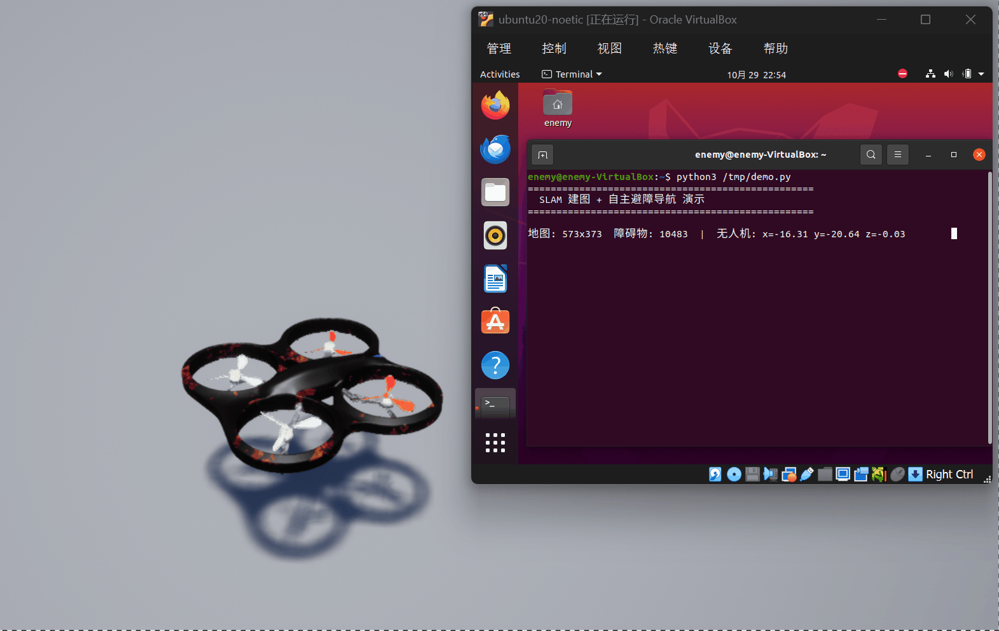

# 无人机 SLAM 建图与导航（uav_slam_nav）

任务③的 Humble 侧实现：Noetic 那边 AirSim 经 carlair_ros_bridge 出 `/lidar/points`、`/uav/odom`、`/uav/cmd_vel`，跨 ros1_bridge 到 Humble，本包跑 slam_toolbox 建图和 nav2 导航。

## 链路

```
Noetic:  AirSim -> carlair_ros_bridge -> /lidar/points, /uav/odom, /uav/cmd_vel
                                   \__ ros1_bridge 跨版本 __/
Humble:  /lidar/points -> points_to_scan -> /scan -> slam_toolbox -> /map
                        \-> nav2 -> /cmd_vel
         /uav/odom -> odom_tf -> odom->base_link
         simple_nav -> /simple_nav/cmd_vel（nav2 超时兜底）
         nav_relay -> /uav/cmd_vel（唯一发布者）
```

## 启动

```bash
# Noetic
roslaunch carlair_ros_bridge bringup.launch
roslaunch ros1_bridge ros1_bridge.launch

# Humble
ros2 launch uav_slam_nav main.launch.py
# 或
ros2 run uav_slam_nav main
```

RViz 里 Add Map / LaserScan / TF，点 2D Goal Pose 给目标。

## 节点

| 节点 | 作用 |
|---|---|
| `points_to_scan` | 点云切片投影成 /scan，tf2 查 cloud→base_link |
| `odom_tf` | /uav/odom 发成 odom→base_link |
| `simple_nav` | nav2 停发 1.5s 且收到 /goal_pose 时接管，前向 120° 扇区避障 |
| `nav_relay` | 仲裁 nav2 / simple_nav，限幅 vx 0.8 / vy 0.5 / yaw 0.6，z 恒 0 |

## 参数

- `config/slam_toolbox.yaml`：建图参数
- `config/nav2_params.yaml`：global costmap=map，local=odom，base=base_link

## 演示



## 测试

```bash
python3 test/test_uav_slam_nav_local.py
```

22 个用例，不依赖 ROS，CI 直接跑。
