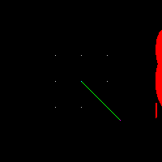
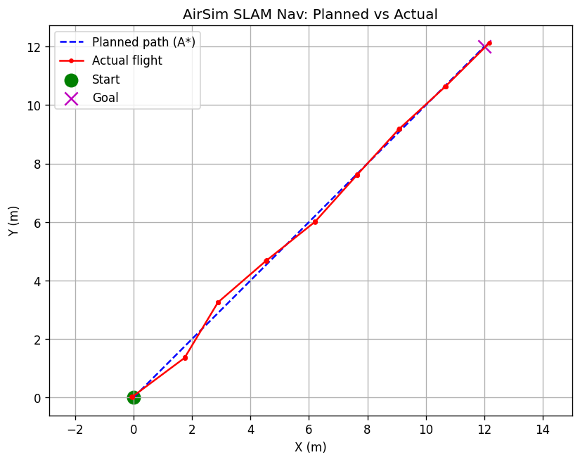
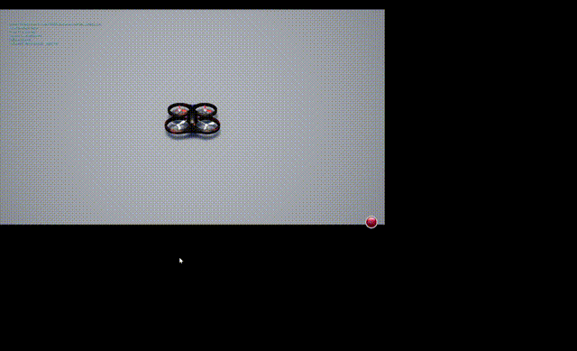

# AirSim 无人机建图与自主导航

基于 AirSim 深度相机的占据栅格建图 + A* 路径规划 + 自主导航闭环（ROS 课程任务3）。

## 流程

1. **建图**：无人机沿扫描轨迹飞行，前视深度相机反投影成 3D 点云，投影到 2D 占据栅格地图
2. **规划**：A* 算法在栅格地图上搜索无碰撞路径（8 邻域，避开障碍）
3. **导航**：沿规划路径自动飞行至目标点

## 建图结果

（黑底，红色=障碍物，灰色=扫描轨迹）

## A* 路径规划

（绿=规划路径，黄=起点，紫=终点）

## 实际飞行轨迹

（蓝虚线=规划，红实线=实际飞行，几乎重合）

## 演示

## 运行

    python3 main.py
    ros2 launch uav_slam_nav uav_slam_nav.launch.py
