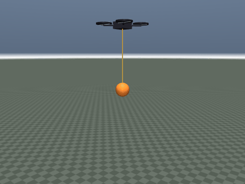
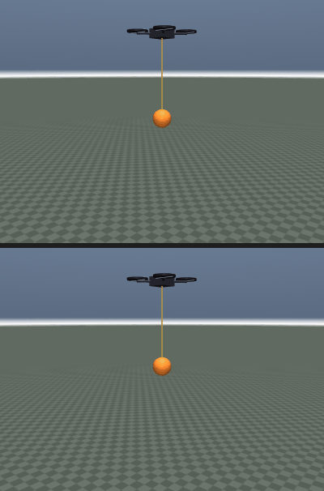

# 四旋翼吊挂负载防摆控制

## 1 任务与动机

四旋翼在下方用绳缆吊挂负载做点到点搬运时，负载是一个欠阻尼摆。机体为了跟踪位置指令不断加速、减速，
等于持续给摆“注入”能量，结果是指令结束后负载仍在摆动，末端定位精度下降，严重时摆角会撞到绳缆限位。
本模块在 MuJoCo 里搭建“四旋翼 + 绳缆 + 球形负载”的台架，比较三种控制律：

- `pd`：纯位置 PD（不含积分项），不感知负载摆动（基线）；
- `zv`：位置环 + ZV 输入整形，把位置阶跃拆成相隔半个摆动周期的两段；
- `swing`：位置环 + 负载摆角/摆速反馈。

位置环刻意不加积分项：吊挂摆的等效干扰是持续低频耦合，积分项会在摆的周期附近累积相位滞后，
容易把基线推向极限环；代价是基线存在厘米级稳态误差（见结果表的位置 RMS 一列）。

模块目录：`src/air/uav_slung_load`，与 `air/uav_mujoco_sim` 共用机体尺寸、混控系数与坐标约定。

## 2 模型

| 项目 | 取值 |
| --- | --- |
| 机体质量 | 0.85 kg（4 个旋翼各 0.025 kg） |
| 桨臂 `a` / 反扭矩系数 `k_m` | 0.106 m / 0.005 |
| 单桨推力范围 | 0～6 N |
| 绳缆长度 | 0.5 m（一个刚性连杆 + 两个同点正交铰，等效球摆） |
| 摆的自然周期 | `2π√(L/g) ≈ 1.42 s`（模型质量矩阵 + 重力刚度反算 1.416 s，误差 0.2%） |
| 负载 | 球形，半径 0.06 m，默认 0.3 kg（可改为 0.1/0.5 kg） |
| 关节 / 自由度 / 执行器 | 3（`freejoint` + 2 摆铰）/ 8 / 4 |
| 物理步长 / 控制周期 | 0.0025 s / 0.01 s（100 Hz） |

MuJoCo 没有原生绳索，绳缆用“一个刚性连杆 + 两个同点正交铰”等效球摆，摆长固定、不能折叠。
摆铰限位 ±1.2 rad，用来模拟绳缆不会无限翻转。

负载质量在运行时通过 `model.body_mass` 修改，并同步按实心球 `0.4·m·r²` 重算转动惯量，
改完调用 `mujoco.mj_setConst` 刷新子树质量等派生量，否则与编译期缓存不一致。

## 3 控制

三种控制律共用同一个外环：

1. 位置环给出期望加速度 `a_d = kp_p (p* - p) - kd_p v`，水平分量限制在 25° 倾角对应的加速度内；
2. 由 `a_d + g ẑ` 反算期望滚转/俯仰，姿态环用 PD 跟踪；
3. 总推力 `T = m (a_z + g) / (cosφ cosθ)`，再按混控分配给四个桨；偏航力矩单独用外力矩施加。

差别只在第 1 步：

- `pd` 直接使用上式；
- `zv` 把参考信号整形：`p*_shaped(t) = 0.5 [p*(t) + p*(t - T/2)]`，`T = 1.42 s`；
- `swing` 在期望加速度上叠加 `k_s (p_load - p) + k_d (v_load - v)`，即“朝负载的水平投影加速”，
  相当于给摆加了一个主动阻尼。

参数：`kp_p = 0.5`、`kd_p = 1.4`、姿态环 `kp = 25`、`kd = 7`、`k_s = 2.6`、`k_d = 2.2`。
位置环刻意取较低带宽，否则基线 PD 与摆的耦合会把系统推到极限环，对比就失去意义。

## 4 实验设置

- 前 1 s 在起点悬停，第 1 s 给 `+x` 方向 2 m 的阶跃；
- 每段 12 s，负载质量 0.1 / 0.3 / 0.5 kg；
- 指标：摆角 RMS、摆角峰值、残余摆角（最后 2 s 的 RMS）、稳态位置误差、末端误差、
  进入 ±5 cm 的调节时间、最大推力；
- 阵风场景：第 8 s 在负载上施加 1.5 N × 0.1 s 的横向冲量（约 0.15 N·s）。

## 5 结果

下面是 0.1 kg 负载、`+x` 方向 3.5 m 平移的动态过程（镜头跟随机体）。对比动图上下两格为同一时刻：
上格是 PD 基线，下格是摆角反馈。





2 m 阶跃（角度单位：度）：

| 负载 | 控制 | 摆角 RMS | 摆角峰值 | 残余摆角 | 位置 RMS | 末端误差 | 调节时间 |
| --- | --- | --- | --- | --- | --- | --- | --- |
| 0.1 kg | pd | 6.23 | 10.13 | 6.99 | 0.052 m | 0.026 m | 10.90 s |
| 0.1 kg | zv | 2.64 | 4.64 | 2.81 | 0.032 m | 0.041 m | 9.27 s |
| 0.1 kg | swing | 1.75 | 6.58 | 0.09 | 0.013 m | 0.007 m | 7.54 s |
| 0.3 kg | pd | 3.04 | 7.69 | 0.99 | 0.024 m | 0.005 m | 7.98 s |
| 0.3 kg | zv | 1.79 | 4.44 | 0.50 | 0.024 m | 0.006 m | 8.37 s |
| 0.3 kg | swing | 1.59 | 6.28 | 0.03 | 0.013 m | 0.007 m | 7.54 s |
| 0.5 kg | pd | 2.64 | 7.12 | 0.64 | 0.018 m | 0.009 m | 8.41 s |
| 0.5 kg | zv | 1.73 | 4.29 | 0.41 | 0.021 m | 0.017 m | 8.70 s |
| 0.5 kg | swing | 1.55 | 5.81 | 0.03 | 0.013 m | 0.007 m | 7.54 s |

阵风扰动后的残余摆角：

| 负载 | pd | zv | swing |
| --- | --- | --- | --- |
| 0.1 kg | 29.67 | 25.84 | 9.39 |
| 0.3 kg | 4.90 | 5.73 | 0.42 |
| 0.5 kg | 3.08 | 3.33 | 0.38 |

结论：

- 摆角反馈把残余摆角降低 95%～99%，调节时间缩短 5%～31%，且对阵风这类“计划外”扰动同样有效；
  注意 `swing` 三档之间（0.1/0.3/0.5 kg）的调节时间与稳态位置 RMS 几乎不变（7.54 s 附近、
  0.013 m），说明防摆控制对负载质量不敏感；但相对 PD 它在 0.1 kg 时把位置 RMS 从 0.052 m
  降到 0.013 m，位置精度同样受益；
- ZV 输入整形降低残余摆角 35%～60%，但开环整形对未建模扰动没有抑制作用（0.3 kg 阵风下甚至
  略差于 PD）；且 0.3/0.5 kg 时 ZV 的调节时间反而比 PD 长（8.37 对比 7.98、8.70 对比 8.41），
  提升只体现在残余摆角；
- 负载越轻，基线 PD 的残余摆动越大（0.1 kg：6.99°），因为负载对机体的反作用小、摆动更自由；
- 摆角峰值在 0.3/0.5 kg 时约降 18%，峰值主要由阶跃幅度决定，反馈项的主要贡献是“更快收敛”。

原始数据：`src/air/uav_slung_load/results/eval_20261107_184238.csv`。

## 6 复现

运行环境：Python 3.8+、MuJoCo `>= 3.2, < 4`（pip 安装，无对应 rosdep 键）、NumPy >= 1.20。
命令都假设当前目录是 `src/air/uav_slung_load`：

```
cd src/air/uav_slung_load
pip3 install -r requirements.txt
python3 test/test_offline.py -v                     # 7 项离线断言
python3 scripts/evaluate.py                         # 复现上表
python3 scripts/evaluate.py --with-gust             # 复现阵风表
python3 scripts/main.py --mode demo --controller swing --no-viewer
python3 scripts/make_gif.py                         # 重新生成上面两张动图（默认 0.1 kg）
```

`test_offline.py` 共 7 项断言：模型结构（3 关节 / 8 自由度 / 4 执行器）、改负载质量后子树质量与
负载球惯量同步刷新（实心球 `0.4·m·r²`）、由质量矩阵与重力刚度反算的摆周期与
`SWING_PERIOD` 相差 < 3%、三种控制律有界且推力不超限、摆角反馈的 RMS 与残余摆角小于 PD 且残余 < 0.5°、
ZV 残余小于 PD、两次运行结果一致。

## 7 局限

- 绳缆是刚性连杆近似，不能折叠、没有松弛，摆长不可变；
- 无风场/地面效应，阵风用短时冲量近似；
- 目标点在世界系给定，未接入视觉或激光；
- 只对比了经典控制，未做 MPC / 强化学习。
