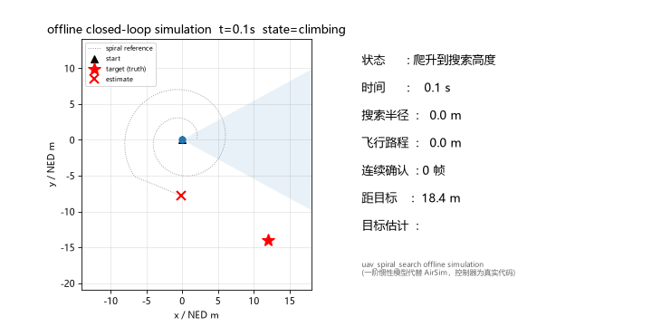

# 基于阿基米德螺旋的无人机自主搜索与目标定位

`uav_spiral_search` 让无人机从当前悬停位置出发，沿阿基米德螺旋逐渐外扩扫描周边区域；机载相机用 HSV 颜色检测寻找目标，连续 `confirm_frames` 帧确认后锁定，无人机飞到目标上方悬停，并发布目标位置的估计值。与[目标水平视觉居中](../openhutb_yolo_mlp_control/yolo_visual_centering.md)模式不同，本实验不依赖 YOLO 权重，核心是搜索轨迹生成、比例位置反馈控制和任务状态机，属于任务级自主飞行而非视觉伺服。

无人机须先在仿真器中起飞并稳定悬停（或使用 `auto_takeoff:=true`），本模式不负责降落；任务结束后由操作者按照仿真器流程接管无人机。

## 实验原理

**阿基米德螺旋**：极坐标下 `r(θ) = r₀ + s·θ/(2π)`，其中 `s` 为相邻两圈的径向间距（`spiral_spacing`）。螺旋从起飞点附近（`start_radius`）开始，向外扩展到 `max_radius` 为止。参考点沿曲线以 `cruise_speed` 推进，弧长微元为 `ds = √(r² + b²)·dθ`（`b = s/(2π)`），因此每步推进 `Δθ = v·Δt/√(r² + b²)`。

**比例位置控制**：每个控制周期计算参考点与当前位置的误差，`v = k_p·(p_ref − p)`，水平速度饱和于 `max_speed`。参考点只在无人机跟得上（距离不超过 `max_tracking_error`）时才继续推进，避免参考点越跑越远。

**HSV 颜色检测**：对 `/openhutb/camera/rgb` 的 `bgr8` 图像转 HSV，按色相/饱和度/明度阈值分割出目标颜色（默认红色，色相区间 170–10 按环形处理），形态学开运算去噪后取最大连通域作为目标。该方法无需下载神经网络权重，便于在仿真中反复调试。

**目标位置估计**：前视相机没有深度信息，锁定时刻按固定假设距离 `assumed_target_distance` 把目标投影到地面，方位角由检测框中心的水平偏差校正：`ψ_target = ψ + cx·camera_half_fov`（`cx` 为归一化横坐标 [-1, 1]）。因此估计误差主要来自真实距离与假设距离之差：目标在假设距离附近被锁定时误差小，从远处进入视场边缘时误差大。

**任务状态机**：

```
waiting_odom ──收到里程计──> climbing ──到达搜索高度──> searching
                                                        │
                          连续 confirm_frames 帧检测到目标 ──> locked（悬停在目标上方）
                          半径达到 max_radius 仍未发现   ──> exhausted（原地悬停）
```

## 运行步骤

以下命令在完成[环境配置](../openhutb_yolo_mlp_control/setup.md)中的依赖安装、功能包构建并加载工作空间后运行。先设置仓库根目录和 Windows 主机地址，并确认 RPC 端口可用：

```bash
export REPO_DIR=/绝对路径/到/ros2
export AIRSIM_IP=实际Windows地址
nc -vz "$AIRSIM_IP" 41451
```

构建本包（在 ROS 2 工作空间根目录）：

```bash
colcon build --packages-select uav_spiral_search
source install/setup.bash
```

### 预览模式（不发送飞行指令）

```bash
ros2 launch uav_spiral_search spiral_search.launch.py \
  airsim_ip:="$AIRSIM_IP" \
  dry_run:=true \
  show_window:=true
```

在另一个已加载工作空间环境的终端查看状态和预览速度：

```bash
ros2 topic echo /openhutb/spiral_search/status
ros2 topic echo /openhutb/spiral_search/preview_cmd_vel
```

调试窗口会叠加显示当前状态、确认帧数和检测十字线；把无人机（或相机视野内）摆一个红色目标即可观察 `confirm_frames` 计数。

### 仿真控制

确认目标颜色处于检测区间内、无人机已稳定悬停，并停止其他飞行指令发布者后，将 `dry_run` 设为 `false`：

```bash
ros2 launch uav_spiral_search spiral_search.launch.py \
  airsim_ip:="$AIRSIM_IP" \
  dry_run:=false \
  show_window:=true
```

也可从任意当前目录调用仓库入口脚本：

```bash
bash "$REPO_DIR/src/air/uav_spiral_search/main.sh" \
  airsim_ip:="$AIRSIM_IP" \
  dry_run:=false
```

目标锁定或搜索区域耗尽后，无人机会在悬停点保持位置；退出 ROS 节点不会自动降落，由操作者按照仿真器流程接管无人机。

## 常用参数与状态

| 参数 | 默认值 | 作用 |
| --- | --- | --- |
| `dry_run` | `true` | 预览模式，不发送飞行控制指令 |
| `auto_takeoff` | `false` | 启动时自动解锁并起飞 |
| `spiral_spacing` | `4.0` | 相邻螺旋圈间距，单位 m |
| `max_radius` | `30.0` | 搜索区域半径上限，单位 m |
| `search_height` | `-3.0` | 搜索高度（NED，负值代表高度） |
| `cruise_speed` | `1.6` | 参考点推进速度，单位 m/s |
| `confirm_frames` | `3` | 连续检测到目标的确认帧数 |
| `det_hue_min` / `det_hue_max` | `170` / `10` | 目标色相区间（OpenCV 单位，环形） |
| `det_min_area_fraction` | `0.0015` | 目标最小占画面比例 |
| `assumed_target_distance` | `8.0` | 目标位置估计的假设距离，单位 m |
| `camera_half_fov` | `0.5` | 相机水平半视场角，单位 rad |
| `show_window` | `true` | 显示叠加调试窗口 |

状态发布在 `/openhutb/spiral_search/status`（JSON 字符串），字段包括：`state`（`waiting_odom` / `climbing` / `searching` / `locked` / `exhausted` / `odom_stale`）、`search_time_s`（搜索用时）、`radius_m`（当前螺旋半径）、`path_len_m`（累计水平路程）、`confirm_frames`（当前连续检测帧数）、`target_estimate_ned`（锁定后的目标位置估计）与 `velocity_ned`。预览速度发布在 `/openhutb/spiral_search/preview_cmd_vel`。

## 离线闭环仿真演示

无需 AirSim 仿真器即可验证任务逻辑：`tools/simulate_mission.py` 用一阶惯性速度模型代替无人机闭环运行真实控制器代码（状态机、螺旋轨迹与锁定逻辑与实机运行完全一致）；`tools/make_demo_gif.py` 将该过程生成动画。目标位于 NED (12, −14) m、初始方位在相机视场之外时的完整任务过程：



蓝色为无人机实际轨迹，灰色虚线为螺旋参考点，扇形为相机水平视场（目标进入视场并连续确认后扇形变红）；右侧实时显示状态、搜索半径、路程、确认帧数与目标估计。复现命令：

```bash
python3 tools/simulate_mission.py --target-x 12 --target-y -14 --plot sim.png
python3 tools/make_demo_gif.py --target-x 12 --target-y -14 --output demo.gif
```

返回[文档目录](README.md)。

## 说明

本文档整理、代码重构和问题排查过程中使用了大模型辅助；提交者已检查全部内容并对最终结果负责。
