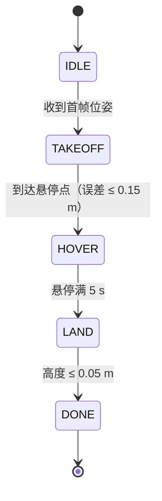
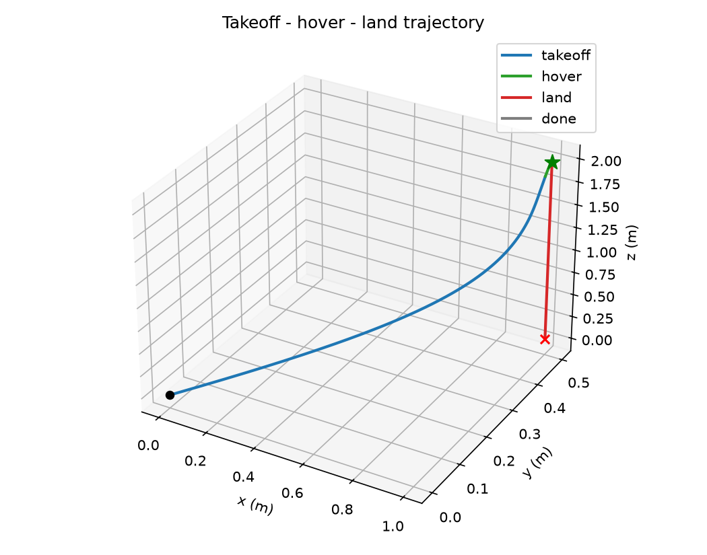
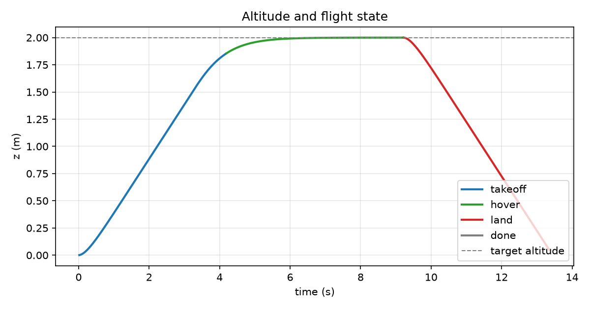
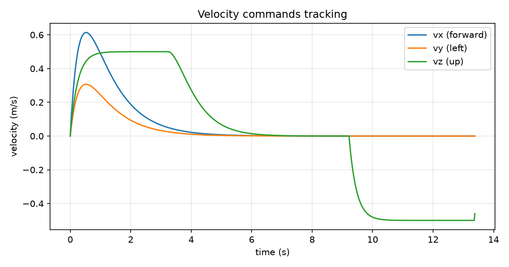

# 无人机起飞—悬停—降落状态机实验

本实验用 ROS 节点实现一个最小的无人机飞行任务状态机：从当前位置起飞到指定高度，
平移到悬停点后保持一段时间，再原地降落。状态机与控制器不依赖具体仿真器，
只要订阅到 `/uav/pose`、有人执行 `/uav/cmd_vel`，就可以接到 PX4/MAVROS、
CarlaAir/AirSim 或仓库里的 `carlair_ros_bridge` 上运行。

## 一、实验目的与环境说明

### 1.1 实验目的

1. 掌握用有限状态机组织飞行任务：待机 → 起飞 → 悬停 → 降落 → 完成；
2. 理解“位置误差 → 速度指令”的比例控制结构，以及速度限幅对安全的作用；
3. 掌握 ROS 话题接口：订阅 `geometry_msgs/PoseStamped`，发布 `geometry_msgs/Twist`；
4. 学会处理位姿超时、程序退出等异常情况，保证无人机不失控；
5. 用离线仿真在没有飞控和仿真器的情况下复现并量化控制效果。

### 1.2 实验环境

| 项目 | 配置 |
| ---- | ---- |
| 操作系统 | Ubuntu 20.04（ROS 端）；Windows/Linux（离线仿真） |
| ROS 发行版 | ROS Noetic（Python 3） |
| 依赖 | rospy、geometry_msgs |
| 离线仿真依赖 | Python 3、numpy、matplotlib ≥ 3.1（3D 绘图依赖 mplot3d） |
| 位姿来源 | 任意发布 `/uav/pose` 的仿真器或桥接（本实验不绑定具体仿真器） |

功能包目录结构：

```text
uav_takeoff_hover_land/
├── main.py                 # ROS 节点入口：话题收发、参数、异常保护
├── flight_state_machine.py # 纯 Python 状态机与比例控制（可单独测试）
├── offline_sim.py          # 离线仿真与出图
├── main.launch             # roslaunch 入口
├── config/params.yaml      # 默认参数
├── package.xml
├── CMakeLists.txt
└── README.md
```

## 二、实验原理

### 2.1 状态机



- **IDLE**：等待第一帧位姿，记录起飞点，并把悬停点设为“起飞点 + 水平偏移 + 目标高度”；
- **TAKEOFF**：同时控制水平和高度，飞向悬停点；位置误差小于容差即认为到点；
- **HOVER**：保持悬停点位置，计时达到 `hover_time` 后进入降落；
- **LAND**：水平方向继续保持在悬停点，垂直方向以固定速度下降，触地后完成；
- **DONE**：发布零速度并结束节点。

### 2.2 位置误差到速度指令

每个控制周期计算目标点与当前位置的误差，用比例控制得到期望速度，再做限幅：

$$
v_x = \mathrm{clip}(k_p^x (x^* - x), -v_x^{\max}, v_x^{\max})
$$

$v_y$、$v_z$ 同理，只是高度方向使用单独的 $k_p^z$ 和 $v_z^{\max}$。
限幅保证“误差再大也不会要求过大的速度”，这是实机上防止姿态剧烈变化的第一道保护。

本实验默认 $k_p^x = k_p^y = 0.8\ \mathrm{s^{-1}}$、$k_p^z = 1.0\ \mathrm{s^{-1}}$，
水平限幅 1.0 m/s、垂直限幅 0.5 m/s。

### 2.3 话题与坐标系

| 方向 | 话题 | 类型 | 说明 |
| ---- | ---- | ---- | ---- |
| 订阅 | `/uav/pose` | `geometry_msgs/PoseStamped` | 位置，ENU（东-北-天），z 向上 |
| 发布 | `/uav/cmd_vel` | `geometry_msgs/Twist` | 机体系速度，`linear.x` 前、`linear.y` 左、`linear.z` 上 |

实验假设偏航角保持 0，因此机体系与 ENU 方向一致；若接入了带航向的控制接口，
需要先把机体系速度旋转到世界系再做位置闭环。

### 2.4 异常保护

- **位姿超时**：超过 `pose_timeout`（默认 1 s）没收到新位姿，节点持续发布零速度并等待恢复，
  避免桥接断开后仍按旧位姿“盲飞”；
- **退出停车**：无论正常结束、`Ctrl+C` 还是异常抛出，都会在 `finally` 中发布零速度；
- **状态日志**：每次状态切换打印中文状态名和当前高度，方便对照终端排查。

## 三、运行步骤

### 3.1 ROS 节点

```bash
# 1. 拷贝到工作空间并编译
mkdir -p ~/catkin_ws/src
cp -r <本仓库>/src/air/uav_takeoff_hover_land ~/catkin_ws/src/
chmod +x ~/catkin_ws/src/uav_takeoff_hover_land/main.py
cd ~/catkin_ws && catkin_make
source devel/setup.bash

# 2. 先启动能提供 /uav/pose 的仿真器或桥接，并确认话题有数据
rostopic echo -n1 /uav/pose

# 3. 启动状态机
roslaunch uav_takeoff_hover_land main.launch
```

修改任务参数时，编辑 `config/params.yaml` 即可，例如把 `hover_time` 改为 10 s、
把 `takeoff_altitude` 改为 3 m。

### 3.2 离线仿真

没有 ROS 环境时，可以直接用仓库里的离线脚本验证同一套状态机和控制器：

```bash
cd <本仓库>
python -m pip install "matplotlib>=3.1" numpy
python src/air/uav_takeoff_hover_land/offline_sim.py
```

脚本把速度指令送入一阶惯性环节（时间常数 0.25 s）再积分得到位置，
模拟“指令下发—机体响应”的滞后，输出三张图和一组指标。

## 四、实验结果

离线仿真的任务参数为：起飞高度 2 m、悬停点相对起飞点 (1.0, 0.5) m、悬停 5 s。

### 4.1 三维轨迹



蓝色为起飞段，绿色为悬停段，红色为降落段。无人机先斜向爬升到悬停点，
悬停期间位置基本不动，最后垂直下降到地面。

### 4.2 高度与状态



起飞段高度单调上升，接近目标高度时因比例控制减速，没有明显超调；
悬停段高度稳定在 2 m；降落段以 0.5 m/s 匀速下降，约 4 s 触地。

### 4.3 速度指令



水平速度在起飞初期达到限幅附近后回落，垂直速度在爬升和下降阶段分别贴近
+0.5 m/s 和 −0.5 m/s，符合限幅设计。

### 4.4 指标

| 指标 | 数值 |
| ---- | ---- |
| 起飞到点时间 | 4.20 s |
| 悬停时长 | 5.02 s |
| 悬停位置 RMSE | 0.038 m |
| 最大高度 | 2.000 m |
| 高度超调 | < 0.001 m |
| 降落时间 | 4.16 s |
| 总飞行时间 | 13.38 s |
| 落地位置 | (1.000, 0.500, 0.036) m |

悬停误差主要来自速度指令的一阶滞后：比例控制没有积分项，稳态时会残留一个
与速度滞后相匹配的小偏差。若需要更高精度，可以加入积分项或改用位置/速度串级控制。

## 五、已知限制与后续工作

1. 离线仿真使用的是运动学一阶模型，不含姿态动力学、电机延迟、风扰和地效，
   因此指标只用于对比控制逻辑，不等于真实飞行性能；
2. 本机为 Windows，没有安装 ROS 与无人机仿真器，**ROS 端的实际飞行未验证**，
   需要在 ROS Noetic + 仿真器（PX4/MAVROS、CarlaAir 等）上按第 3.1 节复验；
3. 当前假设偏航角为 0，接入真实飞控后需要处理航向旋转和飞控自身的 offboard 心跳；
4. 后续可以把状态机扩展为航点序列、加入低电量返航和地理围栏。

## 说明

本文档与配套代码在整理过程中使用了 AI 助手（DeepSeek）辅助，实验参数、运行结果
和图表均由作者实际运行核对；作者对本文内容负全部责任。
