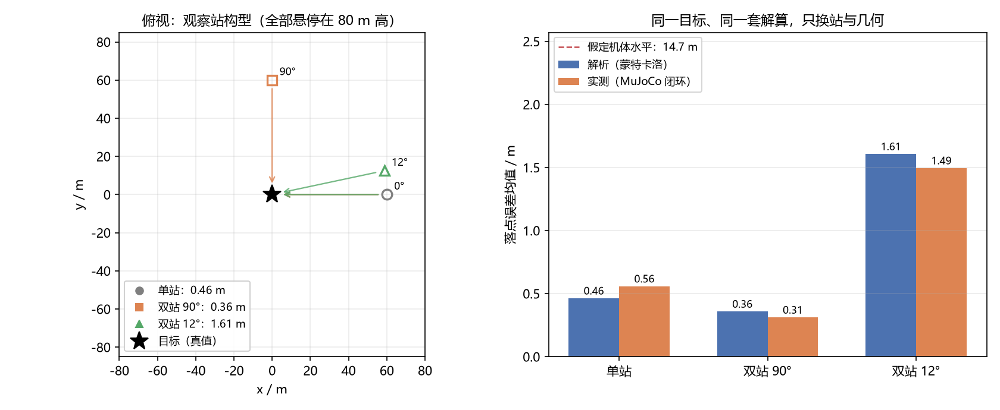
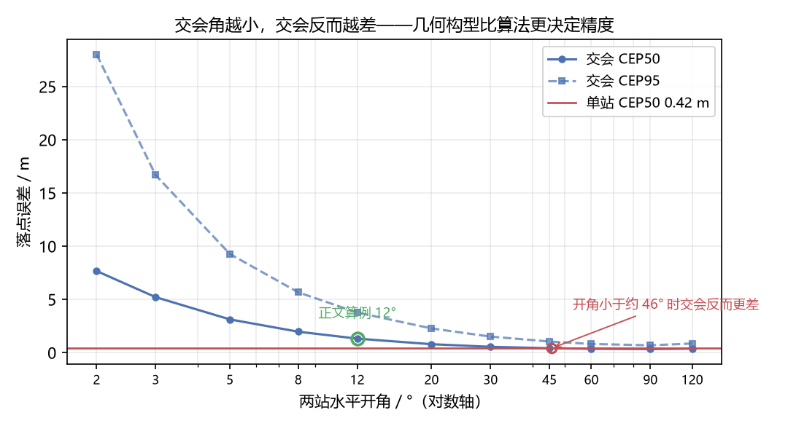
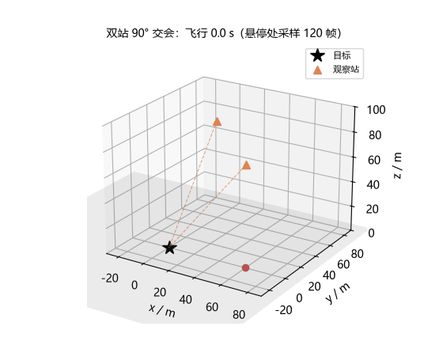

# 目标地理定位与多站交会

无人机悬停在 80 m 高度看地面一个目标，云台视线打下来，交点就是目标坐标——
一句话说完，但这句里藏着一个放大的旋钮：视线角偏 1°，交点偏 2.18 m。
敏感度是 `h / cos²θ`（θ 为视线与竖直方向的夹角），越掠射越狠，而且**和算法无关**。

这个模块把"看到目标之后、它到底在哪"拆成三层，每层都有明确的误差来源：

1. **单站几何**：一条视线与地面求交。误差 ≈ 敏感度 × 视轴角误差；
2. **多站交会**：几条视线在地面平面上做加权最小二乘，把各站独立的零位偏置
   互相约束掉；
3. **两种模式的对照**：解析打点（只按几何 + 噪声）和 MuJoCo 闭环（位置/姿态
   全部来自刚体积分）共用同一套统计口径，数可以直接对。

## 为什么需要多个站

视轴误差分两类，交会对它们的态度完全不同：

| 误差源 | 量级 | 平均 120 帧能消掉吗 | 多站交会能救吗 |
| --- | --- | --- | --- |
| 视轴逐帧抖动 σ = 0.30° | ~0.65 m | 能，剩 0.03° | 能 |
| 单站零位偏置 σ = 0.20° | ~0.44 m | **不能**（一整个架次不变） | **主要收益来源** |
| 机体倾角（1 N 外力 → 6.1°） | 14.7 m | 不能 | 用真实姿态即可消除 |
| 悬停位置偏离标称点 | < 0.08 m | — | — |

零位偏置平均不掉，所以单站的精度天花板就是它。交会之所以有用，是因为
两个站偏置方向独立，正交构型下误差摊薄 1/√2——**前提是站要张开**。

## 运行效果



左图是俯视构型：目标在原点，三个算例分别用 1 个站、2 个正交站、2 个只差
12° 的站（都在 80 m 高度悬停）。右图是同一套解算、只换布局的误差对比：
解析（蓝）与 MuJoCo 闭环实测（橙）对得上，"假定机体水平"这条基线（虚线）
是最该避免的错误做法。



把两站开角从 2° 扫到 120°：交会误差要到 **45° 左右才穿过单站基线**——
比这更小的开角，交会不但白干，反而更差。正文选的 12° 算例正好落在吃亏区，
1.61 m，是单站的 3.5 倍。

这个临界角几乎不随单站偏置大小移动：`python tools/crossing_table.py`（每档
1500 次蒙特卡洛，结果落在 `results/crossing_table.json`）给出 σ_b = 0.05° /
0.10° / 0.20° → **44.8° / 45.9° / 46.4°**，三档落在 1.6° 以内。原因很干脆：
交会的收益是"两条独立偏置平均"（1/√2），小开角的几何放大是另一个独立因子，
两个因子都正比于偏置，交点自然与偏置大小无关。所以"开大角"这件事没有便宜
货：想让交会赚，站就得真的张开。

> **口径提醒**：临界角必须拿**与偏置匹配的单站基线**去比。偏置变小，单站
> 也跟着变准（CEP50：0.20° → 0.414 m，0.10° → 0.213 m，0.05° → 0.119 m）。
> 若把基线钉死在 0.46 m（那是 0.20° 时的单站值），就会得到"偏置越小、临界角
> 越小"的假象（≈9° / ≈19°）——那实际画的是"不同偏置的曲线穿过同一条水平
> 线"，不是临界角。本模块的工具对每个偏置都重算基线。



MuJoCo 闭环：无人机从地面爬升到 80 m，先飞到 0° 站悬停采样 120 帧，
再转到 90° 站。悬停时用 1 N 水平外力逼出 6.1° 的机体倾角。

## 结果

| 算例 | 站 | 开角 | 解析单站 | 解析交会 | 实测单站 | 实测交会 |
| --- | --- | --- | --- | --- | --- | --- |
| `single_station` | 1 | — | 0.46 m | — | 0.56 m | 0.56 m |
| `two_station_orthogonal` | 2 | 90° | 0.46 m | **0.36 m** | 0.56 m | **0.31 m** |
| `two_station_shallow` | 2 | 12° | 0.46 m | **1.61 m** | 0.56 m | **1.49 m** |

（解析列 = 蒙特卡洛 600 次；实测列 = 20 个架次的均值，每个架次重新抽
零位偏置——只飞一次拿到的只是偏置的一个抽样，浅交会这种几何必须看分布。）

闭环的三个数值得单独说：

- **假定机体水平：14.7 m**。悬停时为了抵消 1 N 外力，机体俯仰 6.1°；
  拿指令姿态（水平）当真实姿态，误差是正确做法（0.46 m）的 32 倍。云台测量与
  IMU 姿态必须同步，这不是可选项；
- **逐帧 0.85 m → 平均视线 0.56 m**：抖动按 1/√120 被平均掉，剩下的
  就是零位偏置的贡献——这也是交会能继续压的部分；
- 正交交会的收益要**同列比较**：解析 0.358/0.465 = −23%，实测
  0.311/0.558 = −44%，1/√2 的系综预期是 −29%。实测比预期好，不是交会
  突然变神：单站参照取的是 0 号站，它的零位偏置在 20 个架次里是 20 次
  独立抽样（模长均值 0.30°，最大 0.72°），抽得大的架次把分母抬高了——
  逐架次比值与 0 号站偏置模长的相关系数 −0.48，就是这条机制。解析基线
  没有这层抽样涨落，所以更贴近 1/√2。

`results/<case>_result.json` 里有逐项机读记录：每站的偏置抽样、悬停均值
与倾角、逐架次误差、法方程条件数。

## 改了什么

```
src/air/uav_target_geolocation/
├── uav_target_geolocation/
│   ├── core/
│   │   ├── geometry.py   # 射线求交、掠射角、敏感度 h/cos²θ
│   │   ├── fusion.py     # 加权最小二乘交会 + CEP/误差统计
│   │   ├── cases.py      # 三个算例：站布局与噪声参数
│   │   ├── analysis.py   # 蒙特卡洛打点、交会角扫描、理论对照
│   │   └── flyer.py      # MuJoCo 闭环：转场 + 悬停采样
│   ├── ros/geo_node.py   # 在线判定节点（状态机可脱离 rclpy 单测）
│   └── cli.py
├── main.py  config/  launch/  test/  tools/  results/
```

- `docs/air/uav_target_geolocation.md`：本页；
- `docs/img/air/uav_target_geolocation/`：构型图、扫描曲线、闭环 GIF；
- `mkdocs.yml` 与 `docs/index.md` 各加 1 行。

## 复现

```bash
cd src/air/uav_target_geolocation
python main.py                 # 解析 600 次 + 闭环 20 架次 × 3 算例，约 45 s
python main.py --no-sim        # 只跑解析层，秒级
python main.py --case two_station_shallow
python -m pytest test/ -q      # 70 passed, 1 skipped
python tools/make_figures.py   # 重新生成本页配图
```

依赖 numpy / mujoco / matplotlib / pytest。ROS 2 环境下
`colcon build --packages-select uav_target_geolocation`，
`ros2 run uav_target_geolocation geo_node` 起在线节点。

闭环结果在本机 Windows + Python 3.12/3.13 出的，三次重跑数字一致；
`--seed` 固定随机流（闭环第 i 个架次用 `seed + i`），`--reps` 改架次数
（默认 20，`python main.py` 直接就能复现上表）。

## 与仓库已有模块的关系

- `uav_mujoco_sim`：物理底座，复用同一份 `quadrotor.xml` 与
  `GeometricController`，没有另起一套仿真；
- `uav_apriltag_landing` / `uav_gimbal_reacquisition` / `uav_gimbal_stabilization`：
  解决"看到并跟住目标"，本模块解决"看到之后它在地面哪个坐标"；
- `uav_moving_platform_landing` / `uav_drop_on_moving_target`：拿到带误差量
  的目标位置之后的下游问题；
- `uav_gps_integrity_guard`：GPS 侧的完整性保护，本模块是视觉侧的定位精度。

## 已知局限

- 视线模型是"云台已对准目标 + 小角度噪声"，没有做完整相机投影（像素 →
  视线），像素量化噪声并入 σ 与偏置，不单独建模；
- 交会只在 z = 0 平面上做，没有利用视线俯仰分量做三维交会；
- ROS 节点是简化版：站点切换靠 `/target/geo/new_station` 手动触发，视线
  只做单站打点与逐站累积，不含目标运动模型；节点已做时间同步与坐标系
  检查（`max_stamp_skew_s` / `odom_frame_id` / `los_frame_id`），时间戳
  偏差过大或 frame_id 不匹配时拒收该帧；
- 本机为 Windows + Python 3.13、没有 ROS 2，无法本地实跑 launch；CI 里
  有专门的 ROS 2 Humble job（`ci_uav_target_geolocation.yml` 的 `ros2`），
  用官方 `ros:humble-desktop` 容器 `colcon build` 后 `ros2 launch` 起
  geo_node，并跑 `tools/ros2_smoke_test.py` 实测 /uav/odom、/gimbal/los、
  /target/ground 的话题收发（待仓库 workflow 批准后可见）；
- 闭环里的外力直接写入 `xfrc_applied` 的力分量（每步改写一次）。MuJoCo 的
  `xfrc_applied` 跨步保留，逐子步累加的写法会让力按子步数叠乘、几秒内
  飞散——`uav_mujoco_sim.apply_wind` 的注释与其行为不一致，本模块没有
  使用该接口。
