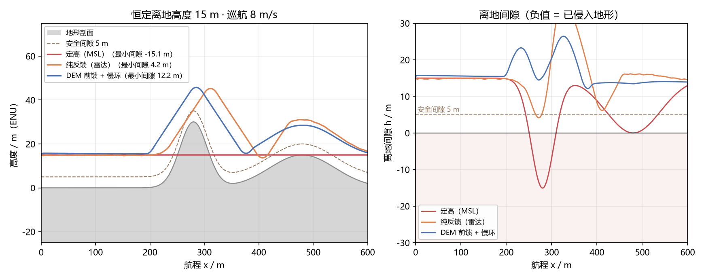
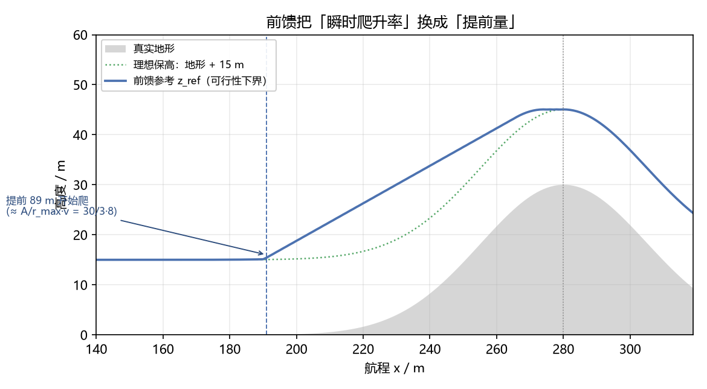
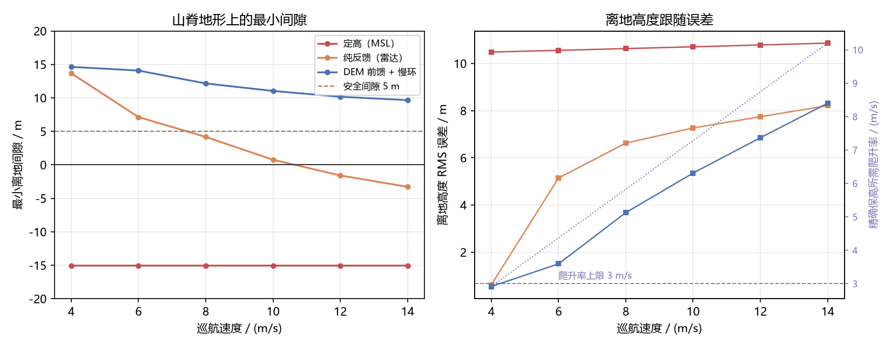
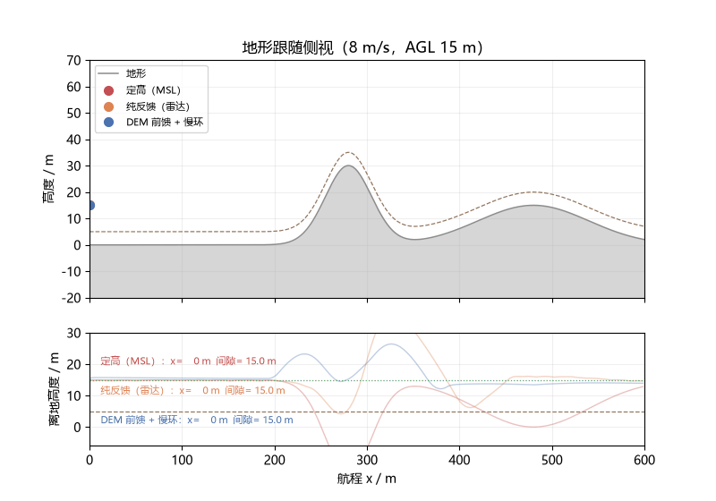

# 低空地形跟随：恒定离地高度保持、雷达高度表延迟补偿与 DEM 前馈

本模块回答一个低空作业里的常见问题：**要求无人机全程保持固定的离地高度
（AGL，这里取 15 m），但脚下的地形在变，而告诉你"脚下有多高"的雷达高度表
又慢又抖，怎么办？**

结论先说：

- **定高（MSL）**在所有带起伏的地形上都会侵入地形，30 m 山脊上深 15 m；
- **只用雷达高度表反馈**在恒坡上很好（误差 0.20 m），但碰到山脊会在坡顶挖坑
  （间隙从 15 m 掉到 4.2 m），速度再高就直接撞进去；
- **DEM 前馈 + 慢环校正**把爬升率预算显式用起来（提前量 ≈ 需要爬升的高度 ÷
  爬升率上限 × 速度），四个算例的最小间隙全部保持在安全阈值之上
  （12.2 / 10.2 / 6.8 / 15.0 m）。

源码位置：`src/air/uav_terrain_follow_agl/`；结果数据：`results/terrain_follow.json`。



## 1. 问题与动机

低空巡检、测绘、农林作业都要求"贴着地形保持一个固定离地高度"飞。这件事的难点
不在高度控制本身，而在信息：

1. 雷达高度表有 **120 ms 级的采样与传输延迟**：10 m/s 时控制器看到的地形比实际
   晚 1.2 m；
2. 它还有噪声（σ ≈ 0.25 m）、量化（0.05 m）、丢帧和一个整架次不变的安装偏置；
3. 最关键的：**它只能看见脚下，看不见前方**。等它告诉你"离地高度在掉"的时候，
   需要的爬升率往往已经超出旋翼机的垂直能力。

与仓库已有模块的关系：

- `uav_altitude_sensor_fusion`：一维卡尔曼融合 IMU 与气压高度，解决"高度怎么估"，
  不涉及地形与前方高程；
- `uav_altitude_command_guard`：对上层高度指令做限幅、限变化率与超时保持，是
  纯指令层防护，不看地形；
- `airsim_height_aware_overfly`：用前视深度图决定"从上方越过还是绕行"，是局部
  越障决策，不保持恒定离地高度；
- `uav_emergency_landing_selector`：给定点上的坡度/粗糙度评估，用于选着陆点；
- 本模块处理的是"沿航迹连续保持恒定离地高度"这个问题，核心是**延迟传感 +
  爬升率受限下的前视参考生成**。

## 2. 方法

### 2.1 地形高程场

地形用解析形式描述（`core/terrain.py`）：

```text
h(x, y) = base + tan(θ)·x + Σ Aᵢ·exp(−((x−xᵢ)² + (y−yᵢ)²) / (2σᵢ²))
```

选解析形式而不是查表高程图，是因为它处处可微且坡度有闭式——高斯隆起的峰值
坡度是 `|A|/(σ√e)`，直接给出"精确保高需要多大爬升率"。预设地形五种：

| 名称 | 构成 | 峰值坡度 |
|---|---|---|
| `flat` | 平地 | 0° |
| `gentle_slope` | 恒定 6° 坡 | 6° |
| `ridge_crossing` | 30 m/半宽 25 m 主脊 + 15 m/半宽 60 m 缓脊 | **36.1°** |
| `mixed` | 4° 缓坡 + 26 m 与 36 m 两道山脊 + 14 m 沟谷 | ≈43° |
| `steep_slope` | 恒定 14° 坡 | 14° |

### 2.2 雷达高度表模型

`core/altimeter.py` 逐帧复现 20 Hz 采样保持、0.12 s 传输延迟、σ=0.25 m 噪声、
0.05 m 量化、1% 丢帧和一次抽样的固定偏置。延迟用队列实现：采样时刻 +
`latency_s` 之前不出读数，与真实传感器的"测到了但还没到"一致。

### 2.3 DEM 与它的误差

机上的先验地形库（`core/dem.py`）按网格预采样真值，叠加三类系统性误差：
垂直偏置（0.8 m）、水平移位（3 m，相当于 10 m/s 时晚 0.3 s 看到坡）、网格
分辨率（2 m）。三档配置（理想 / 实用 / 劣化）用于第 5 节的敏感性。

### 2.4 三种策略

三者都只输出"高度设定 + 爬升率设定"，底层统一用仓库的几何控制器：

| 策略 | 用到的信息 | 一句话描述 |
|---|---|---|
| `constant_msl` | 起飞点高程 | 锁死起飞高度，飞行中不再更新 |
| `reactive_agl` | 只有延迟的雷达读数 | PI 跟踪离地高度（Kp=1.2 /s，Ki=0.25 /s²） |
| `dem_preview` | DEM 前视剖面 + 雷达读数 | 可行性前馈 + 慢速偏置积分 |

`dem_preview` 的前馈不是"看前方固定几秒"，而是把爬升率预算显式用起来：

```text
z_ref(t) = max_{0 ≤ s ≤ 150 m} [ DEM(x+s) + AGL_set − climb_capacity(s/v) ] + trim
climb_capacity(τ) = max(0, ṙ·τ − ṙ²/(2a))
```

含义：**现在的高度，至少要够我在剩余爬升预算里摸到前方 150 m 内最高的那个地形
点**。`climb_capacity` 里那项 `ṙ²/(2a)` 是加速段损失（ṙ=3 m/s、a=2 m/s² 时
2.25 m）——忽略它，30 m 山脊上的参考会晚起爬约 0.7 s，间隙刚好差 2 m。



两个实现细节是实测出来的教训：

- **参考速度也要前馈**。参考本身在爬升，只给位置误差会让被控对象永远差
  `ṙ/Kz ≈ 2 m`，坡顶挖坑主要来自这里；
- **偏置积分要慢**（Ki=0.02 /s，时间常数 50 s）。机动期间 AGL 本来就该偏离
  设定值（提前起爬），积分一快就会把它当 DEM 偏置抹掉，30 m 山脊的最小间隙
  会从 12.2 m 掉到 2.9 m（见 5.2 节）。

## 3. 闭环设置

- 被控对象：仓库 `uav_mujoco_sim` 的四旋翼（100 Hz 控制、4 物理子步），
  几何控制器 + 真旋翼推力；
- 航迹：沿 +x 直线 600 m，梯形速度参考（加速 4 s）；
- 每帧记录真值位置、真值离地间隙、当帧指令，指标全部按**真值**算，避免
  "自己评自己"；
- 地形**不进入** MuJoCo 碰撞场景：底座模型 `models/quadrotor.xml` 里机身与
  桨的 geom `contype/conaffinity` 都是 0（测试 `test_base_model_really_has_no_ground_contact`
  会核验这一点），本模块不改共享模型。因此"间隙为负"按**侵入地形**记录并继续
  跑完整条航迹，好把"会深到多少"量出来，而不是去等一个不会发生的碰撞；
- 另提供 `--plant kinematic` 的一阶滞后（τ=0.15 s）运动学替代，不装 mujoco
  也能复算；两者在同算例上的最小间隙差 ≤ 0.4 m（测试里约束 < 1.0 m）。

## 4. 结果

四个算例 × 三种策略，MuJoCo 闭环（安全间隙阈值 5 m）：

| 算例 | 策略 | 最小间隙 / m | 侵入深度 / m | AGL RMS / m | 低于安全 / s | 最大爬升 / (m/s) |
|---|---|---:|---:|---:|---:|---:|
| 山脊 8 m/s | 定高 | −15.06 | 15.06 | 10.63 | 22.86 | 0 |
| | 纯反馈 | **4.17** | 0 | 6.63 | 1.62 | 3.17 |
| | **DEM 前馈** | 12.15 | 0 | 3.68 | 0 | 3.17 |
| 山脊 12 m/s | 定高 | −15.06 | 15.06 | 10.78 | 15.24 | 0 |
| | 纯反馈 | −1.59（侵入） | 1.59 | 7.74 | 4.34 | 3.17 |
| | **DEM 前馈** | 10.17 | 0 | 6.85 | 0 | 3.17 |
| 混合地形 10 m/s | 定高 | −51.11 | 51.11 | 34.38 | 46.74 | 0 |
| | 纯反馈 | −16.58（侵入） | 16.58 | 12.53 | 10.23 | 3.17 |
| | **DEM 前馈** | 6.83 | 0 | 8.21 | 0 | 3.17 |
| 恒坡 6° 10 m/s | 定高 | −48.07 | 48.07 | 37.69 | 50.50 | 0 |
| | 纯反馈 | 14.14 | 0 | **0.20** | 0 | 1.47 |
| | **DEM 前馈** | 15.00 | 0 | 0.64 | 0 | 1.05 |

读法：

- **定高**是对照组，四个算例全挂——它证明"高度控制没问题"不等于"地形跟随没问题"；
- **纯反馈**在恒坡上最好（积分环把稳态误差吃掉了，0.20 m），但在山脊上要么跌破
  安全间隙（8 m/s：4.17 m），要么直接侵入（12 m/s 与混合地形）。原因很物理：
  它只能在 AGL 开始掉之后反应，而山脊段的瞬时需求爬升率（8 m/s 时 5.83 m/s）
  是预算（3 m/s）的近两倍；
- **DEM 前馈**把峰值需求摊成平均需求，四个算例全部不低于安全阈值。代价是
  恒坡上 AGL RMS（0.64 m）反而略差于纯反馈——前馈用了带 0.8 m 偏置的 DEM，
  慢环在 600 m / 64 s 的航段里只来得及吃掉一部分。

## 5. 消融

### 5.1 纯反馈的稳态滞后：解析式与闭环对上了

纯比例（Ki=0）在恒坡上的稳态滞后是 `e = v·tanθ·(1/Kp + τ)`，τ 是采样保持与
传输延迟的等效滞后（0.17 s）。恒坡 6°、10 m/s、Kp=1.2：

| 配置 | AGL RMS 实测 / m | 解析 / m |
|---|---:|---:|
| 纯比例 Ki=0 | **1.021** | 1.055（−3%） |
| Ki=0.05 | 0.481 | — |
| Ki=0.25（默认） | 0.204 | — |

积分项能消掉这条滞后，但**积分救不了山脊**：山脊的问题是瞬时爬升率超出预算，
是能力问题不是增益问题。

### 5.2 偏置积分的快慢：平地精度与山脊间隙是直接交换的

| Ki（1/s） | 山脊最小间隙 / m | 恒坡 AGL RMS / m |
|---:|---:|---:|
| 0.005 | 14.15 | 1.00 |
| **0.02（默认）** | **12.15** | **0.64** |
| 0.05 | 9.91 | 0.35 |
| 0.10 | 7.50 | 0.21 |

选 0.02 是折中：再快就明显侵蚀山脊间隙，再慢则一条 600 m 航段吃不完 1 m 级
的 DEM 偏置。

### 5.3 DEM 质量三档

| DEM | 最小间隙 / m | AGL RMS / m |
|---|---:|---:|
| 理想（即真值） | 12.27 | 3.31 |
| 实用（2 m 网格 / 0.8 m 偏置 / 3 m 前移） | 12.15 | 3.68 |
| 劣化（8 m 网格 / 4 m 偏置 / 12 m 前移） | 12.29 | 5.35 |

**最小间隙几乎不受 DEM 质量影响**——间隙由前馈几何决定，只要"前方 150 m 内
哪里最高"不错得离谱，提前量就成立；DEM 误差走的是 AGL 精度（慢环吃剩下的
部分），劣化 DEM 下 RMS 从 3.31 涨到 5.35。这个分工是本模块最重要的设计
结论：**安全靠前馈，精度靠慢环**。

## 6. 速度扫描与设计规则

同一道山脊（峰值坡度 36.1°），爬升率上限 3 m/s：

| 速度 / (m/s) | 精确保高需求 / (m/s) | 纯反馈最小间隙 / m | DEM 前馈最小间隙 / m |
|---:|---:|---:|---:|
| 4 | 2.91 | 13.69 | 14.63 |
| 6 | 4.37 | 7.13 | 14.08 |
| 8 | 5.83 | 4.17 | 12.15 |
| 10 | 7.29 | 0.76 | 11.04 |
| 12 | 8.74 | −1.59 | 10.17 |
| 14 | 10.20 | −3.29 | 9.66 |





两条设计规则：

1. **精确保高（AGL 恒定）的硬上限**：`v ≤ ṙ_max / max|∂h/∂x|`。这道山脊给
   4.1 m/s，超过它任何控制律都保不了恒定 AGL，只能靠抬高 AGL 设定或降速；
2. **不侵入地形（AGL 可以波动）**：前馈把"瞬时爬升率"换成"提前量"，条件是
   峰值在视距内且 `(到峰距离)/v ≥ 需要爬升的高度/ṙ_max`。本算例 8 m/s 时
   提前量 80 m，150 m 视距内绰绰有余——所以前馈在需求爬升率已达预算两倍时
   仍保持 12.2 m 间隙。代价是坡前偏高（"切角"），体现在 AGL RMS 随速度上升。

## 7. ROS 2 在线节点

`ros/terrain_follow_node.py` 把同一套逻辑搬到在线：不需要在机上存整张 DEM，
规划端只发一条**前视剖面**（从当前位置起、每 2 m 一个高程点、共 76 点）。

| 话题 | 类型 | 方向 | 内容 |
|---|---|---|---|
| `/uav/odom` | nav_msgs/Odometry | 订阅 | 位置与速度（ENU） |
| `/range/agl` | sensor_msgs/Range | 订阅 | 雷达高度表 |
| `/terrain/profile` | std_msgs/Float32MultiArray | 订阅 | 前视高程剖面 |
| `/uav/altitude_setpoint` | std_msgs/Float64 | 发布 | 高度设定 |
| `/uav/climb_rate_setpoint` | std_msgs/Float64 | 发布 | 爬升率设定 |
| `/terrain_follow/diag` | std_msgs/String | 发布 | JSON 诊断（trim、参考、计数） |

```bash
ros2 launch uav_terrain_follow_agl main.launch.py
ros2 launch uav_terrain_follow_agl main.launch.py strategy:=reactive_agl agl_set_m:=20.0
```

`FollowState` 不 import rclpy，核心状态机可单独单测；没收到剖面时退化为
保持当前高度，并在诊断里以 `profile_updates=0` 暴露。

## 8. 测试

```bash
cd src/air/uav_terrain_follow_agl
python -m pytest test -q
```

共 101 项，其中 4 项（MuJoCo 闭环三策略排序、运动学与 MuJoCo 一致性、真值/指令
记录、底座碰撞体检查）需要 `mujoco` 与同仓库 `src/air/uav_mujoco_sim`，缺任一项
会自动跳过；离线 CI 只跑其余约 97 项，所以 CI 里的通过数会比 101 少。

覆盖：地形解析值与数值差分互检、DEM 插值误差界、高度表延迟/量化/
丢帧/偏置不变性、三种策略的行为（含"提前起爬"与"爬升率限幅"）、闭环冒烟
（三策略排序、运动学与 MuJoCo 一致性）、节点状态机与参数校验。

## 9. 已知局限

- 地形只以解析场进入参考与评估，未进入 MuJoCo 碰撞（原因见第 3 节）；"侵入
  深度"是几何量，不是碰撞仿真结果；
- 前视剖面默认沿 +x（航向与坡向一致）。斜穿山脊时有效坡度按 cos 折减，模块
  的地形场支持二维，但算例都取了一维剖面；
- 风没有单独建模——风致俯仰角会同时改变空速与雷达波束入射角，实测要先把
  `xfrc_applied` 的跨步行为摸清楚（底座注释与实测行为不一致），留待后续；
- DEM 水平移位在强曲率地形（如陡坎）会放大误差，实用档只测到了 3 m；
- 速度扫描的地形固定为 `ridge_crossing`，没有覆盖"峰后紧接峰"的连续起伏。

## 10. 运行

```bash
cd src/air/uav_terrain_follow_agl
python main.py                       # MuJoCo 闭环，四个算例 × 三种策略
python main.py --sweep --dem-levels --ablation --json   # 全部实验组 + 结果 JSON
python main.py --no-sim              # 一阶滞后运动学，不装 mujoco 也能跑
python tools/make_figures.py         # 生成文档配图
```

依赖：Python 3.10+、NumPy、MuJoCo（`--no-sim` 可省）、Matplotlib + Pillow
（仅出图）。ROS 部分需要 Ubuntu 22.04 / Humble 与 rclpy。

---

> 大模型使用声明：本模块的代码实现、测试用例与文档由作者在 AI 大语言模型辅助下完成，作者已逐项复核，对提交内容负责。
