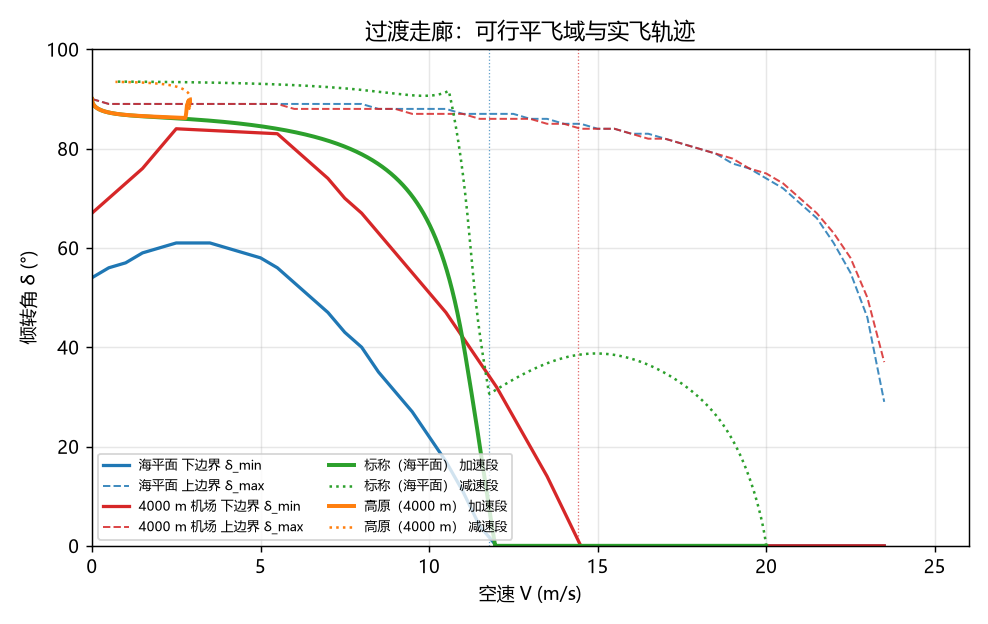
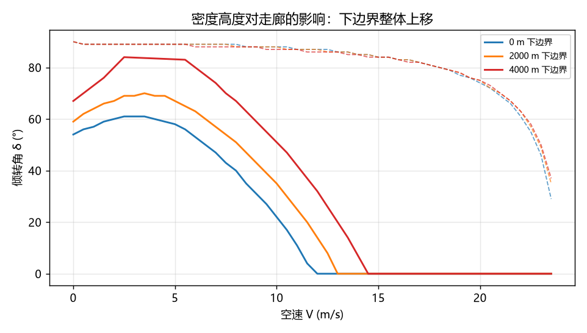
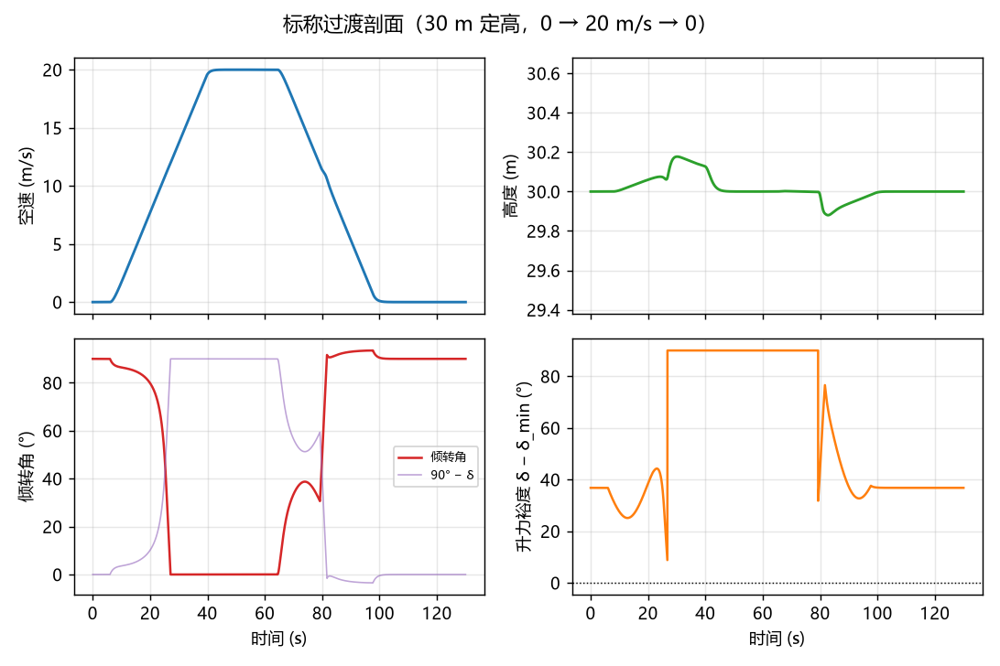
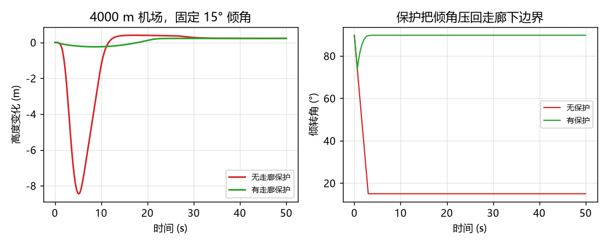

# 倾转旋翼过渡走廊与倾转角调度

倾转旋翼机在悬停和巡航之间必须穿过一段**既飞不快也停不住**的速度区间：机翼还托不住全重，
旋翼又已经因为前进比上升而推力衰减。这段区间里能活下来的 (空速, 倾转角) 组合就是
**过渡走廊**（transition corridor）。本项目把走廊显式计算出来，并用它做倾转角调度与掉高保护。



图中实线是走廊下边界 `δ_min`（升力侧，越过就掉高度），虚线是上边界 `δ_max`（推力侧，
越过就维持不住这个速度）。绿色是海平面标称过渡的轨迹，橙色是 4000 m 机场的轨迹——整条轨迹
明显向"更立"的方向偏，这就是高原过渡更难的原因。

## 1. 机型与两条硬约束

6.5 kg 级四旋翼倾转验证机，机翼 0.55 m²、CLmax 1.35、推重比 **1.249**。

| 量 | 值 | 来源 |
| --- | --- | --- |
| 全重 W | 63.74 N | `m·g` |
| 悬停最大推力 | 79.61 N | `(P·fm·√(2ρA))^(2/3)` |
| 悬停功率 | 1003 W | `T·v_i/fm` |
| 失速速度 | 11.78 m/s | `√(2W/(ρS·CLmax))` |
| 旋翼独撑的极限速度 | 5.18 m/s | 推力归零速度 26 m/s 处线性衰减 |

推力上限取两条约束的最小值：

```text
功率限制：  P = T·(V + v_i)/fm ≤ P_max,   v_i = √(T/(2ρA))
前进比限制：T ≤ T_static·(1 − V/26)
```

低速端由功率限制主导，高速端由前进比限制主导——**走廊的上下两条边界正是分别由这两条约束生成的**。

## 2. 走廊怎么算

平飞时垂直方向必须严格平衡，水平方向只要有净推力即可：

```text
T·sinδ + L = W          （严格）
T·cosδ ≥ D(CL)          （不等式，允许有余量用于加速）
```

给定 (V, δ) 后，`CL` 是唯一自由度。又因为 `T = (W − qS·CL)/sinδ` 随 `CL` 单调下降、
`D(CL)` 随 `CL` 单调上升，可行性就退化成一个区间判定，二分即可求解，不需要网格扫描
（实测比逐点扫描快 20 倍，控制回路每步都能调用）。

计算出的走廊边界（δ 单位：度）：

| 空速 | 海平面 | 2000 m | 4000 m |
| --- | --- | --- | --- |
| 0 m/s | 53.5 – 90.0 | 59.0 – 90.0 | 66.5 – 90.0 |
| 4 m/s | 60.0 – 89.5 | 69.0 – 89.5 | （断开） |
| 8 m/s | 39.5 – 89.0 | 50.5 – 88.5 | 66.5 – 88.0 |
| 12 m/s | 0.0 – 87.0 | 14.0 – 87.0 | 31.5 – 86.5 |
| 20 m/s | 0.0 – 74.0 | 0.0 – 75.0 | 0.0 – 75.0 |

两点值得注意：

* **下边界先升后降**。从 0 到 4 m/s，推力衰减（前进比）快于升力增长（V²），需要的倾角反而更大，
  在 4 m/s 附近达到最"陡"；过了 6 m/s 升力开始接管，下边界才回落。
* **4000 m 的 4 m/s 处走廊断开**。此时推重比只剩 1.09，任何倾角都无法同时满足"托得住"和
  "压得过阻力"，只能快速穿过。这不是数值毛刺，用解析式复算同样无解。

## 3. 高原：密度是隐形的敌人



| 密度高度 | 失速速度 | 旋翼独撑极限 | 死区宽度 |
| --- | --- | --- | --- |
| 0 m | 11.78 m/s | 5.18 m/s | 6.60 m/s |
| 2000 m | 12.99 m/s | 3.77 m/s | 9.22 m/s |
| 4000 m | 14.40 m/s | 2.19 m/s | 12.21 m/s |

失速速度上移、旋翼能力下移，中间"两边都不靠"的死区从 6.6 m/s 扩到 12.2 m/s。
**所以走廊表必须按当地密度重算**：拿海平面的表去飞高原，下边界会被低估 13° 以上（4 m/s 处 60.0° vs 69.0°）。

## 4. 控制结构

三层：

1. **外环**：高度 → 升降速度 → 垂向加速度；空速 → 纵向加速度。
2. **分配**：`F_z = W + m·a_z − L`、`F_x = D + m·a_x`，再取
   `T = √(F_x²+F_z²)`、`δ = atan2(F_z, F_x)`。机翼优先承担重量（`CL = (W+m·a_z)/qS`
   截断到 CLmax），托不住的部分才给旋翼。
3. **执行机构**：推力一阶滞后 0.12 s、倾转角速率 25°/s、升力系数滞后 0.2 s。
   三者饱和后如实表现为掉高，不是"指令发了就算"。

走廊保护只守**下边界**。这是刻意的：上边界限制的是"能不能维持速度"，减速过渡时把倾角
往上拉完全合法，用上边界去卡会在减速段把飞机摁住。安全指标同理，只看 `δ − δ_min`。

## 5. 闭环结果

标称剖面：30 m 定高，悬停 6 s → 加速到 20 m/s → 巡航 25 s → 减速回悬停。



| 场景 | 中止 | 能量 | 高度误差 | 最大下沉 | 最差升力裕度 |
| --- | --- | --- | --- | --- | --- |
| 标称过渡 | 否 | 20.01 Wh | 0.18 m | 0.08 m/s | 8.8° |
| 高原过渡（4000 m） | 否 | 42.70 Wh | 0.23 m | 0.06 m/s | 0.0° |
| 顶风阵风（5 m/s） | 否 | 20.20 Wh | 1.23 m | 0.48 m/s | 25.1° |
| 推力降级 15% | **是** | 19.95 Wh | 9.50 m | 1.20 m/s | 8.8° |
| 粗糙调度 + 无保护 | **是** | 4.29 Wh | 8.45 m | 3.48 m/s | −39.5° |
| 粗糙调度 + 有保护 | 否 | 16.12 Wh | 0.24 m | 0.10 m/s | 2.0° |

高原能量翻倍不是效率问题：4000 m 密度只有海平面的 67%，悬停诱导速度从 11.3 m/s 升到 13.9 m/s，
功率按 `T·v_i` 走，1.22 kW 的悬停功率是物理决定的。

**推力降级 15% 会中止**，这是真实的脆弱点而不是 bug：推重比从 1.249 掉到 1.06 后，
减速过渡经过 3–5 m/s 时旋翼已经托不住全重，只能靠机翼剩的那点升力硬撑，
掉高 9.5 m 触发保护。要留余量，推重比至少 1.3。

## 6. 保护到底救了多少



同一条固定 15° 的粗糙调度，在 4000 m 机场：

* 关保护：倾角一路压到 15°，下沉率 3.48 m/s，持续 0.8 s 后触发中止，掉高 8.45 m；
* 开保护：倾角被兜在 `δ_min + 2°`，掉高 0.24 m，全程无中止。

## 7. 已知局限

* 只有**纵向**自由度。转向、侧风、非对称失效都不在模型里。
* 旋翼用动量理论 + 线性前进比衰减，没有桨叶挥舞、没有压缩性，`fm` 取常数 0.72。
* 倾角 > 90° 用一个"可反向推力"的假设带过（变距桨可做到，定距桨需要反转）。
* 机翼失速用 `cos` 型衰减近似，失速后的分离流场没有建模。
