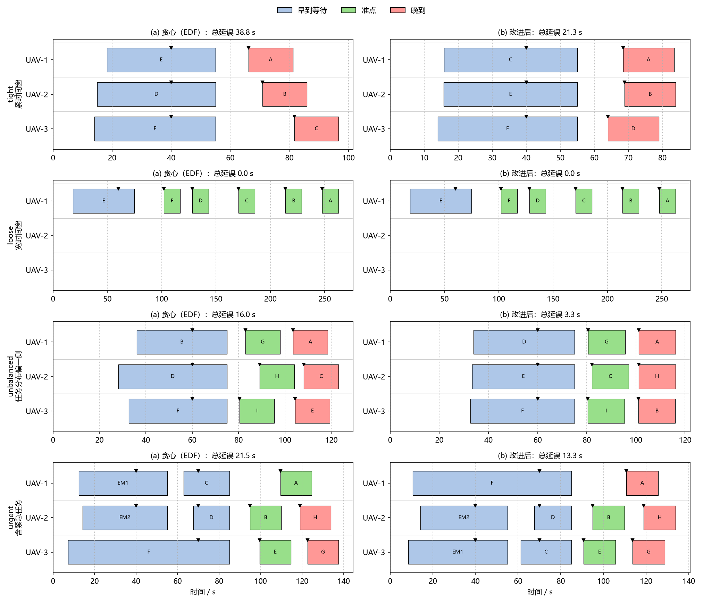
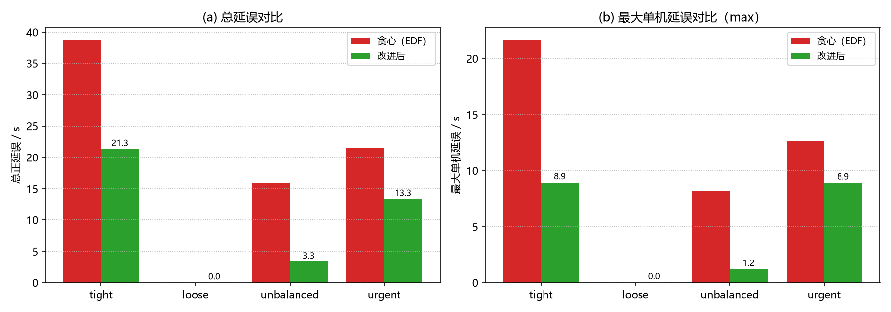

# 低空多机任务时间窗分配与延误均衡（MuJoCo 闭环验证）

## 1. 背景与定位

投送类任务都带"什么时间之前送到"的约束：每个任务点有服务窗口
`[earliest, latest]`，早到要悬停等待（耗能），晚到算延误。多架机分
一批任务时还有第二个矛盾——把活都排给一架总延误最小，但机间苦乐
不均。本模块补的是**任务-时间窗分配**这一层：给定机队与带窗任务集，
产出"谁、按什么顺序、何时到达每个点"的执行计划，目标是总延误小且
机间均衡，并用真物理仿真证明计划可飞。

与仓库里相邻模块的分工：

| 已有模块 | 解决的问题 | 与本模块的关系 |
| --- | --- | --- |
| [`uav_mujoco_sim`](./uav_mujoco_sim.md) | 单机刚体仿真底座 | 本模块在它上面做多机任务分配与闭环复核 |
| [`uav_deconflict`](./uav_deconflict.md) | 给定航迹后的机机间隔冲突 | 输入是航迹；本模块输入是任务集，输出机-任务-时刻三元组 |
| [`uav_vertiport_queue`](./uav_vertiport_queue.md) | 起降位资源排队与容量 | 管地面起降位，本模块管空中任务时间窗 |
| 航点巡航类模块 | 单机沿航路飞 | 单机视角，没有多机任务竞争 |

## 2. 方法

### 2.1 时间窗检验（`core/window.py`）

到达时刻 = 起飞时刻 + 航段飞行时间（欧氏距离 / 巡航速度）+ 前序任务
服务时长，逐段前推、全解析：

- 早到：悬停到 `earliest` 再开始服务，等待按 `hover_weight`（0.2 s/s）折算进成本；
- 准点：服务开始落在窗内；
- 晚到：正延误 = 服务开始 − `latest`，早到不计负延误。

### 2.2 分配算法（`core/assign.py`）

1. **EDF 贪心初始解**：任务按优先级降序 + 截止时刻升序排序，逐个枚举
   "分配给哪架机、插在序列哪个位置"，取目标函数增量最小且航程不超
   续航的方案；
2. **局部搜索改进**：反复尝试同机换位、跨机对调、机间迁移，**仅当目标
   函数严格下降才接受**，直到无改进动作或到轮数上限——结果不会比初始
   解差，且 steps 可复现。

目标函数兼顾总延误与公平：

$$
J = \sum_i \text{delay}_i + \lambda \cdot \left(\max_i \text{delay}_i - \min_i \text{delay}_i\right),\quad \lambda = 0.5
$$

### 2.3 可行性预检（`core/mission.py`）

- 距离过远：任务点航程 > 续航折算航程；
- 窗口过窄：窗口宽度 < 服务时长。

不可达任务标记原因后不参与分配，诊断行随结果 JSON 落盘，不硬塞。

### 2.4 4D 航迹与闭环（`core/track.py` + `core/sim.py`）

任务序列展开为航路点串：第一段沿斜线爬升转场（水平分量恒等于巡航
速度，因此到达时刻与解析时刻表严格一致），任务点上空悬停（早到等待 +
服务时长），任务间平飞，终点垂直下降。每个场景抽 2 架任务最多的机用
MuJoCo 真飞（速度前馈经 τ=0.5 s 一阶低通、姿态阻尼 kw≈−0.18，与
`uav_deconflict` 相同的控制模式），按"首次进入任务点半径 5 m 且高度
接近巡航高度"判定实际到达时刻。

## 3. 实测结果（与 `results/all_results.json` 一致）

### 3.1 四场景：贪心 vs 局部搜索

| 场景 | 任务 | 架次 | 总延误/s | 机间极差/s | 目标函数 | 晚到数 | 互换/迁移 |
| --- | --- | --- | --- | --- | --- | --- | --- |
| tight（紧窗口） | 6 | 3 | 38.77 → **21.33** | 15.50 → **4.98** | 46.52 → 23.82 | 3 → 3 | 2 / 0 |
| loose（宽窗口） | 6 | 3 | 0.00 → 0.00 | 0.00 → 0.00 | 0.00 → 0.00 | 0 → 0 | 0 / 0 |
| unbalanced（活偏一侧） | 9 | 3 | 15.97 → **3.34** | 4.65 → **0.14** | 18.30 → 3.41 | 3 → 3 | 3 / 0 |
| urgent（含紧急任务） | 10 | 3 | 21.52 → **13.35** | 12.62 → **8.16** | 27.83 → 17.43 | 2 → 3 | 1 / 1 |

tight 场景 6 个任务窗口统一压到 60 s 前，任何排序都必然晚到，改进后
总延误降 45%、机间极差从 15.5 s 压到 5.0 s；unbalanced 场景把活摊平
后极差只剩 0.14 s。loose 场景初始解已经最优，局部搜索**一步都没动**
（0/0）——算法不会为了"有改动"而改坏方案。

urgent 场景里 2 个 priority=10 的紧急任务在贪心与改进后均零延误，普通
任务晚到数由 2 增到 3：把紧急窗口让出来后，普通任务的晚到点从"某个点
晚一点"变成"另一个点晚一点"，总延误与极差同时下降，属于有意识的取舍
而非退化。

### 3.2 分配甘特图

横轴时间、纵轴机号，色块为任务点的服务区间，竖线为各自时间窗：



贪心与改进后的逐机延误对比（柱状）：



### 3.3 MuJoCo 闭环真飞

| 场景 | 真飞机 | 任务点 | 到达偏差（均值/最大）/s | 未检出任务点 | 全程最大跟踪误差/m |
| --- | --- | --- | --- | --- | --- |
| tight | UAV-1, UAV-2 | 4 | 0.94 / 0.96 | 0 | 3.63 / 4.07 |
| loose | UAV-1 | 6 | 0.99 / 1.00 | 0 | 3.62 |
| unbalanced | UAV-1, UAV-2 | 6 | 0.96 / 1.00 | 0 | 3.54 / 4.01 |
| urgent | UAV-2, UAV-3 | 8 | 0.89 / 0.94 | 0 | 4.08 / 4.79 |

四场景闭环总墙钟约 42 s（约 7 倍实时）。实际到达普遍比计划早约 1 s，
原因是到达判定取"进入 5 m 半径"的时刻，而计划时刻表按精确位置推算；
所有任务点都被检出，没有失联点。跟踪误差峰值出现在起飞瞬态，巡航段
远小于该值。

## 4. 使用与测试

```bash
python main.py --no-sim              # 仅算法层（秒级，不需要 mujoco）
python main.py                       # 全部场景 + MuJoCo 闭环（约 42 s）
python main.py --scenario tight      # 只跑一个场景
python tools/make_figures.py         # 从 results/*.json 重新生成两张图
python -m pytest test/ -q            # 33 项（含 4 项 MuJoCo 冒烟）
bash tools/ci_tests.sh               # CI 入口：无 mujoco 时闭环用例自动跳过
ros2 launch uav_time_window main.launch.py   # 在线调度节点
```

安装、编译、ROS 节点话题说明见模块
[README](https://github.com/OpenHUTB/ros2/tree/master/src/air/uav_time_window)。

## 5. 已知限制

- **启发式非最优**：EDF + 局部搜索是单轮起点，不保证全局最优；tight
  场景仍有 3 个晚到点，是窗口本身不可行，不是搜索没找到；
- **闭环抽样**：每场景只抽 2 架任务最多的机真飞（受墙钟限制），其余机
  的到达时刻由解析时刻表给出，两者的一致性由抽样机代表；
- **ROS 节点未在 ROS 环境实跑**（开发机无 ROS 2）：因此分配与窗口判定
  全部下沉到无 ROS 依赖的 `core/`，节点只做订阅/发布的薄壳，逻辑单元
  测试已覆盖。
