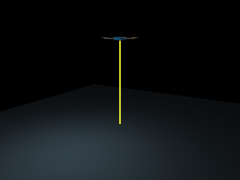
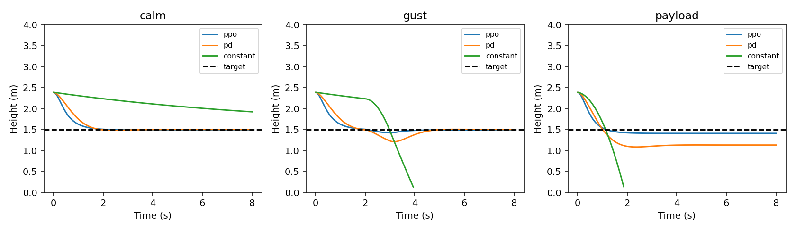

# MuJoCo 四旋翼垂直通道 PPO 定高与抗扰控制

本模块将四旋翼的垂直运动作为独立控制问题：向下测距给出高度，速度传感器给出垂直速度，PPO 神经网络输出合成推力。在无扰动、阵风和增载三个条件下，与 PD 反馈和恒定推力比较。

模型约束水平位移和姿态，只保留垂直自由度；不将本结果解释为六自由度飞控、避障或真机能力。旋翼以合成推力建模，未包含电机电气动态和气动耦合。



## 1. 环境与统一入口

离线运行：Windows、Python 3.11、MuJoCo 3.12.0、Gymnasium 1.2.0、Stable Baselines3 2.7.0、PyTorch 2.5.1 CPU。

ROS 2 运行：Ubuntu 22.04、Python 3.10、Humble；使用相同的 MuJoCo 和策略文件。Ubuntu 20.04 尚未验证。

```bash
cd src/air/uav_vertical_ppo
python3 -m pip install -r requirements.txt
python3 main.py evaluate --gif
python3 main.py train --steps 65536 --output outputs/retrained
python3 main.py evaluate --model outputs/retrained/hover_ppo.zip --output outputs/retest --gif
```

默认评估随附的 `data/hover_ppo.zip`，不需要先训练。训练输出与发布模型分目录，评估不修改权重。Linux 无显示服务器时，渲染前设置 `MUJOCO_GL=egl`；ROS 节点不调用渲染器。

## 2. 动力学与传感器

名义质量 1 kg，重力加速度 9.81 m/s²。物理步长 0.005 s，每次控制推进四步，即 50 Hz。垂直方程为：

$$m\ddot z = T - mg + F_d.$$

测距站点位于机体中心下方 0.05 m，观测时加回安装偏移。观测为高度误差与垂直速度：

$$o_t=[z_{range}+0.05-z_{target},\ v_z].$$

目标高度为 1.5 m；初始高度均匀分布于 [0.5, 2.5] m，初始速度于 [-0.3, 0.3] m/s。测距、速度和加速度传感器均在 XML 中定义，策略只使用前两者。场景外力与质量不直接输入网络。

动作经 [-1,1] 限幅后转换为合成推力：

$$T=9.81+6a_t\quad\mathrm{N}.$$

这是固定重力前馈加神经网络反馈，不含隐藏的 PD 控制。PPO 控制器与 PD 对照在评估入口中独立选择。

## 3. 神经网络与训练

PPO 采用 actor / critic 分离的双层 32 单元 MLP；策略输入 2 维、动作 1 维。训练种子为 17，交互 65,536 步，`n_steps=1024`、`batch_size=64`、`n_epochs=10`、学习率 0.0003、折扣 0.99。奖励为：

$$r_t=1-2e_z^2-0.15v_z^2-0.01a_t^2.$$

高度低于 0.15 m 或高于 4 m 提前终止并扣 20；正常回合 400 步、8 s。训练只使用无扰动场景。模型文件、训练配置和逐回合回报均随包保存。


## 4. 场景与对照

每个控制器使用相同的独立评估种子 101、202、303；这些种子不参与训练。对照不是调优后的最优控制器，结论只适用于给定参数。

| 场景 | 变化 |
|---|---|
| calm | 名义质量，无外力 |
| gust | 2–3 s 施加 1.5 N 向下外力 |
| payload | 质量及惯量增加 15%，控制器不读取质量 |

PD 使用 `a=(-4e-3v)/6` 并施加相同限幅；恒定推力使用 `a=0`。RMSE 汇总三个回合的全部有效采样，包含初始收敛过程。成功定义为完整运行 400 步，且末 50 步绝对误差均小于 0.15 m。

| 场景 | PPO RMSE/m | PD RMSE/m | 恒定推力 RMSE/m | PPO 成功回合 |
|---|---:|---:|---:|---:|
| calm | 0.132433 | 0.161828 | 0.609603 | 3/3 |
| gust | 0.134951 | 0.188662 | 0.686960 | 3/3 |
| payload | 0.158576 | 0.383839 | 0.759949 | 3/3 |



图中每个场景展示种子 101。表格汇总三个种子，不能直接用单条轨迹重算整张表。仅三个测试种子，不代表统计显著性或未知工况保证；训练环境未注入测量噪声、时延或姿态变化。

## 5. ROS 2 接口

```bash
source /opt/ros/humble/setup.bash
cd ~/ros2
colcon build --packages-select uav_vertical_ppo
source install/setup.bash
ros2 launch uav_vertical_ppo main.launch.py
ros2 topic echo /uav/hover_state --once
```

节点以 50 Hz 运行仿真与推理，发布 `std_msgs/String` JSON，字段为 `time_s`、`height_m`、`target_m`、`velocity_m_s`、`thrust_n`；单位分别为秒、米、米、米/秒、牛顿。每个回合结束后重置，`time_s` 是回合内仿真时间，不是持续递增的 ROS 时钟。

可用 `ros2 run uav_vertical_ppo node --ros-args -p scenario:=gust` 切换场景。参数 `target_height` 接受 [0.4,3.0] m，发布指标仅针对已测的 1.5 m；`model_path` 可指向重新训练的文件。

## 6. 源码与数据

| 路径 | 职责 |
|---|---|
| `main.py`、`cli.py` | 训练与评估统一入口 |
| `environment.py` | 动力学推进、传感器读取、奖励与回合边界 |
| `models/vertical_quadrotor.xml` | 几何、惯量、传感器与推力执行器 |
| `ros_node.py` | 推理定时器与状态发布 |
| `data/hover_ppo.zip` | 训练得到的策略及价值网络 |
| `data/training_config.json`、`training.monitor.csv` | 训练设置和回合回报 |
| `data/evaluation/` | 27 个回合 CSV 和汇总指标 |
| `test/test_environment.py` | 传感器、种子、动作限幅与外力时段检查 |

三项环境测试通过；ROS 包构建、安装后 launch 和话题接收通过。验证记录采用 Ubuntu 22.04 / Humble，不代表 Ubuntu 20.04 或真机验证。其他使用者仍需在自己的环境独立运行。

## 使用声明

使用 ChatGPT / Codex 辅助实现与文档整理；提交者负责审阅、理解并对提交内容负责。
