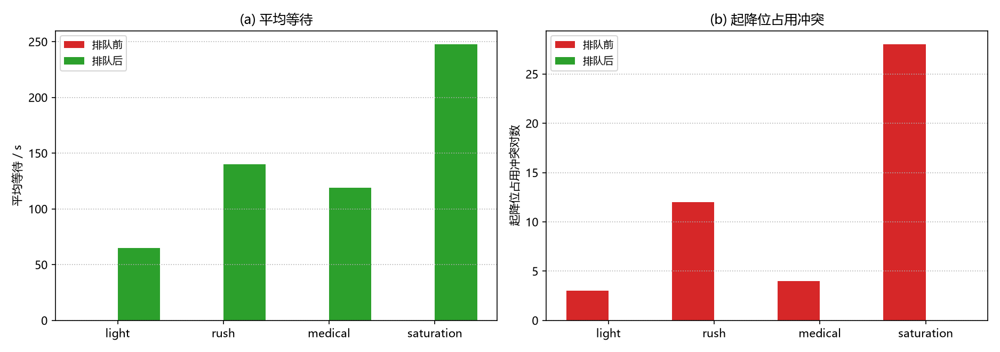
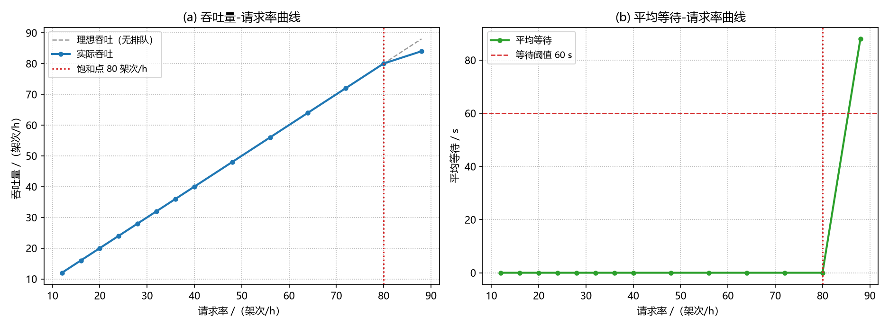

# 低空起降场进离场排队与容量评估（MuJoCo 闭环验证）

## 1. 背景与定位

低空经济落地后，一个 vertiport（垂直起降场）要在有限的起降资源下接待
密集的进离场请求：2 条起飞位、2 个降落位、4 个停机坪，高峰时段十几架
UAV 各有计划起降时刻。请求间隔一旦小于运行间隔，**同一时刻多架机抢同
一个起降位**就是冲突。

配套模块 [`uav_deconflict`](./uav_deconflict.md) 解决的是空中航迹的
机机间隔问题；本模块往下走一层，解决**地面起降位资源的占用与排队**：

* 输入：一批起降请求（机型、计划时刻、优先级）；
* 输出：一份起降位不冲突、进离场间隔达标的排队序列；
* 附带：场地的**容量曲线与饱和点**（一小时到底能承接多少架次）；
* 证明：排定时刻经 MuJoCo 刚体闭环真飞后仍然成立。

## 2. 问题模型

### 2.1 起降位占用

每架 UAV 的任务抽象为「起飞或降落 + 计划时刻 + 优先级」。一次占用 =
在指定位上的一段区间（起飞滑跑/爬离，或进近/接地/滑入）。冲突判定：

$$
\text{同一位上的占用区间重叠} \iff \text{冲突}
$$

### 2.2 三种排队策略

| 策略 | 规则 |
| --- | --- |
| FIFO | 先到先得，冲突者依次后移 |
| priority | 优先级高者先占位（医疗/警用 priority=10 可插队），同级 FIFO |
| interval | FIFO + 固定间隔：相邻两次离场 ≥ 60 s、相邻两次进场 ≥ 90 s（可配置） |

### 2.3 容量评估

固定请求率 λ 从 12 架次/h 扫到 88，统计吞吐量、平均等待、最大队列
长度。离场 60 s / 进场 90 s 交替决定了理论上限 ≈ 80 架次/h，扫描用于
验证排队系统确实在该点饱和。

## 3. 实测结果（详见 `results/vertiport_queue_result.json`）

### 3.1 四场景排队前后

| 场景 | 架次 | 起降位冲突（对） | 平均等待/s |
| --- | --- | --- | --- |
| light | 8 | 3 → **0** | 0.0 → 65.0 |
| rush | 16 | 12 → **0** | 0.0 → 140.0 |
| medical | 12 | 4 → **0** | 0.0 → 118.75 |
| saturation | 20 | 28 → **0** | 0.0 → 247.5 |

medical 场景验证优先级抢占：急救机（priority=10）30 s 请求、30 s 起飞
（延误 0），普通机 UAV-2 让行（15 s → 150 s）。



### 3.2 容量曲线

请求率 ≤ 80 架次/h 时全部即时服务（零等待）；88 架次/h 出现 4 架次
积压、平均等待 87.95 s——**饱和点 80 架次/h** 与理论值一致。



### 3.3 MuJoCo 闭环真飞

每场景抽 3 架（2 离场 + 1 进场），排队前后各飞一遍：实际离地/接地
时刻与排定时刻偏差 ≤ 0.55 s，排队后实际离场间隔从违规的 15~35 s
恢复到 60~120 s 达标。排队策略给出的时刻经刚体动力学闭环后成立。

## 4. 使用

```bash
python main.py --no-sim              # 仅算法层（秒级）
python main.py                       # 算法层 + MuJoCo 闭环（约 3.5 min）
python main.py --scenario medical    # 只跑一个场景
python -m pytest test/ -q            # 37 项（含 3 项 MuJoCo 冒烟）
ros2 launch uav_vertiport_queue main.launch.py   # 在线排队节点
```

安装、编译与 ROS 节点话题说明见模块
[README](https://github.com/OpenHUTB/ros2/tree/master/src/air/uav_vertiport_queue)。
