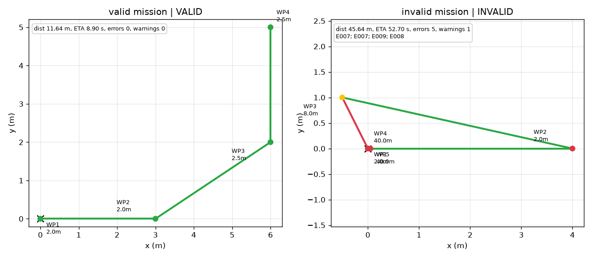

# 无人机航点任务飞行前校验 / UAV Waypoint Preflight Validator

航点任务进入控制器之前，先检查坐标约定、航点高度、重复点、爬升角、转弯角和
总航程。模块只生成诊断和 RViz 预览，不发布飞行速度指令。

源代码：`src/air/uav_waypoint_preflight_validator/`

## 1. 为什么需要预检

航点轨迹跟踪解决“已有航点如何飞”，本模块解决“这组航点是否适合提交给控制器”。
任务文件统一使用相对起飞点的 ENU 坐标：

- `x`：东；
- `y`：北；
- `z`：上；
- 单位：米。

`frame` 必须显式写为 `enu_relative`。缺失或其他坐标系会被拒绝，防止把 World/ENU
绝对坐标误当成相对航点。

## 2. 检查内容

| 检查项 | 结果 |
|---|---|
| 航点格式与有限数值 | 字符串、布尔值、NaN 或 Inf 拒绝 |
| 航点数量 | 至少 2 个，默认最多 100 个 |
| 高度 | 默认 `0.5–20 m` |
| 最小航段 | 默认 `0.25 m`，拒绝重复或过近航点 |
| 爬升角 | 非竖直航段默认不超过 `60°` |
| 转弯角 | 超过 `90°` 警告，超过 `150°` 阻塞 |
| 航程与 ETA | 航程默认不超过 `500 m`；ETA 使用最大水平/垂直速度估计 |

这些检查是飞行前几何与配置预检，不替代障碍物检测、禁飞区检查或实际飞行动力学
验证。

## 3. 离线运行

```bash
cd src/air/uav_waypoint_preflight_validator
python3 -m pip install -r requirements.txt

python3 scripts/preflight.py \
  --mission config/missions/demo_valid.yaml \
  --json-out validation/demo_valid.json

python3 scripts/preflight.py \
  --mission config/missions/demo_invalid.yaml \
  --json-out validation/demo_invalid.json
```

合法任务退出码为 `0`，存在阻塞错误时退出码为 `2`。

## 4. ROS Noetic 运行

```bash
cd ~/catkin_ws
source /opt/ros/noetic/setup.bash
catkin_make
source devel/setup.bash

roslaunch uav_waypoint_preflight_validator main.launch \
  mission_file:=$(rospack find uav_waypoint_preflight_validator)/config/missions/demo_valid.yaml \
  output_json:=/tmp/uav_preflight.json
```

输出接口：

| 话题 | 类型 | 说明 |
|---|---|---|
| `/uav_waypoint_preflight/status` | `std_msgs/String` | 完整 JSON 报告 |
| `/uav_waypoint_preflight/valid` | `std_msgs/Bool` | 是否允许继续任务 |
| `/uav_waypoint_preflight/markers` | `visualization_msgs/MarkerArray` | RViz 航段与航点预览 |

节点默认校验一次后退出；合法任务退出码为 `0`，存在阻塞错误时退出码为 `2`。

Marker 坐标是相对起飞点的 ENU 偏移。默认 `marker_frame=world` 只适用于 RViz 的
`world` 原点与起飞点重合、坐标轴也同向的场景。如果真实地图原点不同，请将
`marker_frame` 设为一个原点在起飞点且轴向为 ENU 的 TF frame，或关闭 Marker 发布。

## 5. ROS Noetic 实测

已在 Ubuntu 20.04 + ROS Noetic 的独立 catkin 工作空间验证：

- `catkin_make` 通过；
- `catkin_make run_tests_uav_waypoint_preflight_validator` 的 18 项测试通过；
- `roslaunch uav_waypoint_preflight_validator main.launch` 正常启动、发布结果并退出；
- 合法示例返回 `status=VALID`、`errors=[]`、`warnings=[]`；
- 4 个航点、总航程 `11.640 m`、保守 ETA `8.904 s`。

## 6. 结果预览



左侧合法任务使用绿色航段；右侧非法任务标出高度越界、急转弯、过陡航段和过短航段。

本次离线校验结果：

| 任务 | 状态 | 航点数 | 总航程 | 保守 ETA | 结果 |
|---|---|---:|---:|---:|---|
| `demo_valid.yaml` | VALID | 4 | 11.640 m | 8.904 s | 0 error / 0 warning |
| `demo_invalid.yaml` | INVALID | 5 | 45.636 m | 52.700 s | 5 errors / 1 warning |

非法任务包含 `E007` 高度越界、`E008` 过短航段、`E009` 过陡爬升、`E012`
急转弯和 `W001` 接近急转弯限制的警告。

## 7. 测试

```bash
python3 -m unittest discover -s test -v
```

18 项测试覆盖任务解析、坐标约定、非法数值、高度范围、重复航点、爬升角、
转弯角、总航程、配置参数、路径展开和 JSON 往返。

## 8. 已知限制

- 不检查障碍物、禁飞区或地形；
- 不模拟飞行动力学；
- 不发布控制指令；
- 转弯执行能力仍需由飞控和实际飞行条件确认。

## AI 使用声明

使用 Codex（OpenAI）辅助代码、测试和文档；作者负责在 ROS Noetic/OpenHUTB
环境中运行验证并对提交内容负责。
