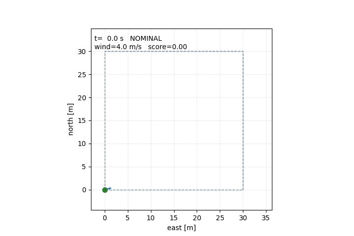
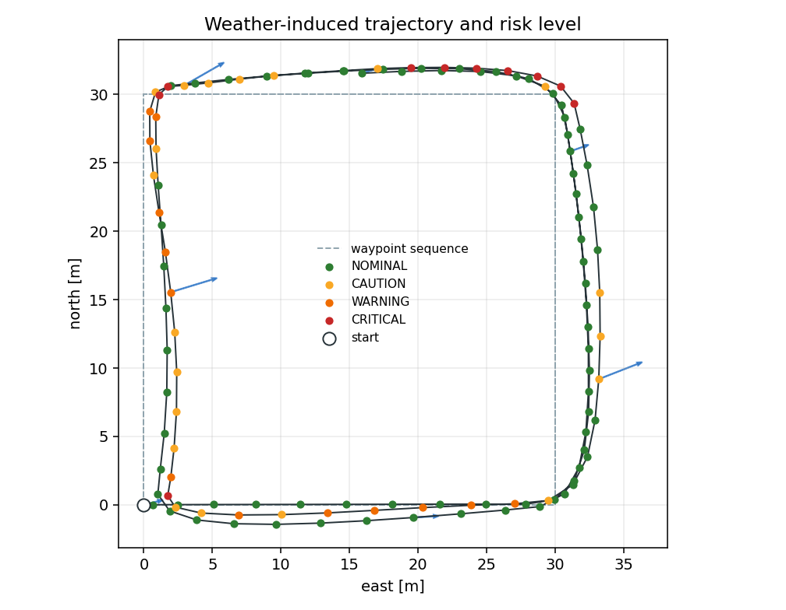
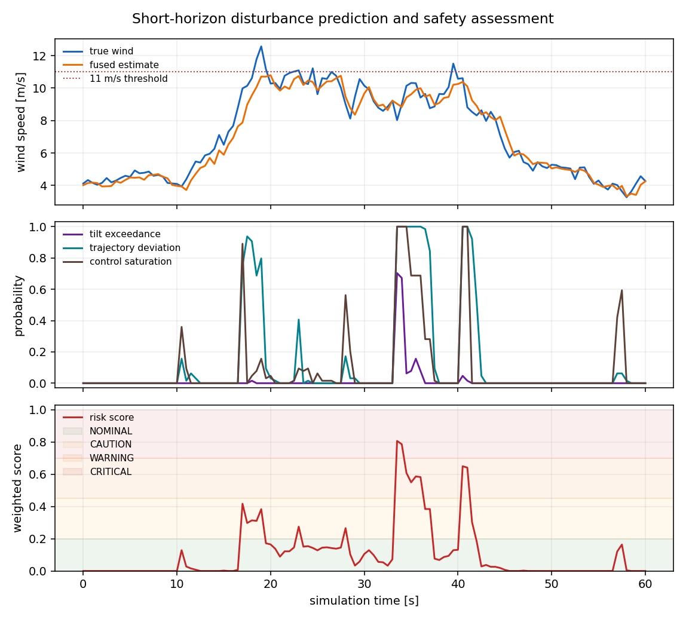
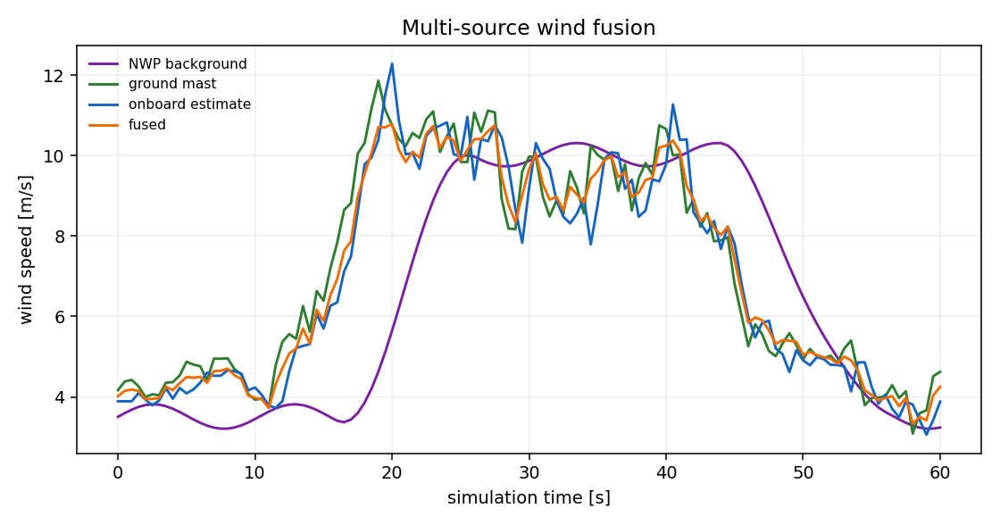

# 低空多源气象扰动下无人机影响预测与风险分级（ROS 2）

本项目在 ROS 2 中演示一条从**多源气象估计**到**小型飞行器响应预测**、再到**四级安全风险**的完整链路。输入不是预先录制的标签，而是三路异步风估计；预测不是单点风速，而是未来 10 秒的姿态、轨迹偏差和控制裕度超限概率。



项目刻意保持自包含：不调用在线气象 API，不依赖 AirSim，不发送飞控指令。其价值在于把“天气数据”转化为可复现的飞行风险指标，并暴露模型边界，便于后续替换为真实气象场和更高保真飞行器模型。

## 1. 定位与边界

本项目适合课程实验、算法原型和 ROS 2 接口联调，**不是**以下系统：

- 不是业务气象预报，不提供真实天气准确率承诺；
- 不是 6-DOF 飞行动力学或风洞试验；
- 不是适航认证、运行许可或空管决策工具；
- 不是纯气象因果归因。风险分数同时包含当前机动需求，航点切换时也可能出现短时升高。

模块只发布风险建议和可视化标记，不发布速度、姿态或航点控制指令。实机运行前须由持证人员独立评估。

## 2. 方法链路

```text
NWP 背景场 ─┐
地面风塔   ─┼─ 逆方差融合 ─ 平均风 + 阵风/湍流 ─ 降阶飞行器模型
机载估计   ─┘                                      │
                                                   ├─ 蒙特卡洛响应集合
                                                   ├─ 超限概率与风险分数
                                                   └─ ROS 2 JSON + MarkerArray
```

演示中的三路数据由 `GustFrontScenario` 生成：NWP 平滑但有 6 秒延迟，地面风塔响应快，机载估计有 1 秒延迟和固定偏置。这样可以在没有外部数据的情况下稳定复现“多源不一致、融合后更平滑”的行为。

## 3. 多源风场融合

对第 \(i\) 个源的 ENU 风矢量 \(\mathbf{w}_i\)、标准差 \(\sigma_i\)、置信度 \(c_i\) 和数据年龄 \(a_i\)，权重取

\[
w_i=\frac{c_i}{\sigma_i^2\left(1+a_i/\tau\right)},
\qquad
\bar{\mathbf{w}}=\frac{\sum_i w_i\mathbf{w}_i}{\sum_i w_i}.
\]

融合不确定度按一阶误差传播计算：

\[
\sigma_{\mathrm{fused}}=
\frac{\sqrt{\sum_i w_i^2\sigma_i^2}}{\sum_i w_i}.
\]

默认 `age_tau_s=30`。当某一路数据变旧或置信度降低时，它的权重会下降，但不会把其他源直接丢弃。融合结果和每一路原始估计同时写入 `weather` 话题，方便审计。

## 4. 扰动与飞行器响应

阵风和湍流用离散 Ornstein-Uhlenbeck 过程近似：

\[
\mathbf{g}_{k+1}=e^{-\Delta t/\tau}\mathbf{g}_k
+\sigma\sqrt{1-e^{-2\Delta t/\tau}}\,\boldsymbol{\varepsilon}_k,
\qquad \boldsymbol{\varepsilon}_k\sim\mathcal{N}(0,I).
\]

飞行器采用二维水平加高度的降阶模型，核心是相对气流阻力：

\[
\mathbf{a}_{\mathrm{drag}}
=-\frac{\rho C_d A}{2m}\lVert\mathbf{v}-\mathbf{W}\rVert
(\mathbf{v}-\mathbf{W}).
\]

控制器根据位置误差产生速度指令，再产生加速度指令。倾角不是完整姿态解算，而是维持指令加速度并补偿水平阻力所需的等效倾角：

\[
\theta=\operatorname{atan2}\left(
\left\lVert \mathbf{a}_{\mathrm{cmd}}-\mathbf{a}_{\mathrm{drag,horiz}}\right\rVert,
g\right).
\]

因此这里的倾角是**控制裕度代理量**，不是实测滚转/俯仰角。代码中的 `roll_deg`、`pitch_deg` 也只用于演示可视化姿态，不应作为飞控姿态真值。

## 5. 影响预测与风险指标

每次评估从当前状态出发，生成 `samples` 条未来阵风样本，在 `horizon_s` 内推进同一控制律。四项指标分别为：

| 指标 | 定义 | 默认阈值 |
|---|---|---:|
| 风速超限 | 集合中最大风速超过阈值 | 11 m/s |
| 等效倾角超限 | 集合中最大等效倾角超过阈值 | 33° |
| 轨迹偏差 | 相对**无风参考轨迹**的最大位置偏差 | 2.5 m |
| 控制饱和 | 所需水平加速度超过可用加速度的比例 | 1.10 |

轨迹偏差不是“到远航点的距离”。对每个评估时刻，先在同一初始状态下做一次无风参考推进，再比较扰动集合与参考轨迹在同一时刻的位置。这样 30 米外的前方航点不会天然被判定为风险。

风险分数为四项超限概率的加权和：

\[
S=0.15P_{\mathrm{wind}}+0.35P_{\mathrm{tilt}}
+0.25P_{\mathrm{position}}+0.25P_{\mathrm{control}}.
\]

同时设置概率下限规则，防止单项极端超限被平均分掩盖：

| 等级 | 分数条件 | 额外条件 | 含义 |
|---|---:|---:|---|
| NOMINAL | \(S<0.20\) | 最大概率 < 0.50 | 当前条件下未发现明显超限趋势 |
| CAUTION | \(0.20\le S<0.45\) | 或最大概率 ≥ 0.50 | 需要关注，建议降低速度或延迟任务 |
| WARNING | \(0.45\le S<0.70\) | 或最大概率 ≥ 0.90 | 高风险趋势，建议改变航线或等待天气窗口 |
| CRITICAL | \(S\ge0.70\) | 或最大概率 ≥ 0.98 | 演示中的最高告警级，不等于真实飞行许可结论 |

## 6. 程序结构

```text
src/air/uav_weather_risk/
├── README.md
├── package.xml
├── setup.py / setup.cfg
├── config/demo.yaml
├── launch/main.launch.py
├── resource/uav_weather_risk
├── sample/timeseries.csv / summary.json
├── tests/test_core.py
├── main.py
└── uav_weather_risk/
    ├── core/
    │   ├── types.py       # ENU 向量、数据容器
    │   ├── weather.py     # 多源融合与阵风过程
    │   ├── aircraft.py    # 降阶响应模型
    │   ├── risk.py        # 蒙特卡洛与风险分级
    │   └── scenario.py    # 阵风锋演示场景
    ├── demo_node.py       # 合成气象与飞行状态发布
    ├── risk_node.py       # 风险预测与 MarkerArray
    ├── headless_demo.py   # 无 ROS 的离线入口
    └── plotting.py        # CSV/PNG/GIF 输出
```

## 7. 构建与运行

推荐环境：Ubuntu 22.04、ROS 2 Humble、Python 3.10。Humble 之外的发行版未验证。

```bash
source /opt/ros/humble/setup.bash
rosdep install --from-paths src/air/uav_weather_risk --ignore-src -r -y
colcon build --symlink-install --packages-select uav_weather_risk
source install/setup.bash
python3 -m unittest discover -s src/air/uav_weather_risk/tests -v
ros2 launch uav_weather_risk main.launch.py
```

启动后查看：

```bash
ros2 topic list | grep uav_weather_risk
ros2 topic echo /uav_weather_risk/assessment
```

RViz2 中添加 `MarkerArray` 显示，话题选择 `/uav_weather_risk/markers`，Fixed Frame 设为 `map`。标记包括预测轨迹集合、当前风险包络球、融合风矢量和等级文字。`SPHERE` 的 `scale.x/y/z` 是直径，本模块按等级设置为 1.0、1.6、2.2、2.8 米。

### 话题

| 话题 | 类型 | 方向 | 说明 |
|---|---|---|---|
| `/uav_weather_risk/odom` | `nav_msgs/Odometry` | 输入 | ENU 位置、速度，frame `map` |
| `/uav_weather_risk/weather` | `std_msgs/String` | 输入 | 融合风场与原始源 JSON |
| `/uav_weather_risk/target` | `geometry_msgs/PointStamped` | 输入 | 当前航点；缺失时按悬停评估 |
| `/uav_weather_risk/assessment` | `std_msgs/String` | 输出 | 等级、分数、概率、原因、输入年龄 |
| `/uav_weather_risk/markers` | `visualization_msgs/MarkerArray` | 输出 | RViz2 预测与风险可视化 |

风险节点对坏 JSON、非有限数、缺失输入做防御处理。输入超过 `stale_timeout_s` 时发布 `valid=false`、建议等级 `CAUTION`，并在 `reason` 中说明是数据陈旧，而不是伪造一个正常结论。

## 8. 离线复现

不安装 ROS 2 也能运行核心模型。仅绘图需要 Matplotlib；核心算法只使用 Python 标准库。

```bash
cd src/air/uav_weather_risk
python3 -m pip install matplotlib
python3 main.py --duration 60 --seed 42 --output-dir artifacts/demo
```

输出：

- `timeseries.csv`：121 个评估时刻的时间、位置、风场、概率和等级；
- `summary.json`：峰值、等级计数和记录 SHA256；
- `trajectory.png`、`risk_timeline.png`、`wind_sources.png`；
- `demo.gif`：俯视轨迹动画。

随包 `sample/` 目录保存了本次实际生成的小型 CSV 和 summary，可直接核对；完整 PNG/GIF 位于 `docs/img/air/uav_weather_risk/`。

## 9. 本次实际运行结果

环境：Windows 11、Python 3.13.7；NumPy 2.3.4、Matplotlib 3.10.8 仅用于绘图。核心 `unittest` 共 12 项通过。

固定 `seed=42`、60 秒、评估周期 0.5 秒、每次 64 个集合成员的本次输出：

| 项目 | 结果 |
|---|---:|
| 评估次数 | 121 |
| NOMINAL | 78 |
| CAUTION | 20 |
| WARNING | 13 |
| CRITICAL | 10 |
| 最大真实风速 | 12.57 m/s |
| 最大融合风速 | 10.79 m/s |
| 最大等效倾角 | 33.23° |
| 最大控制饱和 | 1.285 |
| 最大风险分数 | 0.807 |
| 峰值时刻 | 33.5 s |
| 记录 SHA256 | `cc617e25...d600173a` |







这些图来自同一份实际 CSV，不是手工绘制的示意图。阵风锋在约 10 秒后增强，风险在 20 秒后进入警告区，峰值出现在 33.5 秒；45 秒后随锋面减弱回到正常。

## 10. 验证状态与提交前检查

已完成：

- 核心融合、随机过程、飞行器响应、风险分级和场景确定性测试；
- 60 秒离线端到端运行，CSV、summary、PNG、GIF 均由同一 `seed=42` 生成；
- `package.xml` 使用 `ament_python`，入口、launch、config、resource 和 README 齐备；
- 未声称进行过真实气象数据接入、AirSim 飞行或实机测试。

尚需在 Ubuntu 22.04 / ROS 2 Humble 环境执行并附终端输出：

```bash
colcon build --symlink-install --packages-select uav_weather_risk
source install/setup.bash
ros2 launch uav_weather_risk main.launch.py
ros2 topic echo /uav_weather_risk/assessment
```

提交前还应由另一名同学在另一台机器复跑上述命令，确认话题、MarkerArray 和干净退出。没有完成这一步时，不应把本模块标记为“已通过 ROS 2 实测”。

## 11. 参数说明

| 参数 | 默认值 | 说明 |
|---|---:|---|
| `rate_hz` | 10.0 | 演示节点发布频率 |
| `duration_s` | 0.0 | 0 表示持续运行 |
| `assessment_period_s` | 0.5 | 风险评估周期 |
| `horizon_s` | 10.0 | 预测时域 |
| `dt_s` | 0.25 | 集合推进步长 |
| `samples` | 64 | 每个评估时刻的集合成员数 |
| `max_wind_mps` | 11.0 | 风速超限阈值 |
| `max_tilt_deg` | 33.0 | 等效倾角阈值 |
| `max_position_error_m` | 2.5 | 相对无风参考轨迹的偏差阈值 |
| `max_control_saturation` | 1.10 | 控制饱和阈值 |
| `turbulence_sigma_mps` | 1.3 | 阵风过程标准差 |
| `turbulence_tau_s` | 3.0 | 阵风相关时间 |
| `stale_timeout_s` | 2.0 | 输入过期判定 |
| `keep_paths` | 8 | 保留并可视化的集合轨迹条数 |

风险阈值是演示默认值，不是监管限值。替换机型或场景时必须重新标定，并在文档中记录标定数据来源。

## 12. 局限与后续

1. 当前气象场是合成场景，不是 ERA5、雷达、激光雷达或地面站实测；真实数据接入需要单独的数据适配器和缺测处理。
2. 飞行器模型是降阶代理，不包含旋翼气动、执行机构延迟、姿态控制器内环和电池压降；不可用于适航或寿命结论。
3. 风险分数没有经过真实事故样本校准，概率含义是“模型集合内超限频率”，不是经过验证的实际事故概率。
4. 尚未实现 6-DOF 与 PX4/ArduPilot SITL 闭环，也没有真实飞行数据对照。
5. 后续可扩展：接入 OpenHUTB/AirSim 状态、ERA5/地面站适配器、集合校准、SORA 风格风险矩阵、6-DOF 校验和真实飞行日志回放。

## 13. 参考与术语

- MIL-F-8785C / Dryden 湍流模型：阵风相关时间与功率谱的工程近似；
- JARUS SORA：仅参考其“地面风险/空中风险”和运行边界的分层思想，本项目不声称符合 SORA；
- 中国民航局 CCAR-92《民用无人驾驶航空器运行安全管理规则》：实际运行须遵循现行法规与地方空域管理要求；
- OpenHUTB/ros2 的 `uav_mission_safety_manager`、`telemetry_diagnostics` 模块：本项目沿用其“可离线复现 + ROS 2 薄封装 + 明示验证边界”的工程风格。
