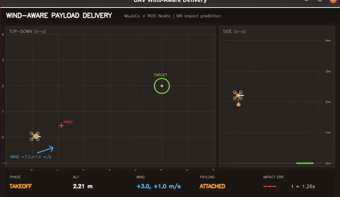
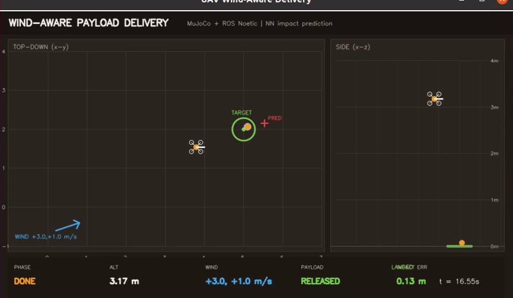

# 四旋翼风扰下物资精准空投：MuJoCo 仿真与神经网络落点预测

基于 **ROS Noetic + MuJoCo 3.12.0** 的四旋翼空投模块：无人机吊挂物资起飞，在侧风下计算补偿后的释放点；释放后物资自由落体并受风阻力，最终落入目标区。模块包含 MuJoCo 吊挂/释放模型、几何控制器、弹道积分器、纯 NumPy 落点预测 MLP、任务状态机、ROS 节点和 OpenCV 桌面可视化。



## 与仓库已有空域模块的区别

| 模块 | 关注点 | 物资释放/落点 |
| --- | --- | --- |
| `payload_mass_estimation` | 从飞行数据估计载荷质量 | 否 |
| `landing_assessment` | 着陆阶段识别与接地载荷 | 否 |
| `rooftop_landing` / `rooftop_landing_nn` | 屋顶降落点选择 | 否 |
| `uav_mujoco_sim` | 四旋翼仿真底座 | 否 |
| **本模块** | **风扰下释放点补偿 + NN 落点预测** | **是** |

本项目把“吊挂 → 释放 → 自由落体 → 落点误差”串成可评估闭环：网络预测“如果现在释放会落在哪里”，任务层据此把释放点向上风方向平移。

## 项目结构

```text
uav_wind_aware_delivery/
├── main.py / main.sh                 统一入口
├── package.xml / CMakeLists.txt      ROS1 catkin 包
├── models/
│   ├── uav_delivery.xml              MuJoCo 四旋翼 + 吊挂物资
│   └── impact_mlp.npz                训练好的落点 MLP
├── src/uav_wind_aware_delivery/
│   ├── sim.py                        MuJoCo 推进、weld、释放、风阻力
│   ├── control.py                    PID + 几何姿态控制
│   ├── ballistics.py                 弹道积分与释放点迭代
│   ├── nn.py                         纯 NumPy MLP + Adam
│   ├── mission.py                    起飞/巡航/对准/释放/落地状态机
│   ├── state.py                      28 维 ROS 状态向量
│   ├── mathutil.py                   四元数/欧拉角
│   └── viz.py                        OpenCV 俯视 + 侧视 + HUD
├── scripts/nodes/                    6 个 ROS 节点
├── launch/                           demo / headless / teleop
├── tools/                            训练、评估、单集调试、录制
├── tests/run_all.py                  15 个单元测试
├── results/                          benchmark / predictor 指标
└── media/ubuntu_air_demo.mp4         Ubuntu 桌面实操视频
```

## 一、环境准备

| 组件 | 版本 |
| --- | --- |
| Ubuntu | 20.04.6 LTS（VMware） |
| ROS | Noetic（`/opt/ros/noetic`） |
| Python（计算节点） | 3.11，项目内 `.venv` |
| MuJoCo | 3.12.0 |
| NumPy | 1.26.4 |
| OpenCV | 4.2（系统 Python，仅 Viewer） |

MuJoCo 3.12 要求 Python ≥ 3.10，而 Ubuntu 20.04 系统 Python 是 3.8。因此 `roslaunch/roscore` 仍用系统 Python 3.8，仿真节点通过 `_bootstrap.use_venv()` 自动 exec 到项目 venv；Viewer 使用系统 Python 的 OpenCV。无需修改 `.bashrc`、PATH 或系统 Python 包。

```bash
# 1. 放入 catkin 工作区
mkdir -p ~/air_ws/src
cp -r <仓库>/src/air/uav_wind_aware_delivery ~/air_ws/src/

# 2. Python 3.11 依赖（首次；已有可用 venv 可跳过）
cd ~/air_ws/src/uav_wind_aware_delivery
bash scripts/setup_env.sh

# 3. 编译
cd ~/air_ws
source /opt/ros/noetic/setup.bash
catkin_make -j2
source devel/setup.bash
```

如果 MuJoCo 的 venv 不在默认路径：

```bash
export UAV_VENV_PYTHON=/path/to/python3.11
```

## 二、启动流程

每个新终端先：

```bash
source /opt/ros/noetic/setup.bash
source ~/air_ws/devel/setup.bash
```

### 1. 完整空投演示（推荐）

```bash
roslaunch uav_wind_aware_delivery demo.launch \
  wind_x:=3.0 wind_y:=1.0 \
  target_x:=5.0 target_y:=2.0
```

会打开 OpenCV 窗口：

- 左侧：俯视图（无人机、物资、目标区、风矢量、预测落点、轨迹）；
- 右侧：侧视图（高度、吊挂、释放）；
- 底部 HUD：`PHASE / ALT / WIND / PAYLOAD / IMPACT ERR`。

任务流程：

```text
takeoff → cruise → align → released → done
```

### 2. 无窗口（SSH/评测）

```bash
roslaunch uav_wind_aware_delivery headless.launch wind_x:=3.0 wind_y:=1.0
```

### 3. 键盘手动控制

```bash
roslaunch uav_wind_aware_delivery teleop.launch
```

`W/S` 前后、`A/D` 左右、`R/F` 升降、`Q` 退出。手动模式只检查控制链路，不自动释放。

### 4. 统一入口

```bash
python3 main.py --info
python3 main.py --launch demo --wind-x 3.0 --wind-y 1.0
python3 main.py --test
python3 main.py --train
python3 main.py --evaluate
```

## 三、ROS 接口

| 话题 | 类型 | 方向 | 说明 |
| --- | --- | --- | --- |
| `/uav/state` | `std_msgs/Float64MultiArray` | 发布 | 28 维状态 |
| `/uav/cmd` | `std_msgs/Float64MultiArray` | 控制→仿真 | 世界系合力 3 + 世界系力矩 3 |
| `/uav/setpoint` | `geometry_msgs/PoseStamped` | 任务→控制 | 位置设定点 |
| `/uav/release` | `std_msgs/Bool` | 任务→仿真 | 释放物资（只释放一次） |
| `/uav/predicted_impact` | `geometry_msgs/PointStamped` | 预测→Viewer | 当前状态释放的预测落点 |
| `/uav/mission` | `std_msgs/String` | 任务→Viewer | 当前阶段 |

28 维状态：

```text
0      t
1:4    UAV x,y,z
4:8    quat w,x,y,z
8:11   vx,vy,vz
11:14  wx,wy,wz
14:17  roll,pitch,yaw
17:20  payload x,y,z
20:23  payload vx,vy,vz
23     released
24     landed
25     payload_contact
26:28  wind x,y
```

## 四、方法

### 1. 吊挂与释放

无人机与物资都是 MuJoCo 自由刚体，初始用 `<weld>` equality 把物资固定在机腹。`release()` 把 `data.eq_active[weld]` 置 0，物资保留释放瞬间速度，进入自由落体；风阻力：

```text
a_xy = k_drag * (wind_xy - v_xy) / m
a_z  = -g - 0.02 * v_z / m
```

### 2. 落点预测 MLP

输入 6 维：`[release_height, vx, vy, vz, wind_x, wind_y]`；输出 2 维：相对释放点的落点偏移 `[dx,dy]`。网络为 `6-64-64-2` tanh MLP，输入/输出标准化，Adam 训练；6 000 组弹道积分样本，110 epochs。

### 3. 释放点补偿

目标点 `T=(5,2)`，释放高度 `h=3 m`。迭代：

```text
rel ← T
repeat 4:
    off ← MLP(h, 0, 0, 0, wind)
    rel ← T − off
```

无人机飞到 `rel` 上方，悬停稳定后释放。无补偿基线直接把释放点设为 `T`，风会把物资吹离目标。

## 五、实测结果

### 预测器（验证集 2 000 组）

| 指标 | 数值 |
| --- | --- |
| 验证 RMSE | **0.0143 m** |
| 验证 MAE | 0.0109 m |
| 零偏移基线 RMSE | 0.8661 m |
| 相对零基线提升 | **98.35%** |

### 闭环空投（10 组随机风，成功半径 0.5 m）

| 方法 | 成功率 | 平均落点误差 | P90 误差 | 平均完成时间 |
| --- | --- | --- | --- | --- |
| **NN 释放点补偿** | **10/10（100%）** | **0.1604 m** | **0.2481 m** | 12.73 s |
| 不补偿（目标正上方释放） | 0/10（0%） | 1.0455 m | 1.3195 m | 12.59 s |

平均误差降低 **84.7%**。

固定风 `(3.0, 1.0) m/s` 的 ROS 全链：

```text
takeoff t=0.05 → cruise t=3.17 → align t=12.19
released t=13.00 → done t=14.54
payload landing error 0.13 m
```



### 复现

```bash
cd ~/air_ws/src/uav_wind_aware_delivery

# 训练（约 1 分钟，CPU）
.venv/bin/python tools/train_predictor.py

# 10 组随机风 × 2 方法
.venv/bin/python tools/evaluate.py

# 单元测试
.venv/bin/python tests/run_all.py     # 15/15 OK
```

结果写入 `results/benchmark.json`、`results/predictor_metrics.json`。

## 六、Ubuntu 桌面实操视频

- 视频：`media/ubuntu_air_demo.mp4`
- 规格：1280×796，15 fps，45 s，H.264
- 内容：Ubuntu 桌面打开 OpenCV Viewer，展示起飞、巡航、对准、释放、落地与 HUD 误差。

录制脚本：

```bash
bash scripts/record_demo.sh
```

使用 `ffmpeg -f x11grab` 录屏；需要桌面会话（`DISPLAY=:0`）。GIF 由视频裁剪 Viewer 区域生成，见 `docs/img/air/uav_wind_aware_delivery.gif`。

## 七、常见报错

### 1. `ModuleNotFoundError: No module named 'mujoco'`

仿真节点没有切到 Python 3.11：

```bash
export UAV_VENV_PYTHON=/path/to/python3.11
.venv/bin/python -c "import mujoco; print(mujoco.__version__)"
```

### 2. `ROS_DISTRO: unbound variable`

录制/启动脚本里不要用 `set -u` 去 source ROS 的 `setup.bash`。

### 3. Viewer 不显示

必须在 Ubuntu 桌面会话运行：

```bash
export DISPLAY=:0
export XAUTHORITY=/run/user/1000/gdm/Xauthority
```

仅 SSH 无桌面时用 `headless.launch`。

### 4. `catkin_make` 找不到包

确认 `src/air/uav_wind_aware_delivery/package.xml` 的 `<name>` 与目录一致，并先 `source /opt/ros/noetic/setup.bash`。

### 5. 释放后物资不落地

检查 `/uav/release` 是否发布、`data.eq_active` 是否置 0；可运行：

```bash
.venv/bin/python tools/check_episode.py 3 1
```

## 八、验证范围与限制

- 实测平台为 **ROS Noetic**，未在 ROS 2 Humble 验证。
- 控制器为简化几何控制（直接施加世界系合力/力矩），没有实现四旋翼混控与电机动力学；重点是空投任务层，不宣称是飞控级模型。
- 风场为水平常值风 + 线性阻力，没有阵风/湍流模型。
- 闭环评估为 **10 组随机风**（仿真），不是硬件飞行；成功率对风场上界敏感。
- 落点预测网络在训练分布内精度很高，超出 `|wind|>5 m/s` 或释放高度范围时需重新训练。
- 未做视觉目标检测；目标点由参数给定。

## 九、源码与许可

源码：`src/air/uav_wind_aware_delivery/`。MIT License。

```text
15 tests, failures=0, errors=0
```
