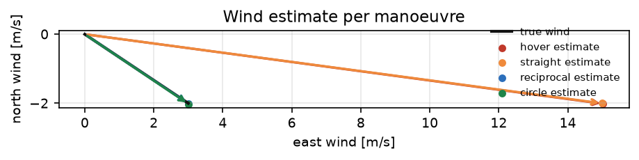
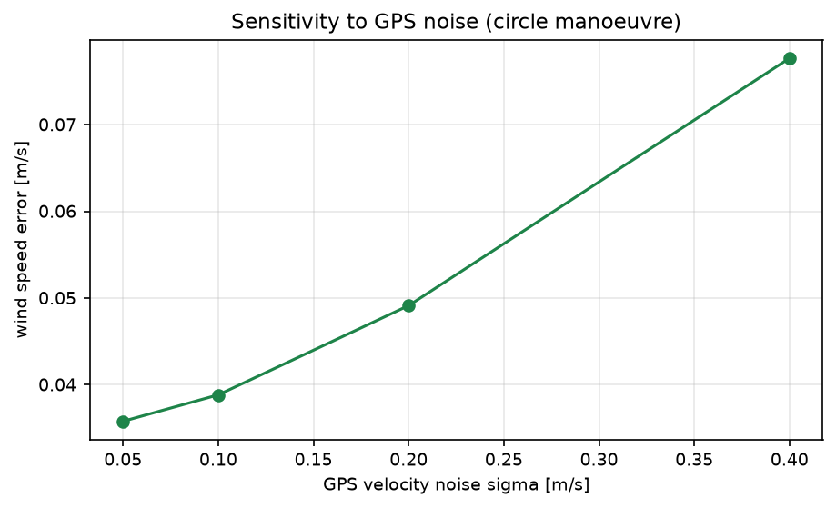

# 无人机空速/地速三角估风与可观测性分析

风对小型无人机的影响常常比模型误差更大，但风本身不可直接测量。本模块**不使用皮托管量测**，
只用「地速矢量与机头方向平行于空速矢量」这一方向约束构造最小二乘，并回答一个更实际的问题：
**飞什么机动才能估出风**。

与仓库已有模块的区别：

- 仓库里没有估风模块（`wind_est`、`air_data`、`wind_triangle` 关键词命中数为 0）；
- `uav_weather_risk`、`uav_link_outage_guard` 是风险评估，输入里直接假设风已知；
- `uav_route_cruise`、`uav_formation_flight` 讨论抗风飞行，但不估计风。

## 1. 方法

### 1.1 风三角

设地速 $\mathbf{v}_g$、航向单位矢量 $\mathbf{u}$（机头方向）、真空速 $V_a$，则

$$
\mathbf{v}_g=V_a\,\mathbf{u}+\mathbf{w}
$$

皮托管只测到 $|V_a|$，所以给定候选风 $\mathbf{w}$，空速由

$$
V_a=\mathbf{u}^\top(\mathbf{v}_g-\mathbf{w})
$$

反解。把它代回，得到只含 $\mathbf{w}$ 的残差——**垂直分量必须为零**：

$$
\mathbf{r}_i(\mathbf{w})=\big(I-\mathbf{u}_i\mathbf{u}_i^\top\big)(\mathbf{v}_{g,i}-\mathbf{w})
$$

于是估计问题变成 $\min_{\mathbf{w}}\sum_i\lVert\mathbf{r}_i(\mathbf{w})\rVert^2$。
雅可比为 $-(I-\mathbf{u}_i\mathbf{u}_i^\top)$，用 Gauss–Newton 求解（本问题线性化后几乎精确，3 次迭代收敛）。

### 1.2 可观测性

信息矩阵

$$
\mathcal I=\frac{1}{\sigma^2}\sum_i\big(I-\mathbf{u}_i\mathbf{u}_i^\top\big)
$$

只有两个特征值都远离零时风才可估。单一航向下两个投影相同，$\mathcal I$ 秩 1——
这就是"悬停/直线飞行估不出风"的数学原因。本模块要求
$\lambda_{\min}\ge10^{-3}\lambda_{\max}$ 才认为可估。

### 1.3 对飞平均法

经典做法：分别沿 $\mathbf{u}$ 与 $-\mathbf{u}$ 飞，取两次地速的平均：

$$
\frac{\mathbf{v}_{g,1}+\mathbf{v}_{g,2}}{2}
=\mathbf{w}+\frac{V_{a,1}-V_{a,2}}{2}\mathbf{u}
$$

当两段空速相等时正好等于风；空速有差异时误差与差值同量级。

## 2. ROS 2 接口

| 节点 | 作用 |
|---|---|
| `wind_sim` | 按选定机动发布地速、航向与空速 |
| `wind_estimator` | 收满一批样本后解算风并发布 JSON（含可观测性） |

## 3. 构建与运行

```bash
source /opt/ros/humble/setup.bash
cd ~/hutb_ws
colcon build --symlink-install --packages-select uav_wind_estimation
source install/setup.bash
ros2 launch uav_wind_estimation main.launch.py maneuver:=circle
```

离线：

```bash
cd src/air/uav_wind_estimation
python3 main.py --out results --figure-dir ../../../docs/img/air/uav_wind_estimation
python3 -m unittest discover -s tests -v
```

## 4. 结果

环境：Windows 11、Python 3.12.14、NumPy 2.3.5。真值风 $(3.0,-2.0)$ m/s（3.6 m/s），
空速 12 m/s、GPS 速度噪声 0.2 m/s、航向噪声 1°、每段空速波动 ±0.35 m/s，每种机动 40 次试验。

| 机动 | 信息矩阵条件数 | 可观测 | 最小二乘风速 RMSE | 对飞平均法 RMSE |
|---|---|---|---|---|
| 悬停 | 3600 | 否 | 不可估 | 11.996 m/s |
| 直线 | 2914 | 否 | 不可估 | 11.996 m/s |
| 对飞 | 3945 | 否 | 不可估 | **0.287 m/s** |
| 圆周 | **1.0** | **是** | **0.049 m/s** | 0.230 m/s |

圆周机动的估计误差 0.049 m/s 相当于真值风速的 1.4 %，风向误差 0.62°。



图中黑色箭头是真实风矢量，四个彩色箭头是四种机动下的估计：悬停与直线几乎完全偏离
（估计值≈平均地速，误差约等于空速），对飞平均法落在真值附近，圆周机动的估计与真值几乎重合。

### 4.1 噪声敏感性

| GPS 速度噪声 [m/s] | 风速 RMSE [m/s] |
|---|---|
| 0.05 | 0.036 |
| 0.10 | 0.039 |
| 0.20 | 0.049 |
| 0.40 | 0.078 |



σ 每翻一倍，误差依次变为 ×1.08、×1.26、×1.59：低噪声段被 1° 航向噪声的地板限制，0.2 以上才逐渐趋于线性，0.4 时仍受地板影响（实测 0.078，纯线性外推会是 0.098）。用 $\sqrt{\sigma_0^2+(k\sigma)^2}$ 描述更贴合，拟合 $\sigma_0\approx0.035$、$k\approx0.17$。

### 4.2 三个结论

1. **机动决定可观测性**：悬停与直线飞行的信息矩阵秩 1，本类方向约束估计器都只能给出"平均地速"，
   误差约等于空速（本次 12 m/s 量级）；
2. **对飞平均是个特例**：它靠"两段空速相等"消掉未知量，实测 0.287 m/s，比圆周差 6 倍；
3. **圆周（或八字）机动**让投影矩阵均匀覆盖两个方向，条件数 1.0，风速误差 0.049 m/s。

## 5. 复现

```bash
cd src/air/uav_wind_estimation
python3 main.py --out results --figure-dir ../../../docs/img/air/uav_wind_estimation
python3 -m unittest discover -s tests -v    # 12 项
```

| 文件 | 内容 |
|---|---|
| `uav_wind_estimation/core.py` | 风三角残差、Gauss–Newton、信息矩阵与可观测性、对飞平均 |
| `uav_wind_estimation/scene.py` | 四种机动的确定性测量生成 |
| `uav_wind_estimation/headless.py` | 实验、噪声扫描与 `results/summary.json` |
| `uav_wind_estimation/plotting.py` | 两张图 |
| `uav_wind_estimation/nodes.py` | 仿真与估计节点 |
| `results/summary.json` | 本文全部数值 |

## 6. 限制

1. 只估计**水平风**，未估计上升气流与风切变；三维风需要攻角/侧滑角观测。
2. 假设风在观测窗口内恒定；实际需要递推估计（如卡尔曼）以跟踪变化。
3. 空速用皮托管模型（无安装角误差、无位置误差修正），真实系统需先做空速标定。
4. 可观测性判据用信息矩阵特征值比，阈值 $10^{-3}$ 是工程取值，不是统计检验。
5. 未考虑机动本身的代价（圆周机动耗电、偏离航线），实际任务规划需权衡。
6. ROS 2 端只做了 `compileall`、`package.xml` 解析与桩模块联调，未在本机执行 `colcon build` 与 `ros2 launch`。

## 7. 大模型使用声明

使用 DeepSeek Harness（deepseek-flash）辅助完成代码、推导整理、测试与文档。作者核对了风三角残差、
信息矩阵与可观测性判据，并在本机实际运行了离线实验与 12 项单元测试，数值来自 `results/summary.json`。

> **建模选择**：本模块**不消费** /uav/airspeed。若把皮托管量测接进来，单点即可解 $\mathbf{w}=\mathbf{v}_g-V_a\mathbf{u}$，直线飞行也可估，不可估就消失了。因此表 4.1/4.2 的不可估是**方向约束估计算法**的结论；空速波动 ±0.35 m/s 不进入残差，对本估计器无影响。
