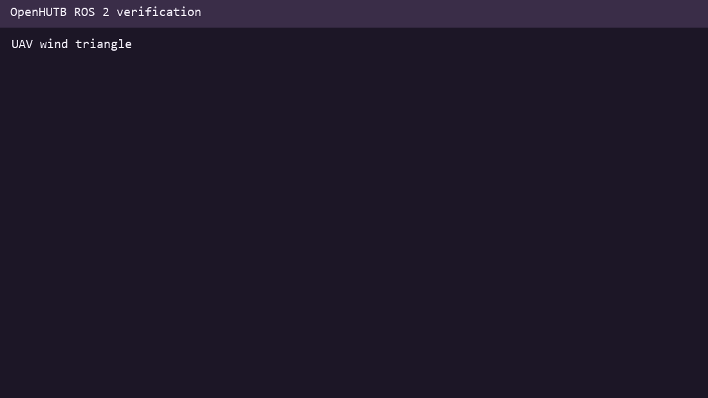

# UAV wind triangle

Calculate required heading, ground speed and wind correction from true airspeed, wind and desired course.

## 1. Prerequisites

- Python 3.10 or newer.
- No third-party runtime dependency for the offline calculation.
- ROS 2 Humble only for the installed launch entry.

## 2. Scope and limitations

This module provides a deterministic preflight calculation. The result must be checked against the actual airframe, mission constraints and measured system data before flight.



## 3. Run

```bash
PYTHONPATH=src/air/uav_wind_triangle python3 -m uav_wind_triangle.main
```

## 4. Test

```bash
PYTHONPATH=src/air/uav_wind_triangle python3 -m unittest discover \
  -s src/air/uav_wind_triangle/tests -v
```

## 5. Expected result

The runnable sample passes the wind-triangle checks, followed by `PASS`.

## AI assistance disclosure

This module, tests and documentation were prepared with large-language-model assistance. The submitter reviewed and ran the content and is responsible for the submission.
