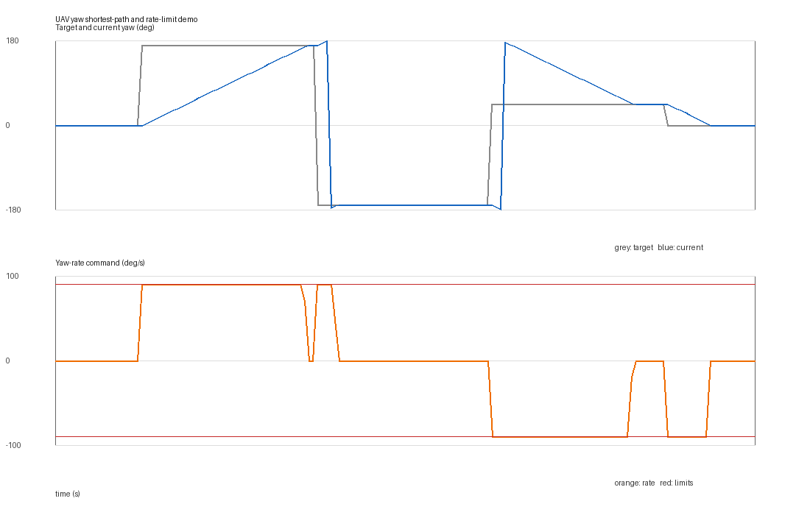

# 无人机偏航指令最短路径与角速度限幅

无人机航向通常用 `[-pi, pi)` 表示。若直接把 `+179°` 到 `-179°` 的数值差交给
姿态控制器，会得到 `-358°` 的长路径，而实际最短转动只有 `+2°`。本模块在计算
偏航误差时先去回绕，再按最大偏航角速度限制输出，最后通过
`geometry_msgs/Twist.angular.z` 发布角速度建议。

## 1. 方法

最短偏航误差：

\[
e_k=\operatorname{wrap}\left(\psi_{\mathrm{target}}-\psi_{\mathrm{current}}\right)
\]

其中 `wrap` 将角度映射到 `[-pi, pi)`。每个控制周期的角速度命令为：

\[
\omega_k=\operatorname{clamp}
\left(e_k f_s,\;-\omega_{\max},\;+\omega_{\max}\right)
\]

`f_s` 是控制频率，`omega_max` 是允许的最大偏航角速度。若目标超过
`target_timeout_s` 未刷新，模块输出零角速度并进入 `HOLD`。若当前偏航角超过
`current_timeout_s` 未刷新，模块同样输出零角速度并进入 `CURRENT_STALE`，
避免使用陈旧航向反馈继续转弯。

## 2. ROS 2 接口

| 话题 | 类型 | 方向 | 说明 |
|---|---|---|---|
| `/uav/yaw/current` | `std_msgs/Float64` | 输入 | 当前偏航角，rad |
| `/uav/yaw/target` | `std_msgs/Float64` | 输入 | 原始目标偏航角，rad |
| `/uav/yaw/rate_cmd` | `geometry_msgs/Twist` | 输出 | 仅使用 `angular.z`，rad/s |
| `/uav/yaw/guard_status` | `std_msgs/String` | 输出 | 当前角、目标角、最短误差和限幅状态 |

模块不直接改变飞控模式，也不发布线速度。实际接入时需确认飞控采用的偏航坐标系
与 `angular.z` 正方向。

## 3. 构建与运行

环境：Ubuntu 22.04.5、ROS 2 Humble、Python 3.10.12。

```bash
source /opt/ros/humble/setup.bash
colcon build --symlink-install --packages-select uav_yaw_command_guard
source install/setup.bash
ros2 launch uav_yaw_command_guard main.launch.py duration:=8
```

演示场景的目标序列为：

```text
0° → +170° → -170° → +45° → 0°
```

`duration:=8` 时模拟器结束后整个 launch 自动关闭；`duration:=0` 表示持续运行，
使用 `Ctrl+C` 停止。

运行 CSV 默认写入：

```text
/tmp/uav_yaw_command_guard_runtime.csv
```

## 4. 测试

```bash
cd src/air/uav_yaw_command_guard
PYTHONPATH=. python3 -m unittest discover -s tests -v
```

测试覆盖角度回绕、跨 `±pi` 的短路径选择、大角度限速、小误差跟踪、目标超时保持、
当前航向超时保护、非法输入和非法参数。

## 5. 离线复现

```bash
cd src/air/uav_yaw_command_guard
PYTHONPATH=. python3 -m uav_yaw_command_guard.demo \
  --duration 8 --rate-hz 20 --output-dir artifacts/demo
```

输出 `runtime_demo.csv`、`summary.json` 和 `runtime_demo.png`。曲线只用于验证
核心回绕与限幅逻辑，不等同于 ROS 2 launch 证据。

本次离线闭环运行 8 秒、20 Hz，共 161 个样本；其中 82 个样本触发限幅，最大角速度
严格为 `90°/s`，最终偏航误差为 `0°`。



上图由随包脚本实际生成。灰色为目标偏航角，蓝色为被控对象当前偏航角，橙色为
`angular.z` 指令，两条红线为 `+/-90°/s` 限幅边界。

## 6. 验证范围

当前已完成 Windows 11 / Python 3.14 的 11 项离线测试、包构建和 8 秒闭环复算。
ROS 2 Humble 的 `colcon build`、`ros2 launch` 和话题收发尚未在本机独立复跑，
提交者应在 Ubuntu 22.04 / Humble 虚拟机完成后再作为正式运行证据记录。

## 7. 已知限制

1. 当前使用确定性的偏航角度与一阶最大角速度约束，不包含风扰、执行器延迟和飞控
   姿态内环。
2. 输入是欧拉偏航角，尚未从四元数直接提取并处理奇异姿态。
3. `Twist.angular.z` 的正方向依赖具体飞控坐标系，接入前必须标定。
4. 该模块只做指令保护，不替代飞控中的姿态安全、地理围栏或失效保护。

## 8. 大模型使用声明

使用 OpenAI Codex 辅助完成代码、测试、文档和离线演示。作者已复核算法、参数与
提交内容，并对数据真实性和后续维护负责。
