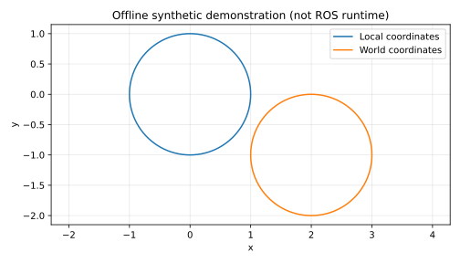

# 无人机航向坐标变换与往返误差验证

核对偏航姿态下机体系到世界系的平面坐标变换，并和 ROS tf2 输出对照。

**开发状态：离线演示和核心测试已运行；ROS Noetic 构建、launch、在线话题和飞行/模拟器闭环尚未验证。** 本文不作为已通过课程验收的声明。

## 环境与依赖

本次实测为云端 Ubuntu 24.04、Python 3.12.14，NumPy 2.3.5、matplotlib 3.10.8，未安装 ROS。离线演示使用 matplotlib，神经网络模块另需 NumPy。
目标 ROS 环境为 Ubuntu 20.04 / Python 3.8 / ROS Noetic；该目标环境已由用户此前检查，本模块本次尚未进入其中运行。

## 离线复现

在仓库根目录执行，输出目录应不存在：

```bash
python3 -m unittest discover -s src/air/uav_yaw_frame_validation/tests -v
python3 src/air/uav_yaw_frame_validation/main.py --output /tmp/uav_yaw_frame_validation_demo
```

第二条生成 samples.csv、metrics.json 和 offline_demo.svg；MLP 还会重新训练并输出 model.json。不同 NumPy/BLAS 版本可能产生末位数值差异。

## ROS 构建和运行（下方附本轮实测）

从仓库根目录开始，在独立 catkin 工作空间中只放这个包，不把整个混合 ROS1/ROS2 仓库交给 catkin：

```bash
source /opt/ros/noetic/setup.bash
mkdir -p ~/air_course_ws/src
cp -r src/air/uav_yaw_frame_validation ~/air_course_ws/src/
cd ~/air_course_ws
catkin_make
source devel/setup.bash
roslaunch uav_yaw_frame_validation main.launch
```

如缺依赖，按 package.xml 使用 ROS 对应发行版安装；不要在系统 ROS 中随意混装 Python 版本。
Ctrl+C 结束本模块。话题演示不要连接实机飞控，先完成受控仿真联调。

## 变换原理

限定二维、零滚转和零俯仰。机体系 x 向前、y 向左；世界系 x/y 为 ENU 水平坐标，正偏航绕 +z 逆时针。
前向变换 `p_world = R(yaw) * p_body + translation`；逆变换 `p_body = R(-yaw) * (p_world-translation)`。
先平移再旋转和先旋转再平移结果一般不同，单元测试专门覆盖这个常见误用。

离线演示把单位圆上的 101 个点从局部系变换到世界系，再恢复，计算最大往返误差。
在线节点发布固定 `world -> sensor_frame` 变换：平移 (2,-1) 米，偏航 0.7 rad。
节点用 ROS tf2 转换局部点，并与解析结果和解析逆变换对照，分别发布两种误差。

| 接口 | 类型 | 说明 |
|---|---|---|
| `/tf_static` | tf2_msgs/TFMessage | 固定教学变换 |
| `~local_point` | geometry_msgs/PointStamped | 局部点 |
| `~world_point` | geometry_msgs/PointStamped | tf2 输出的世界点 |
| `~error` | std_msgs/String | tf2 与解析值差、往返恢复差 |

## ROS 联调操作（下方附本轮实测）

```bash
rostopic echo /uav_yaw_frame_validation/error
rosrun tf2_ros tf2_echo world sensor_frame
```

tf2 监听器刚启动时可能尚未收到变换，节点输出 WAITING 并重试。
默认使用最新可用变换（Time(0)），因为变换是静态的；没有验证动态变换的时间插值。
可在 RViz 中设置 Fixed Frame 为 world，再添加两个 PointStamped 显示项。

## 限制

没有三维姿态、相机投影、GNSS 坐标转换或真正的飞行导航。浮点往返误差小只证明数学变换自洽，不证明真实相机/机体标定正确。
在线 tf2 比较尚未在本次环境中执行；图中的轨迹是数学点集合，不是无人机实飞航迹。


## 本次实际结果

离线单元测试：**7/7 通过**。原始输出位于本模块 tests_result.txt。

```json
{
  "max_roundtrip_error": 3.554447978966673e-16,
  "samples": 101,
  "validation_scope": "offline mathematical demo; ROS runtime not tested"
}
```

下面为程序实际生成的**离线合成数据/数学演示图**，不是 ROS 窗口截图或飞行记录：



指标文件：源码模块内 offline_metrics.json。逐点样本可用离线复现命令重新生成。
本轮 ROS 构建与通信验证见下方实测补充；仍无真实硬件和外部复测。

## 大模型使用声明

使用 OpenAI Codex 辅助方案设计、代码、核心测试、合成演示、文档和提交准备。仅报告实际执行结果；作者需理解、复核和补充目标环境验证，并对内容负责。


## ROS Noetic 实测补充（2026-11-04）

本轮使用 VirtualBox Ubuntu 20.04.6、Python 3.8.10、ROS Noetic。工作目录为 `/home/ros/four_assignments_0yekhx11/ws_uav_yaw_frame_validation`。

离线测试、独立 catkin 构建、真实 roslaunch/话题功能、退出清理四项分别通过；launch 返回码 0，无节点异常退出。

测试使用真实 ROS 通信发送合成输入，不是无人机飞行、真实传感器或 AirSim/Gazebo 验证。

- tf2 forward and inverse errors below 1e-6 for >=10 samples
- transformed circle center (2,-1), radius 1, world frame
- {"samples": 10, "max_tf_error": 4.97e-16, "max_roundtrip": 2.48e-16}
- roslaunch remains running through functional checks

复现构建（将本模块复制到独立工作空间 src 后）：

```bash
source /opt/ros/noetic/setup.bash
catkin_make -C /path/to/workspace
source /path/to/workspace/devel/setup.bash
roslaunch uav_yaw_frame_validation main.launch
```

必须检查 `devel/setup.bash` 与 `devel/lib/uav_yaw_frame_validation/main.py` 存在。旧脚本曾在错误工作空间构建，旧 BUILD=PASS 无效；以上是修正版的新工作空间证据。

原始证据：[构建](validation/build.txt)、[launch](validation/launch.log)、[ROS 测试](validation/ros_test.txt)、[结构化结果](validation/ros_result.json)、[离线测试](validation/offline.txt)、[源码 SHA256](validation/source_sha256.json)。哈希对应运行包源码，本轮已逐项核对；README 后续文档更新会改变其哈希，程序源码未改变。

仍未验证真实硬件/飞行与另一人另一台机器复测。PR 保持 Draft，外部复测不勾选。使用 OpenAI Codex 辅助日志核验、文档与提交整理。
