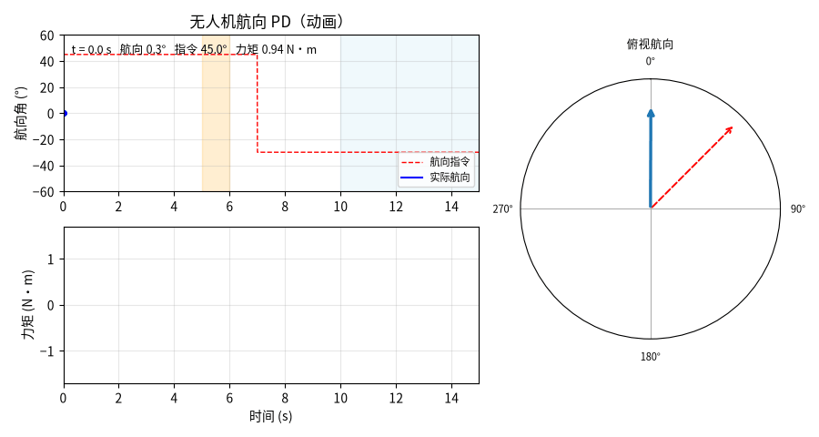

# 基于 PD 的无人机航向角稳定控制与阶跃转向仿真

本文介绍一个**不需要 PX4 / Gazebo / AirSim 的无人机航向控制复现模块**。模块用偏航单轴刚体模型作被控对象，航向指令由 +45° 阶跃到 −30°，中间叠加一次 1 s 阵风力矩与持续往复风扰；控制器为 PD（微分作用在角速率上，误差按最短弧回绕，力矩限幅）。运行一次即可得到航向曲线、力矩曲线、俯视罗盘动图与指标 JSON，全部数值由代码算出。

本文档承接仓库中「无人机姿态控制」相关实验的偏航通道部分，把它搬到**纯 Python、纯 CPU** 的离线环境上复现。

> **与 PX4 / Gazebo / AirSim 的关系**：本模块的被控对象是「控制力矩 / 转动惯量 + 风扰力矩」的单轴刚体，不含桨叶气动阻尼、电机与电调延迟、姿态环串级结构、四元数与欧拉角的完整耦合。它能复现「PD 能锁住航向、被阵风顶偏后能拉回」这一趋势，但不等价于飞控在环仿真，具体差异见第 7 节。

## 1. 运行环境

| 项目 | 版本 / 说明 |
| --- | --- |
| 操作系统 | Ubuntu 22.04.5 LTS（纯 CPU 运行，不依赖 GPU） |
| Python | 3.12.11 |
| 依赖 | `numpy>=1.21`（实测 1.26.4）、`matplotlib>=3.5`（实测 3.11.0）、`Pillow>=9.0`（实测 10.4.0，仅用于导出 GIF） |
| 是否需要 ROS / PX4 / Gazebo / AirSim | **不需要** |

`requirements.txt` 已写明上述下限；测试与出图只在当前环境验证过，没有在其他发行版或 Python 版本上验证。

## 2. 实验原理

### 2.1 被控对象

偏航单轴刚体，转动惯量 `Izz = 0.02 kg·m²`，状态为航向角 `yaw` 与偏航角速率 `rate`：

```python
accel = (torque + disturbance) / Izz     # 风扰直接以力矩形式叠加
rate += accel * dt
yaw = wrap_pi(yaw + rate * dt)           # 航向角回绕到 [-π, π]
```

航向角必须回绕：第二段指令为 −30°，若在第一段把角度累积到 +45° 后直接线性相减，误差会出现 75° 的正负跳变；回绕到 [−π, π] 并按**最短弧**求差，才能保证第二段转向走的是 75° 而不是 285°。

### 2.2 控制器

航向 PD，采样周期 `dt = 0.01 s`：

| 参数 | 取值 | 说明 |
| --- | --- | --- |
| `kp` | 1.2 | 比例：每 1 rad 航向误差给 1.2 N·m |
| `kd` | 0.35 | 微分：按角速率阻尼（作用在测量上） |
| `torque_limit` | 1.5 | 力矩限幅，对应偏航通道可用力矩上限 |

按二阶模型折算：自然频率 `ωn = sqrt(kp / Izz) ≈ 7.7 rad/s`，阻尼比 `ζ = kd / (2·sqrt(kp·Izz)) ≈ 0.97`，接近临界阻尼，因此阶跃超调极小。

微分项作用在角速率上（`−kd·rate`）而不是误差上：航向指令两段都是阶跃，对误差求导会在 t=7 s 处产生一次性微分冲击，把力矩瞬间推到限幅，动画里表现为一根与实际执行器不符的力矩尖峰。

### 2.3 航向指令与扰动

| 时间区间 | 航向指令 | 用途 |
| --- | --- | --- |
| `0 ≤ t < 7 s` | +45° | 首段阶跃转向（右转 45°），量上升时间、超调与稳态误差 |
| `t ≥ 7 s` | −30° | 第二段阶跃转向（左转 75°），量稳定时间 |

| 扰动 | 时间区间 | 幅值 | 物理含义 |
| --- | --- | --- | --- |
| 阵风力矩 | 5–6 s | 0.06 N·m | 侧风突加，把机头往一侧推 |
| 往复风扰 | `t > 10 s` | 0.02 N·m，0.8 Hz | 阵风后的持续湍流 |

扰动幅值取 0.06 / 0.02 N·m 而不是 0.5 / 0.2 N·m：`Izz = 0.02` 时 0.5 N·m 相当于 25 rad/s² 的角加速度，持续 1 s 会把航向推偏 50° 以上，那不是「阵风」而是「失控」，观测不到稳定的抗扰行为。

### 2.4 指标口径

所有指标按**窗口**计算，阶跃指标避开风扰窗口：

| 指标 | 定义 | 取值窗口 |
| --- | --- | --- |
| 上升时间 | 10% → 90% 幅值的耗时 | 0–5 s（0 → +45° 段） |
| 首段超调 | 窗口内 `航向最大值 − 45°` | 0–5 s |
| 首段稳态误差 | `\|指令 − 航向\|` 在窗口内的均值 | 4.0–4.9 s（阵风前） |
| 阵风峰值偏差 | 窗口内 `\|指令 − 航向\|` 的最大值 | 5–6 s |
| 阵风后残差 | 窗口内 `\|指令 − 航向\|` 的最大值 | 6.9–7.0 s |
| 阵风恢复时间 | 阵风结束后首次回到 ±0.5° 带的耗时 | 6 s 起 |
| 二段稳定时间 | 进入 ±0.5° 带并在风扰开始前保持的耗时 | 7–10 s |
| 往复风扰最大偏差 | `\|指令 − 航向\|` 的最大值 | 12–15 s |

风扰窗口从 10 s 起，而第二段阶跃发生在 7 s，因此「二段稳定时间」必须在 10 s 之前判定；若把窗口拉到 15 s，往复风扰本身就会把误差推出 ±0.5° 带，稳定时间会永远判不出来。

## 3. 代码结构

完整源码位于 [`src/air/uav_yaw_stabilize`](https://github.com/OpenHUTB/ros2/tree/master/src/air/uav_yaw_stabilize)，唯一的实现文件是 `scripts/uav_yaw_stabilize.py`，`main.py` 只是把它转发执行：

| 代码段 | 作用 |
| --- | --- |
| `wrap_pi()` | 角度回绕到 [−π, π] |
| `UAVYawPlant` | 偏航单轴刚体，`step()` 推进航向角与角速率 |
| `PDYawController` | 航向 PD，微分在测量上，力矩限幅 |
| `yaw_profile()` / `wind_torque()` | 两段航向阶跃指令、阵风与往复风扰 |
| `simulate()` | 闭环仿真，返回时间、航向、指令、力矩、角速率 |
| `rise_time()` / `recovery_time()` / `settle_time()` / `evaluate()` | 指标计算（按窗口分离） |
| `plot_static()` | 静态双面板图 `yaw_response.png` |
| `plot_gif()` | 逐帧动图 `yaw_demo.gif`（曲线 + 力矩 + 俯视罗盘，60 帧、10 fps） |
| `main()` | 命令行入口，写 PNG / GIF / `summary.json` |

下面只解释两处关键实现，完整代码请直接查看 `src/` 下的源码。

**（1）最短弧误差与限幅**

```python
err = wrap_pi(yaw_target - yaw_meas)      # 最短弧，避免 ±180° 处跳变
u = self.kp * err - self.kd * yaw_rate_meas
return float(np.clip(u, -self.torque_limit, self.torque_limit))
```

**（2）第二段稳定时间的判据**

```python
for k in idx:                              # 首次进入 ±0.5° 带
    if np.all(err[k:][times[k:] < until] <= band_deg):   # 且在 until 之前一直保持
        return float(times[k] - since)
```

`until` 取 10 s（风扰起点）。不设这个上界时，10 s 之后的往复风扰会把误差重新推出 ±0.5° 带，「此后一直在带内」的条件永远不成立，稳定时间会返回 `None`。

## 4. 运行步骤

```bash
cd src/air/uav_yaw_stabilize
pip install -r requirements.txt
python main.py
```

可选参数：`--out-dir` 指定输出目录（默认 `results`）、`--dt` 指定仿真步长（默认 0.01 s）、`--t-end` 指定仿真时长（默认 15 s）。

跑测试：

```bash
cd src/air/uav_yaw_stabilize
python -m pytest tests -v
```

**本地跑不通时的排查顺序**：

1. 报 `ModuleNotFoundError: matplotlib` 或 `PIL`——依赖没装全，`pip install -r requirements.txt`；只装 numpy 会在保存动图时失败。
2. 报输出目录不可写——用 `--out-dir` 指到一个可写目录。
3. 第二段稳定时间显示 `nan`——说明 7–10 s 内没进入 ±0.5° 带，多半是增益被改小或 `torque_limit` 被调低。
4. 航向曲线在 ±180° 附近出现竖直跳变——回绕逻辑被去掉或写错了，检查 `wrap_pi()` 是否正确用于求差。

运行结束后 `results/` 目录得到：

- `yaw_response.png`：上图为航向角曲线（含指令与两段风扰阴影），下图为控制力矩曲线
- `yaw_demo.gif`：逐帧动画，左上航向曲线、左下力矩曲线、右侧俯视罗盘（虚线为目标航向、实线为实际航向）
- `summary.json`：第 2.4 节全部指标的数值

终端同时打印各项指标。

## 5. 运行效果

航向稳定动图（左上航向曲线、左下力矩、右侧俯视罗盘；橙色为阵风、浅蓝为往复风扰）：



实测指标（`summary.json`）：

| 指标 | 实测值 |
| --- | --- |
| 0→45° 上升时间 | 0.53 s |
| 首段超调（0–5 s） | 0.000° |
| 首段稳态误差（4.0–4.9 s） | 0.000° |
| 阵风峰值偏差（5–6 s） | 2.817° |
| 阵风后残差（6.9–7.0 s） | 0.068° |
| 阵风恢复时间（±0.5° 带） | 0.46 s |
| 二段阶跃（+45°→−30°）稳定时间 | 1.19 s |
| 往复风扰最大偏差（12–15 s） | 0.601° |
| 末航向（指令 −30.0°） | −30.55° |
| 最大力矩 | 1.50 N·m（顶到限幅） |

从动图与表中可以看到：

- **阶跃几乎没有超调**：0.53 s 走完 10%→90%，超调 0.000°，这是 `ζ ≈ 0.97` 的临界阻尼特性，代价是响应比高增益方案慢一档。
- **力矩在第一段阶跃起始处顶到 1.5 N·m 限幅**：45° 误差 × `kp = 1.2` 已超过限幅，起始段工作在饱和区；这也说明上升时间由力矩上限与转动惯量共同决定，而不只由 `kp` 决定。
- **阵风把航向顶偏 2.8°，0.46 s 后拉回**：0.06 N·m 的阵风持续 1 s，期间由 `kd` 提供的阻尼项抵抗角速率，阵风结束后误差迅速收敛到 0.068°。
- **第二段 75° 转向用 1.19 s 稳定**：转向幅度更大，但起始速度已归零、误差一直在缩短，实际用时只比首段多一倍。
- **往复风扰下偏差 0.601°**：0.8 Hz 风扰已接近闭环带宽（约 1.2 Hz），控制器只能压到 0.6° 量级，末航向因此停在 −30.55° 而不是 −30.00°。

## 6. 分析与结论

- **PD 在这个通道上够用，前提是微分作用在测量上**：航向指令全是阶跃，误差微分会把 t=7 s 的 75° 跳变变成一次力矩暴冲；改成 `−kd·rate` 后，两段阶跃的力矩都是连续爬升到限幅，曲线与真实电机的力矩响应更接近。
- **超调为 0 的代价在响应速度上**：`ζ ≈ 0.97` 对应 0.53 s 的上升时间。把 `kd` 降到 0.2（ζ ≈ 0.65）实测上升时间压到 0.26 s，但首段超调升到 2.8°，二段稳定时间 0.83 s——这是一对显式的取舍。
- **限幅决定了「能扛多大的风」**：起始段力矩顶在 1.5 N·m，说明可用力矩是硬约束；阵风 0.06 N·m 相对限幅很小，所以只被顶偏 2.8°，若阵风提到 0.2 N·m 就会明显顶不住。
- **第二段稳定时间必须限定在风扰之前判定**：0.8 Hz 往复风扰的幅值本身就超过 ±0.5° 带，若不设 10 s 上界，这个指标永远算不出来——这是指标口径设计上的一个坑，已在第 2.4 节写明。
- **本组参数对 `Izz` 敏感**：`Izz` 从 0.02 变到 0.05，同样的 `kp`、`kd` 会变成过阻尼、响应明显变慢；换机型必须重标。

## 7. 边界与局限

- **偏航单轴刚体，不是六自由度姿态模型**：不含横滚/俯仰耦合、桨叶气动阻尼、电机与电调延迟、飞控内环串级结构与滤波器相位滞后。航向结论只覆盖「单轴、无耦合」的理想情形。
- **扰动是两种理想波形**：一段常值阵风力矩 + 一段单频正弦湍流。没有做随机湍流、变幅阵风与同时发生的多轴扰动。
- **没有传感器与执行器非理想性**：航向角与角速率由模型直接给出，没有 IMU 噪声、零偏、量测延迟；真实飞控可用增益区间会比这里窄。
- **指标窗口手工划定**：稳态误差取 4.0–4.9 s、二段稳定时间限定在 7–10 s，均按本实验的扰动时刻排布；改扰动时间必须同步改窗口，否则窗口落空会得到 `nan`。
- **只验证两个航向点**：+45° 与 −30° 两段阶跃，没有做连续航向跟踪（斜坡指令）与航向角速率指令跟踪。

本节源码位于 [`src/air/uav_yaw_stabilize`](https://github.com/OpenHUTB/ros2/tree/master/src/air/uav_yaw_stabilize)，采集流程与指标口径与本文档一致，依赖与运行方式见该目录的 README。
