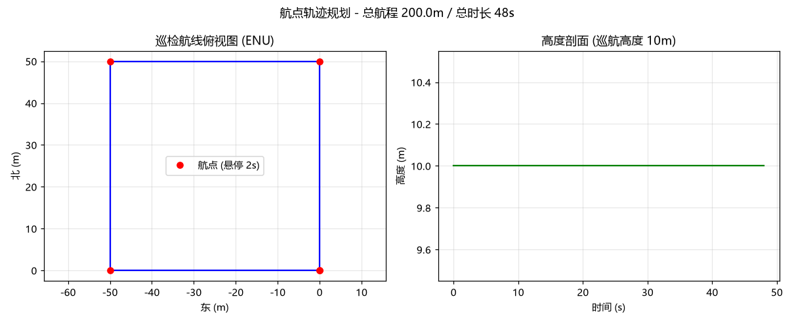

# (作业) 蒋宇鑫 2535030012 无人机航点轨迹规划与航迹可视化 (waypoint_trajectory_planner)

## 1. 简介

巡检、测绘、物流配送是低空经济最典型的应用场景，其共性是**沿预设航点序列巡航**。本模块实现一个轻量的航点轨迹规划器：给定 NED 航点序列，按"匀速巡航 + 航点悬停"生成时间参数化轨迹，发布为 ROS2 `nav_msgs/Path`（ENU），并绘制俯视航迹图与高度剖面图。

## 2. 运行环境

- Ubuntu 22.04 + ROS 2 Humble
- 依赖: rclpy、nav_msgs、geometry_msgs（Humble 自带）；绘图需 matplotlib；测试需 pytest

## 3. 目录结构

```text
src/air/waypoint_trajectory_planner/
├── main.py              # ROS2 节点: 发布 /drone/planned_path (nav_msgs/Path)
├── core.py              # 规划核心（纯 Python, 无 ROS 依赖）
└── test/test_core.py    # 7 项单元测试
```

## 4. 运行步骤

```bash
# 单元测试
pytest src/air/waypoint_trajectory_planner/test/test_core.py -v

# ROS2 节点
python3 src/air/waypoint_trajectory_planner/main.py
# 另一终端验证:
ros2 topic echo /drone/planned_path --once | head -20
```

## 5. 单元测试运行结果

```text
test/test_core.py::test_input_validation PASSED
test/test_core.py::test_total_length PASSED
test/test_core.py::test_total_time PASSED
test/test_core.py::test_start_and_end PASSED
test/test_core.py::test_hover_at_waypoint PASSED
test/test_core.py::test_speed_consistency PASSED
test/test_core.py::test_sample_coverage PASSED
7 passed
```

关键校验：方形航线（边长 50m + 对角回程）总航程应为 `50+50+√(50²+50²)≈170.71m`；巡航段"位移/时间"应等于巡航速度 5m/s（误差 < 0.05）。

## 6. ROS2 节点运行结果

```text
[waypoint_trajectory_planner]: 轨迹规划完成: 5 个航点, 总航程 220.7 m, 总时长 54.1 s (含悬停)
[waypoint_trajectory_planner]: 已发布 12 个路径点到 /drone/planned_path
```

## 7. 运行效果图



（图由 `make_figures.py` 实际运行生成：左图为 ENU 俯视航迹与航点，右图为高度剖面。）

## 8. 设计说明

- **时间参数化**：`position_at(t)` 支持任意时刻插值，便于下游控制器按频率跟踪；
- **悬停建模**：每个航点悬停 2s，模拟巡检拍照/数据采集动作；
- **NED 输入、ENU 输出**：航点按 OpenHUTB 习惯用 NED 给出，发布前经坐标转换（与 [ned_enu_transform](./ned_enu_transform.md) 同套规则）。

## 9. 参考链接

- nav_msgs/Path: <https://docs.ros.org/en/humble/p/nav_msgs/>
- OpenHUTB 多航点示例: <https://openhutb.github.io/doc/python_api/>

## 10. 大模型使用声明

本模块代码与文档在编写过程中使用了大模型工具（WorkBuddy）辅助生成，作者已逐行核对全部内容，理解其原理并实际运行验证，对提交内容负全部责任。
